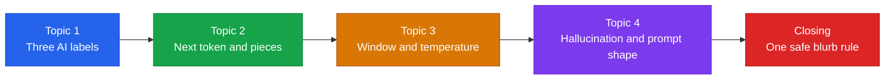
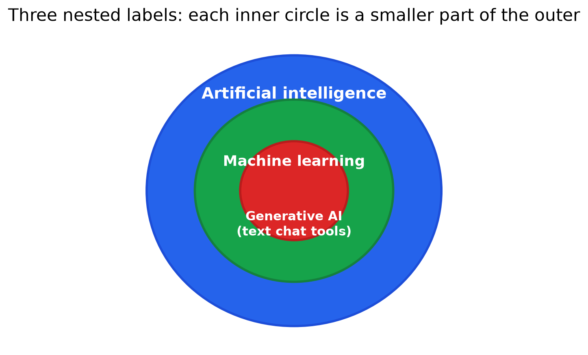
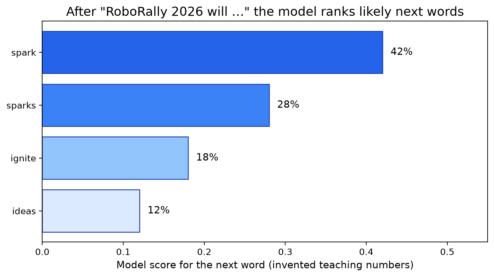
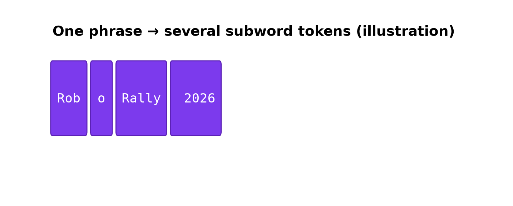
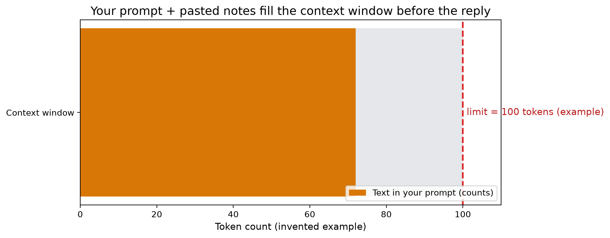
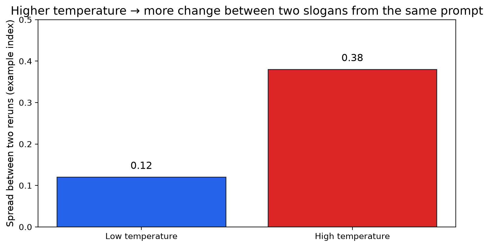
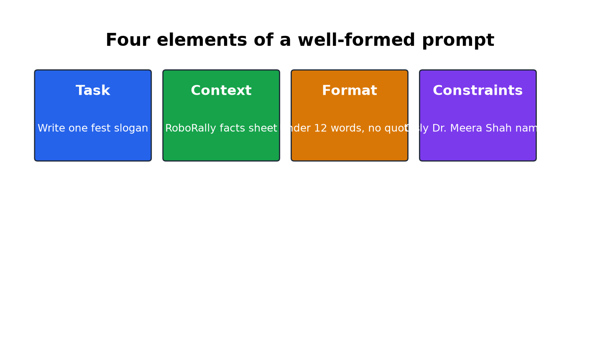

# Lecture Script: How AI, LLMs and Prompts Work

---

## Agenda

The lecture runs as four topics. Each topic ends with a quiz.

| Topic | What we do | Learning objectives covered | Minutes |
|:-:|:--|:--|:-:|
| 1 | Sort the three AI labels | Compare AI, machine learning and generative AI by what each term covers | 20 |
| 2 | Watch words get chosen and split | Describe next-token prediction as the mechanism that produces an LLM response Describe how a tokenizer splits text into subword tokens | 30 |
| 3 | Fit the message in the window | Explain what a context window limits and what counts against it Predict how raising temperature changes the variability of an output | 35 |
| 4 | Spot fluent wrong facts and fix the prompt | Explain why a model can produce fluent text that is factually wrong State the four elements of a well-formed prompt: task, context, format and constraints | 25 |
| — | Closing: Outcome & Summary | | 10 |
| | **Total** | | **120** |

> **🎯 Instructor Note** Pace: keep Topic 1 naming-only; spend most live demo time in Topics 3 and 4 on ChatGPT, Claude, and Gemini free chat pages.

---

## Scenario

Seller A sells cotton kurtas on a large shopping app. The listing needs a short blurb: fabric, size range, and wash care.

An intern opens a free chat page, pastes one line from an old catalog, and ships the reply without reading it.

| Field | Seller A value (invented for teaching) |
|:--|:--|
| Product title | Cotton Kurta — Blue |
| Fabric on the label | 100% cotton |
| Sizes live on site | S, M, L, XL |
| Wash line on label | Cold wash, dry in shade |

> **🎯 Instructor Note** A Flipkart-style app is only the setting; do not claim Seller A or these rows are real. Data is invented for teaching.

---

## Problem Statement

The intern’s chat reply said “silk blend, dry clean only.” The listing went live. A buyer ordered for daily college wear, opened the parcel, and filed a return.

Seller A’s mentor asked for one repeatable way to draft blurbs: right facts, steady tone, and a prompt anyone on the team can reuse.

> **How do we use free chat tools so Seller A’s blurbs stay factual, fit the message limit, and do not invent fabric or care rules?**

> **🎯 Instructor Note** Poll: “Is a smooth product blurb always safe to paste live?” Give learners 30 seconds to respond in chat. Reveal the answer in the Closing.

---

## What We Will Use

Every topic uses the same three free chat pages in the browser. No notebook is required today.

| Topic | Tools | In one line |
|:-:|:--|:--|
| 1 | ChatGPT (Free plan) | Name which broad label fits text-generating chat tools |
| 2 | Claude (Free plan) | Watch how one reply is built word by word and split into tokens |
| 3 | Gemini (Free plan) | See how pasted listing rows fill the reading limit and how settings change reruns |
| 4 | ChatGPT, Claude, Gemini | Compare fluent wrong lines and rewrite using task, context, format, constraints |

---

## How: Walking Through Seller A’s Blurb

---

## Topic 1: Three AI Labels `20 min`

> **Seller A’s intern said “the AI decided.” Which family of tools actually writes listing text—and how is that different from every smart app on the phone?**

### Example: map the three labels to Seller A’s task

> **Where does a chat page that drafts blurbs sit inside the wider AI map?**

$$\boxed{\text{Generative AI} \subset \text{Machine learning} \subset \text{Artificial intelligence}}$$

Artificial intelligence is the wide label for software that handles tasks that look intelligent, such as recommending similar kurtas.

Machine learning is a part of AI where patterns are learned from examples, such as ranking search results.

Generative AI is a part of machine learning that creates new text (or images). Seller A’s blurb draft comes from a **generative** text model.

#### Logic Explanation

- **Outermost circle** Any rule-based chat bot from ten years ago could still count as AI, but it is not what you use today for blurbs.
- **Middle circle** A fraud score on orders uses machine learning but does not write sentences.
- **Inner circle** ChatGPT, Claude, and Gemini free chat pages are generative AI tools focused on language.

> **Result** Seller A is not “using AI” in the vague sense—they are using a generative text model, which is one slice inside machine learning and the wider AI idea.

### Extending it: same tool, three names in the news

> **A headline says “AI tutor,” another says “machine learning model,” a third says “generative AI copilot.” Which headline points at blurb writing?**

> **🎯 Instructor Note** Expected: only the generative AI / copilot headline. Give learners 30 seconds to respond in chat.

#### Logic Explanation

- **AI tutor** could mean many things; ask what it creates.
- **Machine learning model** might score risk or demand; ask if it outputs full sentences.
- **Generative AI copilot** signals text creation—closest to Seller A’s blurb job.

> **Result** For Seller A, the useful label is generative AI, because the deliverable is new product text.

> **Common mistake** Calling every smart feature “AI” hides the fact that only generative tools write blurbs.

### Quiz 1

**Question:** Seller A uses a free chat page to draft a kurta blurb. Which term is most precise for that tool?

**Options:**
- A) Generative AI, because it creates new text from a prompt
- B) Artificial intelligence only, because every app is AI
- C) Machine learning only, with no generative piece
- D) A fixed rule list that never learns from data

**Correct Answer:** A

**Explanation:**
- **A)** Correct: blurb writing is text generation, a generative AI use case.
- **B)** Too broad; many AI systems never write listings.
- **C)** Too narrow a name; generative models are a subset of machine learning.
- **D)** Describes old rule bots, not modern chat pages.

---

## Topic 2: Next Token and Pieces `30 min`

> **The intern pressed Enter once and got a full sentence. Did the model plan the whole blurb in one flash?**

### Example: one word at a time

> **What mechanism produces the visible reply on the chat page?**

$$\boxed{\text{next-token prediction: pick the next word, append it, repeat}}$$

Open Claude (Free plan). Type only: `Cotton kurta for Seller A:` and stop. Watch the reply grow.

The model does not jump to the final blurb in one jump. It repeatedly asks: “Given everything so far, what is the likely next word?”

#### Logic Explanation

- **Each step** The hidden state is the prompt plus every word already shown.
- **Each choice** Many words get scores; one is sampled or taken as top choice (depends on settings).
- **Stops when** an end-of-text signal or length limit appears—not when a human would pause.

> **Result** A fluent blurb is a chain of many next-word choices, not a single lookup from a table of blurbs.

### Extending it: tokenizer subword pieces

> **Before the model scores the next word, how does it read `Cotton Kurta — Blue`?**

A **tokenizer** splits text into **tokens**—often whole words, but long or rare words may split into subword pieces.

Invented teaching split for `RoboRally`-style text:

| Piece index | Text piece |
|:-:|:--|
| 1 | `Cotton` |
| 2 | ` Kur` |
| 3 | `ta` |
| 4 | ` —` |
| 5 | ` Blue` |

The model never sees the string as one unbroken blob; it sees numbered tokens.

#### Logic Explanation

- **Subword split** helps the model handle rare product names without a dictionary entry for every long product code.
- **Spaces and punctuation** often become their own tokens.
- **Your prompt length** is counted in tokens, not characters—important for Topic 3.

> **Result** Seller A’s title can cost more tokens than a shorter name because of how pieces are split.

### Extending it: same prompt, first word fork

> **If two interns run the same opening line, why might the first chosen word already differ?**

> **🎯 Instructor Note** Expected: randomness from sampling and tiny setting differences between tools. Demo the same one-line prompt in ChatGPT and Gemini.

#### Logic Explanation

- **Sampling** The model may roll among high-scoring words instead of always picking the top one.
- **Tool differences** Free plans can use different default creativity settings even when the typed prompt matches.

> **Result** Next-token prediction explains both fluency and early drift between reruns.

### Quiz 2

**Question:** Which statement best describes how an LLM reply appears in the chat window?

**Options:**
- A) The model retrieves one stored blurb that exactly matches the product title
- B) The model repeatedly picks a next token until the reply ends
- C) The model runs a SQL query on Seller A’s live database
- D) The model only reorders words the user already typed, with no new words

**Correct Answer:** B

**Explanation:**
- **A)** Wrong: responses are built, not fetched as a whole document.
- **B)** Correct: next-token prediction builds the answer stepwise.
- **C)** Not in scope; free chat pages do not query Seller A’s database here.
- **D)** Generative models add new tokens beyond the prompt.

---

## Topic 3: Window and Temperature `35 min`

> **The intern pasted four old blurbs plus the full size chart. The reply ignored XL wash care. What limit did they hit?**

### Example: context window budget

> **What does a context window limit, and what counts against it?**

$$\boxed{\text{context window} = \text{max tokens the model can attend to at once (prompt + reply)}}$$

Everything you paste counts: title, fabric facts, your instructions, and earlier chat turns on the same thread.

| Item pasted (invented) | Approx. tokens (teaching) |
|:--|:-:|
| Seller A title and fabric facts | 28 |
| Three old blurbs | 210 |
| Size and wash table | 180 |
| Your instruction paragraph | 55 |
| **Subtotal in prompt** | **473** |

If the window for a free plan is smaller than your pile, the model may drop or forget the bottom lines—such as “cold wash, dry in shade.”

#### Logic Explanation

- **Prompt tokens** All instructions and pasted catalog text in the message box.
- **Reply tokens** The generated blurb also sits inside the same window while it is being written.
- **Not counted** Files sitting on your laptop that you never pasted into the chat.

> **Result** Seller A should paste only the facts needed for one listing, not the entire season catalog in one message.

### Extending it: temperature and variability

> **Same facts, same prompt—why does run two sound more poetic than run one?**

**Temperature** controls how strongly the model explores lower-scoring next tokens.

| Setting (wording varies by tool) | Effect on Seller A blurb reruns (teaching) |
|:--|:--|
| Lower / more focused | Wording stays closer between reruns |
| Higher / more creative | More adjectives and more line-to-line change |

$$\boxed{\text{higher temperature} \Rightarrow \text{more variability across reruns}}$$

On Gemini (Free plan), run the same Seller A prompt twice at default settings, then compare if your UI exposes a creativity slider.

> **🎯 Instructor Note** Expected: higher creativity means wider word choice, not guaranteed better facts. Give learners 30 seconds to respond in chat.

#### Logic Explanation

- **Temperature does not fetch new facts** It only changes which likely words are picked.
- **Marketing tone** Often wants moderate creativity after facts are fixed in the prompt.
- **Compliance tone** Often wants low creativity so wash lines stay stable.

> **Result** Variability is a setting effect, not proof that the model rechecked the label.

### Quiz 3

**Question:** Seller A pastes six long PDF blurbs and wonders why XL wash care vanished from the reply. What is the best explanation?

**Options:**
- A) The model refused cotton products by policy
- B) Pasted text used too much of the context window, so later facts were lost
- C) Temperature was zero so the model could not write the word “wash”
- D) Tokenizer removed every digit from sizes

**Correct Answer:** B

**Explanation:**
- **A)** Fabric policy is unrelated to window limits.
- **B)** Correct: oversized prompts exceed what the model can attend to at once.
- **C)** Low temperature narrows word choice; it does not delete care instructions by itself.
- **D)** Tokenizers do not strip digits as a rule.

---

## Topic 4: Hallucination and Prompt Shape `25 min`

> **The silk-blend line read beautifully. Why was it still wrong—and how do we rewrite the message so the tool stays on the label facts?**

### Example: fluent but false

> **Why can a model sound confident when the fabric line is false?**

A **hallucination** (in this course) means fluent generated text that does not match real facts.

The model optimizes for likely next words given language patterns, not for reading Seller A’s physical label.

Show learners this invented wrong line:

> Soft **silk blend** kurta; **dry clean only**; ideal for evening wear.

Label truth: **100% cotton**, **cold wash**, daily wear.

#### Logic Explanation

- **Language patterns** “Silk blend” often appears near “kurta” in training text, even when your label says cotton.
- **No live label check** The free chat page does not automatically open Seller A’s warehouse photo.
- **Human check** Compare every material and care claim to the four-row fact table in the Scenario.

> **Result** Smooth wording is not evidence. Seller A needs a person or a checklist against source facts.

### Extending it: four prompt elements

> **What belongs in one well-formed prompt for Seller A’s kurta blurb?**

$$\boxed{\text{prompt} = \text{task} + \text{context} + \text{format} + \text{constraints}}$$

| Element | Seller A content (invented) |
|:--|:--|
| Task | Write one listing blurb for the blue cotton kurta |
| Context | Title, 100% cotton, sizes S–XL, cold wash, dry in shade |
| Format | Two short sentences, plain English, no bullet symbols |
| Constraints | Do not name other fabrics; do not add dry clean; under 45 words |

Paste a single message with all four parts into ChatGPT (Free plan). Rerun once in Claude (Free plan) with the same text.

> **🎯 Instructor Note** Expected: outputs stay closer to cotton and cold wash. Poll tie-in: fluency ≠ safety.

#### Logic Explanation

- **Task** Stops the model from guessing your goal (title vs FAQ vs email).
- **Context** Supplies the only facts it should echo.
- **Format** Sets length and shape so uploads stay consistent.
- **Constraints** States forbidden inventions (silk, dry clean).

> **Result** The four-element prompt is Seller A’s reusable template—not a one-line “write a blurb” wish.

### Extending it: quick check on three tools

> **Do all three free chat pages obey constraints every time?**

#### Logic Explanation

- **Same prompt** should be typed, not paraphrased, when comparing tools.
- **Any violation** (silk, dry clean) means edit the blurb manually—do not publish.
- **Next session** you will run Python in Colab; today’s skill is prompt shape and model behaviour.

> **Common mistake** Trusting the first neat sentence because it matches the tone of last season’s catalog.

### Quiz 4

**Question:** Which prompt line is the **constraint** for Seller A?

**Options:**
- A) “Product: Cotton Kurta — Blue”
- B) “Write two short sentences”
- C) “Do not mention silk or dry clean only”
- D) “Sizes S, M, L, XL”

**Correct Answer:** C

**Explanation:**
- **A)** Context fact, not a rule about forbidden text.
- **B)** Format instruction.
- **C)** Correct: tells the model what not to invent.
- **D)** Context fact about sizes.

---

## Closing: Outcome & Summary `10 min`

Seller A needs one blurb pattern that survives free chat tools, intern turnover, and reruns.

> **1. Which label fits the chat tools you used today?**

Generative AI inside machine learning inside the wider AI label—because the output is new listing text.

> **2. How is the blurb actually produced?**

Next-token prediction builds the reply piece by piece; the tokenizer turns your pasted facts into tokens that fill the context window.

> **3. Why did wash care disappear when too much was pasted?**

The context window budget was spent on old blurbs; temperature only changes word choice, not label reading.

> **4. Was the silk line safe because it sounded polished?**

No—that was hallucination. The fix is a four-part prompt plus a human check against the Scenario table.

### Outcome

| Check | Weak one-line prompt | Four-element prompt |
|:--|:-:|:-:|
| Names cotton correctly | Sometimes | Usually |
| Keeps cold wash line | Often dropped when paste is huge | Stays when context is short |
| Avoids silk / dry clean | Often fails | Fails less; still needs human read |
| Stable across reruns | Low | Higher with lower creativity |

> **Therefore,** Seller A should treat chat output as a draft: generative models guess language, limits and settings shape variability, and a structured prompt plus fact check prevents fluent wrong blurbs.

> **🎯 Instructor Note** Reveal poll answer: smooth blurbs are **not** always safe. Point to the silk-blend mistake.

### Summary

| Learning objective | Takeaway |
|:--|:--|
| Compare AI, machine learning and generative AI by what each term covers | Blurb chat tools are generative AI—a slice of ML inside the wider AI idea |
| Describe next-token prediction as the mechanism that produces an LLM response | Replies grow one token at a time by scoring what comes next |
| Describe how a tokenizer splits text into subword tokens | Your title and paste are counted as pieces, not one invisible string |
| Explain what a context window limits and what counts against it | Prompt + reply share a token budget; huge pastes drop facts |
| Predict how raising temperature changes the variability of an output | Higher creativity widens wording swings between reruns |
| Explain why a model can produce fluent text that is factually wrong | Likely language ≠ verified label facts—hallucination |
| State the four elements of a well-formed prompt: task, context, format and constraints | Seller A reuses all four so every intern sends the same shape of message |
| **Practical value** | You can open ChatGPT, Claude, or Gemini on the free plan, send a structured prompt, and verify output before anything goes live |

---

# Launch the Feedback Poll

> **🎯 Instructor Note** Reminder: launch the feedback poll now to collect learner feedback.