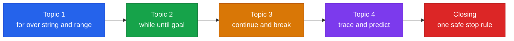
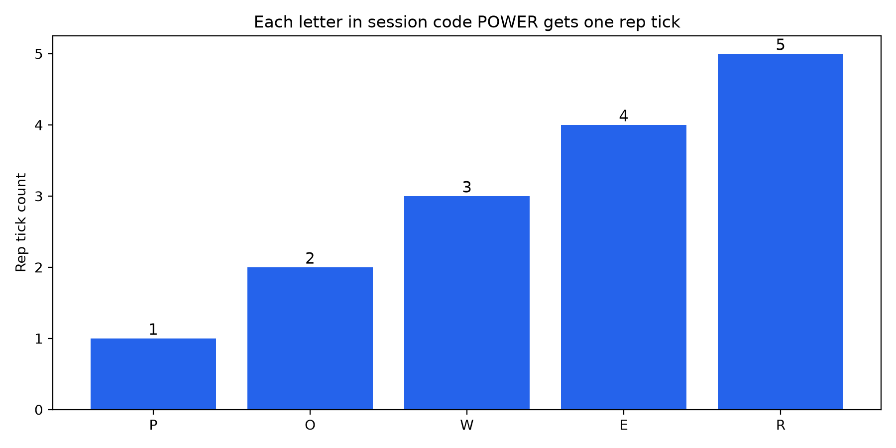
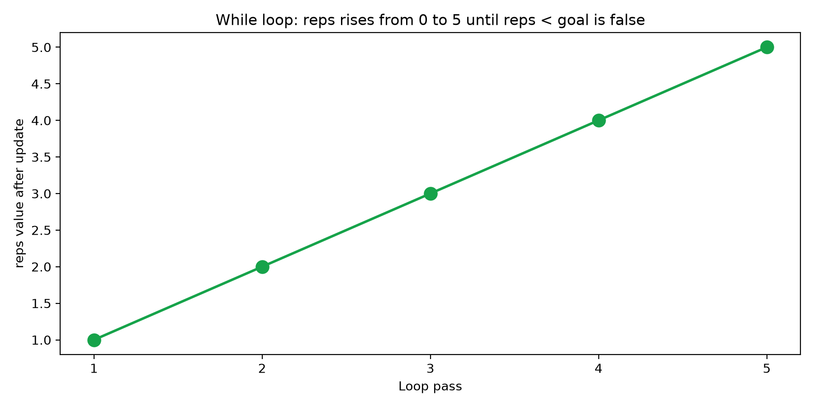
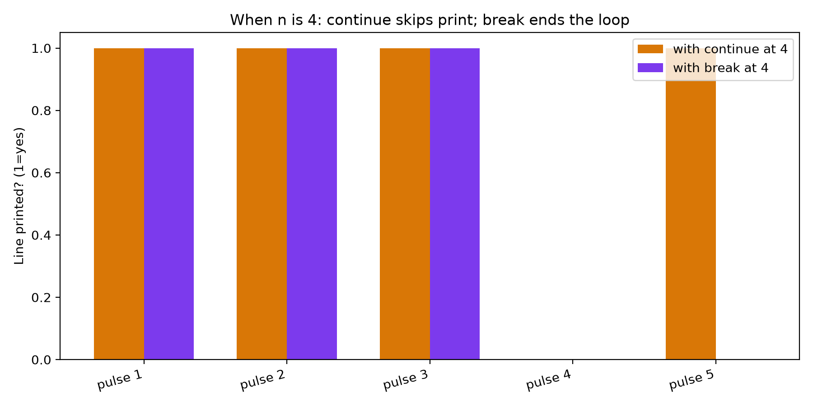
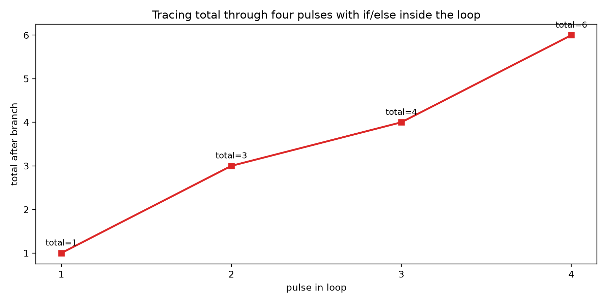
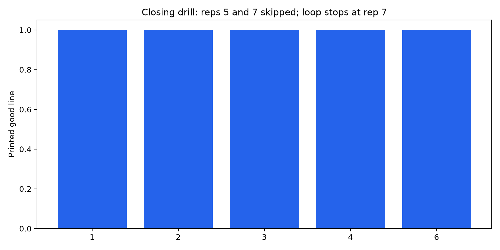

# <font color='#1d4ed8'>Lecture Script: Loops and Tracing What Runs</font>

---

## <font color='blue'>Agenda</font>

The lecture runs as four topics. Each topic ends with a quiz.

| Topic | What we do | Learning objectives covered | Minutes |
|:-:|:--|:--|:-:|
| 1 | Count reps with `for` | Write a for loop that iterates over a sequence | 30 |
| 2 | Repeat until goal with `while` | Write a while loop that terminates on a stated condition<br>Identify the condition in a loop that prevents it from terminating | 32 |
| 3 | Skip or stop one pass | Apply break and continue to exit or skip iterations in a loop | 28 |
| 4 | Trace and predict branches | Predict which branch of a conditional executes for a given input<br>Trace the value of a variable through successive loop iterations | 25 |
| — | Closing: Outcome & Summary | | 5 |
| | **Total** | | **120** |

> <font color="red">**🎯 Instructor Note**</font> Pace: spend extra time in Topic 2 on the stop condition and the missing-update mistake.
> Topic 4 is table-heavy; learners write ticks on paper before they run the cell.

---

## <font color='blue'>Scenario</font>

A Cult.fit-style gym app shows live rep counts on the floor screen. Each session has a short **session code** (letters) and a **rep goal** (a number).

| Session code | Rep goal today | What the member sees |
|:--|:-:|:-|
| POWER | 5 | One tick per letter in the code, then a done banner |
| CORE | 8 | Same rule for a longer set |
| MOBIL | 3 | Short warm-up set |

The mentor file `data/gym_rep_log.csv` holds **120** invented member rows for upload. In Colab we use short strings and `range()` in the cell, not file reads.

> <font color="red">**🎯 Instructor Note**</font> Cult.fit is only the setting; these counts are invented for teaching. Learners work in Google Colab with new code cells only.

---

## <font color='blue'>Problem Statement</font>

Last week the floor screen froze at **rep 47** for member **M019**. The coach had already ended the set at **rep 8**.

The bug was a **while** loop with no update to the counter. The app never saw the stop rule turn false.

Another screen skipped **rep 5** in the log but still billed a full **8-rep** pack. The branch for **pulse 4** ran, but the print line ran anyway.

> <font color='purple'>**How do we repeat work safely in Colab, skip one bad pulse, stop on time, and trace the counter so the screen matches the coach?**</font>

> <font color="red">**🎯 Instructor Note**</font> Poll: "Session code POWER, goal 5. How many lines print inside the for loop?" Give learners 30 seconds to respond in chat. Reveal the answer in the Closing.

---

## <font color='blue'>What We Will Use</font>

Everything below runs in **Google Colab**. You already store values and branch with **if/else** from **Variables and Condition Logic in Colab**. Today we add loops on top of those same cells.

| Topic | Tools | In one line |
|:-:|:--|:--|
| 1 | `for`, `range()`, string sequence | Visit each item in order without copying lines |
| 2 | `while`, comparison in the header | Repeat until a condition becomes false |
| 3 | `continue`, `break` | Skip one pass or leave the loop early |
| 4 | tracing table, `if` inside a loop | Predict the branch and follow one variable step by step |

---

## <font color='blue'>How: Walking Through the Rep Counter</font>



---

## <font color='blue'>Topic 1: Count Reps with `for`</font> `30 min`

> <font color='purple'>**You can already store `goal = 5` and branch on heart rate. How do we tick rep 1, rep 2, rep 3 without pasting five copies of the same print line?**</font>

### <font color='green'>Example: one tick per letter in session code</font>

> <font color='purple'>**Session code is the string `POWER`. How many ticks should print?**</font>

**Predict before running: What will happen?**

> <font color="red">**🎯 Instructor Note**</font> Expected: five lines, one per letter, with `done` rising 1 to 5. Common guess: only `P` prints.

```python
session_code = "POWER"
done = 0
for letter in session_code:
    done = done + 1
    print(letter, "tick", done)
```

**Output**

```
P tick 1
O tick 2
W tick 3
E tick 4
R tick 5
```

#### <font color='#c2410c'>Code Explanation</font>

- **Line 1** `session_code` is a string sequence. The loop visits each character in order.
- **Line 2** `done` starts at 0 and acts like the rep counter on the screen.
- **Lines 3 to 5** Each pass adds 1 to `done` and prints the letter plus the new tick.

> <font color='green'>**Result**</font> Five letters gave five ticks. The loop body ran once per item in the sequence.

<p align="center"></p>

### <font color='green'>Extending it: three sets with `range`</font>

> <font color='purple'>**The coach wants set 1, set 2 and set 3 printed. Which numbers should `range(1, 4)` visit?**</font>

**Predict before running: What will happen?**

> <font color="red">**🎯 Instructor Note**</font> Expected: three lines. Common guess: four lines because learners count the end number 4.

```python
for n in range(1, 4):
    print("set", n, "of 3")
```

**Output**

```
set 1 of 3
set 2 of 3
set 3 of 3
```

#### <font color='#c2410c'>Code Explanation</font>

- **Line 1** `range(1, 4)` feeds the numbers 1, 2 and 3. The stop value 4 is not included.
- **Line 2** Prints a short label for each set number.

> <font color='green'>**Result**</font> `range` is another sequence. The same `for` line visits each number without hand-typing three print cells.

### <font color='purple'>Quiz 1</font>

**Question:** What is the last line printed by the `for` loop over `session_code = "POWER"` in the first example?

**Options:**
- A) `R tick 4`
- B) `R tick 5`
- C) `P tick 5`
- D) `POWER tick 5`

**Correct Answer:** B

**Explanation:**
- **A)** Wrong: `done` reaches 5 on the last letter, not 4.
- **B)** Correct: the fifth pass prints `R` with `done` equal to 5.
- **C)** Wrong: the last letter is `R`, not `P`.
- **D)** Wrong: the loop prints one letter at a time, not the whole word.

---

## <font color='blue'>Topic 2: Repeat Until Goal with `while`</font> `32 min`

> <font color='purple'>**The for loop knew its list upfront. What if we only stop when `reps` reaches goal 5?**</font>

### <font color='green'>Example: count to goal with `while`</font>

> <font color='purple'>**Start at `reps = 0` and goal 5. When does the header `reps < goal` turn false?**</font>

**Predict before running: What will happen?**

> <font color="red">**🎯 Instructor Note**</font> Expected: five `rep` lines then `done at 5`. Give learners 30 seconds to respond in chat on when the loop stops.

```python
reps = 0
goal = 5
while reps < goal:
    reps = reps + 1
    print("rep", reps)
print("done at", reps)
```

**Output**

```
rep 1
rep 2
rep 3
rep 4
rep 5
done at 5
```

#### <font color='#c2410c'>Code Explanation</font>

- **Lines 1 and 2** Start values for the counter and the goal.
- **Line 3** The loop runs only while `reps < goal` is true.
- **Line 4** This update is what makes the counter move toward the goal each pass.
- **Lines 5 and 6** Print inside the loop; after the loop ends, print the final `reps`.

> <font color='green'>**Result**</font> The stop rule fired after `reps` became 5. The line after the loop shows the final value.

<p align="center"></p>

### <font color='green'>Extending it: the missing update (infinite loop)</font>

> <font color='purple'>**What if line 4 `reps = reps + 1` is deleted? Does `reps < goal` ever turn false?**</font>

#### <font color='#c2410c'>Logic Explanation</font>

- With `reps` stuck at 0, the condition `reps < 5` stays true forever. Colab keeps running until you stop the cell.
- That matches the frozen **rep 47** story: no update means no stop signal.
- The fix is always the same: change the variable that the header checks, every pass.

**Predict before running: What will happen?**

> <font color="red">**🎯 Instructor Note**</font> Expected: three numbers then stop. This is the safe version with the update kept.

```python
reps = 0
while reps < 3:
    reps = reps + 1
    print(reps)
```

**Output**

```
1
2
3
```

> <font color='green'>**Result**</font> The update line is the condition that prevents a non-ending loop. Without it, the gym screen never reaches `done`.

> <font color='#b45309'>**Common mistake**</font> Forgetting to move `reps` (or checking the wrong variable in the header). The loop runs until you interrupt the kernel.

### <font color='purple'>Quiz 2</font>

**Question:** `reps = 0`, `goal = 5`, and `while reps < goal:` includes `reps = reps + 1` each pass. How many times does `print("rep", reps)` run?

**Options:**
- A) 4
- B) 5
- C) 6
- D) Forever without `reps = reps + 1`

**Correct Answer:** B

**Explanation:**
- **A)** Wrong: the counter reaches 5, not 4.
- **B)** Correct: prints at 1 through 5, then `reps < goal` is false.
- **C)** Wrong: when `reps` is 5, the header is false before a sixth pass.
- **D)** Wrong: describes the missing-update bug, but this question includes `reps = reps + 1`.

---

## <font color='blue'>Topic 3: Skip or Stop One Pass</font> `28 min`

> <font color='purple'>**Pulse 4 was noisy on the heart strap. Can we skip printing it but keep counting, or stop the whole set early?**</font>

### <font color='green'>Example: skip pulse 4 with `continue`</font>

> <font color='purple'>**Which pulse numbers should still print when `n == 4` hits continue?**</font>

**Predict before running: What will happen?**

> <font color="red">**🎯 Instructor Note**</font> Expected: pulses 1, 2, 3 and 5 only. Common guess: the loop stops completely.

```python
for n in range(1, 6):
    if n == 4:
        continue
    print("pulse", n)
```

**Output**

```
pulse 1
pulse 2
pulse 3
pulse 5
```

#### <font color='#c2410c'>Code Explanation</font>

- **Lines 2 and 3** When `n` is 4, `continue` skips the rest of this pass and jumps to the next `n`.
- **Line 4** Runs only when the continue branch did not fire.

> <font color='green'>**Result**</font> Pulse 4 left no print line, but pulse 5 still ran.

### <font color='green'>Extending it: stop at pulse 4 with `break`</font>

> <font color='purple'>**What changes if we end the whole loop at 4 instead of skipping one print?**</font>

```python
for n in range(1, 6):
    if n == 4:
        break
    print("pulse", n)
```

**Output**

```
pulse 1
pulse 2
pulse 3
```

#### <font color='#c2410c'>Code Explanation</font>

- **Lines 2 and 3** `break` leaves the loop entirely. No later `n` values run.
- **Line 4** Never runs on the pass where `break` fired.

<p align="center"></p>

> <font color='green'>**Result**</font> **continue** skips one body; **break** ends the loop. That is why the billing screen still needs the right choice.

### <font color='purple'>Quiz 3</font>

**Question:** In the continue example, why is `pulse 5` still printed?

**Options:**
- A) `continue` ends the entire loop
- B) `break` ran on pass 5
- C) The loop moved to the next `n` after skipping pass 4
- D) `range(1, 6)` excludes 5

**Correct Answer:** C

**Explanation:**
- **A)** Wrong: that describes `break`, not `continue`.
- **B)** Wrong: there is no `break` in that cell.
- **C)** Correct: pass 4 skipped the print, pass 5 ran normally.
- **D)** Wrong: 5 is inside `range(1, 6)`.

---

## <font color='blue'>Topic 4: Trace and Predict Branches</font> `25 min`

> <font color='purple'>**Heart rate crossed 140 on pass 3 in the pre-read table. Can we predict the branch before Colab prints it?**</font>

### <font color='green'>Example: predict the `if` branch inside a loop</font>

> <font color='purple'>**`heart = 148` for every pass. Which label prints: high or ok?**</font>

**Predict before running: What will happen?**

> <font color="red">**🎯 Instructor Note**</font> Expected: three `high` lines. Give learners 30 seconds to respond in chat before you run the cell.

```python
heart = 148
count = 0
for tick in range(3):
    count = count + 1
    if heart > 140:
        print(tick, "high", count)
    else:
        print(tick, "ok", count)
```

**Output**

```
0 high 1
1 high 2
2 high 3
```

#### <font color='#c2410c'>Code Explanation</font>

- **Line 1** `heart` stays 148 each pass, so the comparison `heart > 140` stays true.
- **Lines 3 to 4** `tick` is 0, 1, 2 from `range(3)`; `count` rises each pass.

> <font color='green'>**Result**</font> The branch choice was known before the run because `heart` and `140` were fixed.

### <font color='green'>Extending it: trace `total` through four pulses</font>

> <font color='purple'>**Fill the table before you run. What is `total` after pulse 4?**</font>

| pulse | branch | total after |
|:-:|:-|:-:|
| 1 | odd (+1) | ? |
| 2 | even (+2) | ? |
| 3 | odd (+1) | ? |
| 4 | even (+2) | ? |

```python
total = 0
for pulse in range(1, 5):
    if pulse % 2 == 0:
        total = total + 2
    else:
        total = total + 1
    print(pulse, total)
```

**Output**

```
1 1
2 3
3 4
4 6
```

#### <font color='#c2410c'>Code Explanation</font>

- **Lines 2 to 6** Even pulses add 2; odd pulses add 1; the print shows the running total.
- **Line 6** Each line is one row in the tracing table.

<p align="center"></p>

> <font color='green'>**Result**</font> Tracing means writing each new `total` after the branch runs. Pulse 4 ends at **6**.

### <font color='purple'>Quiz 4</font>

**Question:** After pulse 3 in the trace example, what is `total`?

**Options:**
- A) 3
- B) 4
- C) 5
- D) 6

**Correct Answer:** B

**Explanation:**
- **A)** Wrong: that is the value after pulse 2.
- **B)** Correct: pulse 3 is odd, so `3 + 1 = 4`.
- **C)** Wrong: 5 would need another +1 pass.
- **D)** Wrong: 6 appears only after pulse 4 adds 2.

---

## <font color='blue'>Closing: Outcome & Summary</font> `5 min`

> <font color='purple'>**1. Session POWER with five letters — how many loop passes was the poll answer?**</font>

Five passes: one per letter, matching the for loop in Topic 1.

> <font color='purple'>**2. Can one cell combine while, continue, break and a branch so the screen stops like the coach expects?**</font>

```python
reps = bad = 0
while reps < 8 and bad < 2:
    reps += 1
    if reps == 5:
        bad += 1
        continue
    elif reps == 7:
        break
    print("good", reps)
print("stop", reps, bad)
```

**Output**

```
good 1
good 2
good 3
good 4
good 6
stop 7 1
```

#### <font color='#c2410c'>Code Explanation</font>

- **Lines 3 to 4** The while header stops when `reps` reaches 8 or `bad` reaches 2 (Topic 2 stop rule).
- **Lines 6 to 8** Pass 5 hits continue, so no `good 5` line (Topic 3).
- **Lines 9 to 10** The `elif` on pass 7 hits break, so `reps` ends at 7.

<p align="center"></p>

### <font color='green'>Outcome</font>

| | Frozen screen (no update) | Safe counter (today's cell) |
|:--|:-:|:-:|
| Last rep shown | 47 | 7 |
| Coach stop respected | no | yes |
| Bad pulse 5 printed | yes | no (continue) |

> <font color='green'>**Therefore,**</font> loops need a clear sequence or stop rule, a moving counter in `while`, and careful **continue** / **break** so the floor screen matches the coach.

> <font color="red">**🎯 Instructor Note**</font> Reveal the poll: **five** ticks for POWER. Point to the Outcome table.

### <font color='green'>Summary</font>

| Learning objective | Takeaway |
|:--|:--|
| Write a for loop that iterates over a sequence | `for x in string` or `for n in range(...)` visits each item once. |
| Write a while loop that terminates on a stated condition | The header must turn false; update the variable you check. |
| Apply break and continue to exit or skip iterations in a loop | `continue` skips one pass; `break` leaves the loop. |
| Predict which branch of a conditional executes for a given input | Fix the test values, then read the `if` line before you run. |
| Trace the value of a variable through successive loop iterations | Write a small table: pass number, branch, new value. |
| Identify the condition in a loop that prevents it from terminating | The update line (or a false header) is what stops an endless loop. |
| **Practical value** | You can read a Colab cell and explain what will print before class ends. |

---

# <font color='red'>Launch the Feedback Poll</font>

> <font color="red">**🎯 Instructor Note**</font> Reminder: launch the feedback poll now to collect learner feedback.