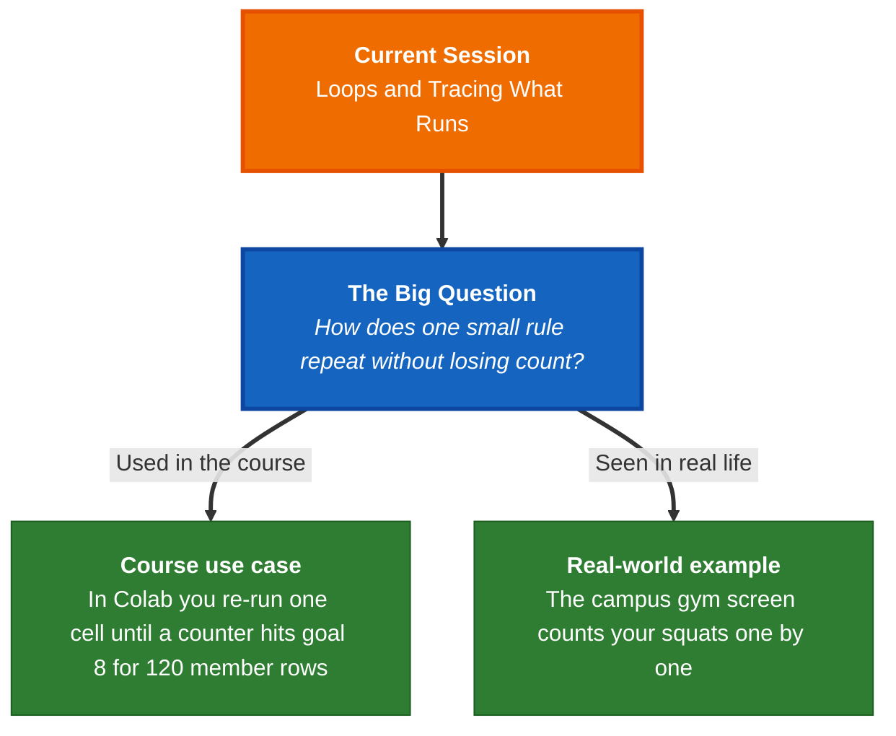

## <span style="color:#2F7DDE">Loops and Tracing What Runs</span>

### <span style="color:#2F7DDE">Mental Map</span>



---

### <span style="color:#2F7DDE">What You'll Learn</span>

Have you ever wondered how the gym screen keeps adding one rep without you tapping each time?

By the end of this session, you will be able to:

- <span style="color:#D9660B">**Use**</span> a for loop to visit each letter in session code **POWER** and add one tick per letter.
- <span style="color:#D9660B">**Run**</span> a while loop that stops once your rep counter reaches goal **12**.
- <span style="color:#D9660B">**Skip**</span> pulse **4** with **continue** and **halt** at rep **7** with **break** when the coach ends the set.
- <span style="color:#D9660B">**Predict**</span> which **if** branch runs when heart rate crosses **140**.
- <span style="color:#D9660B">**Trace**</span> the rep variable through passes **1** to **4** in a small table.
- <span style="color:#D9660B">**Spot**</span> the missing line that would leave the counter stuck below goal **3**.

> <span style="color:#2F7DDE">**Topics you will meet:**</span> For loop over a range or a string; While loop; Break and continue; Which branch runs (if/else); Tracing a loop; Infinite loop.
>
> Join the session to learn each of these in detail.

---

### <span style="color:#2F7DDE">Why You Are Learning This Topic</span>

You join a **CORE** class at the campus gym. The wall screen shows **rep 1, rep 2, rep 3**.

You stop at **8** because the coach ends the set. One wrong rule could show **rep 99** forever.

A **loop** means the same few lines run again until a clear stop rule fires.

In this course you will run those lines in Google Colab and read what prints each time.

> <span style="color:#2F7DDE">**Think about it:**</span> What tells the screen to stop at rep 8 instead of running all night?

---

### <span style="color:#2F7DDE">The Gym Rep Counter Puzzle</span>

The screen tracks one member for one exercise set.

| Pass | Heart rate | Coach note |
|:----:|:----------:|:----------|
| 1 | 128 | good form |
| 2 | 135 | good form |
| 3 | 142 | slow down |
| 4 | 138 | skip this pulse |
| 5 | 131 | last rep today |

<span style="color:#D9660B">**What you want to happen:**</span>

- Print **rep 1** through **rep 5** without manual copy-paste.
- Skip pass **4** but still show **rep 5**.
- Stop the loop when the coach ends the set, not at **rep 100**.

Here is how it might start. You do not need to understand it yet.

```python
reps = 0
while reps < 3:
    reps = reps + 1
```

> <span style="color:#D9660B">**Wonder about this:**</span>
>
> - Which pass should print nothing if pass **4** is noisy?
> - What changes if the counter never adds **1** inside the loop?

---

### <span style="color:#2F7DDE">Think It Through</span>

There is no wrong first try. Keep your guesses for the session.

**1. Session code is the word POWER. How many times should the loop run if each letter gets one tick?**
Hint: Count the letters in **POWER**.

**2. Goal is 12 reps but you are on rep 11. Should the while loop run one more time?**
Hint: Compare rep count to goal with **<**.

**3. Heart rate is 142 on pass 3. Which branch name would you expect: high or ok?**
Hint: The limit in the table is **140**.

---

### <span style="color:#2F7DDE">One Question to Carry Into the Session</span>

> <span style="color:#2F7DDE">**Can you tell, before you run the cell, exactly which rep number prints last?**</span>
>
> What would you write on paper to prove your guess?