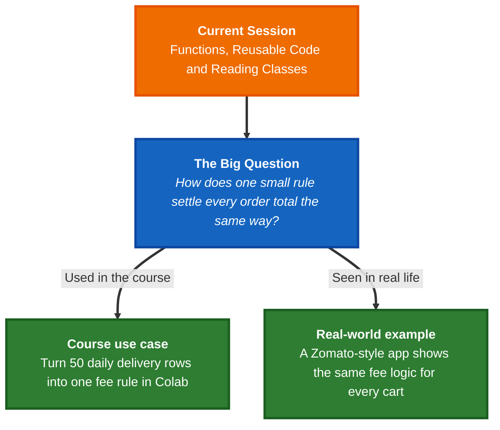

## <span style="color:#2F7DDE">Functions, Reusable Code and Reading Classes</span>

### <span style="color:#2F7DDE">Mental Map</span>



---

### <span style="color:#2F7DDE">What You'll Learn</span>

Have you ever wondered how a food app shows the same delivery fee for every cart in your city?

By the end of this session, you will be able to:

- <span style="color:#D9660B">**Design**</span> a fee rule that turns distance into rupees for three Pune dinner orders.
- <span style="color:#D9660B">**Apply**</span> that rule with item count and price entered in the correct order.
- <span style="color:#D9660B">**Demonstrate**</span> a call that leaves out an optional tip amount and still gets a fair total.
- <span style="color:#D9660B">**Describe**</span> why a name you pick inside the rule never appears in the main notebook.
- <span style="color:#D9660B">**Differentiate**</span> a menu blueprint from the live menu shown for Restaurant Milan on screen.

> <span style="color:#2F7DDE">**Topics you will meet:**</span> Function with def and return; Positional and keyword arguments; Default values; Variable scope; Reading a class: class and instance.
>
> Join the session to learn each of these in detail.

---

### <span style="color:#2F7DDE">Why You Are Learning This Topic</span>

You tap order on a Zomato-style app at dinner time.
The cart lists paneer rolls, distance, and a small packing charge.
The total must match what your friend sees on another phone.
Last week you typed the same five math steps in five notebook cells.
One cell had a typo, and a customer saw the wrong fee.
A **function** means a named set of steps you can run again with new inputs.
You will use that idea every time you clean data in Python.
Later you will read simple class blocks the way you read a printed menu layout.

> <span style="color:#2F7DDE">**Think about it:**</span> What breaks first when five copies of the same math live in five cells?

---

### <span style="color:#2F7DDE">The Dinner Cart Puzzle</span>

Three friends order from the same restaurant tonight. The app must show a fair delivery fee for each cart.

| Friend | Dishes | Distance (km) | Packing (Rs) |
|:--------:|:------:|:-------------:|:------------:|
| Ananya | 2 | 3 | 15 |
| Rahul | 1 | 7 | 10 |
| Meera | 4 | 2 | 20 |

<span style="color:#D9660B">**What you want to happen:**</span>

- Every cart gets the same fee formula, not five separate copy-paste blocks.
- You can change the per-km rate once and fix every order.
- You can read how the app stores one order without writing the full menu code.

Here is how it might start. You do not need to understand it yet.

```python
def delivery_fee(km):
    return 20 + 5 * km
delivery_fee(3)
```

> <span style="color:#D9660B">**Wonder about this:**</span>
>
> - Where does the number 35 come from when the distance is 3 km?
> - Why might the name `delivery_fee` matter more than the numbers inside?

---

### <span style="color:#2F7DDE">Think It Through</span>

There is no wrong first try. Keep your guesses for the session.

**1. Ananya's cart is 3 km away. Which part of the table would you reuse for Rahul's 7 km cart?**
Hint: Look for the column that changes per friend, not per dish count.

**2. Rahul wants to skip naming the packing charge because it is often 10. How might one call still work?**
Hint: Think about a value the rule already knows before you type anything.

**3. Meera sees a screen titled Order for Restaurant Milan. What might be the blueprint versus the one live order?**
Hint: One is a pattern many orders share; one is tonight's paneer rolls only.

---

### <span style="color:#2F7DDE">One Question to Carry Into the Session</span>

> <span style="color:#2F7DDE">**If one named rule can price every cart, what must stay inside the rule—and what can stay outside?**</span>
>
> Bring one guess about names you expect to see in the notebook after the rule runs.