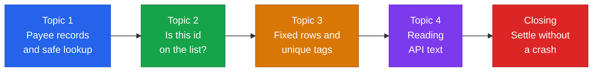
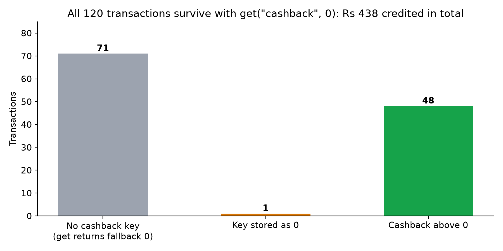
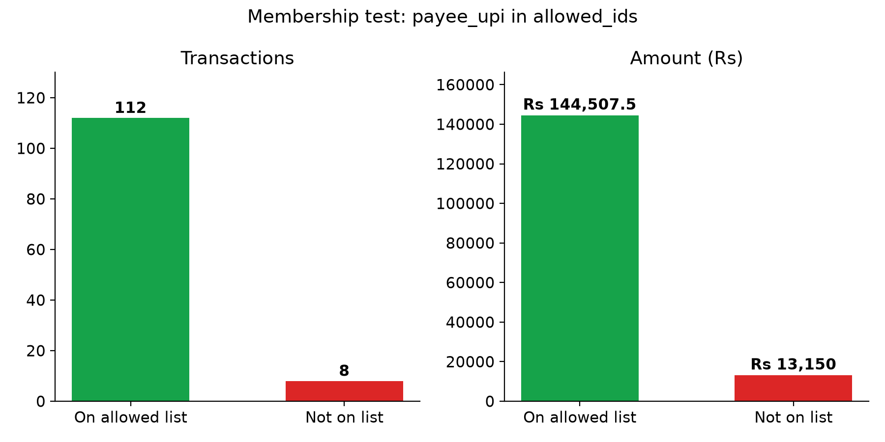
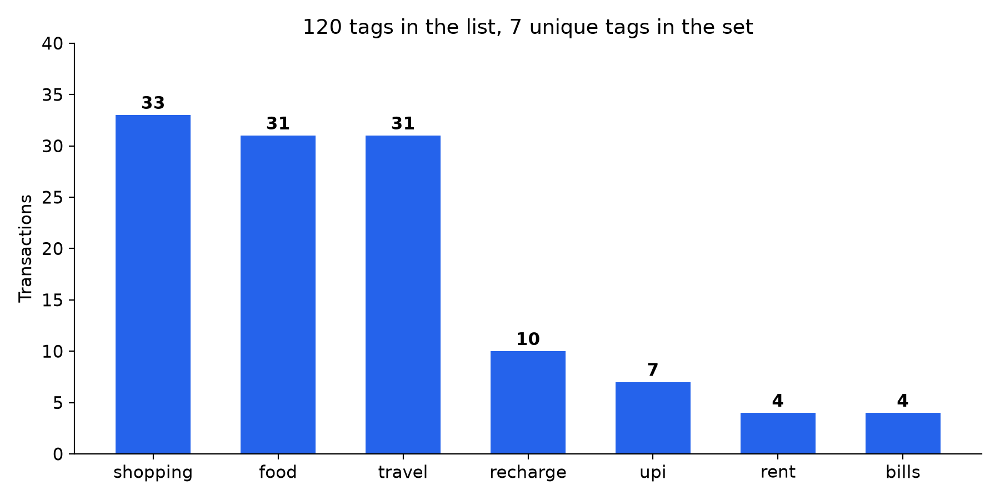
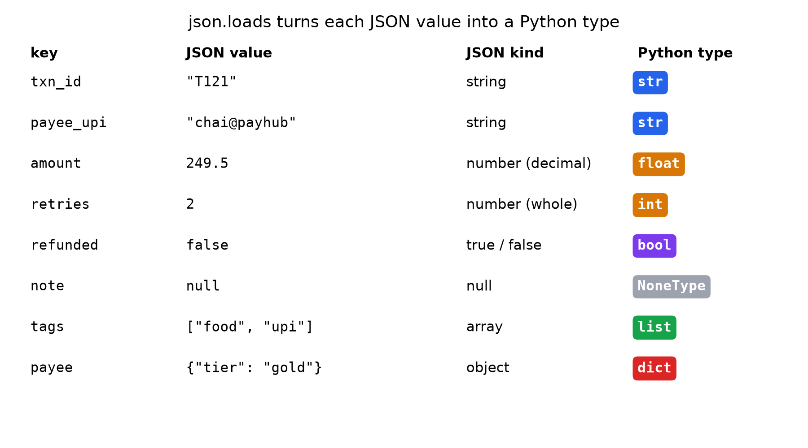
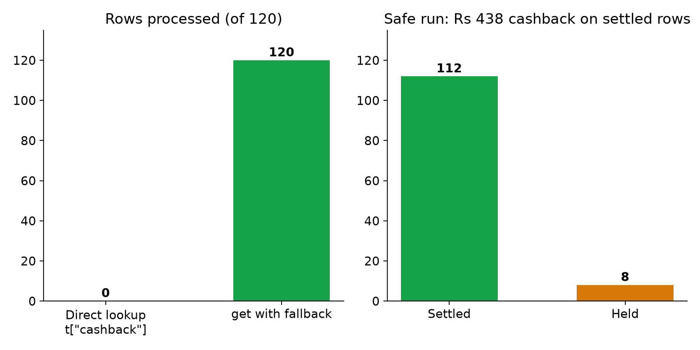

# <font color='#1d4ed8'>Lecture Script: Dictionaries, JSON, Tuples and Sets</font>

---

## <font color='blue'>Agenda</font>

The lecture runs as four topics. Each topic ends with a quiz.

| Topic | What we do | Learning objectives covered | Minutes |
|:-:|:--|:--|:-:|
| 1 | Payee records and safe lookup | Build a dictionary of key-value pairs, retrieving a value by its key<br>Retrieve a dictionary value with get, supplying a fallback for a missing key | 32 |
| 2 | Is this id on the list? | Write a membership test using the in operator on a list and a dictionary | 22 |
| 3 | Fixed rows and unique tags | Write a tuple and unpack it into named variables<br>Build a set to remove duplicate values from a list | 28 |
| 4 | Reading API text | Classify JSON values by the Python types they become when parsed | 28 |
| — | Closing: Outcome & Summary | | 10 |
| | **Total** | | **120** |

> <font color="red">**🎯 Instructor Note**</font> Pace: spend the most time on `get` with a fallback in Topic 1 and on the JSON type labels in Topic 4.
> Keep the `in` operator in Topic 2 and the tuple unpacking in Topic 3 quick; both return in the Closing.

---

## <font color='blue'>Scenario</font>

A PhonePe-style UPI app settles today's payments to local payees: tea stalls, cab rides, recharges, rent.

**The single risk:** one record with a missing field can stop the whole settlement run.

- 120 transactions today, paid to 12 payees
- 10 payee ids are on the approved list; 2 are not
- Only some transactions carry a `cashback` field
- A payment event also arrives from the app's API as plain text

> <font color="red">**🎯 Instructor Note**</font> The app is only the setting; the 120 transactions in `data/` are invented for teaching, with no claim about PhonePe.
> Run the code in Google Colab (Python 3). Error layouts differ slightly between Python versions.

---

## <font color='blue'>Problem Statement</font>

An analyst had to credit cashback to today's 120 transactions. Her script read `t["cashback"]` for every row. The very first row had no cashback, so the script stopped with an error, nobody was credited, and a payee that was never approved went through unchecked.

> <font color='purple'>**How can a script read payee records, check ids against a list, and read API text without stopping on one missing field?**</font>

> <font color="red">**🎯 Instructor Note**</font> Poll: "How many different tags are in today's 120 transactions: 3, 7 or 12?" Give learners 30 seconds to respond in chat. Reveal the answer in the Closing.

---

## <font color='blue'>What We Will Use</font>

Four small tools, each used on the same 120 transactions. Run the two setup cells once before Topic 1, as given.

| Topic | Tools | In one line |
|:-:|:--|:--|
| 1 | `{}` dictionary, `[key]`, `.get(key, fallback)` | Store a record by field name and read it back, safely |
| 2 | `in` | Ask "is this item present?" on a list or a dictionary |
| 3 | `( )` tuple, unpacking, `set()` | Fixed rows with named parts, and a list without repeats |
| 4 | `json.loads` | Turn text from an API into Python values |

The setup uses two names: `txns`, a list of 120 transactions, and `payees`, 12 payee records stored by UPI id. The full JSON text lives in `data/` for mentors; learners paste the same text into the notebook and turn it into values with `json.loads`. Run the two setup cells once before Topic 1.

> <font color="red">**🎯 Instructor Note**</font> Upload `data/transactions.json` and `data/payees.json` to Colab if you like, but **do not** use `open()` in class — file read comes in **Python Files and Data Handling**. Copy the file text into the string variables below (or share a prefilled notebook).

```python
import json
PAYEES_TEXT = """{"chai@payhub": {"upi": "chai@payhub", "name": "Sharma Chai Stall", "tier": "gold", "fee_pct": 1.2}, "metro@payhub": {"upi": "metro@payhub", "name": "City Metro Recharge", "tier": "gold", "fee_pct": 0.8}, "cab@payhub": {"upi": "cab@payhub", "name": "Quick Cab Rides", "tier": "gold", "fee_pct": 1.5}, "kirana@payhub": {"upi": "kirana@payhub", "name": "Anand Kirana Store", "tier": "silver", "fee_pct": 1.0}, "dosa@payhub": {"upi": "dosa@payhub", "name": "Dosa Corner", "tier": "silver", "fee_pct": 1.1}, "power@payhub": {"upi": "power@payhub", "name": "State Power Bills", "tier": "gold", "fee_pct": 0.5}, "mobile@payhub": {"upi": "mobile@payhub", "name": "Mobile Top-up Hub", "tier": "silver", "fee_pct": 0.9}, "flat@payhub": {"upi": "flat@payhub", "name": "Green Flat Rent", "tier": "basic", "fee_pct": 0.0}, "tailor@payhub": {"upi": "tailor@payhub", "name": "Rani Tailors", "tier": "basic", "fee_pct": 1.8}, "friend@payhub": {"upi": "friend@payhub", "name": "Friend Transfer", "tier": "basic", "fee_pct": 0.0}, "gadget@payhub": {"upi": "gadget@payhub", "name": "Gadget Galli", "tier": "silver", "fee_pct": 1.4}, "promo@payhub": {"upi": "promo@payhub", "name": "Lucky Promo Desk", "tier": "basic", "fee_pct": 2.5}}"""
payees = json.loads(PAYEES_TEXT)
print(len(payees))
```

**Output**

```
12
```

```python
TXNS_TEXT = """[{"txn_id": "T001", "payee_upi": "friend@payhub", "amount_inr": 5, "tag": "upi", "refunded": false, "note": null}, {"txn_id": "T002", "payee_upi": "flat@payhub", "amount_inr": 18500, "tag": "rent", "refunded": false, "note": "lunch"}, {"txn_id": "T003", "payee_upi": "chai@payhub", "amount_inr": 45, "tag": "food", "refunded": false, "note": null, "cashback": 0}, {"txn_id": "T004", "payee_upi": "chai@payhub", "amount_inr": 45, "tag": "food", "refunded": true, "note": null, "cashback": 5}, {"txn_id": "T005", "payee_upi": "chai@payhub", "amount_inr": 319, "tag": "food", "refunded": false, "note": "gift"}, {"txn_id": "T006", "payee_upi": "kirana@payhub", "amount_inr": 2174, "tag": "shopping", "refunded": false, "note": null}, {"txn_id": "T007", "payee_upi": "kirana@payhub", "amount_inr": 932.5, "tag": "shopping", "refunded": false, "note": null, "cashback": 10}, {"txn_id": "T008", "payee_upi": "metro@payhub", "amount_inr": 499, "tag": "travel", "refunded": false, "note": null, "cashback": 2}, {"txn_id": "T009", "payee_upi": "kirana@payhub", "amount_inr": 2547, "tag": "shopping", "refunded": false, "note": null}, {"txn_id": "T010", "payee_upi": "chai@payhub", "amount_inr": 422, "tag": "food", "refunded": false, "note": "festival offer"}, {"txn_id": "T011", "payee_upi": "dosa@payhub", "amount_inr": 216, "tag": "food", "refunded": false, "note": "lunch"}, {"txn_id": "T012", "payee_upi": "power@payhub", "amount_inr": 3739, "tag": "bills", "refunded": false, "note": null, "cashback": 10}, {"txn_id": "T013", "payee_upi": "metro@payhub", "amount_inr": 785, "tag": "travel", "refunded": false, "note": null}, {"txn_id": "T014", "payee_upi": "kirana@payhub", "amount_inr": 2253, "tag": "shopping", "refunded": false, "note": null}, {"txn_id": "T015", "payee_upi": "chai@payhub", "amount_inr": 129, "tag": "food", "refunded": true, "note": "festival offer"}, {"txn_id": "T016", "payee_upi": "cab@payhub", "amount_inr": 260, "tag": "travel", "refunded": false, "note": "festival offer"}, {"txn_id": "T017", "payee_upi": "cab@payhub", "amount_inr": 772, "tag": "travel", "refunded": false, "note": null, "cashback": 10}, {"txn_id": "T018", "payee_upi": "power@payhub", "amount_inr": 2576, "tag": "bills", "refunded": false, "note": "festival offer", "cashback": 5}, {"txn_id": "T019", "payee_upi": "chai@payhub", "amount_inr": 328.75, "tag": "food", "refunded": false, "note": null}, {"txn_id": "T020", "payee_upi": "kirana@payhub", "amount_inr": 2352, "tag": "shopping", "refunded": false, "note": "festival offer", "cashback": 10}, {"txn_id": "T021", "payee_upi": "kirana@payhub", "amount_inr": 2420, "tag": "shopping", "refunded": false, "note": "urgent"}, {"txn_id": "T022", "payee_upi": "kirana@payhub", "amount_inr": 3114.5, "tag": "shopping", "refunded": false, "note": "urgent"}, {"txn_id": "T023", "payee_upi": "cab@payhub", "amount_inr": 333.25, "tag": "travel", "refunded": false, "note": null, "cashback": 10}, {"txn_id": "T024", "payee_upi": "chai@payhub", "amount_inr": 304.75, "tag": "food", "refunded": false, "note": null}, {"txn_id": "T025", "payee_upi": "friend@payhub", "amount_inr": 2086, "tag": "upi", "refunded": false, "note": null, "cashback": 10}, {"txn_id": "T026", "payee_upi": "flat@payhub", "amount_inr": 11172, "tag": "rent", "refunded": false, "note": null}, {"txn_id": "T027", "payee_upi": "chai@payhub", "amount_inr": 32, "tag": "food", "refunded": false, "note": null, "cashback": 20}, {"txn_id": "T028", "payee_upi": "chai@payhub", "amount_inr": 199, "tag": "food", "refunded": false, "note": "gift", "cashback": 5}, {"txn_id": "T029", "payee_upi": "metro@payhub", "amount_inr": 205, "tag": "travel", "refunded": false, "note": null}, {"txn_id": "T030", "payee_upi": "chai@payhub", "amount_inr": 163.75, "tag": "food", "refunded": false, "note": "gift", "cashback": 5}, {"txn_id": "T031", "payee_upi": "cab@payhub", "amount_inr": 615.75, "tag": "travel", "refunded": false, "note": "gift", "cashback": 2}, {"txn_id": "T032", "payee_upi": "kirana@payhub", "amount_inr": 1115, "tag": "shopping", "refunded": false, "note": null}, {"txn_id": "T033", "payee_upi": "friend@payhub", "amount_inr": 3143, "tag": "upi", "refunded": false, "note": null, "cashback": 10}, {"txn_id": "T034", "payee_upi": "kirana@payhub", "amount_inr": 2435, "tag": "shopping", "refunded": false, "note": "split bill"}, {"txn_id": "T035", "payee_upi": "chai@payhub", "amount_inr": 290, "tag": "food", "refunded": false, "note": null}, {"txn_id": "T036", "payee_upi": "chai@payhub", "amount_inr": 56, "tag": "food", "refunded": false, "note": "festival offer"}, {"txn_id": "T037", "payee_upi": "dosa@payhub", "amount_inr": 352, "tag": "food", "refunded": false, "note": null, "cashback": 10}, {"txn_id": "T038", "payee_upi": "kirana@payhub", "amount_inr": 2581.5, "tag": "shopping", "refunded": false, "note": null}, {"txn_id": "T039", "payee_upi": "metro@payhub", "amount_inr": 470, "tag": "travel", "refunded": false, "note": null}, {"txn_id": "T040", "payee_upi": "cab@payhub", "amount_inr": 303, "tag": "travel", "refunded": false, "note": null}, {"txn_id": "T041", "payee_upi": "chai@payhub", "amount_inr": 110, "tag": "food", "refunded": false, "note": "monthly"}, {"txn_id": "T042", "payee_upi": "metro@payhub", "amount_inr": 678, "tag": "travel", "refunded": false, "note": null}, {"txn_id": "T043", "payee_upi": "kirana@payhub", "amount_inr": 1028, "tag": "shopping", "refunded": false, "note": null}, {"txn_id": "T044", "payee_upi": "chai@payhub", "amount_inr": 281, "tag": "food", "refunded": false, "note": null}, {"txn_id": "T045", "payee_upi": "kirana@payhub", "amount_inr": 691.5, "tag": "shopping", "refunded": false, "note": "split bill"}, {"txn_id": "T046", "payee_upi": "metro@payhub", "amount_inr": 832.75, "tag": "travel", "refunded": false, "note": null, "cashback": 10}, {"txn_id": "T047", "payee_upi": "kirana@payhub", "amount_inr": 1906.75, "tag": "shopping", "refunded": false, "note": "monthly", "cashback": 15}, {"txn_id": "T048", "payee_upi": "power@payhub", "amount_inr": 2335, "tag": "bills", "refunded": false, "note": "lunch", "cashback": 20}, {"txn_id": "T049", "payee_upi": "chai@payhub", "amount_inr": 263, "tag": "food", "refunded": false, "note": null, "cashback": 10}, {"txn_id": "T050", "payee_upi": "tailor@payhub", "amount_inr": 2319, "tag": "shopping", "refunded": false, "note": "urgent"}, {"txn_id": "T051", "payee_upi": "cab@payhub", "amount_inr": 135, "tag": "travel", "refunded": false, "note": "urgent", "cashback": 20}, {"txn_id": "T052", "payee_upi": "cab@payhub", "amount_inr": 612, "tag": "travel", "refunded": true, "note": null, "cashback": 10}, {"txn_id": "T053", "payee_upi": "tailor@payhub", "amount_inr": 2038, "tag": "shopping", "refunded": false, "note": "festival offer"}, {"txn_id": "T054", "payee_upi": "mobile@payhub", "amount_inr": 306, "tag": "recharge", "refunded": false, "note": "festival offer"}, {"txn_id": "T055", "payee_upi": "kirana@payhub", "amount_inr": 1486, "tag": "shopping", "refunded": false, "note": null, "cashback": 2}, {"txn_id": "T056", "payee_upi": "mobile@payhub", "amount_inr": 304, "tag": "recharge", "refunded": false, "note": null}, {"txn_id": "T057", "payee_upi": "tailor@payhub", "amount_inr": 2200, "tag": "shopping", "refunded": true, "note": null}, {"txn_id": "T058", "payee_upi": "gadget@payhub", "amount_inr": 992, "tag": "shopping", "refunded": true, "note": null}, {"txn_id": "T059", "payee_upi": "flat@payhub", "amount_inr": 13714, "tag": "rent", "refunded": false, "note": null}, {"txn_id": "T060", "payee_upi": "gadget@payhub", "amount_inr": 1180, "tag": "shopping", "refunded": false, "note": "monthly"}, {"txn_id": "T061", "payee_upi": "flat@payhub", "amount_inr": 11316, "tag": "rent", "refunded": false, "note": null}, {"txn_id": "T062", "payee_upi": "chai@payhub", "amount_inr": 242, "tag": "food", "refunded": false, "note": "lunch"}, {"txn_id": "T063", "payee_upi": "cab@payhub", "amount_inr": 586.5, "tag": "travel", "refunded": false, "note": null}, {"txn_id": "T064", "payee_upi": "chai@payhub", "amount_inr": 114, "tag": "food", "refunded": true, "note": null}, {"txn_id": "T065", "payee_upi": "dosa@payhub", "amount_inr": 356, "tag": "food", "refunded": false, "note": null}, {"txn_id": "T066", "payee_upi": "cab@payhub", "amount_inr": 632, "tag": "travel", "refunded": false, "note": "urgent", "cashback": 2}, {"txn_id": "T067", "payee_upi": "mobile@payhub", "amount_inr": 569, "tag": "recharge", "refunded": false, "note": "split bill", "cashback": 2}, {"txn_id": "T068", "payee_upi": "kirana@payhub", "amount_inr": 1370, "tag": "shopping", "refunded": false, "note": "urgent"}, {"txn_id": "T069", "payee_upi": "cab@payhub", "amount_inr": 660, "tag": "travel", "refunded": false, "note": null}, {"txn_id": "T070", "payee_upi": "chai@payhub", "amount_inr": 315, "tag": "food", "refunded": false, "note": null, "cashback": 5}, {"txn_id": "T071", "payee_upi": "mobile@payhub", "amount_inr": 775, "tag": "recharge", "refunded": true, "note": "urgent", "cashback": 5}, {"txn_id": "T072", "payee_upi": "chai@payhub", "amount_inr": 330, "tag": "food", "refunded": false, "note": null}, {"txn_id": "T073", "payee_upi": "metro@payhub", "amount_inr": 113, "tag": "travel", "refunded": false, "note": null}, {"txn_id": "T074", "payee_upi": "dosa@payhub", "amount_inr": 161, "tag": "food", "refunded": false, "note": "monthly"}, {"txn_id": "T075", "payee_upi": "chai@payhub", "amount_inr": 46.75, "tag": "food", "refunded": false, "note": null}, {"txn_id": "T076", "payee_upi": "dosa@payhub", "amount_inr": 354, "tag": "food", "refunded": true, "note": null}, {"txn_id": "T077", "payee_upi": "tailor@payhub", "amount_inr": 158.25, "tag": "shopping", "refunded": false, "note": "morning ride", "cashback": 2}, {"txn_id": "T078", "payee_upi": "mobile@payhub", "amount_inr": 615, "tag": "recharge", "refunded": false, "note": "gift", "cashback": 2}, {"txn_id": "T079", "payee_upi": "mobile@payhub", "amount_inr": 784, "tag": "recharge", "refunded": true, "note": null, "cashback": 20}, {"txn_id": "T080", "payee_upi": "chai@payhub", "amount_inr": 429, "tag": "food", "refunded": false, "note": null}, {"txn_id": "T081", "payee_upi": "cab@payhub", "amount_inr": 143, "tag": "travel", "refunded": true, "note": "festival offer", "cashback": 5}, {"txn_id": "T082", "payee_upi": "power@payhub", "amount_inr": 1611, "tag": "bills", "refunded": false, "note": null}, {"txn_id": "T083", "payee_upi": "mobile@payhub", "amount_inr": 173, "tag": "recharge", "refunded": false, "note": null}, {"txn_id": "T084", "payee_upi": "mobile@payhub", "amount_inr": 109, "tag": "recharge", "refunded": true, "note": null, "cashback": 5}, {"txn_id": "T085", "payee_upi": "cab@payhub", "amount_inr": 150.75, "tag": "travel", "refunded": false, "note": "split bill"}, {"txn_id": "T086", "payee_upi": "dosa@payhub", "amount_inr": 130.75, "tag": "food", "refunded": false, "note": "split bill", "cashback": 2}, {"txn_id": "T087", "payee_upi": "mobile@payhub", "amount_inr": 387, "tag": "recharge", "refunded": false, "note": null, "cashback": 20}, {"txn_id": "T088", "payee_upi": "dosa@payhub", "amount_inr": 298, "tag": "food", "refunded": false, "note": "lunch"}, {"txn_id": "T089", "payee_upi": "gadget@payhub", "amount_inr": 654, "tag": "shopping", "refunded": false, "note": null}, {"txn_id": "T090", "payee_upi": "promo@payhub", "amount_inr": 3267, "tag": "upi", "refunded": false, "note": "festival offer"}, {"txn_id": "T091", "payee_upi": "cab@payhub", "amount_inr": 270, "tag": "travel", "refunded": false, "note": "festival offer", "cashback": 15}, {"txn_id": "T092", "payee_upi": "tailor@payhub", "amount_inr": 2406, "tag": "shopping", "refunded": false, "note": null, "cashback": 15}, {"txn_id": "T093", "payee_upi": "kirana@payhub", "amount_inr": 611, "tag": "shopping", "refunded": false, "note": null, "cashback": 5}, {"txn_id": "T094", "payee_upi": "promo@payhub", "amount_inr": 727, "tag": "upi", "refunded": false, "note": "festival offer"}, {"txn_id": "T095", "payee_upi": "metro@payhub", "amount_inr": 172, "tag": "travel", "refunded": false, "note": "gift", "cashback": 20}, {"txn_id": "T096", "payee_upi": "promo@payhub", "amount_inr": 3158, "tag": "upi", "refunded": false, "note": "split bill"}, {"txn_id": "T097", "payee_upi": "mobile@payhub", "amount_inr": 439, "tag": "recharge", "refunded": false, "note": null, "cashback": 5}, {"txn_id": "T098", "payee_upi": "chai@payhub", "amount_inr": 343.75, "tag": "food", "refunded": false, "note": null, "cashback": 10}, {"txn_id": "T099", "payee_upi": "cab@payhub", "amount_inr": 693.5, "tag": "travel", "refunded": false, "note": null, "cashback": 15}, {"txn_id": "T100", "payee_upi": "kirana@payhub", "amount_inr": 3079, "tag": "shopping", "refunded": false, "note": null, "cashback": 15}, {"txn_id": "T101", "payee_upi": "gadget@payhub", "amount_inr": 2345, "tag": "shopping", "refunded": false, "note": null}, {"txn_id": "T102", "payee_upi": "metro@payhub", "amount_inr": 590, "tag": "travel", "refunded": true, "note": "urgent", "cashback": 5}, {"txn_id": "T103", "payee_upi": "kirana@payhub", "amount_inr": 584, "tag": "shopping", "refunded": false, "note": null, "cashback": 2}, {"txn_id": "T104", "payee_upi": "dosa@payhub", "amount_inr": 133, "tag": "food", "refunded": false, "note": "urgent"}, {"txn_id": "T105", "payee_upi": "kirana@payhub", "amount_inr": 741.25, "tag": "shopping", "refunded": false, "note": "morning ride"}, {"txn_id": "T106", "payee_upi": "cab@payhub", "amount_inr": 195, "tag": "travel", "refunded": false, "note": "lunch"}, {"txn_id": "T107", "payee_upi": "metro@payhub", "amount_inr": 281, "tag": "travel", "refunded": false, "note": null, "cashback": 5}, {"txn_id": "T108", "payee_upi": "metro@payhub", "amount_inr": 216, "tag": "travel", "refunded": false, "note": null, "cashback": 10}, {"txn_id": "T109", "payee_upi": "dosa@payhub", "amount_inr": 170, "tag": "food", "refunded": false, "note": null}, {"txn_id": "T110", "payee_upi": "tailor@payhub", "amount_inr": 1510, "tag": "shopping", "refunded": false, "note": "lunch"}, {"txn_id": "T111", "payee_upi": "gadget@payhub", "amount_inr": 827, "tag": "shopping", "refunded": false, "note": null}, {"txn_id": "T112", "payee_upi": "tailor@payhub", "amount_inr": 2363, "tag": "shopping", "refunded": false, "note": null}, {"txn_id": "T113", "payee_upi": "metro@payhub", "amount_inr": 101, "tag": "travel", "refunded": false, "note": "morning ride"}, {"txn_id": "T114", "payee_upi": "cab@payhub", "amount_inr": 105.25, "tag": "travel", "refunded": false, "note": null, "cashback": 10}, {"txn_id": "T115", "payee_upi": "friend@payhub", "amount_inr": 740, "tag": "upi", "refunded": false, "note": null, "cashback": 15}, {"txn_id": "T116", "payee_upi": "kirana@payhub", "amount_inr": 1720, "tag": "shopping", "refunded": false, "note": null}, {"txn_id": "T117", "payee_upi": "kirana@payhub", "amount_inr": 1389, "tag": "shopping", "refunded": false, "note": null}, {"txn_id": "T118", "payee_upi": "cab@payhub", "amount_inr": 280, "tag": "travel", "refunded": false, "note": null, "cashback": 10}, {"txn_id": "T119", "payee_upi": "cab@payhub", "amount_inr": 810, "tag": "travel", "refunded": false, "note": null}, {"txn_id": "T120", "payee_upi": "cab@payhub", "amount_inr": 105, "tag": "travel", "refunded": false, "note": null}]"""
txns = json.loads(TXNS_TEXT)
print(len(txns), len(payees))
```

**Output**

```
120 12
```

#### <font color='#c2410c'>Code Explanation</font>

- **First cell** Loads `json`, then turns `PAYEES_TEXT` into a dictionary keyed by UPI id.
- **Second cell** `TXNS_TEXT` holds all 120 transactions as text; `json.loads` makes a list of dictionaries.

> <font color='green'>**Result**</font> `txns` holds 120 transactions and `payees` holds 12 payee records — ready for Topic 1 without reading files from disk.

---

## <font color='blue'>How: Walking Through Today's Settlement</font>



---

## <font color='blue'>Topic 1: Payee Records and Safe Lookup</font> `32 min`

> <font color='purple'>**How do we store one payee's name, tier and fee so each can be found by its name, not by its position?**</font>

Last session you wrote lists, picked items by position, sliced them, appended to them and sorted them. Earlier you wrote functions, looped over sequences and chose branches with if/else. A list finds an item by its position. A payee record needs to find a field by its name, and that is what a dictionary does.

### <font color='green'>Example: build one payee record and read a field by its key</font>

> <font color='purple'>**How do we write a payee as key-value pairs and read the tier back?**</font>

A dictionary is written with curly braces. Each entry is a **key**, a colon, and its **value**. Reading `payee["tier"]` returns the value stored under the key `"tier"`.

**Predict before running: What will happen?**

> <font color="red">**🎯 Instructor Note**</font> Expected: `gold` and then `1.2`. Common guess: learners expect the whole record to print.

```python
payee = {"upi": "chai@payhub", "name": "Sharma Chai Stall",
         "tier": "gold", "fee_pct": 1.2}
print(payee["tier"])
print(payee["fee_pct"])
```

**Output**

```
gold
1.2
```

#### <font color='#c2410c'>Code Explanation</font>

- **Lines 1 and 2** Build a dictionary named `payee` with four keys: `upi`, `name`, `tier` and `fee_pct`.
- **Line 3** Reads the value stored under the key `"tier"`.
- **Line 4** Reads the value stored under the key `"fee_pct"`; a value can be a number as well as text.

> <font color='green'>**Result**</font> A dictionary reads a value by its key, not by its position.

### <font color='green'>Extending it: add a key to the record</font>

> <font color='purple'>**What if we learn the payee's city and want to store it too?**</font>

> <font color="red">**🎯 Instructor Note**</font> Ask: "How many keys will the record have now?" Give learners 30 seconds to respond in chat. Expected: 5.

```python
payee["city"] = "Pune"
print(payee["city"])
print(len(payee))
```

**Output**

```
Pune
5
```

#### <font color='#c2410c'>Code Explanation</font>

- **Line 1** Assigns a value to a key that is not there yet, which adds the pair.
- **Line 2** Reads the new key back.
- **Line 3** `len` counts the key-value pairs: four old plus one new.

> <font color='green'>**Result**</font> Assigning to a new key adds it to the dictionary.

### <font color='green'>Extending it: find a payee by its id, then a field</font>

> <font color='purple'>**What if the value stored under a key is itself a dictionary?**</font>

```python
print(payees["dosa@payhub"]["name"])
print(txns[0]["amount_inr"], txns[0]["tag"])
```

**Output**

```
Dosa Corner
5 upi
```

#### <font color='#c2410c'>Code Explanation</font>

- **Line 1** `payees` is keyed by UPI id, and each value is a payee record, so two keys in a row reach the name.
- **Line 2** `txns[0]` is a list position and gives the first transaction, a dictionary; the two keys read its amount and tag.

> <font color='green'>**Result**</font> Square brackets work on a list by position and on a dictionary by key; they can be chained.

### <font color='green'>Example: ask for a key that is not there</font>

> <font color='purple'>**What happens when we read a key the record never stored?**</font>

**Predict before running: What will happen?**

> <font color="red">**🎯 Instructor Note**</font> Expected: an error, not an empty value. Common guess: `0` or an empty line.

```python
print(payee["cashback"])
```

**Output**

```
Traceback (most recent call last):
  File "cell.py", line 1, in <module>
    print(payee["cashback"])
          ~~~~~^^^^^^^^^^^^
KeyError: 'cashback'
```

#### <font color='#c2410c'>Code Explanation</font>

- **Line 1** Square brackets demand that the key exists. Python stops with `KeyError` and names the missing key, `'cashback'`.

> <font color='green'>**Result**</font> A missing key with square brackets stops the program. This is the mistake from the Problem Statement.

### <font color='green'>Extending it: get, with and without a fallback</font>

> <font color='purple'>**Is there a way to ask for a key that does not crash when the key is missing?**</font>

The method `get` takes the key and, as a second argument, a **fallback**: the value to return when the key is missing.

**Predict before running: What will happen?**

> <font color="red">**🎯 Instructor Note**</font> Expected: `None` for the first call, then `0` and `gold` for the second block. Common guess: learners expect `0` from the first call.

```python
print(payee.get("cashback"))
```

**Output**

```
None
```

```python
print(payee.get("cashback", 0))
print(payee.get("tier", "unknown"))
```

**Output**

```
0
gold
```

#### <font color='#c2410c'>Code Explanation</font>

- **First block** `get` with no fallback returns `None` (no value) for a missing key instead of stopping.
- **Second block, line 1** `get("cashback", 0)` returns the fallback `0`, because the key is missing.
- **Second block, line 2** `get("tier", "unknown")` returns `gold`; the fallback is ignored when the key exists.

> <font color='green'>**Result**</font> `get(key, fallback)` returns the stored value when the key exists and the fallback when it does not.

### <font color='green'>Extending it: the failing run, then the fixed run</font>

> <font color='purple'>**What happens when we add up the cashback of all 120 transactions with square brackets, and then with get?**</font>

**Predict before running: What will happen?**

> <font color="red">**🎯 Instructor Note**</font> Expected: `KeyError` right away, because the first transaction has no `cashback`. Then a total for the second run.

```python
total = 0
for t in txns:
    total = total + t["cashback"]
print(total)
```

**Output**

```
Traceback (most recent call last):
  File "cell.py", line 3, in <module>
    total = total + t["cashback"]
                    ~^^^^^^^^^^^^
KeyError: 'cashback'
```

```python
total = 0
paid = 0
for t in txns:
    total = total + t.get("cashback", 0)
    if t.get("cashback", 0) > 0:
        paid = paid + 1
print(total, paid)
```

**Output**

```
438 48
```

#### <font color='#c2410c'>Code Explanation</font>

- **First block, line 3** `t["cashback"]` fails on the first transaction that has no cashback, so the total never prints.
- **Second block, line 4** `t.get("cashback", 0)` adds 0 when the key is missing, so the loop continues.
- **Second block, lines 5 and 6** Count the transactions whose cashback, with the fallback, is above 0.

<p align="center"></p>

> <font color='green'>**Result**</font> With a fallback of 0, all 120 transactions are read: 48 carry cashback above 0 and the total is Rs 438.

> <font color='#b45309'>**Common mistake**</font> Using square brackets on a field that only some records have. Use `get` with a fallback when a key may be missing.

### <font color='green'>Extending it: the fallback is only for a missing key</font>

> <font color='purple'>**What does get return when the key is there but its stored value is None?**</font>

> <font color="red">**🎯 Instructor Note**</font> Ask first. Expected: `None` for `note` (the key exists, its value is `None`), and `no memo` for `memo` (the key is missing).

```python
print(txns[0].get("note", "no note"))
print(txns[0].get("memo", "no memo"))
```

**Output**

```
None
no memo
```

#### <font color='#c2410c'>Code Explanation</font>

- **Line 1** The first transaction stores `note` with the value `None`, so `get` returns that stored value and ignores the fallback.
- **Line 2** The key `memo` was never stored, so the fallback `no memo` is returned.

> <font color='green'>**Result**</font> The fallback replaces a missing key only. A key that exists with `None` gives back `None`.

### <font color='purple'>Quiz 1</font>

**Question:** The dictionary `payee = {"upi": "chai@payhub", "tier": "gold"}` has no key `"cashback"`. What does `payee.get("cashback", 0)` return?

**Options:**
- A) A `KeyError` that stops the program
- B) `0`
- C) `None`
- D) The text `"cashback"`

**Correct Answer:** B

**Explanation:**
- **A)** `KeyError` comes from `payee["cashback"]` with square brackets; `get` never raises it.
- **B)** The key is missing, so `get` returns the fallback you supplied: `0`.
- **C)** `None` is returned only when no fallback is given.
- **D)** `get` returns a value or the fallback; it never returns the key's name.

---

## <font color='blue'>Topic 2: Is This Id on the List?</font> `22 min`

> <font color='purple'>**Safe lookup stops the crash; but how do we check whether a payee id is on the approved list before we pay it?**</font>

Last session you wrote lists. A list can hold the approved UPI ids, and the `in` operator asks whether an item is present and gives back `True` or `False`, just like the comparison operators from earlier.

### <font color='green'>Example: a membership test on a list</font>

> <font color='purple'>**Is `chai@payhub` approved, and is `gadget@payhub`?**</font>

**Predict before running: What will happen?**

> <font color="red">**🎯 Instructor Note**</font> Expected: `True` for `chai@payhub` (in the list) and `False` for `gadget@payhub` (not in the list).

```python
allowed_ids = ["chai@payhub", "metro@payhub", "cab@payhub",
               "kirana@payhub", "dosa@payhub", "power@payhub",
               "mobile@payhub", "flat@payhub", "tailor@payhub",
               "friend@payhub"]
print("chai@payhub" in allowed_ids)
print("gadget@payhub" in allowed_ids)
```

**Output**

```
True
False
```

#### <font color='#c2410c'>Code Explanation</font>

- **Lines 1 to 4** Build the list `allowed_ids` of ten approved UPI ids.
- **Line 5** `"chai@payhub" in allowed_ids` is `True` because the list contains that text.
- **Line 6** `"gadget@payhub"` is not in the list, so the test is `False`.

> <font color='green'>**Result**</font> `item in a_list` gives `True` or `False` without a loop.

### <font color='green'>Extending it: a membership test on a dictionary</font>

> <font color='purple'>**What does `in` check when the right-hand side is a dictionary: keys or values?**</font>

**Predict before running: What will happen?**

> <font color="red">**🎯 Instructor Note**</font> Expected: `True`, `False`, `False`. Common guess: learners expect `"gold" in payee` to be `True`.

```python
print("tier" in payee)
print("gold" in payee)
print("cashback" in payee)
```

**Output**

```
True
False
False
```

#### <font color='#c2410c'>Code Explanation</font>

- **Line 1** `"tier"` is a key of `payee`, so the result is `True`.
- **Line 2** `"gold"` is a value, not a key, so the result is `False`.
- **Line 3** `"cashback"` is not a key, so the result is `False`.

> <font color='green'>**Result**</font> On a dictionary, `in` checks the keys only.

> <font color='#b45309'>**Common mistake**</font> Testing for a value with `in` on a dictionary. Test the key, or read the value with `get`.

### <font color='green'>Extending it: known payee, approved payee</font>

> <font color='purple'>**Is a payee that is stored in `payees` also on the approved list?**</font>

```python
print("gadget@payhub" in payees)
print("gadget@payhub" in allowed_ids)
```

**Output**

```
True
False
```

#### <font color='#c2410c'>Code Explanation</font>

- **Line 1** `payees` is keyed by UPI id, so `in` finds `gadget@payhub` there: the record exists.
- **Line 2** The list of approved ids does not contain it.

> <font color='green'>**Result**</font> Having a record and being approved are two different checks, and each one uses its own `in`.

### <font color='green'>Extending it: hold the transactions that fail the test</font>

> <font color='purple'>**How many of today's transactions go to ids that are not on the list, and how much money is that?**</font>

**Predict before running: What will happen?**

> <font color="red">**🎯 Instructor Note**</font> Ask for a guess between 0 and 20 first. Expected: 8 transactions and Rs 13150.

```python
blocked = 0
held = 0
for t in txns:
    if t["payee_upi"] not in allowed_ids:
        blocked = blocked + 1
        held = held + t["amount_inr"]
print(blocked, held)
```

**Output**

```
8 13150
```

#### <font color='#c2410c'>Code Explanation</font>

- **Lines 1 and 2** Start two counters at 0.
- **Line 4** `not in` is `True` when the id is missing from the list.
- **Lines 5 and 6** Count that transaction and add its amount to the held total.

<p align="center"></p>

> <font color='green'>**Result**</font> 8 of the 120 transactions, worth Rs 13,150, go to ids that are not approved and are held back.

### <font color='green'>Extending it: which records lack the cashback key?</font>

> <font color='purple'>**Can we count the transactions with no cashback key without any error?**</font>

```python
no_key = 0
for t in txns:
    if "cashback" not in t:
        no_key = no_key + 1
print(no_key)
```

**Output**

```
71
```

#### <font color='#c2410c'>Code Explanation</font>

- **Line 3** `"cashback" not in t` checks the keys of each transaction dictionary.
- **Line 4** Adds 1 for every transaction without the key.

> <font color='green'>**Result**</font> 71 transactions have no `cashback` key, so 49 have it. One of those 49 stores the value 0, which is why 48 had cashback above 0 in Topic 1.

### <font color='purple'>Quiz 2</font>

**Question:** For `payee = {"tier": "gold", "fee_pct": 1.2}`, what does `"gold" in payee` return?

**Options:**
- A) `True`, because `"gold"` is stored in the dictionary
- B) A `KeyError`, because `"gold"` is not a key
- C) `False`, because `in` checks keys and `"gold"` is a value
- D) `"tier"`, the key that holds `"gold"`

**Correct Answer:** C

**Explanation:**
- **A)** `gold` is stored, but only as a value; `in` does not look at values.
- **B)** `in` never raises `KeyError`; it only answers `True` or `False`.
- **C)** `in` looks at the keys `tier` and `fee_pct`, and `gold` is neither.
- **D)** `in` returns `True` or `False`, never a key.

---

## <font color='blue'>Topic 3: Fixed Rows and Unique Tags</font> `28 min`

> <font color='purple'>**We can find and check payees; but how do we keep a transaction row that cannot change by accident, and how do we count the tags without repeats?**</font>

### <font color='green'>Example: a tuple and unpacking</font>

> <font color='purple'>**How do we pack a transaction's id, payee and amount into one fixed row, then name each part?**</font>

A **tuple** is written with round brackets and cannot be changed after it is made. **Unpacking** assigns each item of the tuple to its own variable in one line.

**Predict before running: What will happen?**

> <font color="red">**🎯 Instructor Note**</font> Expected: the tuple prints with round brackets, then the three parts print on one line.

```python
t = txns[0]
row = (t["txn_id"], t["payee_upi"], t["amount_inr"])
print(row)
txn_id, upi, amount = row
print(txn_id, upi, amount)
```

**Output**

```
('T001', 'friend@payhub', 5)
T001 friend@payhub 5
```

#### <font color='#c2410c'>Code Explanation</font>

- **Line 1** Takes the first transaction, a dictionary.
- **Line 2** Builds a tuple of three of its values.
- **Line 4** Unpacks the tuple: the first item goes to `txn_id`, the second to `upi`, the third to `amount`.
- **Lines 3 and 5** Print the tuple, and then the three named variables.

> <font color='green'>**Result**</font> One tuple holds three values, and one line gives each its own name.

### <font color='green'>Extending it: tuples are fixed, and counts must match</font>

> <font color='purple'>**What happens if we try to change one item of the tuple, or unpack it into too few names?**</font>

**Predict before running: What will happen?**

> <font color="red">**🎯 Instructor Note**</font> Expected: an error for each. A tuple cannot be changed, and the number of names must equal the number of items.

```python
row[2] = 0
```

**Output**

```
Traceback (most recent call last):
  File "cell.py", line 1, in <module>
    row[2] = 0
    ~~~^^^
TypeError: 'tuple' object does not support item assignment
```

```python
txn_id, upi = row
```

**Output**

```
Traceback (most recent call last):
  File "cell.py", line 1, in <module>
    txn_id, upi = row
    ^^^^^^^^^^^
ValueError: too many values to unpack (expected 2, got 3)
```

#### <font color='#c2410c'>Code Explanation</font>

- **First block** Assigning to `row[2]` is refused with `TypeError`: a tuple does not allow assignment.
- **Second block** Two names for three items gives `ValueError`, and the message says how many were expected.

> <font color='green'>**Result**</font> A tuple is a fixed row, and unpacking needs one name per item.

### <font color='green'>Extending it: unpack inside a loop</font>

> <font color='purple'>**Can we build a tuple for every transaction and name the parts as we loop?**</font>

```python
rows = []
for t in txns:
    rows.append((t["txn_id"], t["payee_upi"], t["amount_inr"]))
for txn_id, upi, amount in rows[:3]:
    print(txn_id, upi, amount)
```

**Output**

```
T001 friend@payhub 5
T002 flat@payhub 18500
T003 chai@payhub 45
```

#### <font color='#c2410c'>Code Explanation</font>

- **Lines 1 to 3** Build an empty list, then append one tuple per transaction.
- **Line 4** The loop variables `txn_id, upi, amount` unpack each tuple as the loop reaches it.
- **Line 5** Prints the named parts of the first three rows (`rows[:3]` is a slice, as in the lists session).

> <font color='green'>**Result**</font> A loop can unpack each tuple into named variables, so the body reads like plain words.

### <font color='green'>Example: a set removes repeated values</font>

> <font color='purple'>**A list of six event tags has repeats; how many different tags are there?**</font>

A **set** keeps each value once. `set(a_list)` creates one from a list, and the repeats disappear.

**Predict before running: What will happen?**

> <font color="red">**🎯 Instructor Note**</font> Expected: `6 3`, then the three tags in order. Common guess: learners expect 4 from counting `food` twice.

```python
tags = ["food", "food", "travel", "food", "upi", "travel"]
unique = set(tags)
print(len(tags), len(unique))
print(sorted(unique))
```

**Output**

```
6 3
['food', 'travel', 'upi']
```

#### <font color='#c2410c'>Code Explanation</font>

- **Line 2** `set(tags)` builds a set from the list; repeated values are kept once.
- **Line 3** `len` of the list is 6; `len` of the set is the number of different tags.
- **Line 4** A set has no order, so `sorted` gives a list in alphabetical order for printing.

> <font color='green'>**Result**</font> The 6 tags hold 3 different values: `food`, `travel` and `upi`.

### <font color='green'>Extending it: the tags of all 120 transactions</font>

> <font color='purple'>**How many different tags are in the 120 transactions, and how often does each appear?**</font>

**Predict before running: What will happen?**

> <font color="red">**🎯 Instructor Note**</font> This is the opening poll. Compare learners' guesses with the output.

```python
all_tags = []
for t in txns:
    all_tags.append(t["tag"])
print(len(all_tags), len(set(all_tags)))
print(sorted(set(all_tags)))
```

**Output**

```
120 7
['bills', 'food', 'recharge', 'rent', 'shopping', 'travel', 'upi']
```

```python
counts = {}
for tag in all_tags:
    counts[tag] = counts.get(tag, 0) + 1
print(counts)
```

**Output**

```
{'upi': 7, 'rent': 4, 'food': 31, 'shopping': 33, 'travel': 31, 'bills': 4, 'recharge': 10}
```

#### <font color='#c2410c'>Code Explanation</font>

- **First block** Collects every transaction's tag into a list of 120, then prints its size and the size of its set.
- **Second block, line 3** `counts.get(tag, 0) + 1` starts at the fallback 0 for a new tag, the same `get` from Topic 1.

<p align="center"></p>

> <font color='green'>**Result**</font> 120 tags hold 7 different values. Shopping, food and travel make up most of the day.

### <font color='green'>Extending it: a set has no positions</font>

> <font color='purple'>**Can we read the first item of a set by position, as we do with a list?**</font>

```python
print(unique[0])
```

**Output**

```
Traceback (most recent call last):
  File "cell.py", line 1, in <module>
    print(unique[0])
          ~~~~~~^^^
TypeError: 'set' object is not subscriptable
```

#### <font color='#c2410c'>Code Explanation</font>

- **Line 1** A set has no order, so there is no first item to read by position; Python refuses with `TypeError`.

> <font color='green'>**Result**</font> A set only answers "is it there?" and "how many?". Turn it into a sorted list when you need an order.

### <font color='purple'>Quiz 3</font>

**Question:** For `tags = ["food", "food", "travel", "food", "upi", "travel"]`, what does `len(set(tags))` return?

**Options:**
- A) 3
- B) 6
- C) 2
- D) 4

**Correct Answer:** A

**Explanation:**
- **A)** The set keeps `food`, `travel` and `upi` once each, so its length is 3.
- **B)** 6 is `len(tags)`, the list with its repeats.
- **C)** 2 leaves out `food`; the set keeps every different value, `food` included.
- **D)** 4 counts one repeat of `food` or `travel` a second time; a set keeps each value once.

---

## <font color='blue'>Topic 4: Reading API Text</font> `28 min`

> <font color='purple'>**Our records sit in Python already; but the app's API sends a payment event as plain text, so what Python values does that text become?**</font>

The API sends a payment event as one line of text in JSON, a format with a few kinds of values: text, numbers, true and false, `null`, arrays and objects. The `json.loads` function turns that text into Python values.

### <font color='green'>Example: text in, dictionary out</font>

> <font color='purple'>**What is the event before `json.loads`, and what is it after?**</font>

**Predict before running: What will happen?**

> <font color="red">**🎯 Instructor Note**</font> Expected: `str`, then `dict`, then `249.5`. Common guess: learners think the text is already a dictionary.

```python
import json
event_text = '{"txn_id": "T121", "payee_upi": "chai@payhub", "amount": 249.5, "retries": 2, "refunded": false, "note": null, "tags": ["food", "upi"], "payee": {"tier": "gold"}}'
print(type(event_text))
event = json.loads(event_text)
print(type(event))
print(event["amount"])
```

**Output**

```
<class 'str'>
<class 'dict'>
249.5
```

#### <font color='#c2410c'>Code Explanation</font>

- **Line 1** Loads the `json` module (the setup cell already used it).
- **Line 2** `event_text` is one line of text in single quotes; the JSON inside it uses double quotes.
- **Line 3** `type` shows that `event_text` is a `str`, plain text.
- **Line 4** `json.loads` turns the text into Python values.
- **Lines 5 and 6** The result is a `dict`, and its `amount` is a number you can read by key.

> <font color='green'>**Result**</font> `json.loads` turns a text into a dictionary, and the values inside it are real Python values.

### <font color='green'>Extending it: the Python type of every value</font>

> <font color='purple'>**What Python type does each field of the event become?**</font>

**Predict before running: What will happen?**

> <font color="red">**🎯 Instructor Note**</font> Ask learners to name the type of `refunded` and `note` first. Expected: `bool` and `NoneType`.

```python
for key in event:
    print(key, "->", type(event[key]).__name__)
```

**Output**

```
txn_id -> str
payee_upi -> str
amount -> float
retries -> int
refunded -> bool
note -> NoneType
tags -> list
payee -> dict
```

#### <font color='#c2410c'>Code Explanation</font>

- **Line 1** A `for` loop over a dictionary visits its keys, one at a time.
- **Line 2** `event[key]` reads the value, `type(...)` finds its type, and `.__name__` gives the type's short name.

<p align="center"></p>

> <font color='green'>**Result**</font> JSON string becomes `str`, a whole number `int`, a decimal `float`, true or false `bool`, `null` becomes `None`, an array a `list` and an object a `dict`.

### <font color='green'>Extending it: read what is inside</font>

> <font color='purple'>**How do we reach the first tag, and the tier inside the nested payee?**</font>

> <font color="red">**🎯 Instructor Note**</font> Expected: `False None` on the first line and `food gold` on the second. `false` has become `False`, with a capital F.

```python
print(event["refunded"], event["note"])
print(event["tags"][0], event["payee"]["tier"])
```

**Output**

```
False None
food gold
```

#### <font color='#c2410c'>Code Explanation</font>

- **Line 1** JSON `false` is now the Python `False`, and JSON `null` is now `None`.
- **Line 2** `event["tags"]` is a list, so `[0]` picks its first item; `event["payee"]` is a dictionary, so `["tier"]` reads its tier.

> <font color='green'>**Result**</font> An array becomes a list and an object becomes a dictionary, so the square brackets from Topics 1 and 3 work on them.

### <font color='green'>Extending it: quotes and decimal points decide the type</font>

> <font color='purple'>**What types do `"249.5"` in quotes, `1` and `1.0` become?**</font>

**Predict before running: What will happen?**

> <font color="red">**🎯 Instructor Note**</font> Expected: `str`, `int`, `float`. Common guess: learners call `"249.5"` a number because it looks like one.

```python
a = json.loads('{"amount": "249.5", "fee": 1, "rate": 1.0}')
for key in a:
    print(key, "->", type(a[key]).__name__)
```

**Output**

```
amount -> str
fee -> int
rate -> float
```

#### <font color='#c2410c'>Code Explanation</font>

- **Line 1** Parses a small JSON text with three fields in one call.
- **Lines 2 and 3** Print each key and the type of its value.

> <font color='green'>**Result**</font> Quotes make a JSON value text, so `"249.5"` is a `str`. Without quotes, `1` is an `int` and `1.0` is a `float`.

### <font color='green'>Extending it: text that is not valid JSON</font>

> <font color='purple'>**What if the text uses single quotes inside, like a Python dictionary?**</font>

> <font color="red">**🎯 Instructor Note**</font> Expected: an error. JSON needs double quotes around names and text. The error is long; read the last line.

```python
json.loads("{'amount': 249.5}")
```

**Output**

```
json.decoder.JSONDecodeError: Expecting property name enclosed in double quotes: line 1 column 2 (char 1)
```

#### <font color='#c2410c'>Code Explanation</font>

- **Line 1** The inside of the text uses `'amount'` in single quotes, which JSON does not allow, so Python stops.
- **Output** The traceback lists several lines of the `json` module; its last line, shown here, gives the reason.

> <font color='green'>**Result**</font> `json.loads` accepts only valid JSON: double quotes around keys and text.

> <font color='#b45309'>**Common mistake**</font> Calling the JSON text a dictionary before parsing it. It is a `str` until `json.loads` turns it into a `dict`.

### <font color='purple'>Quiz 4</font>

**Question:** After `json.loads` on the text `{"retries": 2, "amount": 249.5, "refunded": false}`, what are the Python types of `retries`, `amount` and `refunded`?

**Options:**
- A) `str`, `str`, `str`
- B) `int`, `int`, `bool`
- C) `int`, `float`, `str`
- D) `int`, `float`, `bool`

**Correct Answer:** D

**Explanation:**
- **A)** Only the whole JSON text is a `str` before parsing; the values inside become numbers and a bool.
- **B)** `249.5` has a decimal point, so it is a `float`, not an `int`.
- **C)** `false` without quotes is a `bool`, not a `str`.
- **D)** `2` is an `int`, `249.5` is a `float` and `false` becomes the `bool` `False`.

---

## <font color='blue'>Closing: Outcome & Summary</font> `10 min`

Back to the Problem Statement: a script must settle today's transactions without stopping on one missing field. We answer it using each topic once.

> <font color='purple'>**1. Which transactions can we settle, and how much cashback do we credit? (Topics 1 and 2)**</font>

Check each payee id with `in`, read cashback with `get`, and keep the two results in a tuple (Topic 3).

```python
settled = 0
cashback = 0
for t in txns:
    if t["payee_upi"] in allowed_ids:
        settled = settled + 1
        cashback = cashback + t.get("cashback", 0)
report = (settled, cashback)
print(report)
```

**Output**

```
(112, 438)
```

#### <font color='#c2410c'>Code Explanation</font>

- **Line 4** `in allowed_ids` is the membership test from Topic 2.
- **Line 6** `t.get("cashback", 0)` is the safe lookup from Topic 1; transactions without the key add 0.
- **Line 7** `(settled, cashback)` packs the two results into one tuple (Topic 3).

> <font color='purple'>**2. Which payees were held, and how many different tags were there? (Topic 3)**</font>

```python
settled_count, cashback_total = report
held = []
for t in txns:
    if t["payee_upi"] not in allowed_ids:
        held.append(t["payee_upi"])
print(settled_count, cashback_total)
print(sorted(set(held)), len(set(all_tags)))
```

**Output**

```
112 438
['gadget@payhub', 'promo@payhub'] 7
```

#### <font color='#c2410c'>Code Explanation</font>

- **Line 1** Unpacks the tuple from the last cell into two named variables (Topic 3).
- **Lines 2 to 5** Collect the ids that fail the `not in` test into a list (Topic 2).
- **Line 7** `set(held)` removes repeated ids, and `set(all_tags)` counts the 7 different tags (Topic 3).

> <font color='purple'>**3. Can the new API event be processed? (Topic 4)**</font>

```python
event = json.loads(event_text)
ok = event["payee_upi"] in allowed_ids
bonus = event.get("cashback", 0)
print(ok, bonus, type(event["amount"]).__name__)
```

**Output**

```
True 0 float
```

#### <font color='#c2410c'>Code Explanation</font>

- **Line 1** `json.loads` turns the event text into a dictionary (Topic 4).
- **Line 2** The event's `payee_upi` is tested against the approved list (Topic 2).
- **Line 3** The event has no `cashback`, so `get` returns the fallback 0 (Topic 1).
- **Line 4** The amount arrives as a `float`, because JSON `249.5` has a decimal point (Topic 4).

<p align="center"></p>

### <font color='green'>Outcome</font>

| | Square brackets `t["cashback"]` | `get` with fallback and `in` |
|:--|:-:|:-:|
| Rows processed | 0 of 120 (stops at T001) | 120 of 120 |
| Rows settled | 0 | 112 |
| Rows held, id not approved | not checked | 8 |
| Cashback credited | Rs 0 | Rs 438 |

> <font color='green'>**Therefore,**</font> a script that reads cashback with `get(key, 0)` and checks each id with `in` settles 112 transactions, holds 8, and credits Rs 438 without stopping. The 120 transactions carry 7 different tags, and the API event reads as a dictionary with real Python types.

> <font color="red">**🎯 Instructor Note**</font> Reveal the opening poll: 7 different tags. Compare it with learners' answers of 3, 7 or 12.

### <font color='green'>Summary</font>

| Learning objective | Takeaway |
|:--|:--|
| Dictionary and key lookup | `{"tier": "gold"}` stores values under keys; `payee["tier"]` reads one by its key |
| `get` with a fallback | `payee.get("cashback", 0)` returns the fallback when the key is missing instead of stopping the program |
| Membership with `in` | `x in a_list` checks items; `x in a_dict` checks keys only |
| Tuple and unpacking | `(id, upi, amount)` is a fixed row; `a, b, c = row` names each part |
| Set for unique values | `set(a_list)` keeps each value once, so `len(set(tags))` counts different tags |
| JSON types | `json.loads` makes `str`, `int`, `float`, `bool`, `None`, `list` and `dict` from JSON values |
| **Practical value** | Scripts that read records, API text and id lists stay running when one field is missing |

---

# <font color='red'>Launch the Feedback Poll</font>

> <font color="red">**🎯 Instructor Note**</font> Reminder: launch the feedback poll now to collect learner feedback.
