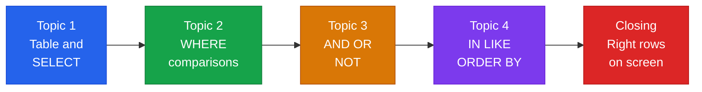
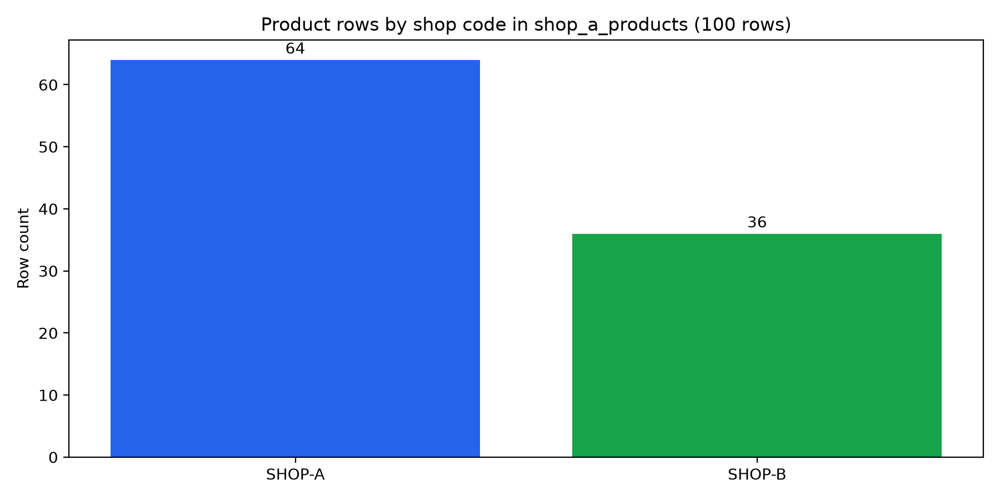
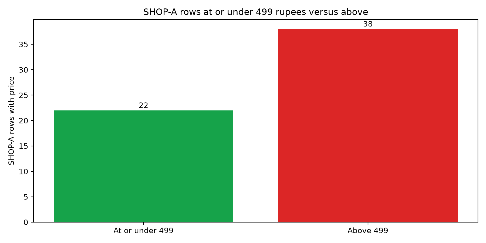
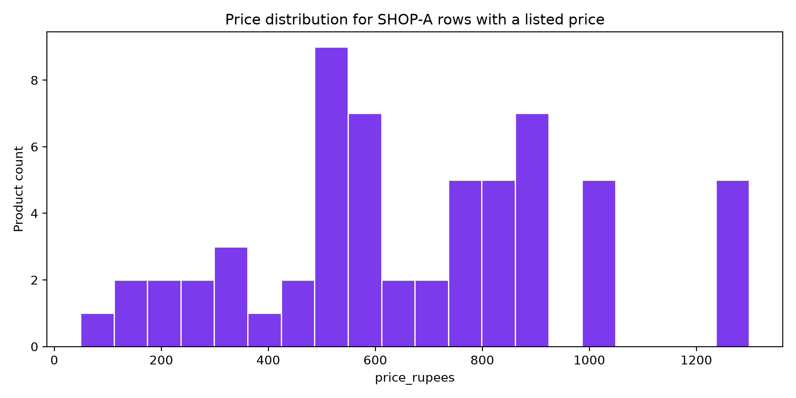
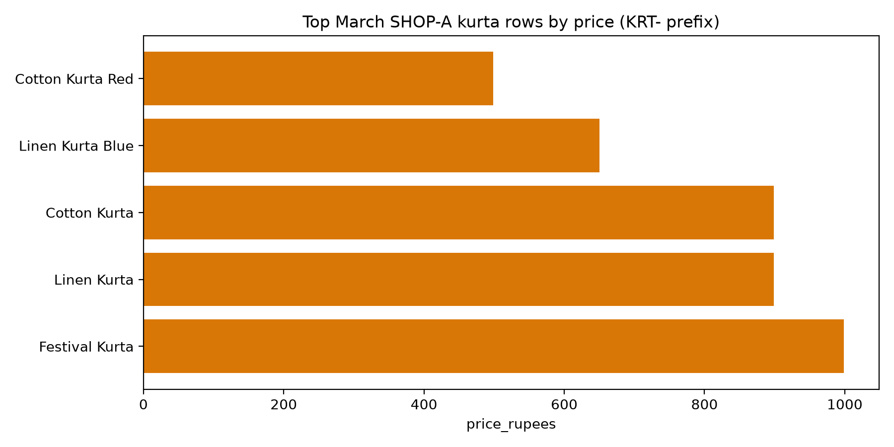
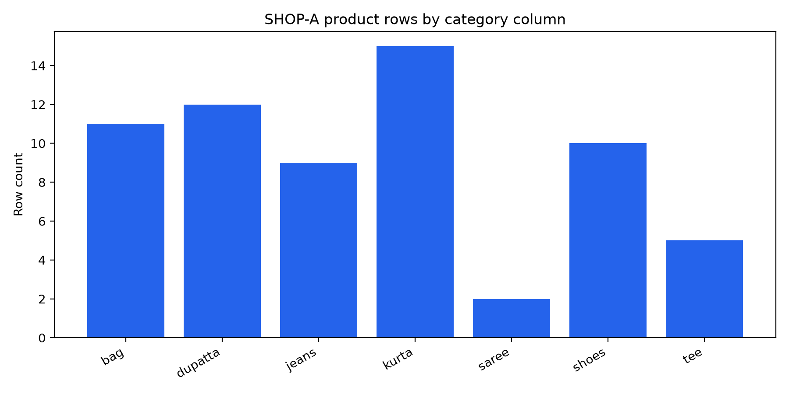
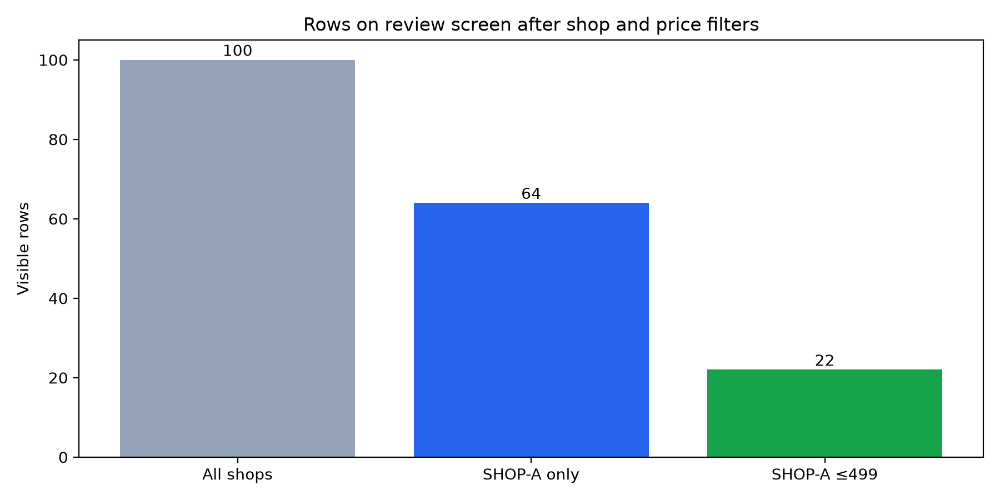

# <font color='#1d4ed8'>Lecture Script: Relational Databases and SELECT Queries</font>

---

## <font color='blue'>Agenda</font>

The lecture runs as four topics. Each topic ends with a quiz.

| Topic | What we do | Learning objectives covered | Minutes |
|:-:|:--|:--|:-:|
| 1 | Map the product table and pick columns | Describe how a relational database stores data as tables, rows and a defined schema<br>Write a SELECT query returning named columns from a single table | 28 |
| 2 | Cut rows with comparisons | Filter rows using comparison operators in a WHERE clause | 26 |
| 3 | Combine tests with brackets | Construct a multi-condition WHERE clause using AND, OR, NOT and parentheses | 32 |
| 4 | Patterns, ranges and sort order | Filter rows using IN, BETWEEN and LIKE pattern matching<br>Write a query that sorts results on multiple columns with mixed ASC and DESC | 24 |
| — | Closing: Outcome & Summary | | 10 |
| | **Total** | | **120** |

> <font color="red">**🎯 Instructor Note**</font> Pace: keep schema labels quick in Topic 1; spend time on parentheses in Topic 3 and on multi-column ORDER BY in Topic 4.
> Topic 2 stays comparison-only so NULL and the ₹499 cutoff are clear before AND and OR appear.

---

## <font color='blue'>Scenario</font>

| Before Monday's review | After a correct SQL filter |
|:--|:--|
| Seller A's desk scrolls all 100 product rows from every shop | The screen shows only **SHOP-A** rows with chosen columns |
| A festival price band (₹400–₹800) is checked by eye | **WHERE** drops prices outside the band in one run |
| March kurta codes are sorted in a separate sheet tab | **ORDER BY** category A→Z, then price high→low, on one result grid |

A **Myntra-style** fashion app hosts Seller A's **SHOP-A** storefront. The product grid is invented for teaching, with four blank prices on SHOP-A rows and listing dates in March and April 2025.

> <font color="red">**🎯 Instructor Note**</font> The app is only the setting; do not claim Myntra uses this data. Use **MySQL Workbench** (MySQL 8.0 or later) or **SQLite**; load `data/shop_a_products.sql` first.

---

## <font color='blue'>Problem Statement</font>

On Monday after a festival weekend, Seller A's analyst opened the full 100-row export in a spreadsheet. She filtered on price ≤ ₹499 but forgot to lock **shop_code** to **SHOP-A**. **SHOP-B** bargain rows filled the review tablet, four SHOP-A rows with blank prices were counted wrong, and March kurtas were not sorted for the manager. Seller A almost published the wrong shelf.

> <font color='purple'>**How do you ask the product table for Seller A rows and prices in order without copying the whole sheet?**</font>

> <font color="red">**🎯 Instructor Note**</font> Poll: "How many SHOP-A rows have a blank price: 2, 4, or 8?" Give learners 30 seconds to respond in chat. Reveal the answer in the Closing.

---

## <font color='blue'>What We Will Use</font>

The same Seller A grid from your file sessions now lives in one database table. You will run every query in **SQLite** or **MySQL Workbench**, not in Colab.

| Topic | Tools | In one line |
|:-:|:--|:--|
| 1 | `DESCRIBE`, `SELECT`, column list | Name the schema, then return only the columns the desk needs |
| 2 | `WHERE`, `=`, `<`, `<=`, `>`, `>=`, `IS NULL` | Keep rows that pass one comparison |
| 3 | `AND`, `OR`, `NOT`, `( )` | Combine several tests without changing row meaning |
| 4 | `IN`, `BETWEEN`, `LIKE`, `ORDER BY` | Match patterns and ranges, then sort on more than one column |

Load the table once: open `data/shop_a_products.sql` in your tool and execute it. The table holds 100 rows across **SHOP-A** and **SHOP-B**. When the script mentions "today's review" in chat, treat the review date as **15 March 2026**; listing dates in the data are in **2025**.

---

## <font color='blue'>How: Walking Through Seller A's Monday Review</font>



---

## <font color='blue'>Topic 1: Map the Product Table and Pick Columns</font> `28 min`

> <font color='purple'>**If the grid has 100 rows and seven named columns, how do we read the schema and return only title and price for Seller A?**</font>

Last session you read a CSV from disk into Python rows with the `csv` module. Before that you sorted lists and cleaned strings in Colab. Here the 100 product rows sit in one **table**: each **row** is one product, each **column** is one field, and the **schema** is the list of column names and types.

### <font color='green'>Example: count rows and read the schema</font>

> <font color='purple'>**How many products are in the table, and what columns exist?**</font>

**Predict before running: What will happen?**

> <font color="red">**🎯 Instructor Note**</font> Expect one number, 100, and seven column names. A common wrong guess is that each shop has its own table.

```sql
SELECT COUNT(*) AS row_count
FROM shop_a_products;
```

**Output**

```
row_count
---------
100
```

#### <font color='#c2410c'>Code Explanation</font>

- **Line 1** `COUNT(*)` counts every row in the table.
- **Line 2** `FROM shop_a_products` names the single table for this session.

```sql
DESCRIBE shop_a_products;
```

**Output**

```
Field          Type         Null  Key  Default  Extra
product_id     int          NO    PRI  NULL
product_code   varchar(20)  NO         NULL
title          varchar(80)  NO         NULL
price_rupees   int          YES        NULL
shop_code      varchar(10)  NO         NULL
category       varchar(20)  NO         NULL
listed_date    date         NO         NULL
```

#### <font color='#c2410c'>Code Explanation</font>

- **Line 1** `DESCRIBE` lists each column, its type, and whether NULL is allowed (MySQL Workbench).
- **SQLite users** run `PRAGMA table_info(shop_a_products);` for the same labels.

> <font color='green'>**Result**</font> One table holds 100 rows. **product_id** is the primary key; **price_rupees** may be NULL on four SHOP-A rows.

<p align="center"></p>

### <font color='green'>Example: return two columns for SHOP-A</font>

> <font color='purple'>**Which titles and prices appear for SHOP-A only?**</font>

**Predict before running: What will happen?**

> <font color="red">**🎯 Instructor Note**</font> Expect five SHOP-A rows, not the SHOP-B Cotton Top row (product_id 3).

```sql
SELECT title, price_rupees
FROM shop_a_products
WHERE shop_code = 'SHOP-A'
ORDER BY product_id
LIMIT 5;
```

**Output**

```
title                 price_rupees
--------------------  ------------
Cotton Kurta Red      499
Linen Kurta Blue      650
Festival Kurta Green  799
Silk Dupatta Gold     450
Canvas Backpack       1299
```

#### <font color='#c2410c'>Code Explanation</font>

- **Line 1** Lists only **title** and **price_rupees**, not all seven columns.
- **Lines 2–4** `WHERE` keeps **SHOP-A** rows; `ORDER BY product_id` fixes order; `LIMIT` shows five for the screen demo.

> <font color='green'>**Result**</font> **SELECT** returns a slim grid. **SHOP-B** rows stay out when **shop_code** is filtered.

### <font color='green'>Extending it: how many SHOP-A rows exist</font>

> <font color='purple'>**How many of the 100 rows belong to SHOP-A?**</font>

```sql
SELECT COUNT(*) AS shop_a_rows
FROM shop_a_products
WHERE shop_code = 'SHOP-A';
```

**Output**

```
shop_a_rows
-----------
64
```

> <font color='green'>**Result**</font> Seller A's shop has 64 rows in this export; the other 36 rows are **SHOP-B**.

> <font color='#b45309'>**Common mistake**</font> Selecting `*` when the desk only needs two columns hides the mistake until someone scrolls horizontally.

### <font color='purple'>Quiz 1</font>

**Question:** In `shop_a_products`, which column is the primary key that identifies one row?

**Options:**
- A) `shop_code`
- B) `product_code`
- C) `product_id`
- D) `listed_date`

**Correct Answer:** C

**Explanation:**
- **A)** Wrong — many rows share the same shop code.
- **B)** Wrong — product codes are unique in this data, but the schema marks the integer id as the key.
- **C)** Correct — `DESCRIBE` shows `PRI` on **product_id**.
- **D)** Wrong — many products can list on the same date.

---

## <font color='blue'>Topic 2: Cut Rows with Comparisons</font> `26 min`

> <font color='purple'>**The manager wants SHOP-A items at or under ₹499 for the festival review. How does WHERE apply that rule?**</font>

Comparisons work like Python: `=`, `<`, `<=`, `>`, `>=`. Text columns use quotes; numbers do not.

### <font color='green'>Example: price at or under ₹499</font>

> <font color='purple'>**Which SHOP-A rows have price_rupees ≤ 499?**</font>

**Predict before running: What will happen?**

> <font color="red">**🎯 Instructor Note**</font> Expect 22 priced rows. Rows with NULL price do not appear in a `<=` filter.

```sql
SELECT product_id, title, price_rupees
FROM shop_a_products
WHERE shop_code = 'SHOP-A'
  AND price_rupees <= 499
ORDER BY product_id;
```

**Output**

```
product_id  title               price_rupees
----------  ------------------  ------------
1           Cotton Kurta Red    499
5           Silk Dupatta Gold   450
12          Cotton Dupatta      49
15          Laptop Sling Bag    499
19          Polo T-Shirt        499
21          Men's Denim Jeans   399
22          Festival Kurta      499
24          Linen Kurta         249
25          Running Shoes       299
30          Silk Dupatta        299
33          Printed Kurti       499
37          Graphic Tee         499
38          Men's Denim Jeans   449
40          Cotton Dupatta      199
42          Running Shoes       149
46          Silk Saree          199
59          Cotton Dupatta      499
63          Festival Kurta      349
69          Linen Kurta         499
93          Canvas Backpack     499
97          Graphic Tee         149
99          Printed Kurti Gold  249
```

#### <font color='#c2410c'>Code Explanation</font>

- **Lines 3–4** Two tests: shop is **SHOP-A**, price is at most 499.
- **Line 5** `ORDER BY product_id` breaks ties in a stable order.

> <font color='green'>**Result**</font> Twenty-two priced rows qualify. The four NULL prices need a separate `IS NULL` check when blanks matter.

<p align="center"></p>

### <font color='green'>Extending it: count expensive SHOP-A rows</font>

> <font color='purple'>**How many SHOP-A rows cost more than ₹800?**</font>

```sql
SELECT COUNT(*) AS over_800
FROM shop_a_products
WHERE shop_code = 'SHOP-A'
  AND price_rupees > 800;
```

**Output**

```
over_800
--------
17
```

> <font color='green'>**Result**</font> Seventeen rows sit above ₹800, including high saree and bag prices.

<p align="center"></p>

> <font color='#b45309'>**Common mistake**</font> Treating a blank spreadsheet cell as zero — in SQL, NULL is unknown, so `<= 499` does not include it.

### <font color='purple'>Quiz 2</font>

**Question:** Which clause keeps only rows where `shop_code` equals `SHOP-A`?

**Options:**
- A) `HAVING shop_code = 'SHOP-A'`
- B) `WHERE shop_code = 'SHOP-A'`
- C) `ORDER BY shop_code = 'SHOP-A'`
- D) `SELECT shop_code = 'SHOP-A'`

**Correct Answer:** B

**Explanation:**
- **A)** Wrong — `HAVING` filters groups after aggregation, not taught here.
- **B)** Correct — `WHERE` filters rows before they are returned.
- **C)** Wrong — `ORDER BY` only sorts.
- **D)** Wrong — `SELECT` lists columns; it does not filter rows by itself.

---

## <font color='blue'>Topic 3: Combine Tests with Brackets</font> `32 min`

> <font color='purple'>**What breaks if AND and OR run in the wrong order without parentheses?**</font>

**AND** needs every test true. **OR** needs at least one true. **NOT** flips a test. Brackets fix the order, like in Python.

### <font color='green'>Example: festival band OR kurta in the title</font>

> <font color='purple'>**Which SHOP-A rows sit in ₹400–₹800 or mention Kurta, but are not shoes?**</font>

**Predict before running: What will happen?**

> <font color="red">**🎯 Instructor Note**</font> Ask learners to predict row 5 (₹450 dupatta) stays because 400–800 is true inside the bracket.

```sql
SELECT product_id, title, price_rupees
FROM shop_a_products
WHERE shop_code = 'SHOP-A'
  AND (price_rupees >= 400 AND price_rupees <= 800
       OR title LIKE '%Kurta%')
  AND NOT category = 'shoes'
ORDER BY product_id
LIMIT 8;
```

**Output**

```
product_id  title                 price_rupees
----------  --------------------  ------------
1           Cotton Kurta Red      499
2           Linen Kurta Blue      650
4           Festival Kurta Green  799
5           Silk Dupatta Gold     450
15          Laptop Sling Bag      499
17          Canvas Backpack       599
19          Polo T-Shirt          499
20          Silk Dupatta          749
```

#### <font color='#c2410c'>Code Explanation</font>

- **Lines 3–5** Brackets group price band **OR** title pattern before the next **AND**.
- **Line 6** `NOT category = 'shoes'` drops footwear even if the price matches.

> <font color='green'>**Result**</font> Dupatta row 5 stays because ₹450 is inside 400–800. Without brackets, **OR** could pull in wrong shops or categories.

### <font color='green'>Extending it: typo in a column name</font>

> <font color='purple'>**What happens if you misspell a column in SELECT?**</font>

```sql
SELECT titel, price_rupees
FROM shop_a_products
WHERE shop_code = 'SHOP-A'
LIMIT 1;
```

**Output**

```
ERROR 1054 (42S22): Unknown column 'titel' in 'field list'
```

#### <font color='#c2410c'>Code Explanation</font>

- **Line 1** The engine checks every name against the schema from Topic 1.

> <font color='green'>**Result**</font> The query stops with a clear column error — fix the spelling against `DESCRIBE`.

> <font color='#b45309'>**Common mistake**</font> Writing `price_rupees >= 400 OR price_rupees <= 800` without **AND** between bounds — that is true for almost every price.

### <font color='purple'>Quiz 3</font>

**Question:** You need SHOP-A rows where (price between 400 and 800) **or** title contains "Kurta". Which shape is correct?

**Options:**
- A) `WHERE shop_code = 'SHOP-A' AND (price_rupees BETWEEN 400 AND 800 OR title LIKE '%Kurta%')`
- B) `WHERE shop_code = 'SHOP-A' AND price_rupees BETWEEN 400 AND 800 OR title LIKE '%Kurta%'`
- C) `WHERE shop_code = 'SHOP-A' OR price_rupees BETWEEN 400 AND 800 AND title LIKE '%Kurta%'`
- D) `WHERE shop_code = 'SHOP-A' AND NOT (price_rupees BETWEEN 400 AND 800 OR title LIKE '%Kurta%')`

**Correct Answer:** A

**Explanation:**
- **A)** Correct — shop filter applies to the whole OR group inside brackets.
- **B)** Wrong — bare OR lets non-SHOP-A rows through when the title matches.
- **C)** Wrong — OR at the top splits the shop rule.
- **D)** Wrong — NOT inverts the whole band you wanted to keep.

---

## <font color='blue'>Topic 4: Patterns, Ranges and Sort Order</font> `24 min`

> <font color='purple'>**How do you keep March kurta codes and sort by category A→Z then price high→low?**</font>

### <font color='green'>Example: March kurta rows with KRT- prefix</font>

> <font color='purple'>**Which SHOP-A rows are kurtas listed in March 2025 with a KRT- product code?**</font>

**Predict before running: What will happen?**

> <font color="red">**🎯 Instructor Note**</font> Expect nine rows; row with April listed_date (id 4) drops out.

```sql
SELECT product_id, product_code, title, price_rupees
FROM shop_a_products
WHERE shop_code = 'SHOP-A'
  AND product_code LIKE 'KRT-%'
  AND listed_date BETWEEN '2025-03-01' AND '2025-03-31'
  AND category IN ('kurta')
ORDER BY product_id;
```

**Output**

```
product_id  product_code  title             price_rupees
----------  ------------  ----------------  ------------
1           KRT-0412-RD   Cotton Kurta Red  499
2           KRT-0891-BL   Linen Kurta Blue  650
24          KRT-0575-BL   Linen Kurta       249
31          KRT-4017-WH   Linen Kurta       899
63          KRT-0973-WH   Festival Kurta    349
75          KRT-4531-GN   Festival Kurta    749
90          KRT-2933-WH   Cotton Kurta      899
91          KRT-0404-BK   Festival Kurta    999
98          KRT-1406-WH   Linen Kurta       749
```

#### <font color='#c2410c'>Code Explanation</font>

- **Line 4** `LIKE 'KRT-%'` matches codes starting with **KRT-**.
- **Line 5** `BETWEEN` includes both March end dates.
- **Line 6** `IN` lists allowed categories in one test.

> <font color='green'>**Result**</font> Nine March kurta rows remain. April festival kurta (id 4) is excluded by the date range.

<p align="center"></p>

### <font color='green'>Extending it: sort category then price</font>

> <font color='purple'>**How should March SHOP-A rows appear on the manager tablet?**</font>

```sql
SELECT product_id, category, title, price_rupees
FROM shop_a_products
WHERE shop_code = 'SHOP-A'
  AND listed_date BETWEEN '2025-03-01' AND '2025-03-31'
ORDER BY category ASC, price_rupees DESC, product_id
LIMIT 10;
```

**Output**

```
product_id  category  title             price_rupees
----------  --------  ----------------  ------------
7           bag       Canvas Backpack   1299
56          bag       Canvas Backpack   999
43          bag       Canvas Backpack   599
54          bag       Laptop Sling Bag  599
15          bag       Laptop Sling Bag  499
28          bag       Canvas Backpack
89          dupatta   Cotton Dupatta    1299
20          dupatta   Silk Dupatta      749
84          dupatta   Cotton Dupatta    699
95          dupatta   Cotton Dupatta    549
```

#### <font color='#c2410c'>Code Explanation</font>

- **Line 5** Sorts **category** A→Z, then **price_rupees** high→low, then **product_id** for ties.
- **NULL** prices sort first or last depending on the engine; row 28 shows a blank price in the grid.

> <font color='green'>**Result**</font> Bags appear before dupattas alphabetically; within bags, ₹1299 is on top.

<p align="center"></p>

### <font color='purple'>Quiz 4</font>

**Question:** Sort SHOP-A March rows by category A→Z, then highest price first. Which ORDER BY is right?

**Options:**
- A) `ORDER BY category ASC, price_rupees DESC, product_id`
- B) `ORDER BY price_rupees DESC, category ASC`
- C) `ORDER BY category DESC, price_rupees ASC`
- D) `ORDER BY product_id, category, price_rupees`

**Correct Answer:** A

**Explanation:**
- **A)** Correct — category ascending, then price descending, with a tie-breaker id.
- **B)** Wrong — price first ignores the category A→Z rule.
- **C)** Wrong — category DESC is Z→A; price ASC is low→high.
- **D)** Wrong — product id order ignores category and price goals.

---

## <font color='blue'>Closing: Outcome & Summary</font> `10 min`

The analyst needed one review screen: **SHOP-A** only, March **KRT-** kurtas, sorted for the manager. Each topic added one piece.

> <font color='purple'>**1. Where do 100 products live, and which columns did we show first?**</font>

One table **shop_a_products** with seven columns; **SELECT title, price_rupees** slimmed the grid for Seller A.

> <font color='purple'>**2. How many priced rows sit at or under ₹499 on SHOP-A?**</font>

Twenty-two rows with **price_rupees <= 499**; NULL prices need **`IS NULL`** when blanks must be listed separately.

> <font color='purple'>**3. Why did parentheses matter for the festival band?**</font>

**AND (band OR title)** kept dupatta row 5 at ₹450 while still requiring **SHOP-A**.

> <font color='purple'>**4. What runs for Monday's kurta shelf?**</font>

```sql
SELECT title, price_rupees, listed_date
FROM shop_a_products
WHERE shop_code = 'SHOP-A'
  AND product_code LIKE 'KRT-%'
  AND listed_date BETWEEN '2025-03-01' AND '2025-03-31'
ORDER BY price_rupees DESC, product_id
LIMIT 5;
```

**Output**

```
title           price_rupees  listed_date
--------------  ------------  -----------
Festival Kurta  999           2025-03-04
Linen Kurta     899           2025-03-29
Cotton Kurta    899           2025-03-21
Festival Kurta  749           2025-03-25
Linen Kurta     749           2025-03-16
```

#### <font color='#c2410c'>Code Explanation</font>

- **Lines 3–5** Same filters as Topic 4; **ORDER BY price_rupees DESC** puts the top festival kurta first (Topic 4 sort rules).

<p align="center"></p>

### <font color='green'>Outcome</font>

| | Spreadsheet mistake | SQL review screen |
|:--|:-:|:-:|
| Rows visible to Seller A | 100 (all shops) | 64 SHOP-A rows when filtered |
| March KRT- kurta rows | miscounted | 9 rows with one query |
| SHOP-A rows at or under ₹499 | included SHOP-B deals | 22 priced rows |

> <font color='green'>**Therefore,**</font> Seller A can publish from one filtered, sorted grid instead of a fragile copy of the sheet — **SHOP-A**, price band, code pattern and sort order are all explicit.

> <font color="red">**🎯 Instructor Note**</font> Poll answer: **4** SHOP-A rows have a blank **price_rupees** (ids 28, 41, 67, 88). Point to the NULL row in the Topic 4 sort output.

### <font color='green'>Summary</font>

| Learning objective | Takeaway |
|:--|:--|
| Describe how a relational database stores data as tables, rows and a defined schema | One table, many rows, named columns with types |
| Write a SELECT query returning named columns from a single table | List only the columns the desk needs |
| Filter rows using comparison operators in a WHERE clause | Comparisons cut rows; NULL needs its own test |
| Construct a multi-condition WHERE clause using AND, OR, NOT and parentheses | Brackets keep OR from breaking the shop filter |
| Filter rows using IN, BETWEEN and LIKE pattern matching | Patterns and date ranges replace hand-sorting codes |
| Write a query that sorts results on multiple columns with mixed ASC and DESC | **ORDER BY** category then price matches the manager view |
| **Practical value** | The same ask works on any product export once it lives in a table — no more scrolling 100 rows by eye |

---

# <font color='red'>Launch the Feedback Poll</font>

> <font color="red">**🎯 Instructor Note**</font> Reminder: launch the feedback poll now to collect learner feedback.