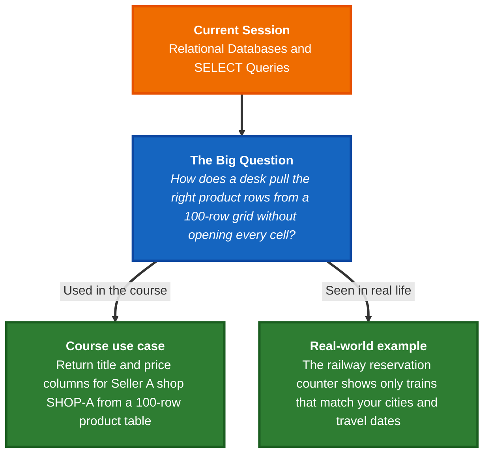

## Relational Databases and SELECT Queries

### Mental Map

---

### What You'll Learn

Have you ever wondered how Seller A’s desk shows kurtas under ₹600 from a 100-row sheet?

By the end of this session, you will be able to:

- **Identify** table, row, and column roles in Seller A’s SHOP-A grid.
- **Describe** how schema labels name each field in `seller_product_codes.csv`.
- **Apply** a ₹499 price cutoff on SHOP-A rows for the review screen.
- **Use** AND and OR with brackets for kurtas priced ₹400 to ₹800.
- **Check** a KRT- code pattern and a March listed date on one run.
- **Plan** a sort with category A to Z and price high to low together.

> **Topics you will meet:** Tables rows and schema; SELECT; WHERE; AND OR and NOT.
>
> IN LIKE and date range (BETWEEN); ORDER BY.
>
> Join the session to learn each of these in detail.

---

### Why You Are Learning This Topic

Seller A opens Monday’s 100-row export after a festival weekend.

You need titles and prices for SHOP-A only.

Blank prices appear on four rows. Codes like KRT-0412-RD need pattern checks.

The manager wants March listings first, then top price per category.

A **relational database** means data stored in tables with named columns and one row per record.

In this course you will ask that table for named columns instead of scrolling by hand.

> **Think about it:** What breaks if you hide the wrong rows when two filters disagree?

---

### The Seller A Stock Desk Puzzle

Five sample rows sit on Seller A’s desk screen.

| product_code | title | price_rupees | shop_code | listed_date |
|:------------:|:------|:------------:|:---------:|:-----------:|
| KRT-0412-RD | Cotton Kurta Red | 499 | SHOP-A | 2025-03-08 |
| KRT-0891-BL | Linen Kurta Blue | 650 | SHOP-A | 2025-03-15 |
| TOP-2201-WH | Cotton Top White | 299 | SHOP-B | 2025-02-20 |
| KRT-1104-GR | Festival Kurta Green | 799 | SHOP-A | 2025-04-02 |
| DUP-3300-GL | Silk Dupatta Gold | 450 | SHOP-A | 2025-03-22 |

**What you want to happen:**

- Show only `title` and `price_rupees` for SHOP-A.
- Keep March 2025 kurtas priced ₹400 to ₹800.
- Sort those rows by falling price, then product code.

> **Wonder about this:**
>
> - How would you hide TOP-2201-WH while keeping SHOP-A rows?
> - Why might KRT-1104-GR vanish under a March date rule?

---

### Think It Through

There is no wrong first try. Keep your guesses for the session.

**1. Which two columns would you show if the cashier needs names and prices only?**
Hint: Picture the narrow strip on the review tablet.

**2. Which rows stay when you demand shop code SHOP-A and a kurta title?**
Hint: Read each title, not only the code prefix.

**3. How would you line up March SHOP-A kurtas with the highest price on top?**
Hint: Lock the date window first, then flip price order.

---

### One Question to Carry Into the Session

> **How do you ask a product table for Seller A rows in order without copying the sheet?**
>
> Which single filter would you try first on the five-row sample above?

---

### Set Up Before the Session

> **Do this before the session starts.** You will run queries in a desktop database tool, not in Colab. SQLite or MySQL Workbench (not Colab).