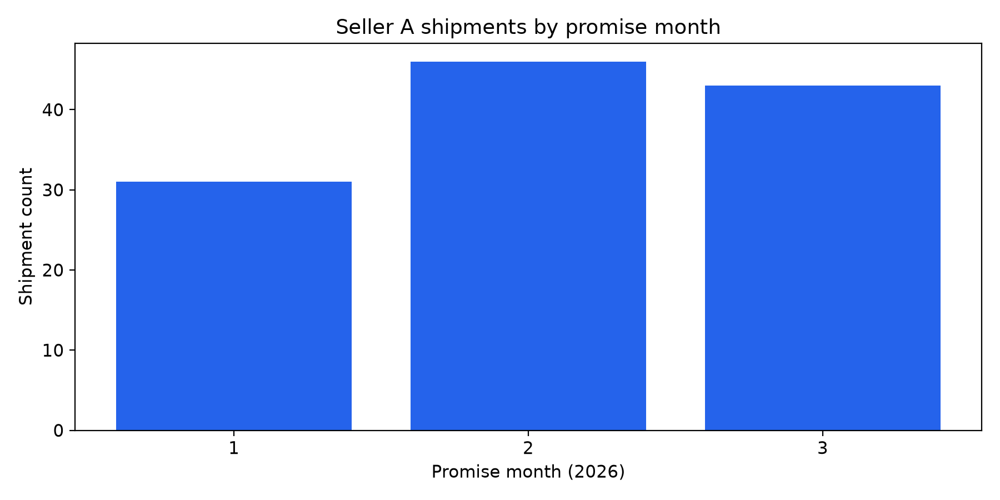
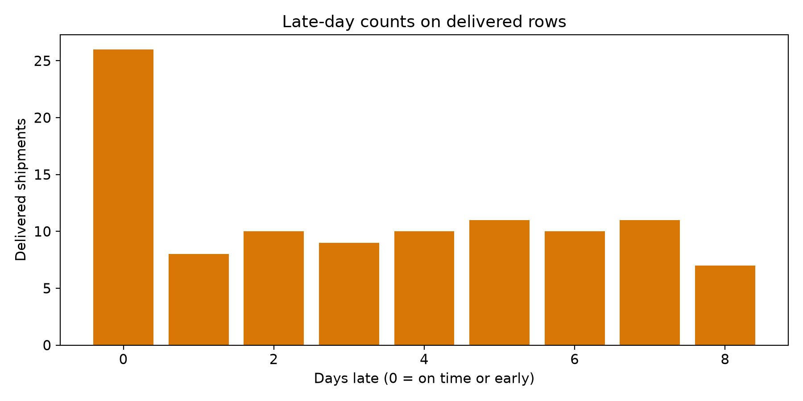
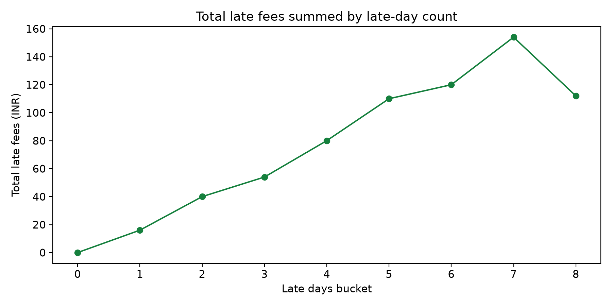
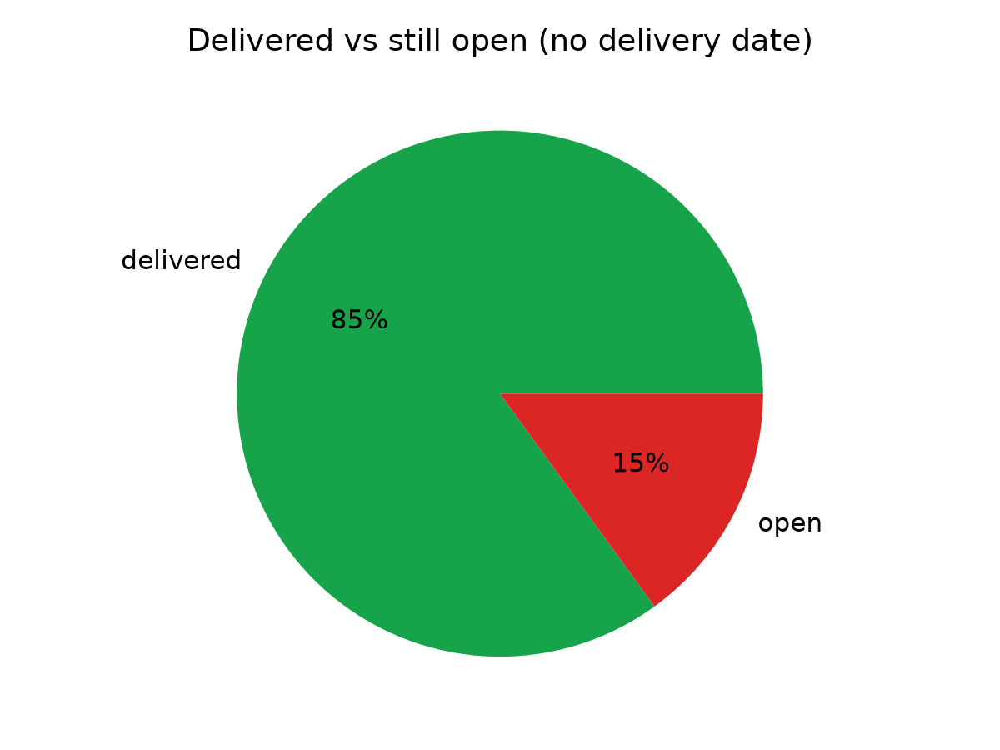
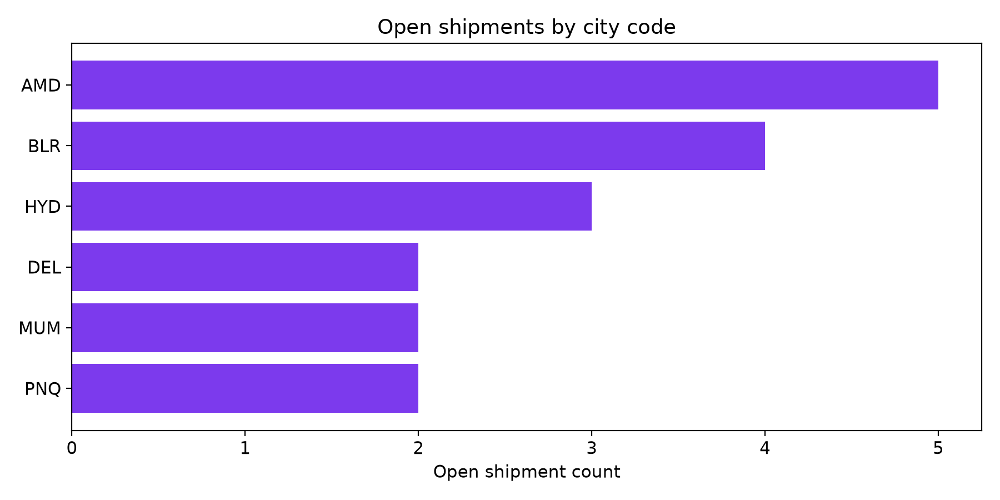
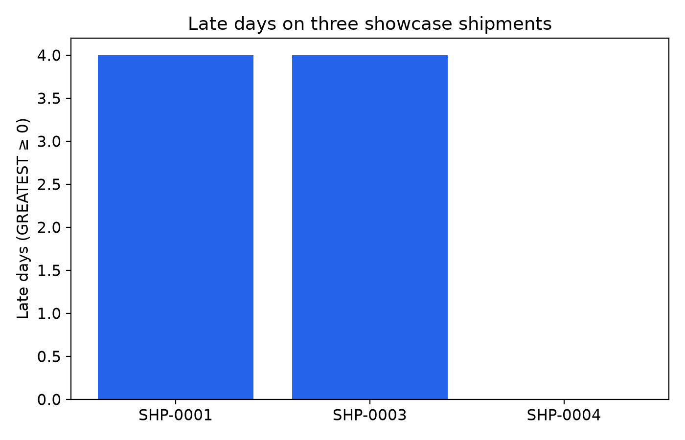

# <font color='#1d4ed8'>Lecture Script: Text, Dates and Calculated Columns</font>

---

## <font color='blue'>Agenda</font>

The lecture runs as four topics. Each topic ends with a quiz.

| Topic | What we do | Learning objectives covered | Minutes |
|:-:|:--|:--|:-:|
| 1 | Clean and combine buyer text | Apply string functions to clean and combine text columns | 30 |
| 2 | Split promise dates and count days | Extract year, month and day parts from a date column<br>Compute the interval between two date columns | 32 |
| 3 | Build handling and late fees | Compute a derived column from arithmetic on existing columns<br>Format numeric output using ROUND and an explicit type cast | 28 |
| 4 | Separate open and delivered rows | Filter rows on missing values using IS NULL and IS NOT NULL | 20 |
| — | Closing: Outcome & Summary | | 10 |
| | **Total** | | **120** |

> <font color="red">**🎯 Instructor Note**</font> Pace: keep TRIM and CONCAT brisk in Topic 1; spend time on signed **DATEDIFF** in Topic 2 and on **GREATEST** with **ROUND** and **CAST** in Topic 3.
> Topic 4 stays short so **IS NULL** is clear before the Closing ties every column together.

---

## <font color='blue'>Scenario</font>

| Manual grocery desk | One SQL report |
|:--|:--|
| Seller A's agent copies 120 shipment rows into a sheet | **SELECT** returns the same 120 rows from one table |
| Buyer names are retyped with leftover spaces | **TRIM** and **CONCAT** build one clean label per row |
| Promise dates are counted by hand for late fees | **YEAR**, **MONTH**, **DAY**, and **DATEDIFF** run in the grid |
| Open orders are hunted by scrolling blanks | **IS NULL** lists rows with no **delivered_date** |

A **JioMart-style** grocery delivery desk serves Seller A's **SHOP-A** orders. The shipment grid is invented for teaching, with messy buyer text, promise and delivery dates, and blank delivery fields on orders still on the road.

> <font color="red">**🎯 Instructor Note**</font> JioMart is only the setting; do not claim it uses this data. Use **MySQL Workbench** with **MySQL 8.0** or later; load `data/seller_a_shipments.sql` first. Treat **today** in chat as **15 March 2026**.

---

## <font color='blue'>Problem Statement</font>

On Friday morning Seller A's ops lead opened the week-end shipment export. She copied buyer names into the fine sheet by hand, so **ananya rao** printed with edge spaces and the city code sat in the wrong column. She counted late days between promise and delivery in a calculator for **SHP-0003** and typed ₹8, but early delivery on **SHP-0004** almost became a negative fine. Eighteen orders still had no delivery stamp, yet they were mixed into the paid list. Seller A nearly called the wrong buyers before the lunch wave.

> <font color='purple'>**How do you build one report line with a tidy name, a day count, and a fine from raw columns—without copying the sheet?**</font>

> <font color="red">**🎯 Instructor Note**</font> Poll: "Would you trust manual desk copy or one query for the fine sheet?" Give learners 30 seconds to respond in chat. Reveal the delivery count in the Closing.

---

## <font color='blue'>What We Will Use</font>

Last session you filtered Seller A product rows with **SELECT** and **WHERE**. The same pattern returns shipment rows; each new column in the result is a **calculated column** built from other fields on that row.

| Topic | Tools | In one line |
|:-:|:--|:--|
| 1 | `TRIM`, `UPPER`, `CONCAT`, column aliases | Strip spaces, change case, join text with a separator |
| 2 | `YEAR`, `MONTH`, `DAY`, `DATEDIFF` | Read date parts and count days from delivery minus promise |
| 3 | `*`, `GREATEST`, `ROUND`, `CAST(… AS DECIMAL)` | Multiply units for handling; cap late days; show two decimals |
| 4 | `IS NULL`, `IS NOT NULL`, `COUNT` | Keep rows with blank delivery dates; count rows that have a date |

Load the table once: open `data/seller_a_shipments.sql` in Workbench and execute it. The table holds **120** rows for **SHOP-A**, with **late_fee_per_day** fixed at ₹2.00 on every row.

---

## <font color='blue'>How: Walking Through Seller A's Delivery Desk</font>


---

## <font color='blue'>Topic 1: Clean and Combine Buyer Text</font> `30 min`

> <font color='purple'>**The fine sheet needs one readable buyer line per shipment. How do we fix stored text without retyping 120 rows?**</font>

**Calculated columns** appear in the **SELECT** list. They do not change the table on disk—they only shape what the report shows.

### <font color='green'>Example: trim spaces and append the city code</font>

> <font color='purple'>**What does row SHP-0001 look like after trim and concat?**</font>

**Predict before running: What will happen?**

> <font color="red">**🎯 Instructor Note**</font> Expect edge spaces gone on **buyer_trimmed** and a middle dot before **PNQ**. A common wrong guess is that **TRIM** changes the stored **buyer_name_raw** in the table.

```sql
SELECT shipment_id, buyer_name_raw,
  TRIM(buyer_name_raw) AS buyer_trimmed,
  CONCAT(TRIM(buyer_name_raw), ' · ', city_code) AS buyer_label
FROM seller_a_shipments
WHERE shipment_id = 'SHP-0001';
```

**Output**

```
+-------------+----------------+---------------+-------------------+
| shipment_id | buyer_name_raw | buyer_trimmed | buyer_label       |
+-------------+----------------+---------------+-------------------+
| SHP-0001    |   ananya rao   | ananya rao    | ananya rao · PNQ  |
+-------------+----------------+---------------+-------------------+
```

#### <font color='#c2410c'>Code Explanation</font>

- **Line 2** `TRIM` removes leading and trailing spaces from the raw name.
- **Line 3** `CONCAT` joins the trimmed name, a separator, and **city_code** into **buyer_label**.
- **Lines 4–5** `WHERE` keeps one row so the screen matches the desk card.

> <font color='green'>**Result**</font> One query prints a desk-ready label. The messy stored text stays in **buyer_name_raw** for audit; the report column is new.

### <font color='green'>Extending it: same cleanup in uppercase</font>

> <font color='purple'>**How do two buyer rows look when names are trimmed and forced to capitals?**</font>

> <font color="red">**🎯 Instructor Note**</font> Ask for a prediction on **SHP-0002**—it already has capitals, so **UPPER** does not change meaning, only letter size.

```sql
SELECT shipment_id, buyer_name_raw,
  UPPER(TRIM(buyer_name_raw)) AS buyer_upper
FROM seller_a_shipments
WHERE shipment_id IN ('SHP-0001', 'SHP-0002');
```

**Output**

```
+-------------+----------------+-------------+
| shipment_id | buyer_name_raw | buyer_upper |
+-------------+----------------+-------------+
| SHP-0001    |   ananya rao   | ANANYA RAO  |
| SHP-0002    | PRIYA DAS      | PRIYA DAS   |
+-------------+----------------+-------------+
```

> <font color='green'>**Result**</font> **UPPER(TRIM(…))** chains two string steps in one calculated column—order matters: trim first, then case.

> <font color='#b45309'>**Common mistake**</font> Using `+` to join strings—MySQL expects **CONCAT** for text columns.

### <font color='purple'>Quiz 1</font>

**Question:** Which expression builds a desk label with trimmed name and city code **PNQ**?

**Options:**
- A) `TRIM(buyer_name_raw) + ' · ' + city_code`
- B) `CONCAT(TRIM(buyer_name_raw), ' · ', city_code)`
- C) `UPPER(buyer_name_raw)`
- D) `TRIM(CONCAT(buyer_name_raw, city_code))`

**Correct Answer:** B

**Explanation:**
- **A)** Wrong — `+` does not join text in MySQL the way learners expect.
- **B)** Correct — **TRIM** then **CONCAT** with the separator and **city_code**.
- **C)** Wrong — case change alone does not add the city.
- **D)** Wrong — trimming after concat would not insert the middle dot between name and city.

---

## <font color='blue'>Topic 2: Split Promise Dates and Count Days</font> `32 min`

> <font color='purple'>**The desk sorts fines by promise month and counts late days per row. How do we read a date apart and compare it to delivery?**</font>

### <font color='green'>Example: year, month, and day on the promise date</font>

> <font color='purple'>**Which parts does SHP-0004 show for promised_date 2026-03-01?**</font>

**Predict before running: What will happen?**

> <font color="red">**🎯 Instructor Note**</font> Expect **p_month** = 3, not 03 as text—the column is numeric.

```sql
SELECT shipment_id, promised_date,
  YEAR(promised_date) AS p_year,
  MONTH(promised_date) AS p_month,
  DAY(promised_date) AS p_day
FROM seller_a_shipments
WHERE shipment_id = 'SHP-0004';
```

**Output**

```
+-------------+---------------+--------+---------+-------+
| shipment_id | promised_date | p_year | p_month | p_day |
+-------------+---------------+--------+---------+-------+
| SHP-0004    | 2026-03-01    |   2026 |       3 |     1 |
+-------------+---------------+--------+---------+-------+
```

#### <font color='#c2410c'>Code Explanation</font>

- **Lines 2–4** `YEAR`, `MONTH`, and `DAY` each return one integer part of **promised_date**.
- **Line 6** One shipment keeps the date anatomy visible on screen.

> <font color='green'>**Result**</font> March promise month is **3** on the calendar part—no manual splitting in a spreadsheet.

<p align="center"></p>

### <font color='green'>Extending it: signed days between promise and delivery</font>

> <font color='purple'>**How many calendar days sit between delivery and promise on SHP-0003 and SHP-0004?**</font>

**Predict before running: What will happen?**

> <font color="red">**🎯 Instructor Note**</font> Expect **4** for SHP-0003 and **-1** for SHP-0004—delivery before promise goes negative.

```sql
SELECT shipment_id, promised_date, delivered_date,
  DATEDIFF(delivered_date, promised_date) AS days_vs_promise
FROM seller_a_shipments
WHERE shipment_id IN ('SHP-0003', 'SHP-0004');
```

**Output**

```
+-------------+---------------+----------------+-----------------+
| shipment_id | promised_date | delivered_date | days_vs_promise |
+-------------+---------------+----------------+-----------------+
| SHP-0003    | 2026-02-08    | 2026-02-12     |               4 |
| SHP-0004    | 2026-03-01    | 2026-02-28     |              -1 |
+-------------+---------------+----------------+-----------------+
```

#### <font color='#c2410c'>Code Explanation</font>

- **Line 2** `DATEDIFF(later_date, earlier_anchor)` counts days from **promised_date** toward **delivered_date**.
- **Line 4** Two ids show both late and early delivery in one grid.

> <font color='green'>**Result**</font> Positive **days_vs_promise** means delivery after the promise; negative means the truck arrived early.

<p align="center"></p>

> <font color='#b45309'>**Common mistake**</font> Swapping date order in **DATEDIFF** flips the sign—always match delivery minus promise when "late" should be positive.

### <font color='purple'>Quiz 2</font>

**Question:** **SHP-0004** has **delivered_date** 2026-02-28 and **promised_date** 2026-03-01. What is `DATEDIFF(delivered_date, promised_date)`?

**Options:**
- A) `0`
- B) `1`
- C) `2`
- D) `-1`

**Correct Answer:** D

**Explanation:**
- **A)** Wrong — delivery is not on the promise day.
- **B)** Wrong — the gap is not positive one day late.
- **C)** Wrong — the magnitude is one day, not two.
- **D)** Correct — delivery is one calendar day before promise, so the difference is **-1**.

---

## <font color='blue'>Topic 3: Build Handling and Late Fees</font> `28 min`

> <font color='purple'>**After text and dates, how do we turn units and day counts into rupee columns the manager can total?**</font>

### <font color='green'>Example: handling fee from units</font>

> <font color='purple'>**What handling amount does SHP-0003 earn from four units at ₹15 each?**</font>

**Predict before running: What will happen?**

> <font color="red">**🎯 Instructor Note**</font> Expect **60**—arithmetic on **units** only, no dates yet.

```sql
SELECT shipment_id, units,
  units * 15 AS handling_inr
FROM seller_a_shipments
WHERE shipment_id = 'SHP-0003';
```

**Output**

```
+-------------+-------+--------------+
| shipment_id | units | handling_inr |
+-------------+-------+--------------+
| SHP-0003    |     4 |           60 |
+-------------+-------+--------------+
```

#### <font color='#c2410c'>Code Explanation</font>

- **Line 2** `units * 15` multiplies two numbers on the same row—a simple derived column.

> <font color='green'>**Result**</font> Handling is **60** rupees for four units without a separate calculator column.

### <font color='green'>Extending it: late fee with cap, round, and cast</font>

> <font color='purple'>**How do ROUND and CAST show ₹8.00 for four late days at ₹2 per day?**</font>

$$\boxed{ \text{late\_fee} = \mathrm{GREATEST}(\mathrm{DATEDIFF}(\text{delivered}, \text{promised}), 0) \times \text{late\_fee\_per\_day} }$$

**Predict before running: What will happen?**

> <font color="red">**🎯 Instructor Note**</font> Expect **fee_round** and **fee_cast** both **8.00**—**GREATEST** drops negative gaps to zero before multiply.

```sql
SELECT shipment_id,
  GREATEST(DATEDIFF(delivered_date, promised_date), 0) AS late_days,
  ROUND(GREATEST(DATEDIFF(delivered_date, promised_date), 0)
    * late_fee_per_day, 2) AS fee_round,
  CAST(ROUND(GREATEST(DATEDIFF(delivered_date, promised_date), 0)
    * late_fee_per_day, 2) AS DECIMAL(6,2)) AS fee_cast
FROM seller_a_shipments
WHERE shipment_id = 'SHP-0003';
```

**Output**

```
+-------------+-----------+-----------+----------+
| shipment_id | late_days | fee_round | fee_cast |
+-------------+-----------+-----------+----------+
| SHP-0003    |         4 |      8.00 |     8.00 |
+-------------+-----------+-----------+----------+
```

#### <font color='#c2410c'>Code Explanation</font>

- **Line 2** `GREATEST(..., 0)` counts only late days, not early delivery.
- **Lines 3–4** `ROUND(..., 2)` keeps two decimals; **CAST AS DECIMAL(6,2)** fixes the display type for the slip.

> <font color='green'>**Result**</font> Four capped late days times ₹2.00 prints as **8.00** in both fee columns.

<p align="center"></p>

> <font color='#b45309'>**Common mistake**</font> Multiplying raw **DATEDIFF** on early rows would invent negative fees—always cap with **GREATEST** before multiply.

### <font color='purple'>Quiz 3</font>

**Question:** Which expression charges a late fee only when delivery is on or after the promise date?

**Options:**
- A) `GREATEST(DATEDIFF(delivered_date, promised_date), 0) * late_fee_per_day`
- B) `DATEDIFF(delivered_date, promised_date) * late_fee_per_day`
- C) `units * late_fee_per_day`
- D) `ROUND(units, 2)`

**Correct Answer:** A

**Explanation:**
- **A)** Correct — **GREATEST** with zero blocks negative day gaps.
- **B)** Wrong — early delivery yields a negative product.
- **C)** Wrong — units do not measure days late.
- **D)** Wrong — **ROUND** on units does not build a day-based fee.

---

## <font color='blue'>Topic 4: Separate Open and Delivered Rows</font> `20 min`

> <font color='purple'>**Which shipments still need a truck update, and how many are already closed?**</font>

### <font color='green'>Example: list open shipments</font>

> <font color='purple'>**Which promise dates belong to the first six rows with no delivery stamp?**</font>

**Predict before running: What will happen?**

> <font color="red">**🎯 Instructor Note**</font> Expect **SHP-0002** first in id order—not the same as latest promise date.

```sql
SELECT shipment_id, promised_date
FROM seller_a_shipments
WHERE delivered_date IS NULL
ORDER BY shipment_id
LIMIT 6;
```

**Output**

```
+-------------+---------------+
| shipment_id | promised_date |
+-------------+---------------+
| SHP-0002    | 2026-02-10    |
| SHP-0008    | 2026-01-11    |
| SHP-0022    | 2026-03-17    |
| SHP-0034    | 2026-03-09    |
| SHP-0036    | 2026-03-03    |
| SHP-0047    | 2026-03-27    |
+-------------+---------------+
```

#### <font color='#c2410c'>Code Explanation</font>

- **Line 3** `delivered_date IS NULL` keeps rows where the delivery field is missing—never `= NULL`.
- **Lines 4–5** Sort by id for a stable desk list; **LIMIT** shows six for the screen.

> <font color='green'>**Result**</font> Six open cards appear with promise dates only—no fake delivery day typed in.

<p align="center"></p>

### <font color='green'>Extending it: count delivered rows</font>

> <font color='purple'>**How many of the 120 shipments already have a delivery date?**</font>

```sql
SELECT COUNT(*) AS delivered_count
FROM seller_a_shipments
WHERE delivered_date IS NOT NULL;
```

**Output**

```
delivered_count
---------------
            102
```

> <font color='green'>**Result**</font> **102** rows are closed; the other **18** stay open when delivery is **IS NULL**.

<p align="center"></p>

> <font color='#b45309'>**Common mistake**</font> Writing `delivered_date = NULL`—in SQL, unknown is tested only with **IS NULL** or **IS NOT NULL**.

### <font color='purple'>Quiz 4</font>

**Question:** How do you count rows that already have a delivery date filled in?

**Options:**
- A) `WHERE delivered_date = NULL`
- B) `WHERE delivered_date IS NULL`
- C) `SELECT COUNT(*) FROM seller_a_shipments WHERE delivered_date IS NOT NULL`
- D) `WHERE delivered_date <> ''`

**Correct Answer:** C

**Explanation:**
- **A)** Wrong — `= NULL` is never true in SQL.
- **B)** Wrong — that filter keeps open rows, not delivered ones.
- **C)** Correct — **COUNT(\*)** with **WHERE delivered_date IS NOT NULL** totals closed shipments.
- **D)** Wrong — delivery is a **DATE** column, not an empty string test.

---

## <font color='blue'>Closing: Outcome & Summary</font> `10 min`

The ops lead needed one fine sheet: tidy buyer line, promise month, capped late days, and fee in rupees—plus a separate open list. Each topic added one calculated piece.

> <font color='purple'>**1. How does Topic 1 stop hand-copying buyer names?**</font>

**TRIM** and **CONCAT** build **buyer_label** in the **SELECT** list; stored **buyer_name_raw** stays unchanged for audit.

> <font color='purple'>**2. What did Topics 2 and 3 add before money columns?**</font>

**MONTH(promised_date)** buckets the promise month; **GREATEST(DATEDIFF(...), 0)** turns signed gaps into non-negative late days before **ROUND** and **CAST**.

> <font color='purple'>**3. What does one combined query print for three showcase shipments?**</font>

```sql
SELECT shipment_id,
  CONCAT(TRIM(buyer_name_raw), ' · ', city_code) AS buyer_label,
  MONTH(promised_date) AS due_month,
  GREATEST(DATEDIFF(delivered_date, promised_date), 0) AS late_days,
  CAST(ROUND(GREATEST(DATEDIFF(delivered_date, promised_date), 0)
    * late_fee_per_day, 2) AS DECIMAL(6,2)) AS late_fee_inr
FROM seller_a_shipments
WHERE shipment_id IN ('SHP-0001', 'SHP-0003', 'SHP-0004');
```

**Output**

```
+-------------+----------------------+-----------+-----------+--------------+
| shipment_id | buyer_label          | due_month | late_days | late_fee_inr |
+-------------+----------------------+-----------+-----------+--------------+
| SHP-0001    | ananya rao · PNQ     |         2 |         4 |         8.00 |
| SHP-0003    | karthik menon · MUM  |         2 |         4 |         8.00 |
| SHP-0004    | Meera Iyer · DEL     |         3 |         0 |         0.00 |
+-------------+----------------------+-----------+-----------+--------------+
```

#### <font color='#c2410c'>Code Explanation</font>

- **Line 2** Topic 1 label—trimmed name and city in one column.
- **Lines 3–6** Topic 2 month and capped days (Topic 3 fee math with **ROUND** and **CAST**).

<p align="center"></p>

### <font color='green'>Outcome</font>

| | Manual desk copy | One SQL report |
|:--|:-:|:-:|
| Buyer labels with spaces fixed | Retype and hope | **TRIM** + **CONCAT** on 120 rows |
| Late days for SHP-0003 / SHP-0004 | Calculator risk | **4** and capped **0** in the grid |
| Rows still on the road | Mixed into paid list | **18** open vs **102** delivered |

> <font color='green'>**Therefore,**</font> Seller A can run one showcase query for fines and a second with **IS NULL** for open cards—no fragile copy of the full export.

> <font color="red">**🎯 Instructor Note**</font> Poll tie-in: one query wins on speed and sign safety; point to **delivered_count** **102** and the six-row open sample from Topic 4.

### <font color='green'>Summary</font>

| Learning objective | Takeaway |
|:--|:--|
| Apply string functions to clean and combine text columns | **TRIM**, **UPPER**, and **CONCAT** shape labels in **SELECT** |
| Extract year, month and day parts from a date column | **YEAR**, **MONTH**, **DAY** replace manual date splitting |
| Compute the interval between two date columns | **DATEDIFF** returns signed days—order matters |
| Compute a derived column from arithmetic on existing columns | Row math like **units \* 15** and capped days times rate |
| Format numeric output using ROUND and an explicit type cast | **ROUND(..., 2)** with **CAST AS DECIMAL** shows rupees neatly |
| Filter rows on missing values using IS NULL and IS NOT NULL | Open vs delivered lists use **IS NULL**, never `= NULL` |
| **Practical value** | The same report pattern works on any shipment table once dates and names live in columns |

---

# <font color='red'>Launch the Feedback Poll</font>

> <font color="red">**🎯 Instructor Note**</font> Reminder: launch the feedback poll now to collect learner feedback.