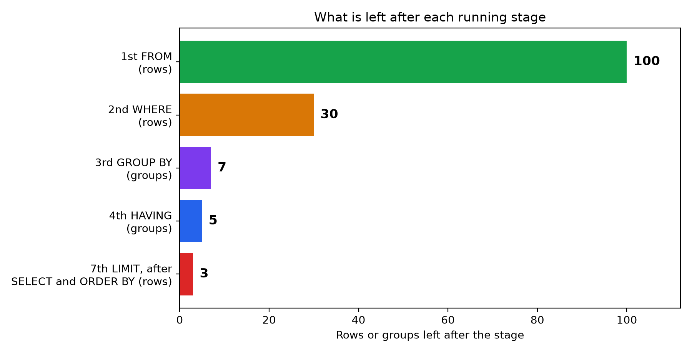
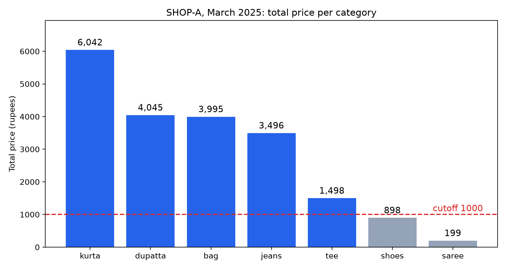
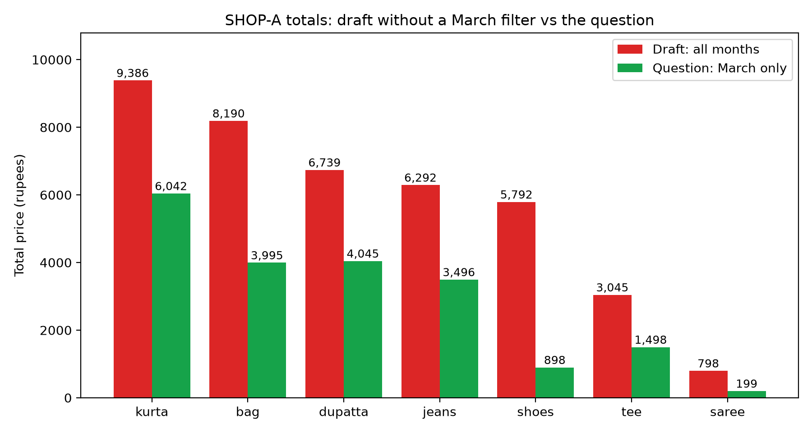
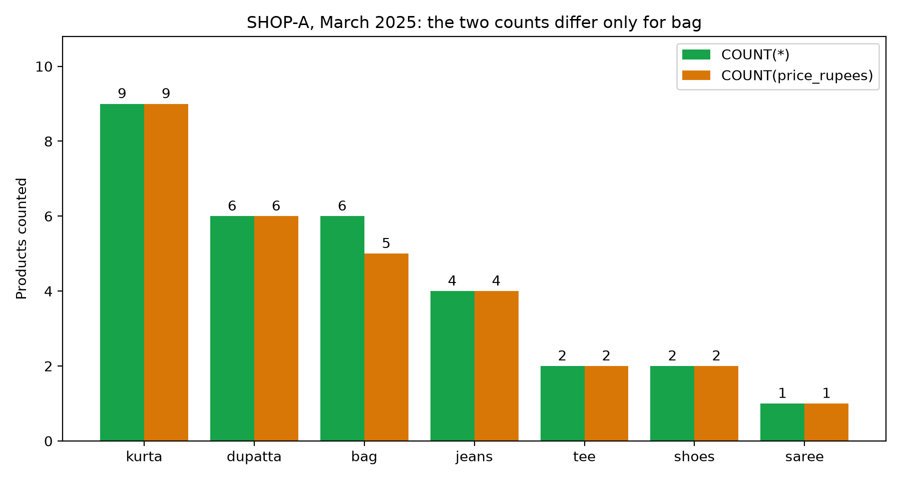
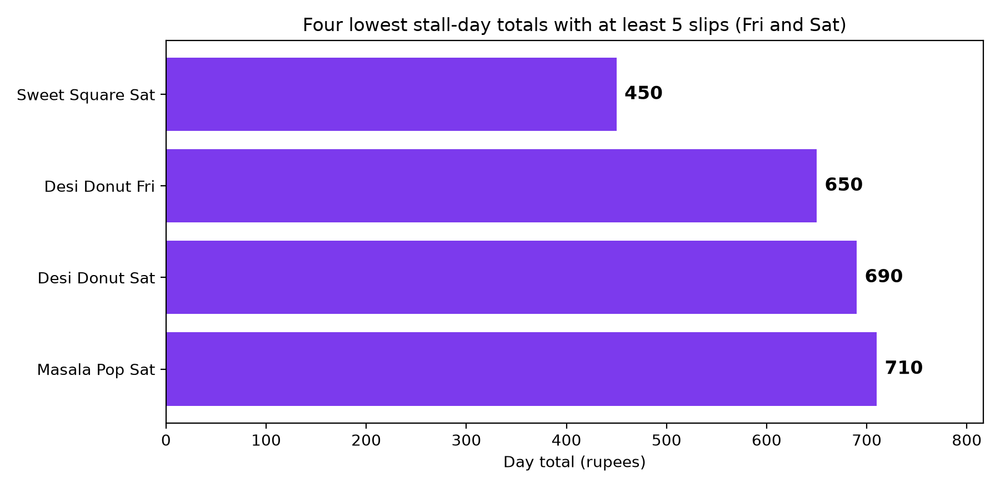
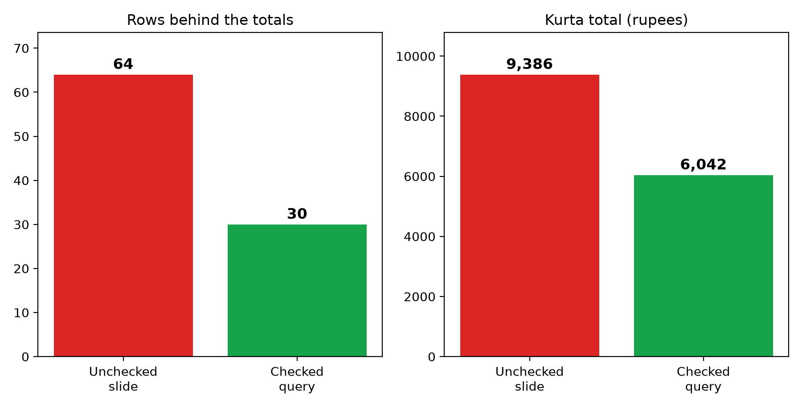

# <font color='#1d4ed8'>Lecture Script: AI-Assisted SQL Writing and Checking</font>

---

## <font color='blue'>Agenda</font>

The lecture runs as four topics. Each topic ends with a quiz.

| Topic | What we do | Learning objectives covered | Minutes |
|:-:|:--|:--|:-:|
| 1 | Read a query in running order | Trace the logical execution order of the clauses in a SELECT statement | 24 |
| 2 | Write the prompt: schema, question, example | Write a prompt that generates a SQL query from a schema and a business question<br>Compare zero-shot and few-shot prompting by the task types each suits | 34 |
| 3 | Check the draft against schema and question | Validate an AI-generated SQL query against the schema and the question asked | 24 |
| 4 | Fix wrong results and explain a query | Debug a SQL query that runs but returns the wrong answer by correcting a column, filter or aggregate<br>Interpret an unfamiliar SQL query, stating in prose what it returns | 28 |
| — | Closing: Outcome & Summary | | 10 |
| | **Total** | | **120** |

> <font color="red">**🎯 Instructor Note**</font> Pace: keep Topic 1 brisk, since the clauses are already known; spend the most time in Topic 2 (prompt and example) and Topic 4 (fix and explain).
> Every AI draft printed here is invented for teaching. Learners paste their own reply from ChatGPT, Claude or Gemini and run the same checks.

---

## <font color='blue'>Scenario</font>

An **Amazon India-style marketplace** hosts Seller A's shop. On Monday morning Meera, Seller A's analyst, needs the March listing total for each product category before the 11:00 review.

| Monday | What happens |
|:--|:--|
| 9:00 | Meera pastes the table's column list and her question into a free chat page. |
| 9:05 | A query comes back. She runs it in Workbench. Rows appear and there is no error. |
| 9:10 | She copies the top row onto the review slide. |
| 11:00 | A teammate adds up the March listings by hand. The numbers do not match. |

> <font color="red">**🎯 Instructor Note**</font> Amazon India is only the setting; do not claim it uses this data. The 100 product rows in `data/shop_a_products.sql` and 120 coupon rows in `data/fest_coupons.sql` are invented for teaching.
> Outputs were run on SQLite 3.54; MySQL Workbench returns the same rows but words errors differently. Load both files before class.

---

## <font color='blue'>Problem Statement</font>

Meera asked for each category's product count and total price for **SHOP-A** listings in **March 2025**: only totals of at least ₹1,000, biggest first, top 3. The reply ran with no error, so she trusted it. It had no March filter at all. The slide said the kurta total was ₹9,386. The true March total is ₹6,042, so the number was ₹3,344 too high. The March budget was set from the wrong figure.

> <font color='purple'>**How do we get a correct query from an AI assistant, and prove it is correct before it goes on a slide?**</font>

> <font color="red">**🎯 Instructor Note**</font> Poll: "An AI-written query runs with no error. Is it safe to put its numbers on a slide?" Give learners 30 seconds to respond in chat. Reveal the answer in the Closing.

---

## <font color='blue'>What We Will Use</font>

You already write `SELECT`, `WHERE`, `GROUP BY` and `HAVING` in Workbench or SQLite. Today a free chat page (ChatGPT, Claude or Gemini) writes the first draft, and you check it. No key or paid plan is needed.

| Topic | Tools | In one line |
|:-:|:--|:--|
| 1 | Workbench or SQLite | Run one query and count what is left after each clause |
| 2 | ChatGPT, Claude or Gemini chat page | Write the prompt with the table's columns, with or without a worked example |
| 3 | Workbench or SQLite, the column list | Check names, filters, shape and numbers of a draft |
| 4 | Workbench or SQLite, the chat page | Find the wrong column, filter or aggregate, fix it and test the fix |

Load the two tables once: run `data/shop_a_products.sql` (100 rows, 4 NULL prices) and `data/fest_coupons.sql` (120 rows) in Workbench or SQLite.

---

## <font color='blue'>How: Walking Through Meera's Monday Query</font>


---

## <font color='blue'>Topic 1: Read a Query in Running Order</font> `24 min`

> <font color='purple'>**Meera's query starts with SELECT. Does the database run it in that order?**</font>

In Relational Databases and SELECT Queries you wrote `SELECT`, `WHERE` and `ORDER BY`. Last session, in Aggregation and GROUP BY, you added `GROUP BY` and `HAVING`. Today all of them sit in one query, and you trace the order the database follows. The written order is not the running order. One new clause appears here: `LIMIT 3` keeps only the first 3 rows of the sorted result.

| Run order | Clause | What it does to the rows |
|:-:|:--|:--|
| 1st | `FROM` | Picks the table |
| 2nd | `WHERE` | Keeps single rows that pass the test |
| 3rd | `GROUP BY` | Puts the kept rows into groups |
| 4th | `HAVING` | Keeps groups that pass the test |
| 5th | `SELECT` | Builds the columns and gives them names |
| 6th | `ORDER BY` | Sorts what is left |
| 7th | `LIMIT` | Cuts the list to the first rows |

### <font color='green'>Example: one full query, clause by clause</font>

> <font color='purple'>**What does the whole query return, and which clause touches the rows first?**</font>

**Predict before running: What will happen?**

> <font color="red">**🎯 Instructor Note**</font> Expect 3 rows: kurta, dupatta, bag. Common wrong guess: SELECT runs first because it is written first.

```sql
SELECT category, COUNT(*) AS product_count, SUM(price_rupees) AS total_rs
FROM shop_a_products
WHERE shop_code = 'SHOP-A'
  AND listed_date BETWEEN '2025-03-01' AND '2025-03-31'
GROUP BY category
HAVING SUM(price_rupees) >= 1000
ORDER BY total_rs DESC, category
LIMIT 3;
```

**Output**

```
+----------+---------------+----------+
| category | product_count | total_rs |
+----------+---------------+----------+
| kurta    | 9             | 6042     |
| dupatta  | 6             | 4045     |
| bag      | 6             | 3995     |
+----------+---------------+----------+
```

#### <font color='#c2410c'>Code Explanation</font>

- **Line 2** `FROM` runs 1st: all 100 product rows are in play.
- **Lines 3–4** `WHERE` runs 2nd: only SHOP-A rows listed in March 2025 stay.
- **Line 5** `GROUP BY` runs 3rd: one group per category.
- **Line 6** `HAVING` runs 4th: groups with a total below 1000 are dropped.
- **Line 1** `SELECT` runs 5th: it builds `product_count` and `total_rs` and gives them their names.
- **Line 7** `ORDER BY` runs 6th: it can sort by `total_rs` because `SELECT` already named it; the category settles ties.
- **Line 8** `LIMIT` runs last: only the first 3 rows are kept.

> <font color='green'>**Result**</font> Three categories come back: kurta (9 products, ₹6,042), dupatta (6, ₹4,045) and bag (6, ₹3,995). Each clause only sees what the clause before it left behind.

### <font color='green'>Extending it: count what is left after each stage</font>

> <font color='purple'>**How many rows and groups survive FROM, WHERE, GROUP BY, HAVING and LIMIT?**</font>

**Predict before running: What will happen?**

> <font color="red">**🎯 Instructor Note**</font> Expect 100 rows, then 30 rows and 7 groups. Ask learners to guess how many groups pass HAVING before the next block.

```sql
SELECT COUNT(*) AS rows_in_table FROM shop_a_products;

SELECT COUNT(*) AS rows_after_where, COUNT(DISTINCT category) AS groups_made
FROM shop_a_products
WHERE shop_code = 'SHOP-A'
  AND listed_date BETWEEN '2025-03-01' AND '2025-03-31';
```

**Output**

```
+---------------+
| rows_in_table |
+---------------+
| 100           |
+---------------+

+------------------+-------------+
| rows_after_where | groups_made |
+------------------+-------------+
| 30               | 7           |
+------------------+-------------+
```

Now remove `LIMIT 3` from the full query to see what `HAVING` kept.

```sql
SELECT category, COUNT(*) AS product_count, SUM(price_rupees) AS total_rs
FROM shop_a_products
WHERE shop_code = 'SHOP-A'
  AND listed_date BETWEEN '2025-03-01' AND '2025-03-31'
GROUP BY category
HAVING SUM(price_rupees) >= 1000
ORDER BY total_rs DESC, category;
```

**Output**

```
+----------+---------------+----------+
| category | product_count | total_rs |
+----------+---------------+----------+
| kurta    | 9             | 6042     |
| dupatta  | 6             | 4045     |
| bag      | 6             | 3995     |
| jeans    | 4             | 3496     |
| tee      | 2             | 1498     |
+----------+---------------+----------+
```

> <font color='green'>**Result**</font> The trace is 100 rows, then 30 rows, then 7 groups, then 5 groups after `HAVING`, then 3 rows after `LIMIT`. Shoes (₹898) and saree (₹199) are dropped at `HAVING`.

<p align="center"></p>

### <font color='green'>Extending it: a total rule written in WHERE</font>

> <font color='purple'>**What happens if the 1,000 rule is written in WHERE, where the rows are still single rows?**</font>

**Predict before running: What will happen?**

> <font color="red">**🎯 Instructor Note**</font> Expect an error: no totals exist yet when `WHERE` runs. MySQL Workbench words it as "Invalid use of group function".

```sql
SELECT category, COUNT(*) AS product_count, SUM(price_rupees) AS total_rs
FROM shop_a_products
WHERE shop_code = 'SHOP-A'
  AND SUM(price_rupees) >= 1000
GROUP BY category;
```

**Output**

```
Error: misuse of aggregate: SUM()
```

> <font color='green'>**Result**</font> `WHERE` is 2nd and `GROUP BY` is 3rd, so a total cannot exist yet. A rule about a total belongs in `HAVING`, the 4th clause.

### <font color='green'>Extending it: sort and cut come after HAVING</font>

> <font color='purple'>**Which category has the smallest total: shoes at ₹898, or something else?**</font>

**Predict before running: What will happen?**

> <font color="red">**🎯 Instructor Note**</font> Expect tee. Common wrong guess: shoes, because it is the smallest total in March. `HAVING` already dropped it.

```sql
SELECT category, COUNT(*) AS product_count, SUM(price_rupees) AS total_rs
FROM shop_a_products
WHERE shop_code = 'SHOP-A'
  AND listed_date BETWEEN '2025-03-01' AND '2025-03-31'
GROUP BY category
HAVING SUM(price_rupees) >= 1000
ORDER BY total_rs ASC, category
LIMIT 1;
```

**Output**

```
+----------+---------------+----------+
| category | product_count | total_rs |
+----------+---------------+----------+
| tee      | 2             | 1498     |
+----------+---------------+----------+
```

> <font color='green'>**Result**</font> Tee (₹1,498) is the smallest total that is left. Shoes never reach `ORDER BY` because `HAVING` removed it first, and `LIMIT` cuts after sorting.

### <font color='purple'>Quiz 1</font>

**Question:** Which list shows the order in which the database runs the clauses of a SELECT query?

**Options:**
- A) SELECT, FROM, WHERE, GROUP BY, HAVING, ORDER BY, LIMIT
- B) FROM, SELECT, WHERE, GROUP BY, HAVING, ORDER BY, LIMIT
- C) FROM, WHERE, GROUP BY, HAVING, SELECT, ORDER BY, LIMIT
- D) FROM, GROUP BY, WHERE, HAVING, SELECT, ORDER BY, LIMIT

**Correct Answer:** C

**Explanation:**
- **A)** Wrong — that is the order the clauses are written, not the order they run.
- **B)** Wrong — SELECT needs the kept rows and groups first, so it cannot run second.
- **C)** Correct — FROM, then WHERE, GROUP BY and HAVING, then SELECT names the columns, then ORDER BY and LIMIT.
- **D)** Wrong — GROUP BY would group rows that WHERE is about to drop.

---

## <font color='blue'>Topic 2: Write the Prompt: Schema, Question, Example</font> `34 min`

> <font color='purple'>**The chat page has never seen Meera's table. What must the prompt hold so the assistant does not guess?**</font>

In How AI, LLMs and Prompts Work you met the four elements of a prompt (task, context, format and constraints) and saw that a model can write fluent text that is wrong. For a query, the context is the **schema**: the table name, the column names and what the values look like. Live replies also vary from run to run, so you always check the draft.

### <font color='green'>Example: a prompt built from the schema and the question</font>

> <font color='purple'>**What does a complete prompt for Meera's question look like?**</font>

```text
Task: Write one SQL query. For SHOP-A products listed in March 2025, show each category with its product count and total price. Keep only categories with a total of at least 1000. Biggest total first. Top 3 only.
Context: Database SQLite. Table shop_a_products(product_id INT, product_code TEXT, title TEXT, price_rupees INT (can be NULL), shop_code TEXT ('SHOP-A' or 'SHOP-B'), category TEXT, listed_date DATE).
Answer format: only the SQL, in one code block.
Constraints: use only these columns; do not change any data.
```

**Predict before running: What will happen?**

> <font color="red">**🎯 Instructor Note**</font> Draft below is invented for teaching, in the style of a chat reply. Expect the same 3 rows as Topic 1, with different column names.

```sql
SELECT category, COUNT(*) AS cnt, SUM(price_rupees) AS total
FROM shop_a_products
WHERE shop_code = 'SHOP-A'
  AND listed_date BETWEEN '2025-03-01' AND '2025-03-31'
GROUP BY category
HAVING SUM(price_rupees) >= 1000
ORDER BY total DESC
LIMIT 3;
```

**Output**

```
+----------+-----+-------+
| category | cnt | total |
+----------+-----+-------+
| kurta    | 9   | 6042  |
| dupatta  | 6   | 4045  |
| bag      | 6   | 3995  |
+----------+-----+-------+
```

#### <font color='#c2410c'>Code Explanation</font>

- **Task line** The question is stated once, with every rule: shop, month, minimum total, order and top 3.
- **Context line** The real table and column names are given, so the draft can only use names that exist.
- **Answer format and Constraints lines** The reply is only SQL, and only the listed columns.
- **Draft lines 1–8** Every column name exists; the clauses match the question.

> <font color='green'>**Result**</font> With the schema in the prompt, the draft uses real names and returns kurta (₹6,042), dupatta (₹4,045) and bag (₹3,995).

<p align="center"></p>

### <font color='green'>Extending it: the same ask with no schema</font>

> <font color='purple'>**What does the assistant write when the prompt holds only the question?**</font>

```text
Give me the March totals for Seller A by category.
```

**Predict before running: What will happen?**

> <font color="red">**🎯 Instructor Note**</font> Expect an error. The draft below is invented for teaching, but it shows what a guess looks like.

```sql
SELECT category, SUM(price) AS total
FROM products
WHERE shop = 'SHOP-A'
  AND month = 'March'
GROUP BY category;
```

**Output**

```
Error: no such table: products
```

> <font color='green'>**Result**</font> The assistant invented `products`, `price`, `shop` and `month`; none of them exists. This is the fluent-but-wrong output from the first session, so the schema belongs in the prompt every time.

### <font color='green'>Extending it: add one worked example (few-shot)</font>

> <font color='purple'>**Can one earlier question and its approved SQL make the draft follow the team's column names and sort rule?**</font>

A prompt with no example is **zero-shot**. A prompt with one or more worked examples (a question and its correct SQL) is **few-shot**. Here the example comes from last session's `fest_coupons` table.

```text
Task: Write one SQL query for the new question. Context: SQLite table shop_a_products(product_id, product_code, title, price_rupees, shop_code, category, listed_date).
Example question: Show each stall with its coupon count and total rupees, biggest total first.
Example SQL: SELECT stall_name, COUNT(*) AS coupon_count, SUM(amount_rs) AS total_rs FROM fest_coupons WHERE stall_name IS NOT NULL GROUP BY stall_name ORDER BY total_rs DESC, stall_name;
New question: For SHOP-A products listed in March 2025, show each category with its product count and total price, totals of at least 1000, biggest first, top 3.
Answer format: only the SQL, with column names in the same style as the example.
```

**Predict before running: What will happen?**

> <font color="red">**🎯 Instructor Note**</font> Expect the same 3 rows. Look at the column names and the `ORDER BY` line, not the numbers.

```sql
SELECT category, COUNT(*) AS product_count, SUM(price_rupees) AS total_rs
FROM shop_a_products
WHERE shop_code = 'SHOP-A'
  AND listed_date BETWEEN '2025-03-01' AND '2025-03-31'
GROUP BY category
HAVING SUM(price_rupees) >= 1000
ORDER BY total_rs DESC, category
LIMIT 3;
```

**Output**

```
+----------+---------------+----------+
| category | product_count | total_rs |
+----------+---------------+----------+
| kurta    | 9             | 6042     |
| dupatta  | 6             | 4045     |
| bag      | 6             | 3995     |
+----------+---------------+----------+
```

> <font color='green'>**Result**</font> The rows are identical to the zero-shot draft. What changed is the shape: `product_count` and `total_rs` copy the example's names, and `ORDER BY` now has a tie-breaker.

#### <font color='#c2410c'>Logic Explanation</font>

| Task type | Zero-shot | Few-shot |
|:--|:--|:--|
| One-off plain question (count the rows, one filter, one sort) | Suits: any correct shape is fine | Not needed |
| Report that must match the team's column names, sort and tie rule | Names and sort will vary | Suits: the example shows the exact shape |
| A rule the assistant cannot guess (what "March" covers, how NULL prices count) | It guesses | Suits: one worked example fixes the rule |

> <font color="red">**🎯 Instructor Note**</font> Poll: "Which style fits: count the rows in `shop_a_products`?" Give learners 30 seconds to respond in chat. Answer: zero-shot, since any correct shape works.

### <font color='purple'>Quiz 2</font>

**Question:** A team's weekly report must always name the count column `product_count`, the total column `total_rs`, and settle ties by category. Which prompt best helps the assistant follow that shape for a new question?

**Options:**
- A) The table's columns, the new question, and one earlier question with its approved SQL
- B) The table's columns and the new question only; the assistant picks the names it likes
- C) Only the new question, written in more detail
- D) The earlier question with its approved SQL, but no columns for the new table

**Correct Answer:** A

**Explanation:**
- **A)** Correct — the columns give the real names, and the worked example shows the exact shape (few-shot).
- **B)** Wrong — zero-shot has no example, so the column names and sort rule will vary.
- **C)** Wrong — more detail does not replace the schema; the assistant still guesses table and column names.
- **D)** Wrong — the example shows the shape but the assistant has no real columns for the new table.

---

## <font color='blue'>Topic 3: Check the Draft Against Schema and Question</font> `24 min`

> <font color='purple'>**The reply looks tidy. How does Meera check it before it reaches a slide?**</font>

In Python Files and Data Handling you tested an AI fix before accepting it. A query needs the same habit. Four checks catch most problems, and each check needs only what you already know.

| Check | Ask | How |
|:--|:--|:--|
| Names | Does every table and column exist in the schema? | Compare with the column list or `SELECT *` with `LIMIT` |
| Filters | Does every phrase of the question have a clause? | Read the query in running order |
| Shape | Do the groups, aggregate, sort and limit match the ask? | Read the query line by line |
| Numbers | Does a plain second query agree? | `COUNT(*)` with the same `WHERE` |

### <font color='green'>Example: a draft that fails the Names check</font>

> <font color='purple'>**Does this draft use only names that exist in `shop_a_products`?**</font>

**Predict before running: What will happen?**

> <font color="red">**🎯 Instructor Note**</font> Expect an error naming one missing column. Ask learners to find the second wrong name by reading the draft.

```sql
SELECT category, COUNT(*) AS product_count, SUM(price) AS total_rs
FROM shop_a_products
WHERE shop = 'SHOP-A'
  AND listed_date BETWEEN '2025-03-01' AND '2025-03-31'
GROUP BY category
HAVING SUM(price) >= 1000
ORDER BY total_rs DESC, category
LIMIT 3;
```

**Output**

```
Error: no such column: price
```

Now peek at the table to see the real column names.

```sql
SELECT * FROM shop_a_products ORDER BY product_id LIMIT 3;
```

**Output**

```
+------------+--------------+------------------+--------------+-----------+----------+-------------+
| product_id | product_code | title            | price_rupees | shop_code | category | listed_date |
+------------+--------------+------------------+--------------+-----------+----------+-------------+
| 1          | KRT-0412-RD  | Cotton Kurta Red | 499          | SHOP-A    | kurta    | 2025-03-08  |
| 2          | KRT-0891-BL  | Linen Kurta Blue | 650          | SHOP-A    | kurta    | 2025-03-15  |
| 3          | TOP-2201-WH  | Cotton Top White | 299          | SHOP-B    | top      | 2025-02-20  |
+------------+--------------+------------------+--------------+-----------+----------+-------------+
```

#### <font color='#c2410c'>Code Explanation</font>

- **First block** The error names only the first missing column, `price`. The draft also uses `shop`, which does not exist either.
- **Second block** `SELECT *` with `LIMIT 3` shows every real column name: `price_rupees` and `shop_code` are the ones the draft needed.

> <font color='green'>**Result**</font> The Names check finds two wrong names: `price` should be `price_rupees` and `shop` should be `shop_code`. An error message alone would have shown you only one.

### <font color='green'>Extending it: a draft that runs but fails the Filters check</font>

> <font color='purple'>**This draft uses real names and shows 3 rows. Does it match the question?**</font>

**Predict before running: What will happen?**

> <font color="red">**🎯 Instructor Note**</font> Expect 3 tidy rows and no error. This is the draft behind the ₹9,386 on Meera's slide.

```sql
SELECT category, COUNT(*) AS product_count, SUM(price_rupees) AS total_rs
FROM shop_a_products
WHERE shop_code = 'SHOP-A'
GROUP BY category
HAVING SUM(price_rupees) >= 1000
ORDER BY total_rs DESC, category
LIMIT 3;
```

**Output**

```
+----------+---------------+----------+
| category | product_count | total_rs |
+----------+---------------+----------+
| kurta    | 15            | 9386     |
| bag      | 11            | 8190     |
| dupatta  | 12            | 6739     |
+----------+---------------+----------+
```

#### <font color='#c2410c'>Logic Explanation</font>

| Phrase in the question | Clause in the draft | Check |
|:--|:--|:--|
| SHOP-A products | `WHERE shop_code = 'SHOP-A'` | Present |
| listed in March 2025 | none | Missing |
| each category, count and total | `GROUP BY category`, `COUNT(*)`, `SUM(price_rupees)` | Present |
| total of at least 1000 | `HAVING SUM(price_rupees) >= 1000` | Present |
| biggest first, top 3 | `ORDER BY total_rs DESC`, `LIMIT 3` | Present |

The Numbers check confirms it. Count the rows the draft used, and the rows the question asked for.

```sql
SELECT COUNT(*) AS rows_draft_used
FROM shop_a_products
WHERE shop_code = 'SHOP-A';

SELECT COUNT(*) AS rows_question_asks
FROM shop_a_products
WHERE shop_code = 'SHOP-A'
  AND listed_date BETWEEN '2025-03-01' AND '2025-03-31';
```

**Output**

```
+-----------------+
| rows_draft_used |
+-----------------+
| 64              |
+-----------------+

+--------------------+
| rows_question_asks |
+--------------------+
| 30                 |
+--------------------+
```

> <font color='green'>**Result**</font> The draft used 64 rows; the question asks for 30. The extra 34 rows come from February and April. The query ran, but it answered a different question.

<p align="center"></p>

### <font color='purple'>Quiz 3</font>

**Question:** A reply runs without an error and shows 3 rows for "SHOP-A products listed in March 2025". What best shows that it matches the question?

**Options:**
- A) It ran without an error
- B) The assistant said the query is correct
- C) It shows exactly 3 rows
- D) Each phrase of the question has a matching clause, and a plain second query for the same rows gives the same count

**Correct Answer:** D

**Explanation:**
- **A)** Wrong — the draft with no March filter also ran without an error.
- **B)** Wrong — the assistant sounds sure even when it is wrong, as in the first session.
- **C)** Wrong — `LIMIT 3` caps the rows at 3 whatever the filters are.
- **D)** Correct — clause-by-clause reading finds a missing filter, and the second count (30, not 64) proves it with numbers.

---

## <font color='blue'>Topic 4: Fix Wrong Results and Explain a Query</font> `28 min`

> <font color='purple'>**Meera's query runs but is wrong. How do we find the cause, fix it, and test the fix? And how do we read a query someone else wrote?**</font>

A wrong answer comes from a wrong column, a wrong filter or a wrong aggregate. Change one thing, re-run, and compare with a plain check query before you accept the fix.

| Symptom | Likely cause | Fix |
|:--|:--|:--|
| A count is lower than a plain `COUNT(*)` | Aggregate: `COUNT(column)` skips NULL values | Use `COUNT(*)` |
| Totals use too many or too few rows | Filter: a condition is missing or wrong | Correct the `WHERE` |
| One row instead of one per category | Column: the wrong column in `GROUP BY` | Group by the column the question names |

### <font color='green'>Example: the count is one short (aggregate)</font>

> <font color='purple'>**The draft shows 5 bags. How do we find out whether that is right?**</font>

**Predict before running: What will happen?**

> <font color="red">**🎯 Instructor Note**</font> Expect 3 rows with bag at 5. Names and filters are fine; ask learners which Numbers check would expose the count.

```sql
SELECT category, COUNT(price_rupees) AS product_count, SUM(price_rupees) AS total_rs
FROM shop_a_products
WHERE shop_code = 'SHOP-A'
  AND listed_date BETWEEN '2025-03-01' AND '2025-03-31'
GROUP BY category
HAVING SUM(price_rupees) >= 1000
ORDER BY total_rs DESC, category
LIMIT 3;
```

**Output**

```
+----------+---------------+----------+
| category | product_count | total_rs |
+----------+---------------+----------+
| kurta    | 9             | 6042     |
| dupatta  | 6             | 4045     |
| bag      | 5             | 3995     |
+----------+---------------+----------+
```

Now a plain check for bags only: all rows, and rows with a price.

```sql
SELECT COUNT(*) AS bag_rows, COUNT(price_rupees) AS bag_priced
FROM shop_a_products
WHERE shop_code = 'SHOP-A'
  AND listed_date BETWEEN '2025-03-01' AND '2025-03-31'
  AND category = 'bag';
```

**Output**

```
+----------+------------+
| bag_rows | bag_priced |
+----------+------------+
| 6        | 5          |
+----------+------------+
```

Fix: change line 1 back to `COUNT(*)` and re-run the test.

```sql
SELECT category, COUNT(*) AS product_count, SUM(price_rupees) AS total_rs
FROM shop_a_products
WHERE shop_code = 'SHOP-A'
  AND listed_date BETWEEN '2025-03-01' AND '2025-03-31'
GROUP BY category
HAVING SUM(price_rupees) >= 1000
ORDER BY total_rs DESC, category
LIMIT 3;
```

**Output**

```
+----------+---------------+----------+
| category | product_count | total_rs |
+----------+---------------+----------+
| kurta    | 9             | 6042     |
| dupatta  | 6             | 4045     |
| bag      | 6             | 3995     |
+----------+---------------+----------+
```

#### <font color='#c2410c'>Code Explanation</font>

- **First block** `COUNT(price_rupees)` counts only rows whose price is not NULL, so the bag with a NULL price is skipped.
- **Second block** The check shows 6 bag rows but only 5 with a price.
- **Third block** `COUNT(*)` counts every row in the group, and bag now shows 6.

> <font color='green'>**Result**</font> The question asks for the product count, so `COUNT(*)` is right. The fix is tested: bag is 6 and the total ₹3,995 did not change.

<p align="center"></p>

### <font color='green'>Extending it: one row instead of one per category (column)</font>

> <font color='purple'>**A draft returns one row, but the question asks for each category. Which column is wrong?**</font>

**Predict before running: What will happen?**

> <font color="red">**🎯 Instructor Note**</font> Expect 1 row for SHOP-A. The question names the shop only as a filter; the groups are categories.

```sql
SELECT shop_code, COUNT(*) AS product_count, SUM(price_rupees) AS total_rs
FROM shop_a_products
WHERE shop_code = 'SHOP-A'
  AND listed_date BETWEEN '2025-03-01' AND '2025-03-31'
GROUP BY shop_code
ORDER BY total_rs DESC, shop_code;
```

**Output**

```
+-----------+---------------+----------+
| shop_code | product_count | total_rs |
+-----------+---------------+----------+
| SHOP-A    | 30            | 20173    |
+-----------+---------------+----------+
```

Fix: use `category` in `SELECT` and `GROUP BY`. Test it without `HAVING` and `LIMIT` so that every group shows.

```sql
SELECT category, COUNT(*) AS product_count, SUM(price_rupees) AS total_rs
FROM shop_a_products
WHERE shop_code = 'SHOP-A'
  AND listed_date BETWEEN '2025-03-01' AND '2025-03-31'
GROUP BY category
ORDER BY total_rs DESC, category;
```

**Output**

```
+----------+---------------+----------+
| category | product_count | total_rs |
+----------+---------------+----------+
| kurta    | 9             | 6042     |
| dupatta  | 6             | 4045     |
| bag      | 6             | 3995     |
| jeans    | 4             | 3496     |
| tee      | 2             | 1498     |
| shoes    | 2             | 898      |
| saree    | 1             | 199      |
+----------+---------------+----------+
```

> <font color='green'>**Result**</font> The wrong draft added all 30 rows into one group (₹20,173). After the fix the 7 groups add back to the same 30 products and ₹20,173, so nothing was lost.

### <font color='green'>Extending it: ask the assistant to fix the filter, then test</font>

> <font color='purple'>**Can the chat page repair the missing March filter if we give it the evidence?**</font>

```text
Here is your query (the SHOP-A draft with no March filter). It used 64 rows, but the question needs only March 2025, which is 30 rows. Fix only the WHERE clause. Keep every other clause the same.
```

**Predict before running: What will happen?**

> <font color="red">**🎯 Instructor Note**</font> Expect the Topic 1 rows. The reply below is invented for teaching; test any real reply the same way before accepting it.

```sql
SELECT category, COUNT(*) AS product_count, SUM(price_rupees) AS total_rs
FROM shop_a_products
WHERE shop_code = 'SHOP-A'
  AND listed_date BETWEEN '2025-03-01' AND '2025-03-31'
GROUP BY category
HAVING SUM(price_rupees) >= 1000
ORDER BY total_rs DESC, category
LIMIT 3;
```

**Output**

```
+----------+---------------+----------+
| category | product_count | total_rs |
+----------+---------------+----------+
| kurta    | 9             | 6042     |
| dupatta  | 6             | 4045     |
| bag      | 6             | 3995     |
+----------+---------------+----------+
```

> <font color='green'>**Result**</font> Kurta is now ₹6,042 with 9 products, ₹3,344 lower than the slide's ₹9,386. The fix passes the test because the numbers match the 30-row check.

### <font color='green'>Extending it: say in words what an unfamiliar query returns</font>

> <font color='purple'>**A teammate pasted this query about the fest coupons. What does it return?**</font>

`<>` means "is not equal to". Read the query in running order, then write one sentence in chat.

**Predict before running: What will happen?**

> <font color="red">**🎯 Instructor Note**</font> Expected sentence: from named-stall coupons that are not from Sunday, group by stall and day, keep groups with at least 5 slips, and show the 4 lowest day totals.

```sql
SELECT stall_name, coupon_day, SUM(amount_rs) AS day_total_rs
FROM fest_coupons
WHERE stall_name IS NOT NULL AND coupon_day <> 'Sun'
GROUP BY stall_name, coupon_day
HAVING COUNT(*) >= 5
ORDER BY day_total_rs ASC, stall_name
LIMIT 4;
```

**Output**

```
+--------------+------------+--------------+
| stall_name   | coupon_day | day_total_rs |
+--------------+------------+--------------+
| Sweet Square | Sat        | 450          |
| Desi Donut   | Fri        | 650          |
| Desi Donut   | Sat        | 690          |
| Masala Pop   | Sat        | 710          |
+--------------+------------+--------------+
```

#### <font color='#c2410c'>Code Explanation</font>

- **Lines 2–3** `FROM` and `WHERE`: coupons with a stall name that are not from Sunday.
- **Lines 4–5** `GROUP BY` and `HAVING`: one group per stall and day; only groups with at least 5 slips stay.
- **Lines 1, 6–7** `SELECT`, `ORDER BY` and `LIMIT`: the day total, lowest first, first 4 groups.

> <font color='green'>**Result**</font> In words: "On Friday and Saturday, for stalls with a name, it shows the four stall-days with the lowest rupee total, counting only stall-days that have at least 5 coupons."

<p align="center"></p>

### <font color='green'>Extending it: check an AI's explanation of the same query</font>

> <font color='purple'>**An assistant explains the query in one sentence. Is the explanation complete?**</font>

```text
This query adds up each stall's coupon amounts for Friday and Saturday, sorts them from lowest to highest and shows the first four.
```

**Predict before running: What will happen?**

> <font color="red">**🎯 Instructor Note**</font> The explanation is invented for teaching. It leaves out the HAVING rule; learners test that by removing the line.

```sql
SELECT stall_name, coupon_day, SUM(amount_rs) AS day_total_rs
FROM fest_coupons
WHERE stall_name IS NOT NULL AND coupon_day <> 'Sun'
GROUP BY stall_name, coupon_day
ORDER BY day_total_rs ASC, stall_name
LIMIT 4;
```

**Output**

```
+--------------+------------+--------------+
| stall_name   | coupon_day | day_total_rs |
+--------------+------------+--------------+
| Spice Route  | Fri        | 369          |
| Sweet Square | Sat        | 450          |
| Frost Cone   | Sat        | 640          |
| Desi Donut   | Fri        | 650          |
+--------------+------------+--------------+
```

> <font color='green'>**Result**</font> Without the `HAVING` line the list changes: Spice Route Fri (₹369, 2 slips) and Frost Cone Sat (₹640, 4 slips) now appear. The explanation missed the 5-slip rule, so it is incomplete.

### <font color='purple'>Quiz 4</font>

**Question:** A draft shows `product_count` 5 for bag, but a plain `COUNT(*)` for SHOP-A bags listed in March gives 6, and one of those bags has a NULL price. What is the fix?

**Options:**
- A) Replace `SUM(price_rupees)` with `AVG(price_rupees)`
- B) Replace `COUNT(price_rupees)` with `COUNT(*)`
- C) Add `HAVING COUNT(*) >= 6`
- D) Raise `LIMIT 3` to `LIMIT 4`

**Correct Answer:** B

**Explanation:**
- **A)** Wrong — `AVG` changes the total column and does nothing to the count.
- **B)** Correct — `COUNT(column)` skips NULL values, while `COUNT(*)` counts every row in the group.
- **C)** Wrong — `HAVING` only keeps or drops groups; it cannot change a count.
- **D)** Wrong — `LIMIT` changes how many rows appear, not the numbers in them.

---

## <font color='blue'>Closing: Outcome & Summary</font> `10 min`

Back to Meera's Monday. The first reply ran with no error and still gave her a wrong slide number. Each topic fixes one weak spot.

> <font color='purple'>**1. Which clause order explains why March sits in WHERE and the 1,000 rule sits in HAVING?**</font>

`WHERE` runs 2nd on single rows, so the shop and month tests go there. `HAVING` runs 4th on groups, so the total rule goes there (Topic 1).

> <font color='purple'>**2. What goes in the prompt, and what does a worked example add?**</font>

The prompt holds the task, the table's columns, the answer format and the constraints. One worked example from `fest_coupons` makes the draft copy the team's names and sort rule (Topic 2).

> <font color='purple'>**3. Does the checked and fixed query agree with a plain second query?**</font>

```sql
SELECT COUNT(*) AS rows_march, SUM(price_rupees) AS total_march_rs
FROM shop_a_products
WHERE shop_code = 'SHOP-A'
  AND listed_date BETWEEN '2025-03-01' AND '2025-03-31';
```

**Output**

```
+------------+----------------+
| rows_march | total_march_rs |
+------------+----------------+
| 30         | 20173          |
+------------+----------------+
```

#### <font color='#c2410c'>Code Explanation</font>

- **Line 1** Count and total with no `GROUP BY`: one summary row for the whole March slice (Topic 3, Numbers check).
- **Lines 3–4** The same filters as the fixed query, so the 30 rows and ₹20,173 match the 7 groups tested in Topic 4.

> <font color='purple'>**4. In one sentence, what does the final query return?**</font>

For SHOP-A products listed in March 2025, it shows the three categories with the biggest total price (at least ₹1,000), each with its product count: kurta, dupatta and bag (Topic 4).

<p align="center"></p>

### <font color='green'>Outcome</font>

| | Unchecked reply (on the slide) | Checked and fixed query |
|:--|:-:|:-:|
| Rows behind the totals | 64 | 30 |
| Kurta total | ₹9,386 | ₹6,042 |
| Top three, in order | kurta, bag, dupatta | kurta, dupatta, bag |
| Checks done before the slide | none | names, filters, shape, numbers |

> <font color='green'>**Therefore,**</font> an AI reply is a first draft. Put the columns (and an example when the shape matters) in the prompt, check names, filters, shape and numbers, fix one thing at a time, and say in words what the query returns. March kurta stock is ₹6,042, not ₹9,386.

> <font color="red">**🎯 Instructor Note**</font> Reveal the poll: No. A query that runs can still answer a different question, so check it before the slide.

### <font color='green'>Summary</font>

| Learning objective | Takeaway |
|:--|:--|
| Trace the clause order | FROM, WHERE, GROUP BY, HAVING, SELECT, ORDER BY, LIMIT: each clause sees only what the one before left |
| Write a prompt from a schema | Task, real column names, answer format and constraints stop the assistant from guessing |
| Compare zero-shot and few-shot | Zero-shot suits plain one-off questions; few-shot suits a fixed shape or an unguessable rule |
| Validate an AI query | Names against the schema, every phrase against a clause, then a plain second query for the numbers |
| Debug a wrong result | Look for the wrong column, filter or aggregate; change one thing and test it |
| Interpret an unfamiliar query | Read in running order and say what it returns, then test the AI's own explanation |
| **Practical value** | You can use an AI assistant for a first draft and still stand behind every number you put on a slide |

---

# <font color='red'>Launch the Feedback Poll</font>

> <font color="red">**🎯 Instructor Note**</font> Reminder: launch the feedback poll now to collect learner feedback.
