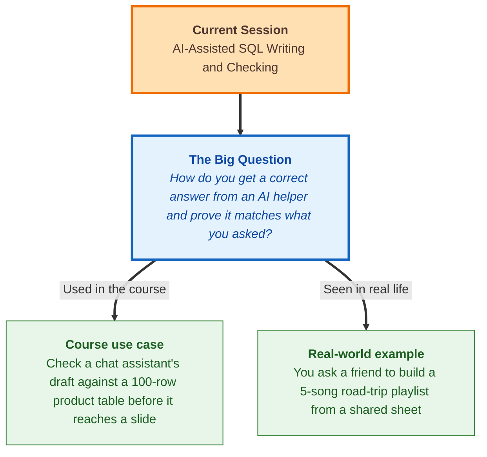

## AI-Assisted SQL Writing and Checking

### Mental Map

---

### What You'll Learn

Have you ever wondered why a friend's playlist looks perfect and still holds the wrong songs?

By the end of this session, you will be able to:

- **Interpret** the rule "Hindi songs under 5 minutes, shortest first, first 5" in one sentence.
- **Solve** a playlist rule that returns 9 songs instead of 5 by finding its wrong part.
- **Trace** the order a playlist rule follows: open the sheet, filter, count, sort, then cut the list.
- **Compare** asking a helper with no sample against asking with one playlist you already like.
- **Check** a friend's rule against the sheet's column headings and against the request you made.
- **Write** a clear request that names the sheet's columns and says what you want back.

> **Topics you will meet:** Clause order in a query; Prompt for a SQL query; Zero-shot or few-shot: adding a worked example to a SQL prompt.
>
> Check AI SQL against the schema; Fix AI SQL mistakes; Explain what a query returns.
>
> Join the session to learn each of these in detail.

---

### Why You Are Learning This Topic

You and four friends plan a road trip. You ask one friend to pick songs from a shared sheet.

The reply is a neat list of 5 songs. On the road, you hear a 9-minute song and a Tamil song. You wanted neither.

The list looked right, but nobody compared it with the sheet or with your request.

A **schema** means the list of column headings in a table and what each heading holds.

In this course, an AI helper drafts a database question. You check the draft before you trust its numbers.

> **Think about it:** What would you check before you play that playlist for the whole bus?

---

### The Road-Trip Playlist Puzzle

Each row is one song on the shared sheet.

| Song | Language | Minutes | Mood |
|:----:|:--------:|:-------:|:----:|
| Highway Sunrise | Hindi | 4 | Happy |
| Chai Stop | Hindi | 3 | Calm |
| Midnight Rail | Tamil | 5 | Calm |
| Monsoon Drive | Hindi | 6 | Sad |
| Dhol Beat | Punjabi | 3 | Happy |

**What you want to happen:**

- Keep only Hindi songs shorter than 5 minutes.
- Put the shortest song first.
- Stop after the first 5 songs.

> **Wonder about this:**
>
> - Which songs does that rule pick from this sheet?
> - What goes wrong if the helper writes "length" when the sheet says "Minutes"?

---

### Think It Through

There is no wrong first try. Keep your guesses for the session.

**1. Which songs stay when the rule says "Hindi, shorter than 5 minutes"?**
Hint: Test each row against both parts of the rule.

**2. Your friend writes "length" for the minutes column. Where do you look to spot it?**
Hint: Compare the word with the headings in the table.

**3. The list shows a Tamil song, but you asked for Hindi only. Which part of the rule is missing?**
Hint: Read the rule one wish at a time.

---

### One Question to Carry Into the Session

> **How can you prove a helper's answer matches your request, and not only that it looks neat?**
>
> Bring one check you would run before you share the list.
