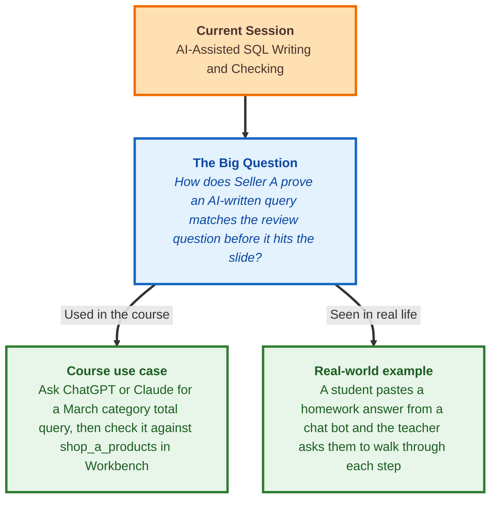

## <span style="color:#2F7DDE">AI-Assisted SQL Writing and Checking</span>

### <span style="color:#2F7DDE">Mental Map</span>



---

### <span style="color:#2F7DDE">What You'll Learn</span>

Have you ever seen a query run with no red error line and still show the wrong total?

By the end of this session, you will be able to:

- <span style="color:#D9660B">**trace**</span> the order SQL clauses run in before you trust a result grid.
- <span style="color:#D9660B">**write**</span> a prompt that names the table columns and the business question.
- <span style="color:#D9660B">**compare**</span> zero-shot and few-shot prompts when the question needs a pattern.
- <span style="color:#D9660B">**check**</span> an AI draft against the real column names in **shop_a_products**.
- <span style="color:#D9660B">**fix**</span> a query that runs but drops the March date filter.
- <span style="color:#D9660B">**explain**</span> in plain words what an unfamiliar **SELECT** returns.

> <span style="color:#2F7DDE">**Topics you will meet:**</span> Clause order; SQL prompts; zero-shot and few-shot; schema checks; debugging wrong totals; reading a query in prose.
>
> Join the session to learn each in detail.

---

### <span style="color:#2F7DDE">Why You Are Learning This Topic</span>

Seller A's analyst Meera needs March totals per category for shop **SHOP-A** before the 11:00 review.

A chat assistant returned a query that ran cleanly in Workbench.

The slide number was ₹3,344 too high because the draft forgot the March filter.

> <span style="color:#2F7DDE">**Think about it:**</span> What is the difference between “no error” and “answers the question”?

---

### <span style="color:#2F7DDE">The Review-Slide Puzzle</span>

| Check | What you look for |
|:--|:--|
| Column names | Do they match **shop_a_products**? |
| Filters | Does **March 2025** appear where the question needs it? |
| Totals | Does one category row match a hand-count on three sample rows? |

<span style="color:#D9660B">**What you want to happen:**</span>

- Paste schema and question, not just the question alone.
- Run the draft in Workbench before copying numbers.
- Say in one sentence what the final query returns.

Here is how a prompt might start. You do not need to understand it yet.

```text
Table shop_a_products columns: product_code, shop_id, title, category, price_rupees, listed_on
Question: For SHOP-A, count products and sum price_rupees per category in March 2025 only.
Return one SELECT query for SQLite.
```

> <span style="color:#D9660B">**Wonder about this:**</span>
>
> - Why list column names in the prompt?
> - Why keep one worked example query in a few-shot prompt?

---

### <span style="color:#2F7DDE">Think It Through</span>

**1. A **SELECT** runs. Which clause usually shrinks rows first?**

- A) **ORDER BY**
- B) **WHERE**
- C) **SELECT** list aliases
- D) The result grid headers

**2. Meera's draft has no March filter. The tool shows no error. What failed?**

- A) The question, not the syntax
- B) The keyboard
- C) **SQLite** was not installed
- D) The table had too many rows

**3. A few-shot prompt adds one worked query before the new question. When is that most helpful?**

- A) When the question needs a fixed pattern like **GROUP BY**
- B) When you never plan to run SQL
- C) When the table has no columns
- D) When you want to skip **Workbench**

**4. You read an unfamiliar query aloud. What should you name first?**

- A) Which tables and filters define the rows
- B) The colour of the Workbench toolbar
- C) How fast the laptop fan spins
- D) The mentor's email address