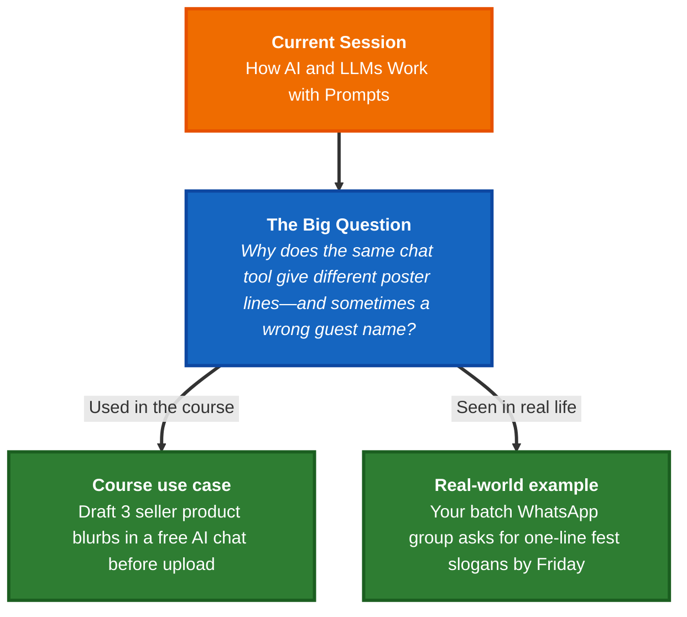

## How AI and LLMs Work with Prompts

### Mental Map

---

### What You'll Learn

Have you ever wondered why two classmates paste the same opening line and still get different poster slogans?

By the end of this session, you will be able to:

- **Classify** artificial intelligence, machine learning, and generative AI when your club picks a free chat tool for poster text.
- **Describe** next-token prediction as the step that adds the next word to a one-line fest slogan draft.
- **Identify** subword pieces inside the title `RoboRally 2026` before the model reads your poster request.
- **Explain** what fills the reading limit when you paste three old posters plus this year’s date list.
- **Predict** how raising the creativity setting changes two slogan endings from the same opening line.
- **State** task, context, format, and constraints in one chat request after you spot a wrong guest name on the poster.

> **Topics you will meet:** AI vs ML vs GenAI; Next-token prediction; Tokens context and temperature (why answers vary); Hallucination; Four elements of a prompt.
>
> Join the session to learn each of these in detail.

---

### Why You Are Learning This Topic

Your cultural committee needs a fresh one-line slogan for Tech Fest.

You open a free chat page and type “Write a catchy line for RoboRally 2026.”

The first reply sounds perfect. You run it again and get a different rhyme.

Your friend pastes last year’s three posters plus a long guest list. The reply invents a speaker who never agreed to come.

A **prompt** means the full message you send the chat tool, including instructions and pasted notes.

Seller teams will use the same kind of chat page to draft product blurbs. You need to know what the tool is doing, not just copy the first reply.

> **Think about it:** If the line reads smoothly, why would you still check the guest name before printing?

---

### The Tech Fest Poster Puzzle

The committee keeps a small fact sheet for this year’s RoboRally poster.

| Fact | Value |
|:----:|:-----:|
| Event name | RoboRally 2026 |
| Dates | 14–16 March |
| Venue | Main auditorium |
| Confirmed guest | Dr. Meera Shah (robotics lab) |
| Tone needed | Short, student-friendly, under 12 words |

**What you want to happen:**

- One chat request returns a slogan that fits the tone and length.
- A second run with the same facts does not surprise you with a wild swing unless you change a setting.
- No printed poster names a guest who is not on the fact sheet.

> **Wonder about this:**
>
> - Why might the tool split `RoboRally` into more than one small piece before it answers?
> - What four parts would you put in your message so the tool knows the task, the facts, the shape, and the limits?

---

### Think It Through

There is no wrong first try. Keep your guesses for the session.

**1. Your classmate says “the AI guessed the next word.” What do you think that means for slogan line two?**
Hint: Think about finishing a sentence one word at a time.

**2. You paste three old posters and a long guest list into one message. What might get cut off if the message is too long?**
Hint: Picture a fixed-size text box with a fill line.

**3. Two drafts both sound confident. How would you decide which guest name is safe to print?**
Hint: Compare each name to the fact sheet, not to how smooth the sentence sounds.

---

### One Question to Carry Into the Session

> **What must you put in a prompt so a chat tool stays helpful instead of confidently wrong?**
>
> Bring your guess about task, facts, format, and limits—and one example slogan you would not print without checking.