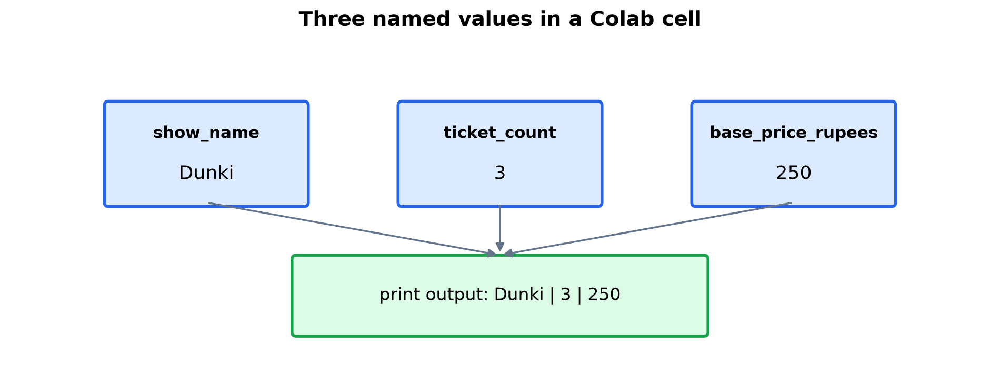
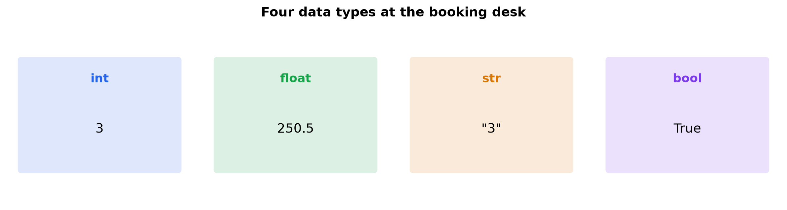
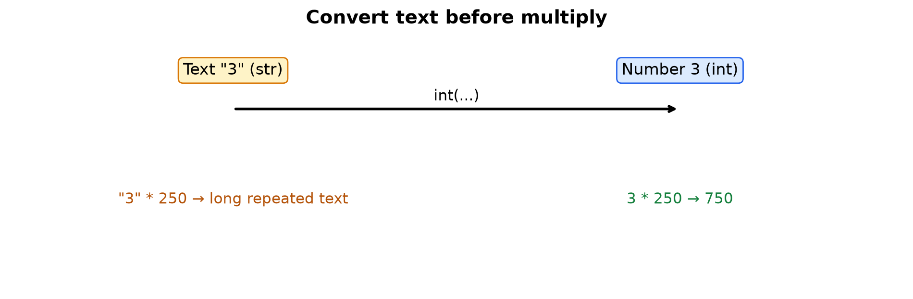
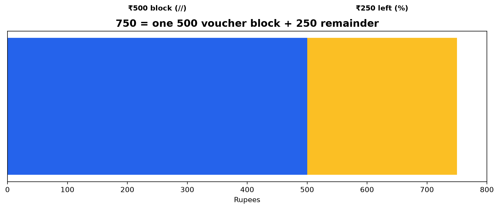
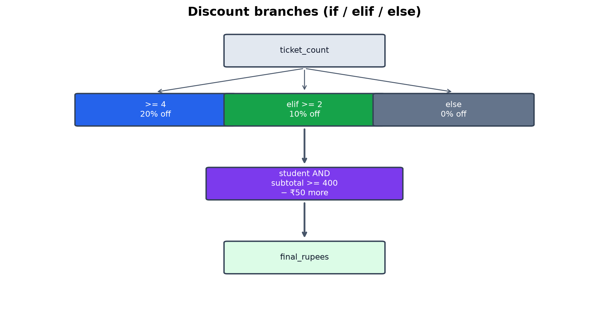
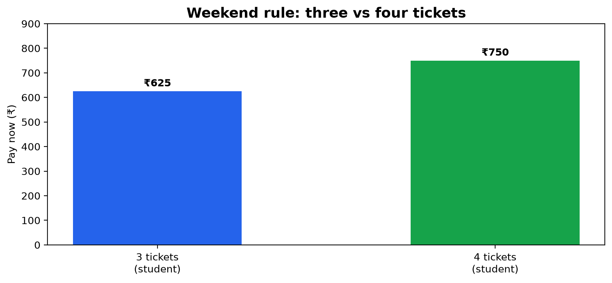

# <font color='#1d4ed8'>Lecture Script: Variables and Condition Logic in Colab</font>

---

## <font color='blue'>Agenda</font>

The lecture runs as four topics. Each topic ends with a quiz.

| Topic | What we do | Learning objectives covered | Minutes |
|:-:|:--|:--|:-:|
| 1 | Run Colab cells and name booking values | Write and run code in a notebook cell, separating code cells from markdown cells<br>Write a script that stores values in named variables following Python naming conventions | 25 |
| 2 | See types and convert ticket text | Classify a value as int, float, str or bool<br>Convert a value between string, integer and float types | 30 |
| 3 | Compute subtotals with operators | Compute a result using arithmetic operators, including integer division and modulo | 28 |
| 4 | Test rules and set the discount branch | Construct a boolean expression using comparison and logical operators<br>Implement branching logic for a stated business rule using if/elif/else | 27 |
| — | Closing: Outcome & Summary | | 10 |
| | **Total** | | **120** |

> <font color="red">**🎯 Instructor Note**</font> Pace: keep Colab setup to five minutes inside Topic 1; spend time on type conversion mistakes in Topic 2.
> Topic 4 is the decision point: walk the full if/elif/else ladder twice with different ticket counts.

---

## <font color='blue'>Scenario</font>

| Field | Value (invented) |
|:--|:--|
| Setting | A BookMyShow-style online booking desk (framing only) |
| Show | `Dunki` at PVR Phoenix, Saturday evening |
| Base seat price | ₹250 per ticket |
| Booking desk check | Four weekend tickets must get the bulk discount, not the single-ticket price |

> <font color="red">**🎯 Instructor Note**</font> BookMyShow and PVR are only the setting; these prices and counts are invented for class.
> Open a fresh Colab notebook before class. No `data/` upload today; later sessions add a `data/` folder for larger tables.

---

## <font color='blue'>Problem Statement</font>

A booking desk staff member stored ticket count as text `"4"` but never converted it before math. The subtotal line showed `250250250250` instead of ₹1,000. On the next booking she typed `ticket_count = 4` without quotes and fixed the subtotal, but she used a single `if` for the student add-on, so the extra ₹50 fired even when only one ticket was sold. Two families saw the wrong pay-now amount that night.

> <font color='purple'>**How do we store booking facts in Colab, convert types safely, and pick the correct discount branch every time?**</font>

> <font color="red">**🎯 Instructor Note**</font> Poll: "Which value is text: `4`, `\"4\"`, or `True`?" Give learners 30 seconds to respond in chat. Reveal the answer in the Closing.

---

## <font color='blue'>What We Will Use</font>

Today you work only in **Google Colab**: markdown cells for notes and **code cells** for Python. Each code block below is one cell; click the play button or press Shift+Enter to run it.

| Topic | Tools | In one line |
|:-:|:--|:--|
| 1 | Colab code and markdown cells, `=`, `print` | Run Python and store values in names |
| 2 | `type`, `int`, `float`, `str`, `bool` | See the kind of value and convert it |
| 3 | `+`, `-`, `*`, `/`, `//`, `%` | Build subtotals, shares, and leftovers |
| 4 | `==`, `!=`, `<`, `>`, `<=`, `>=`, `and`, `or`, `not`, `if` / `elif` / `else` | Test rules and pick one branch |

---

## <font color='blue'>How: Walking Through the Weekend Booking Check</font>


---

## <font color='blue'>Topic 1: Run Colab and Name the Booking Values</font> `25 min`

> <font color='purple'>**Where do we type Python, and what three names hold show, ticket count, and base price?**</font>

In **How AI and LLMs Work with Prompts** you wrote tasks in ChatGPT, Claude, and Gemini. Today you run your own instructions in Colab. A **markdown cell** holds notes; a **code cell** holds Python. Only the code cell runs when you press Run.

### <font color='green'>Example: store three values and print them</font>

> <font color='purple'>**What prints for show name, ticket count, and base price?**</font>

Use **snake_case** names: lowercase words joined by `_`. Start a name with a letter, not a digit.

**Predict before running: What will happen?**

> <font color="red">**🎯 Instructor Note**</font> Expected: `Dunki`, then `3`, then `250`. Common wrong guess: all three on one line.

```python
show_name = "Dunki"
ticket_count = 3
base_price_rupees = 250
print(show_name)
print(ticket_count)
print(base_price_rupees)
```

**Output**

```
Dunki
3
250
```

#### <font color='#c2410c'>Code Explanation</font>

- **Lines 1 to 3** The `=` sign stores a value under a name. Quotes make text; numbers without quotes are whole numbers.
- **Lines 4 to 6** `print` sends each value to the cell output area below the cell.

> <font color='green'>**Result**</font> The notebook holds one show title, one ticket count, and one price per seat.

<p align="center"></p>

### <font color='green'>Extending it: a name Python cannot read</font>

> <font color='purple'>**What happens if the show title has no quotes?**</font>

> <font color="red">**🎯 Instructor Note**</font> Ask for a prediction. Give learners 30 seconds to respond in chat. Expected: `NameError`, because `Dunki` is not defined.

```python
show_name = Dunki
```

**Output**

```
Traceback (most recent call last):
  File "<cell>", line 1, in <module>
NameError: name 'Dunki' is not defined
```

> <font color='green'>**Result**</font> Without quotes, Python treats `Dunki` as another variable name. No such name exists, so the cell stops.

> <font color='#b45309'>**Common mistake**</font> Using spaces or hyphens inside a name. Use `show_name`, not `show name` or `show-name`.

### <font color='purple'>Quiz 1</font>

**Question:** Which name follows Python naming conventions for a base ticket price in rupees?

**Options:**
- A) `base_price_rupees`
- B) `BasePriceRupees`
- C) `base-price-rupees`
- D) `1base_price`

**Correct Answer:** A

**Explanation:**
- **A)** Correct: lowercase words with underscores, and it starts with a letter.
- **B)** Wrong: capitals work but this course uses snake_case for variables.
- **C)** Wrong: hyphens are not allowed inside a variable name.
- **D)** Wrong: a name cannot start with a digit.

---

## <font color='blue'>Topic 2: See Types and Convert Ticket Text</font> `30 min`

> <font color='purple'>**The poll asked about quoted `4`. How do we see types and fix text before math?**</font>

Every value has a **type**. Common types today are **int** (whole number), **float** (decimal), **str** (text), and **bool** (`True` or `False`).

### <font color='green'>Example: classify and convert ticket count</font>

> <font color='purple'>**What types appear before and after `int`, and what float comes from price text?**</font>

**Predict before running: What will happen?**

> <font color="red">**🎯 Instructor Note**</font> Expected: `<class 'str'>`, then `<class 'int'>`, then `250.5`. Common wrong guess: `int` removes decimals from `250.50` in the last line — `float` keeps them.

```python
ticket_count_text = "3"
print(type(ticket_count_text))
ticket_count = int(ticket_count_text)
print(type(ticket_count))
price_text = "250.50"
price_rupees = float(price_text)
print(price_rupees)
```

**Output**

```
<class 'str'>
<class 'int'>
250.5
```

#### <font color='#c2410c'>Code Explanation</font>

- **Line 1** Quotes make a string, even when the characters look like a number.
- **Lines 2 and 4** `type(...)` reports the class name of the value.
- **Lines 3 and 5** `int` and `float` build numeric types from text that looks like numbers.

> <font color='green'>**Result**</font> Text `"3"` becomes whole number `3`. Text `"250.50"` becomes decimal `250.5`.

<p align="center"></p>

### <font color='green'>Extending it: store a member flag</font>

> <font color='purple'>**What type does `is_student_member` have?**</font>

> <font color="red">**🎯 Instructor Note**</font> Expected: `<class 'bool'>` then `True`. Names starting with `is_` often hold true/false facts.

```python
is_student_member = True
print(type(is_student_member))
print(is_student_member)
```

**Output**

```
<class 'bool'>
True
```

> <font color='green'>**Result**</font> `True` is a bool. It is not the text `"True"` in quotes.

### <font color='green'>Extending it: turn a whole number into text for a message</font>

> <font color='purple'>**How do we build the line `3 tickets` without adding numbers to text by accident?**</font>

```python
ticket_count = 3
line = str(ticket_count) + " tickets"
print(line)
```

**Output**

```
3 tickets
```

> <font color='green'>**Result**</font> `str(ticket_count)` makes text so `+` joins text pieces instead of doing math.

> <font color='#b45309'>**Common mistake**</font> `print("Tickets: " + ticket_count)` when `ticket_count` is still an int. Convert with `str` first.

<p align="center"></p>

### <font color='purple'>Quiz 2</font>

**Question:** `ticket_count_text = "4"`. Which call makes `ticket_count` ready for `ticket_count * 250`?

**Options:**
- A) `ticket_count = ticket_count_text`
- B) `ticket_count = int(ticket_count_text)`
- C) `ticket_count = str(ticket_count_text)`
- D) `ticket_count = bool(ticket_count_text)`

**Correct Answer:** B

**Explanation:**
- **A)** Wrong: the value stays text, so multiply repeats the string.
- **B)** Correct: `int` turns digit text into a whole number.
- **C)** Wrong: `str` keeps text; it does not enable numeric multiply.
- **D)** Wrong: any non-empty string becomes `True`, not `4`.

---

## <font color='blue'>Topic 3: Compute Subtotals with Operators</font> `28 min`

> <font color='purple'>**Three tickets at ₹250 each — what is the subtotal, and how many full ₹500 blocks fit?**</font>

| Operator | Meaning in booking math |
|:--|:--|
| `*` | Tickets times price |
| `//` | How many whole ₹500 voucher blocks fit |
| `%` | Rupees left after those blocks |

### <font color='green'>Example: multiply, divide, and remainder</font>

> <font color='purple'>**What subtotal, block count, and leftover rupees print?**</font>

$$\boxed{\text{subtotal} = \text{ticket\_count} \times \text{base\_price\_rupees}}$$

**Predict before running: What will happen?**

> <font color="red">**🎯 Instructor Note**</font> Expected: `750`, then `1 250`. Common wrong guess: `//` gives a decimal — it gives a whole number toward zero.

```python
ticket_count = 3
base_price_rupees = 250
subtotal = ticket_count * base_price_rupees
print(subtotal)
voucher_blocks = subtotal // 500
change_left = subtotal % 500
print(voucher_blocks, change_left)
```

**Output**

```
750
1 250
```

#### <font color='#c2410c'>Code Explanation</font>

- **Line 3** `*` multiplies tickets by price.
- **Line 5** `//` divides and drops any fraction: one full ₹500 block fits in ₹750.
- **Line 6** `%` gives the remainder: ₹250 left after that block.

> <font color='green'>**Result**</font> Three tickets cost ₹750, which is one ₹500 block plus ₹250 left.

<p align="center"></p>

### <font color='green'>Extending it: split a bill with float divide</font>

> <font color='purple'>**Two friends share ₹750 evenly — what does `/` print?**</font>

```python
per_person = subtotal / 2
print(per_person)
```

**Output**

```
375.0
```

> <font color='green'>**Result**</font> `/` always gives a float when needed, even when the answer is a whole number.

### <font color='purple'>Quiz 3</font>

**Question:** `subtotal = 750`. What does `subtotal % 500` return?

**Options:**
- A) `1.5`
- B) `250`
- C) `500`
- D) `0`

**Correct Answer:** B

**Explanation:**
- **A)** Wrong: `%` returns a remainder, not a division decimal.
- **B)** Correct: ₹750 minus one ₹500 block leaves ₹250.
- **C)** Wrong: `500` is the divisor, not the remainder.
- **D)** Wrong: ₹750 is not an exact multiple of ₹500.

---

## <font color='blue'>Topic 4: Test Rules and Set the Discount Branch</font> `27 min`

> <font color='purple'>**Which bulk discount fits four tickets, and when does the student add-on apply?**</font>

**Bulk weekend rule (invented):**

| Tickets | Bulk discount on subtotal |
|:-:|:-:|
| 4 or more | 20% off |
| 2 or 3 | 10% off |
| 1 | no bulk discount |

**Student add-on:** If `is_student_member` is true **and** subtotal is at least ₹400, subtract ₹50 more after the bulk discount.

### <font color='green'>Example: comparisons and boolean flags</font>

> <font color='purple'>**For four weekend tickets, which two flags are true?**</font>

**Predict before running: What will happen?**

> <font color="red">**🎯 Instructor Note**</font> Expected: `True True`. Give learners 30 seconds to respond in chat before you run.

```python
ticket_count = 4
base_price_rupees = 250
is_weekend = True
subtotal = ticket_count * base_price_rupees
bulk_rate = ticket_count >= 4
weekend_pair = is_weekend and ticket_count >= 2
print(bulk_rate, weekend_pair)
```

**Output**

```
True True
```

#### <font color='#c2410c'>Code Explanation</font>

- **Line 5** `>=` asks whether the left side is at least the right side.
- **Line 6** `and` is true only when both sides are true.

> <font color='green'>**Result**</font> Four tickets meet the bulk threshold, and the weekend pair rule is also satisfied.

### <font color='green'>Example: full if/elif/else ladder</font>

> <font color='purple'>**What pay amount prints for four tickets with a student member?**</font>

**Predict before running: What will happen?**

> <font color="red">**🎯 Instructor Note**</font> Expected: `750`. Walk the ladder: 20% of ₹1,000 is ₹200, plus ₹50 student, final ₹750.

```python
ticket_count = 4
subtotal = ticket_count * 250
if ticket_count >= 4:
    discount_rate = 0.20
elif ticket_count >= 2:
    discount_rate = 0.10
else:
    discount_rate = 0.0
discount_rupees = subtotal * discount_rate
print(discount_rate, discount_rupees)
```

**Output**

```
0.2 200.0
```

```python
is_student_member = True
if is_student_member and subtotal >= 400:
    discount_rupees = discount_rupees + 50
final_rupees = subtotal - discount_rupees
print(round(final_rupees))
```

**Output**

```
750
```

#### <font color='#c2410c'>Code Explanation</font>

- **First cell, lines 4 to 9** Python checks branches from top to bottom and runs the first true block only.
- **Second cell** A separate `if` stacks the student rule on top of the bulk discount.
- **Second cell, line 3** `round` drops decimal noise when the answer is a whole rupee amount.

> <font color='green'>**Result**</font> Four tickets cost ₹750 after 20% bulk off and the ₹50 student add-on.

<p align="center"></p>

### <font color='green'>Extending it: one ticket, no student</font>

> <font color='purple'>**What changes when only one ticket is sold?**</font>

```python
ticket_count = 1
subtotal = ticket_count * 250
if ticket_count >= 4:
    discount_rate = 0.20
elif ticket_count >= 2:
    discount_rate = 0.10
else:
    discount_rate = 0.0
discount_rupees = subtotal * discount_rate
print(discount_rate)
```

**Output**

```
0.0
```

```python
is_student_member = False
if is_student_member and subtotal >= 400:
    discount_rupees = discount_rupees + 50
print(subtotal - discount_rupees)
```

**Output**

```
250.0
```

> <font color='green'>**Result**</font> The `else` branch sets rate `0.0`. With no student flag, the pay amount stays ₹250.

> <font color='#b45309'>**Common mistake**</font> Using `=` inside a condition instead of `==`. `=` stores a value; `==` compares two values.

### <font color='purple'>Quiz 4</font>

**Question:** `ticket_count = 3`, `is_student_member = True`, base ₹250. After the same ladder as above, what is `round(final_rupees)`?

**Options:**
- A) `750`
- B) `625`
- C) `675`
- D) `250`

**Correct Answer:** B

**Explanation:**
- **A)** Wrong: that is the four-ticket total with bulk and student add-on.
- **B)** Correct: 10% off ₹750 is ₹75; plus ₹50 student gives ₹125 off; pay ₹625.
- **C)** Wrong: that total would need a larger bulk tier or a smaller discount stack.
- **D)** Wrong: three tickets never hit the single-ticket branch.

---

## <font color='blue'>Closing: Outcome & Summary</font> `10 min`

The opening mistake was mixing text with math and skipping the right branch. Each topic fixes one piece until the pay line matches the rule card.

> <font color='purple'>**1. Where do we run Python, and what three names did we store first?**</font>

In a Colab **code cell**, with `show_name`, `ticket_count`, and `base_price_rupees`.

> <font color='purple'>**2. What type was `\"4\"`, and what did we call to multiply safely?**</font>

It was a **str**; `int(...)` turned it into a whole number before `*`.

> <font color='purple'>**3. For three tickets, what was the subtotal and the `% 500` remainder?**</font>

Subtotal ₹750; remainder ₹250 after one ₹500 block.

> <font color='purple'>**4. Three tickets, student member, weekend — what is the final pay amount?**</font>

```python
ticket_count = 3
subtotal = ticket_count * 250
if ticket_count >= 4:
    discount_rate = 0.20
elif ticket_count >= 2:
    discount_rate = 0.10
else:
    discount_rate = 0.0
discount_rupees = subtotal * discount_rate
print(discount_rate)
```

**Output**

```
0.1
```

```python
is_student_member = True
if is_student_member and subtotal >= 400:
    discount_rupees = discount_rupees + 50
print(int(subtotal - discount_rupees))
```

**Output**

```
625
```

#### <font color='#c2410c'>Code Explanation</font>

- **First cell** Three tickets hit the `elif` branch at 10% off.
- **Second cell** Student add-on needs subtotal at least ₹400; ₹750 qualifies.

<p align="center"></p>

### <font color='green'>Outcome</font>

| Booking | Subtotal | Bulk branch | Student add-on | Pay now |
|:--|:-:|:-:|:-:|:-:|
| 3 tickets, student | ₹750 | 10% (₹75) | ₹50 | ₹625 |
| 4 tickets, student | ₹1,000 | 20% (₹200) | ₹50 | ₹750 |

> <font color='green'>**Therefore,**</font> convert types before arithmetic, test with comparisons, and walk the if/elif/else ladder top to bottom so bulk and student rules both fire only when they should. Poll answer: **`"4"`** is text (`str`); bare **`4`** is a whole number (`int`).

> <font color="red">**🎯 Instructor Note**</font> Reveal the poll answer next to the Outcome table. Give learners 30 seconds to respond in chat if anyone still has the wrong type in mind.

### <font color='green'>Summary</font>

| Learning objective | Takeaway |
|:--|:--|
| Write and run code in a notebook cell, separating code cells from markdown cells | Markdown for notes; code cells for Python; Run shows output under the cell |
| Write a script that stores values in named variables following Python naming conventions | Use snake_case names that start with a letter |
| Classify a value as int, float, str or bool | `type(value)` before you trust an operator |
| Convert a value between string, integer and float types | `int`, `float`, and `str` bridge text and numbers |
| Compute a result using arithmetic operators, including integer division and modulo | `*`, `//`, and `%` answer subtotal, blocks, and leftovers |
| Construct a boolean expression using comparison and logical operators | `>=`, `==`, `and`, and `or` return True or False |
| Implement branching logic for a stated business rule using if/elif/else | Check the highest ticket tier first; only the first true branch runs |
| **Practical value** | Every later notebook stores messy real inputs and applies one clear rule card without hand-calculating each row |

---

# <font color='red'>Launch the Feedback Poll</font>

> <font color="red">**🎯 Instructor Note**</font> Reminder: launch the feedback poll now to collect learner feedback.