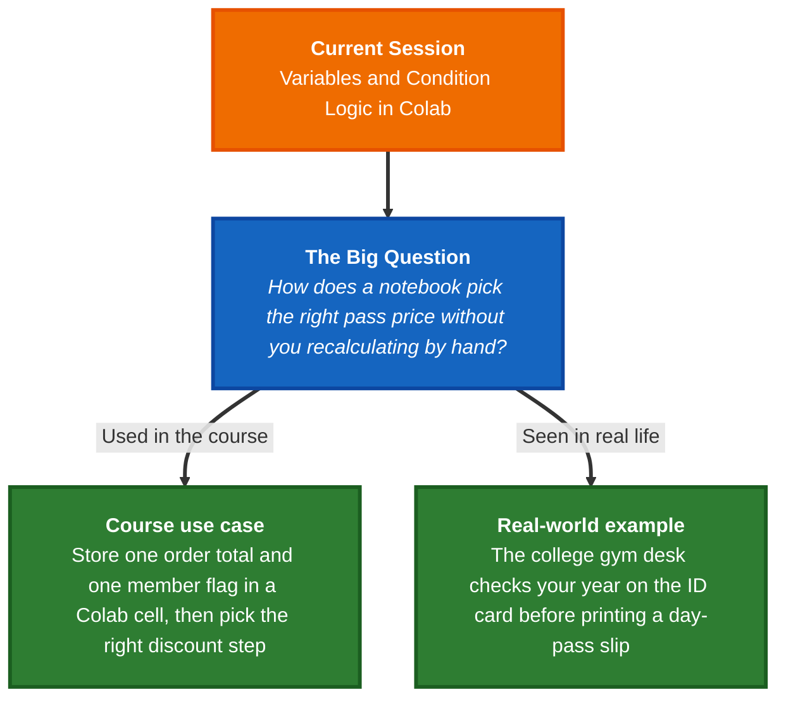

## <span style="color:#2F7DDE">Variables and Condition Logic in Colab</span>

### <span style="color:#2F7DDE">Mental Map</span>



---

### <span style="color:#2F7DDE">What You'll Learn</span>

Have you ever wondered why the gym desk asks your year before they type a price?

By the end of this session, you will be able to:

- <span style="color:#D9660B">**Execute**</span> a Colab code cell that prints a pass price while keeping notes in a markdown cell.
- <span style="color:#D9660B">**Store**</span> student year, visit count, and peak-hour flag under clear names like `student_year` and `is_peak_hour`.
- <span style="color:#D9660B">**Classify**</span> a value as a whole number, decimal, text, or true/false flag before you do math on it.
- <span style="color:#D9660B">**Change**</span> visit count from text `"2"` to a whole number so multiply works on the ₹80 base fee.
- <span style="color:#D9660B">**Calculate**</span> a two-visit total with multiply, whole-number divide, and remainder on ₹160.
- <span style="color:#D9660B">**Choose**</span> the correct pass tier when year, visits, and peak hour follow different rules together.

> <span style="color:#2F7DDE">**Topics you will meet:**</span> Running a Colab cell; Variables; Data types; Type conversion; Arithmetic operators; Comparison and logical operators; If/else.
>
> Join the session to learn each of these in detail.

---

### <span style="color:#2F7DDE">Why You Are Learning This Topic</span>

You walk to the college gym on a busy evening.

The desk needs your year, how many visits you want, and whether it is peak hour.

Last week someone typed visit count as text. The screen showed the wrong total.

A senior student paid peak price when her year should have halved the fee.

A **variable** means a named box that holds one value your code can read and change.

You will use variables whenever you store order totals and discount rules in a notebook.

> <span style="color:#2F7DDE">**Think about it:**</span> What happens if visit count stays as text when the rule needs a number?

---

### <span style="color:#2F7DDE">The Gym Day Pass Puzzle</span>

The desk tablet holds three facts for one student at 6 pm on Tuesday.

| Field | Value entered | Kind of value |
|:-----:|:--------------|:-------------:|
| Student year | 2 | whole number |
| Visits today | `"2"` | text in quotes |
| Peak hour (6–9 pm) | yes | true/false style |

<span style="color:#D9660B">**What you want to happen:**</span>

- Charge ₹80 per visit when year is 1, and ₹50 when year is 2 or 3.
- Add ₹20 per visit only when peak hour is yes.
- Show one final total for two visits, not two separate guesses.

Here is how it might start. You do not need to understand it yet.

```python
student_year = 2
visit_count = "2"
print(student_year, visit_count)
```

> <span style="color:#D9660B">**Wonder about this:**</span>
>
> - Why might `"2"` and `2` behave differently when you multiply by ₹50?
> - How would the desk know which price step to use without rewriting the math each time?

---

### <span style="color:#2F7DDE">Think It Through</span>

There is no wrong first try. Keep your guesses for the session.

**1. A first-year student wants one off-peak visit. Which base fee fits?**
Hint: Look at the year row in the table.

**2. The tablet shows visit count as `"2"` in quotes. Is that ready for multiply?**
Hint: Think text versus whole number.

**3. Peak hour is yes and visits are two. What two facts must both be true for the extra ₹20 each?**
Hint: You will meet words that join two checks into one answer.

---

### <span style="color:#2F7DDE">One Question to Carry Into the Session</span>

> <span style="color:#2F7DDE">**How do named values and if-steps let Colab pick the right pass total every time?**</span>
>
> What would you store first: year, visits, or peak hour?