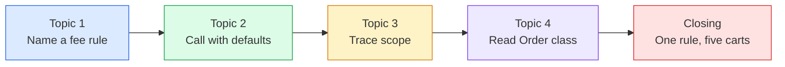

# <font color='#1d4ed8'>Lecture Script: Functions for Reusable Code and Reading Classes</font>

---

## <font color='blue'>Agenda</font>

The lecture runs as four topics. Each topic ends with a quiz.

| Topic | What we do | Learning objectives covered | Minutes |
|:-:|:--|:--|:-:|
| 1 | Name a fee rule once | Write a function that takes arguments and returns a computed value | 30 |
| 2 | Call with order and defaults | Call a function using positional and keyword arguments<br>Write a function with default parameter values | 35 |
| 3 | Trace names inside and out | Explain why a variable defined inside a function is not visible outside it | 25 |
| 4 | Read a class block | Explain the difference between a class definition and an instance created from it | 25 |
| — | Closing: Outcome & Summary | | 5 |
| | **Total** | | **120** |

> <font color="red">**🎯 Instructor Note**</font> Pace: Topic 2 needs both argument styles; slow down on defaults before the quiz.
> Topic 4 is read-only; learners do not write a class from scratch today.

---

## <font color='blue'>Scenario</font>

**Before:** A Flipkart-style marketplace team prices notebook orders in Google Colab. Every analyst pasted the same three lines into separate cells.

**After:** One named rule feeds every cart. A default GST rate covers most orders. One `Order` class block describes every live cart without rewriting the layout.

The numbers below are invented for teaching. They mirror how a large marketplace might batch pricing checks.

> <font color="red">**🎯 Instructor Note**</font> Flipkart is only the setting. Do not claim Flipkart uses these notebook prices; all cart data is invented for teaching.

---

## <font color='blue'>Problem Statement</font>

A mentor copied a fee formula into five Colab cells for five test carts. Cell 4 used `*` twice by mistake. A learner ran all five cells and shipped the wrong total to a demo buyer.

The buyer asked one question: "Why did my notebook total change when I only added one more item?"

> <font color='purple'>**How do we price every cart from one correct rule instead of five fragile copies?**</font>

> <font color="red">**🎯 Instructor Note**</font> Poll: "Would you rather fix five cells or one function?" Give learners 30 seconds to respond in chat. Reveal in the Closing.

---

## <font color='blue'>What We Will Use</font>

You already run cells, store values in variables, branch with `if`, and repeat steps with loops. Today you package those steps under a name.

| Topic | Tools | In one line |
|:-:|:--|:--|
| 1 | `def`, `return` | Name a rule and send back one value |
| 2 | positional args, keyword args, defaults | Call the rule in a fixed order or by name |
| 3 | local scope | Names created inside a rule stay inside |
| 4 | `class`, instance | Read a template versus one live object |

> <font color='#b45309'>**Watch out for**</font>
> - `return` ends the function; code after it in the same block does not run.
> - Positional arguments must follow the order in the `def` line.
> - Default parameters belong at the end of the parameter list.
> - Reading a class is not the same as building one today.

---

## <font color='blue'>How: Walking Through the Cart Rule</font>



---

## <font color='blue'>Topic 1: Name a Fee Rule Once</font> `30 min`

> <font color='purple'>**We fixed prompts, variables, conditionals, and loops. What is still missing when five cells all compute a notebook total?**</font>

You can store `qty` and `unit_price` in variables and loop over carts. A **function** wraps that pattern: inputs go in, one computed value comes back.

### <font color='green'>Example: line total from quantity and price</font>

> <font color='purple'>**How much do four notebooks cost at Rs 149 each?**</font>

**Predict before running: What will happen?**

> <font color="red">**🎯 Instructor Note**</font> Expected: `596`. Common guess: learners print before calling and see nothing.

```python
def order_total(items, price_each):
    return items * price_each

print(order_total(4, 149))
```

**Output**

```
596
```

#### <font color='#c2410c'>Code Explanation</font>

- **Line 1** Opens the rule named `order_total` with two inputs: `items` and `price_each`.
- **Line 2** Multiplies and sends the value back to the caller.
- **Line 4** Calls the rule with `4` and `149`, then prints what comes back.

> <font color='green'>**Result**</font> One call replaces a whole cell of copy-pasted math for this cart.

### <font color='green'>Extending it: reuse the rule on another cart</font>

> <font color='purple'>**A second buyer wants two notebooks at Rs 499. Does the function body change?**</font>

```python
print(order_total(2, 499))
print(order_total(1, 899))
```

**Output**

```
998
899
```

#### <font color='#c2410c'>Code Explanation</font>

- **Line 1** Calls the same rule with new arguments; only the inputs change.
- **Line 2** Shows the rule works for a single-item cart too.

> <font color='green'>**Result**</font> The mentor fixes pricing logic once inside `order_total`, not in five separate cells.

> <font color='#b45309'>**Common mistake**</font> Forgetting `return` prints `None` even when the math inside looks correct.

### <font color='purple'>Quiz 1</font>

**Question:** What does `return items * price_each` do inside `order_total`?

**Options:**
- A) Sends the product back to whoever called the function
- B) Prints the product and keeps running the rest of the notebook
- C) Saves the product only if the variable name is `items`
- D) Runs the function again with swapped arguments

**Correct Answer:** A

**Explanation:**
- **A)** `return` passes the computed value to the caller; this is correct.
- **B)** Printing needs `print`; `return` does not show anything by itself.
- **C)** Any valid expression can follow `return`, not only names that match a parameter.
- **D)** Nothing in `return` swaps argument order automatically.

---

## <font color='blue'>Topic 2: Call With Order and Defaults</font> `35 min`

> <font color='purple'>**The fee rule works. How do we call it when GST is usually 5% but sometimes 12%?**</font>

### <font color='green'>Example: positional call with the default GST</font>

> <font color='purple'>**Two notebooks at Rs 500 each with the usual 5% GST—what is the bill?**</font>

**Predict before running: What will happen?**

> <font color="red">**🎯 Instructor Note**</font> Expected: `1050.0`. Ask why the result is a float.

```python
def bill_total(qty, unit_price, gst_pct=5):
    sub = qty * unit_price
    return sub + sub * gst_pct / 100

print(bill_total(2, 500))
```

**Output**

```
1050.0
```

#### <font color='#c2410c'>Code Explanation</font>

- **Line 1** Lists `qty` and `unit_price` first; `gst_pct` defaults to `5` when omitted.
- **Line 2** Stores the line subtotal before tax.
- **Line 3** Adds GST as a percent of the subtotal and returns the full bill.
- **Line 5** Passes `2` and `500` positionally; Python fills in `gst_pct=5`.

> <font color='green'>**Result**</font> Most carts need only two numbers at the call site.

### <font color='green'>Extending it: keyword arguments for a special GST rate</font>

> <font color='purple'>**The same cart must use 12% GST. How do we override only the tax?**</font>

```python
print(bill_total(qty=2, unit_price=500, gst_pct=12))
```

**Output**

```
1120.0
```

#### <font color='#c2410c'>Code Explanation</font>

- **Line 1** Names each argument, so order in the call can differ from the `def` line.
- **Line 1** Sets `gst_pct` to `12`, overriding the default of `5`.

> <font color='green'>**Result**</font> Keyword calls make optional parameters clear in demo notebooks.

### <font color='green'>Extending it: mix positional and keyword</font>

> <font color='purple'>**Can we pass quantity first by position and GST by name?**</font>

```python
print(bill_total(3, 200, gst_pct=18))
```

**Output**

```
708.0
```

#### <font color='#c2410c'>Code Explanation</font>

- **Line 1** Gives `qty=3` and `unit_price=200` by position, then `gst_pct=18` by keyword.

> <font color='green'>**Result**</font> Positional arguments fill the left side of the parameter list; keywords set the rest.

### <font color='purple'>Quiz 2</font>

**Question:** Which call is valid for `def bill_total(qty, unit_price, gst_pct=5):`?

**Options:**
- A) `bill_total(gst_pct=12, 2, 500)`
- B) `bill_total(2, 500, gst_pct=12)`
- C) `bill_total(2, gst_pct=12)`
- D) `bill_total(unit_price=500)`

**Correct Answer:** B

**Explanation:**
- **A)** Positional arguments cannot follow keyword arguments in a single call.
- **B)** Two positionals plus one keyword override is valid.
- **C)** `unit_price` is missing, so Python raises a type error.
- **D)** Required parameter `qty` is missing.

---

## <font color='blue'>Topic 3: Trace Names Inside and Out</font> `25 min`

> <font color='purple'>**Inside `bill_total`, `sub` holds the pre-tax amount. Can we print `sub` after the function finishes?**</font>

### <font color='green'>Example: a name that lives only inside the rule</font>

> <font color='purple'>**We add 5% tax to Rs 1000. What prints, and what fails?**</font>

**Predict before running: What will happen?**

> <font color="red">**🎯 Instructor Note**</font> Expected: `1050.0` then `NameError` on `tax`. Give learners 30 seconds to respond in chat before running.

```python
def add_tax(amount):
    tax = amount * 0.05
    return amount + tax

result = add_tax(1000)
print(result)
print(tax)
```

**Output**

```
1050.0
NameError: name 'tax' is not defined
```

#### <font color='#c2410c'>Code Explanation</font>

- **Line 2** Creates `tax` only while `add_tax` runs.
- **Line 3** Returns the taxed total; `tax` itself is not returned.
- **Line 5** Stores the returned value in `result`, which lives in the notebook.
- **Line 7** Looks for `tax` in the notebook scope, where it was never created.

> <font color='green'>**Result**</font> Variables defined inside a function are local—they hide from cells below the call.

#### <font color='#c2410c'>Logic Explanation</font>

- Python checks names in the inner block first, then the notebook (global) scope.
- `result` is safe to reuse; `tax` is not, unless you assign it outside the function.

### <font color='green'>Extending it: parameters are local too</font>

> <font color='purple'>**After `add_tax(1000)`, can we print `amount` in the next cell?**</font>

```python
print(amount)
```

**Output**

```
NameError: name 'amount' is not defined
```

#### <font color='#c2410c'>Code Explanation</font>

- **Line 1** Tries to read `amount` after the function ended; the parameter existed only inside `add_tax`.

> <font color='green'>**Result**</font> Parameters behave like temporary local names for the duration of the call.

### <font color='purple'>Quiz 3</font>

**Question:** Why does `print(tax)` fail after `add_tax(1000)` returns?

**Options:**
- A) `tax` was local to `add_tax` and was destroyed when the function finished
- B) `return` deletes every variable in the entire notebook
- C) Float values cannot be printed after a function call
- D) `tax` is a keyword reserved by Python

**Correct Answer:** A

**Explanation:**
- **A)** Local names end with the function call; this is the correct scope rule.
- **B)** Global names like `result` remain; `return` does not wipe the notebook.
- **C)** Types do not control visibility; scope does.
- **D)** `tax` is a valid identifier, not a reserved word.

---

## <font color='blue'>Topic 4: Read an Order Class Block</font> `25 min`

> <font color='purple'>**Fifty carts share the same fields: item name and quantity. How does code describe the pattern versus one live cart?**</font>

You will read, not write, a class today. Think of the **class** as the blueprint on the warehouse wall. An **instance** is one stamped-out order slip.

### <font color='green'>Example: blueprint versus live order</font>

> <font color='purple'>**What is `Order` itself, and what is `order_a`?**</font>

**Predict before running: What will happen?**

> <font color="red">**🎯 Instructor Note**</font> Expected: `True` then `Notebook 2`. Link "blueprint" to class, "slip" to instance.

```python
class Order:
    def __init__(self, item, qty):
        self.item = item
        self.qty = qty

template = Order
order_a = Order("Notebook", 2)
print(template is Order)
print(order_a.item, order_a.qty)
```

**Output**

```
True
Notebook 2
```

#### <font color='#c2410c'>Code Explanation</font>

- **Line 1** Defines the `Order` class—the shared layout for every cart.
- **Line 2** `__init__` sets fields on each new object.
- **Line 3** `self.item` and `self.qty` become data on one instance.
- **Line 5** `template` points at the class object itself.
- **Line 6** `order_a` is one instance built from that class.
- **Line 7** Confirms `template` and `Order` are the same class object.
- **Line 8** Reads fields from the instance, not from the class line.

> <font color='green'>**Result**</font> The class definition describes the shape; each `Order(...)` call creates a separate cart record.

### <font color='green'>Extending it: two instances, one class</font>

> <font color='purple'>**Another buyer orders pens. Do we need a second class?**</font>

```python
order_b = Order("Pen", 10)
print(order_a.qty, order_b.qty)
```

**Output**

```
2 10
```

#### <font color='#c2410c'>Code Explanation</font>

- **Line 1** Builds a second instance from the same `Order` class.
- **Line 2** Each instance keeps its own `qty` value.

> <font color='green'>**Result**</font> One class definition; many instances with different item names and counts.

### <font color='purple'>Quiz 4</font>

**Question:** In the example, what is the difference between `Order` and `order_a`?

**Options:**
- A) `Order` is the class definition; `order_a` is one instance created from it
- B) `Order` is a string; `order_a` is an integer
- C) `Order` runs only once; `order_a` cannot change `qty`
- D) `Order` and `order_a` are always two names for the same object

**Correct Answer:** A

**Explanation:**
- **A)** The class is the template; the instance is one concrete cart—correct.
- **B)** Neither is a string or int type by itself; both are class-related objects.
- **C)** Instances can hold different `qty` values; immutability is not the lesson here.
- **D)** `template is Order` is true, but `order_a` is a separate instance object.

---

## <font color='blue'>Closing: Outcome & Summary</font> `5 min`

> <font color='purple'>**1. Why did the demo buyer see a wrong total when cell 4 had a typo?**</font>

Five pasted cells meant five chances to break the same math. One `order_total` function fixes the logic in one place.

> <font color='purple'>**2. How do we price the five test carts now—defaults, scope, and all?**</font>

```python
def bill_total(qty, unit_price, gst_pct=5):
    sub = qty * unit_price
    return sub + sub * gst_pct / 100

for q, p in [(2, 149), (1, 899), (4, 499), (2, 500), (1, 1299)]:
    print(q, p, "->", bill_total(q, p))
```

**Output**

```
2 149 -> 312.9
1 899 -> 943.95
4 499 -> 2095.8
2 500 -> 1050.0
1 1299 -> 1363.95
```

#### <font color='#c2410c'>Code Explanation</font>

- **Line 1** Reuses the default-GST rule from Topic 2.
- **Line 5** Loops like Session 2.1, calling one function per cart instead of five cells.

### <font color='green'>Outcome</font>

| Approach | Cells to fix when GST changes | Risk of a typo in one cart |
|:--|:-:|:-:|
| Five copy-pasted cells | 5 | High |
| One `bill_total` function | 1 | Low |

> <font color='green'>**Therefore,**</font> one function with clear arguments and defaults answers the buyer's question: totals stay consistent because every cart calls the same rule.

> <font color="red">**🎯 Instructor Note**</font> Reveal the poll: most learners pick one function; tie that vote to the table above.

### <font color='green'>Summary</font>

| Learning objective | Takeaway |
|:--|:--|
| Write a function that takes arguments and returns a computed value | `def` plus `return` packages cart math once |
| Call a function using positional and keyword arguments | Position fills the list left to right; keywords name the rest |
| Write a function with default parameter values | Defaults cover GST unless the call overrides them |
| Explain why a variable defined inside a function is not visible outside it | Locals like `tax` end when the function returns |
| Explain the difference between a class definition and an instance created from it | `Order` is the blueprint; `order_a` is one live cart |
| **Practical value** | Pricing notebooks for a Flipkart-style demo stays consistent and fast to fix |

---

# <font color='red'>Launch the Feedback Poll</font>

> <font color="red">**🎯 Instructor Note**</font> Reminder: launch the feedback poll now to collect learner feedback.