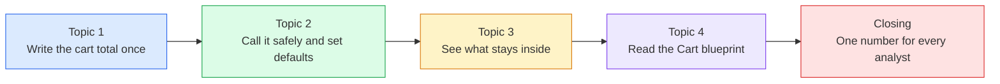
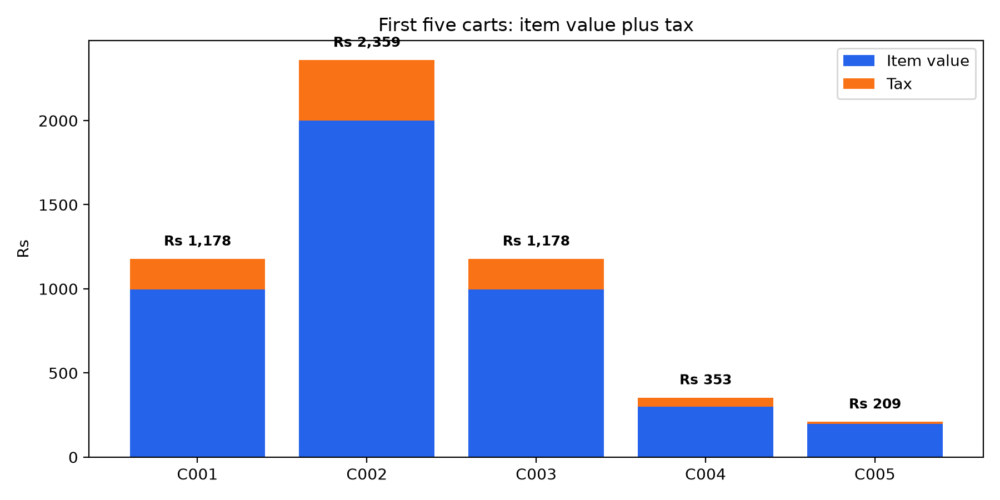
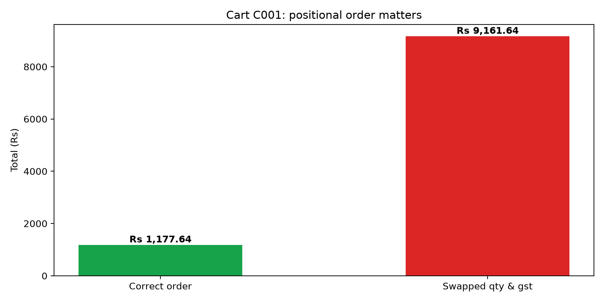
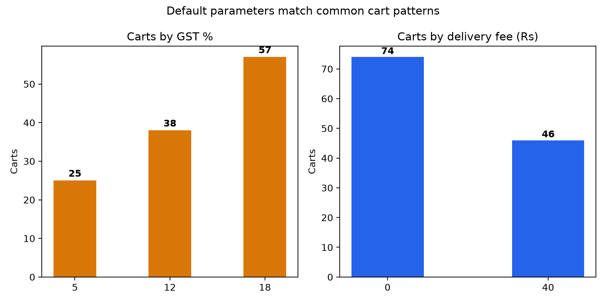
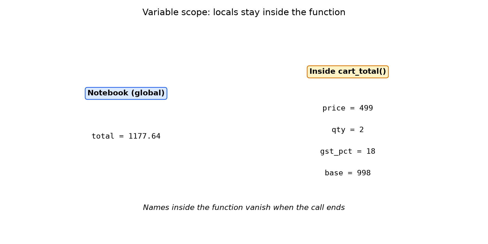
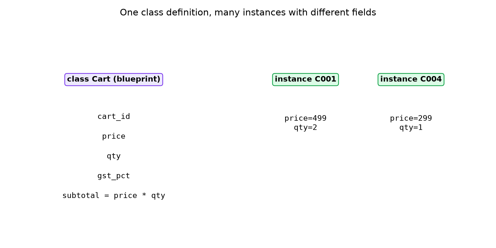
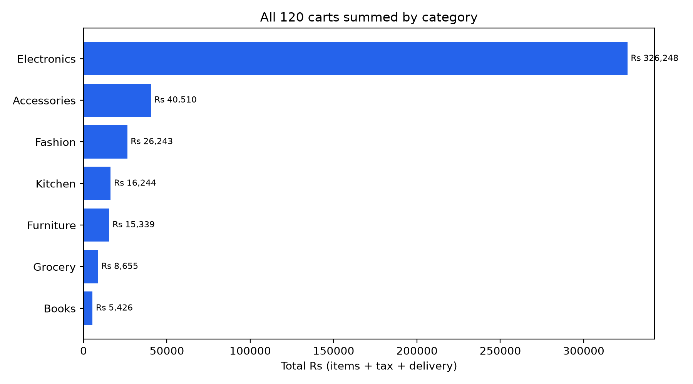

# <font color='#1d4ed8'>Lecture Script: Functions for Reusable Code and Reading Classes</font>

---

## <font color='blue'>Agenda</font>

The lecture runs as four topics. Each topic ends with a quiz.

| Topic | What we do | Learning objectives covered | Minutes |
|:-:|:--|:--|:-:|
| 1 | Write the cart total once | Write a function that takes arguments and returns a computed value | 25 |
| 2 | Call it safely and set defaults | Call a function using positional and keyword arguments<br>Write a function with default parameter values | 35 |
| 3 | See what stays inside | Explain why a variable defined inside a function is not visible outside it | 20 |
| 4 | Read the Cart blueprint | Explain the difference between a class definition and an instance created from it | 30 |
| — | Closing: Outcome & Summary | | 10 |
| | **Total** | | **120** |

> <font color="red">**🎯 Instructor Note**</font> Pace: spend the most time in Topic 2, where learners call and set defaults on their own. Keep Topic 3 short and visual.
> In Topic 4 learners only read a class; no one writes one today.

---

## <font color='blue'>Scenario</font>

A Flipkart-style shopping app shows a cart total before the customer pays. The rule is short: price times quantity, plus a tax percentage.

**The one risk:** that short rule lives as pasted lines in many analysts' notebooks. One wrong copy, and one customer sees the wrong bill.

Think of a lunch counter: one recipe card on the wall beats five staff members each remembering the steps differently.

> <font color="red">**🎯 Instructor Note**</font> Flipkart is only the setting. Do not claim it uses these numbers; the tax rates are invented for teaching.
> The full 120-row cart file is in `data/flipkart_carts.csv` for mentor upload only. Learners work from the five sample carts written as lists in Colab.

---

## <font color='blue'>Problem Statement</font>

Three analysts priced cart C001 (Rs 499 each, 2 items, 18% tax) in their own notebooks. Meera's notebook showed Rs 1,177.64. Arjun forgot the tax and showed Rs 998. Neha typed the quantity and the tax rate in the wrong order and showed Rs 9,161.64.

A support agent read Arjun's number to the customer. The customer was then charged Rs 1,177.64 and asked for a refund.

> <font color='purple'>**How do we write the cart total once, call it safely, and read the shared Cart blueprint, so every analyst gets the same number?**</font>

> <font color="red">**🎯 Instructor Note**</font> Poll: "Cart C001 is Rs 499 each, 2 items, 18% tax. What total will the app show?" Give learners 30 seconds to respond in chat. Reveal the answer in the Closing.

---

## <font color='blue'>What We Will Use</font>

Everything below runs in a Colab notebook. Each topic uses these tools without repeating them.

| Topic | Tools | In one line |
|:-:|:--|:--|
| 1 | `def`, parameters, `return`, `round` | Name a set of steps, feed it inputs and get one value back |
| 2 | positional call, keyword call, default value | Choose how to pass inputs, and let common inputs fill themselves in |
| 3 | local variable, `NameError` | A name made inside a function lives only while the function runs |
| 4 | `class`, `__init__`, `self`, instance, attribute, method | A class is the blueprint; an instance is one real cart built from it |

---

## <font color='blue'>How: Walking Through the Cart Total</font>



---

## <font color='blue'>Topic 1: Write the Cart Total Once</font> `25 min`

> <font color='purple'>**Last session you traced loops over lists in Colab. Three analysts typed the same total rule three ways. How do we write it once, like one recipe card instead of three scribbled copies?**</font>

In **Variables and Condition Logic in Colab** you stored values and used arithmetic. A function packs those same steps under one name.

### <font color='green'>Example: look at the sample carts</font>

> <font color='purple'>**What does each cart hold in our notebook lists?**</font>

We keep five carts as parallel lists. Each index is one row: id, price, quantity, tax rate and delivery fee.

**Predict before running: What will happen?**

> <font color="red">**🎯 Instructor Note**</font> Expected: `5 sample carts` and three printed rows. Common guess: learners forget delivery fee in the print line.

```python
cart_ids = ["C001", "C002", "C003", "C004", "C005"]
unit_prices = [499, 1999, 499, 299, 199]
qtys = [2, 1, 2, 1, 1]
gst_pcts = [18, 18, 18, 18, 5]
delivery_fees = [0, 0, 0, 40, 40]
print(len(cart_ids), "sample carts in the notebook")
for i in range(3):
    print(cart_ids[i], unit_prices[i], qtys[i], gst_pcts[i], delivery_fees[i])
```

**Output**

```
5 sample carts in the notebook
C001 499 2 18 0
C002 1999 1 18 0
C003 499 2 18 0
```

#### <font color='#c2410c'>Code Explanation</font>

- **Lines 1 to 5** Five parallel lists hold the same fields the mentor file has for every cart.
- **Line 6** `len(cart_ids)` counts how many carts sit in the notebook.
- **Lines 7 and 8** The loop prints the first three carts, one field at a time.

> <font color='green'>**Result**</font> Each cart has a price, a quantity, a tax percentage and a delivery fee. The mentor file has 120 carts; we practise on five.

### <font color='green'>Example: the cart total as a function</font>

> <font color='purple'>**How do we turn price, quantity and tax into one named rule that gives back the total?**</font>

By hand for cart C001:

$$\text{total} = 499 \times 2 \times \left(1 + \frac{18}{100}\right) = 998 \times 1.18 = 1177.64$$

$$\boxed{\text{total} = \text{price} \times \text{qty} \times \left(1 + \frac{\text{gst\_pct}}{100}\right)}$$

**Predict before running: What will happen?**

> <font color="red">**🎯 Instructor Note**</font> Expected: 1177.64, the same as the hand answer. Common guess: nothing prints, because the `def` line only stores the rule.

```python
def cart_total(price, qty, gst_pct):
    base = price * qty
    return round(base * (1 + gst_pct / 100), 2)

print(cart_total(499, 2, 18))
```

**Output**

```
1177.64
```

#### <font color='#c2410c'>Code Explanation</font>

- **Line 1** `def` starts the function. `cart_total` is its name. `price`, `qty` and `gst_pct` are parameters, the empty slots for inputs.
- **Line 2** The indented lines are the body. This line multiplies price by quantity.
- **Line 3** `return` hands the computed value back to whoever called the function. `round(..., 2)` keeps 2 decimals.
- **Line 5** The call passes 499, 2 and 18 as arguments, the real values that fill the slots. `print` shows what came back.

> <font color='green'>**Result**</font> One call gave Rs 1,177.64, the same as the hand answer. The rule is written once and can be called again and again.

### <font color='green'>Extending it: call the function on all five sample carts</font>

> <font color='purple'>**What if we call the same function for every cart in our lists?**</font>

> <font color="red">**🎯 Instructor Note**</font> Ask: "Will C001 and C003 give the same total?" Give learners 30 seconds to respond in chat. Expected: yes, both are Rs 499, 2 items, 18%.

```python
for i in range(len(cart_ids)):
    t = cart_total(unit_prices[i], qtys[i], gst_pcts[i])
    print(cart_ids[i], t)
```

**Output**

```
C001 1177.64
C002 2358.82
C003 1177.64
C004 352.82
C005 208.95
```

#### <font color='#c2410c'>Code Explanation</font>

- **Line 1** Loops over index 0 through 4, one pass per sample cart.
- **Line 2** Reads price, quantity and tax from the lists at index `i` and passes them as arguments. The returned value is stored in `t`.
- **Line 3** Prints the cart id and its total.

<p align="center"></p>

> <font color='green'>**Result**</font> Same inputs give the same total (C001 and C003 both Rs 1,177.64). The rule never has to be retyped.

### <font color='green'>Extending it: print is not return</font>

> <font color='purple'>**What if the function prints the total but does not return it?**</font>

**Predict before running: What will happen?**

> <font color="red">**🎯 Instructor Note**</font> Expected: the first line prints 1177.64 during the call, then `None 1177.64`. Common guess: both variables hold 1177.64.

```python
def show_total(price, qty, gst_pct):
    print(round(price * qty * (1 + gst_pct / 100), 2))

a = show_total(499, 2, 18)
b = cart_total(499, 2, 18)
print(a, b)
```

**Output**

```
1177.64
None 1177.64
```

#### <font color='#c2410c'>Code Explanation</font>

- **Lines 1 and 2** `show_total` only prints. It has no `return`, so the call gives back `None`, Python's "no value".
- **Line 4** Prints 1177.64 as a side effect of the call, then stores `None` in `a`.
- **Line 5** `cart_total` returns the number, so `b` holds 1177.64.
- **Line 6** Prints `a` and `b` side by side.

> <font color='green'>**Result**</font> `print` shows a value on screen. `return` hands it back so the notebook can store and reuse it.

### <font color='green'>Extending it: use the returned value</font>

> <font color='purple'>**What is the total of all five sample carts, tax included?**</font>

```python
grand = 0
for i in range(len(cart_ids)):
    row_total = cart_total(unit_prices[i], qtys[i], gst_pcts[i])
    grand += row_total
print(round(grand, 2))
```

**Output**

```
5275.87
```

#### <font color='#c2410c'>Code Explanation</font>

- **Line 1** Starts the running total at 0.
- **Line 2** Loops over every sample cart.
- **Line 3** Calls the function for index `i` and stores the returned total in `row_total`.
- **Line 4** Adds that total to `grand`.
- **Line 5** Prints the sum of the five totals, rounded to 2 decimals.

> <font color='green'>**Result**</font> The five sample carts add up to Rs 5,275.87 before delivery. This works only because the function returns a value.

> <font color='#b45309'>**Common mistake**</font> Writing `print` inside the function instead of `return`. The call then gives back `None`, and `grand += None` fails.

### <font color='purple'>Quiz 1</font>

**Question:** What does `cart_total(200, 3, 12)` return when the function is the one written above?

**Options:**
- A) 600
- B) None
- C) 672.0
- D) 36

**Correct Answer:** C

**Explanation:**
- **A)** Wrong: $200 \times 3 = 600$ is the item value, with the tax left out.
- **B)** Wrong: `None` comes from a function with no `return`; `cart_total` returns its number.
- **C)** Correct: $200 \times 3 \times 1.12 = 672.0$.
- **D)** Wrong: $3 \times 12 = 36$ multiplies the quantity by the tax rate and ignores the price.

---

## <font color='blue'>Topic 2: Call It Safely and Set Defaults</font> `35 min`

> <font color='purple'>**The function has three inputs. In what order, and in what style, do we hand them over?**</font>

### <font color='green'>Example: positional arguments</font>

> <font color='purple'>**What happens when we pass the values by position, and then swap two of them?**</font>

A positional argument is matched to a parameter by its place: first value to `price`, second to `qty`, third to `gst_pct`.

**Predict before running: What will happen?**

> <font color="red">**🎯 Instructor Note**</font> Expected: 1177.64, then 9161.64 with no error. Common guess: Python warns about the swap. It cannot know the order was wrong.

```python
print(cart_total(499, 2, 18))
print(cart_total(499, 18, 2))
```

**Output**

```
1177.64
9161.64
```

#### <font color='#c2410c'>Code Explanation</font>

- **Line 1** Correct order: price 499, quantity 2, tax 18.
- **Line 2** Swapped order: quantity becomes 18 and tax becomes 2, so the rule computes $499 \times 18 \times 1.02$.

<p align="center"></p>

> <font color='green'>**Result**</font> Positional order is the contract. A swap runs without an error and gives Rs 9,161.64, which is Neha's wrong number from the Problem Statement.

### <font color='green'>Extending it: keyword arguments</font>

> <font color='purple'>**What if we name each value, so the order stops mattering?**</font>

**Predict before running: What will happen?**

> <font color="red">**🎯 Instructor Note**</font> Expected: all three lines print 1177.64. Common guess: learners expect the keyword order to matter.

```python
print(cart_total(price=499, qty=2, gst_pct=18))
print(cart_total(gst_pct=18, qty=2, price=499))
print(cart_total(499, gst_pct=18, qty=2))
```

**Output**

```
1177.64
1177.64
1177.64
```

#### <font color='#c2410c'>Code Explanation</font>

- **Line 1** Every value carries its parameter name, written `name=value`.
- **Line 2** The keyword order is reversed, and each value still lands in the right slot.
- **Line 3** Mixing is allowed: positional values come first, keyword values after.

> <font color='green'>**Result**</font> Keyword arguments match by name, so the call reads clearly and the order no longer matters. All three calls give Rs 1,177.64.

### <font color='green'>Extending it: a missing argument</font>

> <font color='purple'>**What if we forget the tax rate?**</font>

**Predict before running: What will happen?**

> <font color="red">**🎯 Instructor Note**</font> Expected: a `TypeError` that names the missing parameter. Common guess: Python assumes the tax is 0.

```python
cart_total(499, 2)
```

**Output**

```
Traceback (most recent call last):
  File "<cell>", line 1, in <module>
    cart_total(499, 2)
TypeError: cart_total() missing 1 required positional argument: 'gst_pct'
```

#### <font color='#c2410c'>Logic Explanation</font>

- Read the last line of a traceback first. `TypeError` is the kind of problem, and the rest names the function and the parameter `gst_pct`.
- Three slots, two values: no guess is made for the empty slot.

> <font color='green'>**Result**</font> A function with three required parameters needs three arguments. Python tells us exactly which one is missing.

### <font color='green'>Extending it: a wrong keyword name</font>

> <font color='purple'>**What if a keyword does not match any parameter?**</font>

```python
cart_total(price=499, qty=2, gst=18)
```

**Output**

```
Traceback (most recent call last):
  File "<cell>", line 1, in <module>
    cart_total(price=499, qty=2, gst=18)
TypeError: cart_total() got an unexpected keyword argument 'gst'
```

#### <font color='#c2410c'>Logic Explanation</font>

- A keyword must match a parameter name exactly. `gst` is not `gst_pct`.

> <font color='green'>**Result**</font> Keywords are checked against the parameter names, so a typo is caught at once instead of giving a wrong total.

### <font color='green'>Example: a default tax rate</font>

> <font color='purple'>**Most carts use one tax rate. Do we have to type it every time?**</font>

**Predict before running: What will happen?**

> <font color="red">**🎯 Instructor Note**</font> Ask which tax rate is most common in the mentor file. Expected: 18% on 57 of the 120 carts.

```python
for rate in (18, 12, 5):
    n = sum(1 for g in gst_pcts if g == rate)
    if n:
        print(rate, n)
```

**Output**

```
18 4
5 1
```

#### <font color='#c2410c'>Code Explanation</font>

- **Lines 1 to 4** Count how many sample carts use each tax rate and print only rates that appear.

> <font color='green'>**Result**</font> In the notebook sample, 18% is the most common rate (4 carts), so it is a good default value.

A default value is written in the `def` line as `parameter=value`. If the caller leaves that argument out, the default is used.

```python
def cart_total(price, qty, gst_pct=18):
    base = price * qty
    return round(base * (1 + gst_pct / 100), 2)

print(cart_total(499, 2))
print(cart_total(499, 2, 12))
```

**Output**

```
1177.64
1117.76
```

#### <font color='#c2410c'>Code Explanation</font>

- **Line 1** `gst_pct=18` gives the tax rate a default of 18.
- **Line 5** No third argument, so `gst_pct` is 18 and the total is $998 \times 1.18 = 1177.64$.
- **Line 6** A third argument replaces the default, so $998 \times 1.12 = 1117.76$.

> <font color='green'>**Result**</font> The default fills in when the caller says nothing, and a value passed in overrides it.

### <font color='green'>Extending it: a second default and an override by keyword</font>

> <font color='purple'>**Some carts include a Rs 40 delivery fee. How do we add it with a default of free delivery?**</font>

**Predict before running: What will happen?**

> <font color="red">**🎯 Instructor Note**</font> Expected: the first call gives 236.0 with the default delivery of 0. The second adds Rs 40 and gives 276.0.

```python
def cart_total(price, qty, gst_pct=18, delivery=0):
    base = price * qty
    return round(base * (1 + gst_pct / 100) + delivery, 2)

print(cart_total(100, 2))
print(cart_total(100, 2, delivery=40))
```

**Output**

```
236.0
276.0
```

#### <font color='#c2410c'>Code Explanation</font>

- **Line 1** Two defaults: tax 18 and delivery 0. Parameters without a default stay first.
- **Line 3** Adds the delivery fee after the tax.
- **Line 5** Both defaults are used: $200 \times 1.18 = 236.0$.
- **Line 6** A keyword overrides only `delivery`, and the tax stays at its default: $236.0 + 40 = 276.0$.

> <font color='green'>**Result**</font> A keyword lets us change one default and leave the others alone.

> <font color='#b45309'>**Common mistake**</font> Putting a parameter without a default after one with a default. Required parameters come first, defaults come last.

### <font color='green'>Extending it: how often do the defaults fit?</font>

> <font color='purple'>**For how many sample carts do both defaults, 18% tax and free delivery, already match?**</font>

```python
fits = 0
for i in range(len(cart_ids)):
    if gst_pcts[i] == 18 and delivery_fees[i] == 0:
        fits += 1
print(fits)
```

**Output**

```
3
```

#### <font color='#c2410c'>Code Explanation</font>

- **Line 1** Starts a counter at 0.
- **Line 2** Loops over every sample cart.
- **Line 3** Checks the two conditions together with `and`.
- **Line 4** Adds 1 when both defaults match.
- **Line 5** Prints the count.

<p align="center"></p>

> <font color='green'>**Result**</font> For 3 of the 5 sample carts the call can leave out both values. In the full mentor file, 41 carts match both defaults.

### <font color='purple'>Quiz 2</font>

**Question:** The function is `def cart_total(price, qty, gst_pct=18, delivery=0)`. What does `cart_total(100, 2, delivery=40)` return?

**Options:**
- A) 276.0
- B) 236.0
- C) 240.0
- D) A `TypeError`

**Correct Answer:** A

**Explanation:**
- **A)** Correct: tax uses the default 18, so $200 \times 1.18 = 236.0$, and the keyword adds the Rs 40 delivery: $276.0$.
- **B)** Wrong: this is the total when `delivery` is left at its default of 0.
- **C)** Wrong: $200 + 40 = 240$ leaves the tax out, but the default tax of 18 still applies.
- **D)** Wrong: `gst_pct` has a default, so leaving it out is allowed and `delivery=40` matches a real parameter.

---

## <font color='blue'>Topic 3: See What Stays Inside</font> `20 min`

> <font color='purple'>**Inside `cart_total` we made a name, `base`. Can the notebook read it after the function finishes?**</font>

### <font color='green'>Example: reading a name from inside the function</font>

> <font color='purple'>**What happens if we print `base` after calling `cart_total`?**</font>

**Predict before running: What will happen?**

> <font color="red">**🎯 Instructor Note**</font> Expected: the total prints, then a `NameError` for `base`. Common guess: learners think the notebook remembers `base` after the call.

```python
total = cart_total(499, 2)
print(total)
print(base)
```

**Output**

```
1177.64
Traceback (most recent call last):
  File "<cell>", line 3, in <module>
    print(base)
          ^^^^
NameError: name 'base' is not defined
```

#### <font color='#c2410c'>Code Explanation</font>

- **Line 1** Calls the function. `base` is created inside it, used, and thrown away when the call ends.
- **Line 2** Prints the returned total.
- **Line 3** The notebook looks for `base` and finds nothing, so Python raises `NameError`.

<p align="center"></p>

> <font color='green'>**Result**</font> A variable made inside a function is local: it exists only while the function runs, so the notebook cannot see it.

### <font color='green'>Extending it: the same name outside</font>

> <font color='purple'>**What if the notebook has its own `base`? Does the function change it?**</font>

**Predict before running: What will happen?**

> <font color="red">**🎯 Instructor Note**</font> Expected: 1177.64, then 1. Common guess: `base` becomes 998.

```python
base = 1
print(cart_total(499, 2))
print(base)
```

**Output**

```
1177.64
1
```

#### <font color='#c2410c'>Code Explanation</font>

- **Line 1** Creates a `base` in the notebook with the value 1.
- **Line 2** The function makes its own `base` (998). It is a different variable that only the function can see.
- **Line 3** The notebook's `base` is still 1.

> <font color='green'>**Result**</font> Two variables can share a name without touching each other, because each lives in its own place.

### <font color='green'>Extending it: parameters are local too</font>

> <font color='purple'>**Is the parameter `price` visible in the notebook?**</font>

```python
print(price)
```

**Output**

```
Traceback (most recent call last):
  File "<cell>", line 1, in <module>
    print(price)
          ^^^^^
NameError: name 'price' is not defined
```

#### <font color='#c2410c'>Logic Explanation</font>

- Parameters are names created for the call, so they are local like `base`.
- The notebook has no `price` of its own. The function's `price` is gone after the call.

> <font color='green'>**Result**</font> Parameters and variables made inside the function are both local.

### <font color='green'>Extending it: get a value out with return</font>

> <font color='purple'>**What if the notebook needs the item value, 998?**</font>

```python
def cart_base(price, qty):
    base = price * qty
    return base

print(cart_base(499, 2))
```

**Output**

```
998
```

#### <font color='#c2410c'>Code Explanation</font>

- **Line 2** `base` is local, just as before.
- **Line 3** `return base` sends its value out of the function.
- **Line 5** The notebook receives 998 as the returned value, not the name `base`.

> <font color='green'>**Result**</font> The way out of a function is `return`. The value comes out; the local name stays inside.

### <font color='purple'>Quiz 3</font>

**Question:** A cell defines `def f(a): c = a + 1; return c` (on separate lines). Then it runs `f(2)` and next runs `print(c)`. What happens?

**Options:**
- A) It prints 3
- B) It prints None
- C) It prints 2
- D) It raises `NameError: name 'c' is not defined`

**Correct Answer:** D

**Explanation:**
- **A)** Wrong: 3 is what `f(2)` returns, but the name `c` is not kept in the notebook.
- **B)** Wrong: `None` would appear only if `c` existed and held nothing; here the name does not exist.
- **C)** Wrong: 2 is the argument `a`, which is also local to the function.
- **D)** Correct: `c` was local to `f`, so the notebook cannot see it after the call ends.

---

## <font color='blue'>Topic 4: Read the Cart Blueprint</font> `30 min`

> <font color='purple'>**A cart has an id, a price, a quantity and a tax rate. How do we read the shared blueprint that describes one?**</font>

A class bundles data and the functions that use it. Today you read a class, you do not write one.

### <font color='green'>Example: the class definition</font>

> <font color='purple'>**What does the code of the Cart class describe, and does running it create a cart?**</font>

**Predict before running: What will happen?**

> <font color="red">**🎯 Instructor Note**</font> Expected: only the type of `Cart` prints. Common guess: learners expect a cart, with a price and quantity, to exist already.

```python
class Cart:
    def __init__(self, cart_id, price, qty, gst_pct):
        self.cart_id = cart_id
        self.price = price
        self.qty = qty
        self.gst_pct = gst_pct

    def subtotal(self):
        return self.price * self.qty
print(Cart)
```

**Output**

```
<class '__main__.Cart'>
```

#### <font color='#c2410c'>Code Explanation</font>

- **Line 1** `class Cart:` starts the class definition. It is the blueprint that says what a cart holds and can do.
- **Line 2** `__init__` is the setup function. It runs each time a cart is built. `self` stands for the cart being built.
- **Lines 3 to 6** Store the four inputs on the cart. `self.price` is an attribute, a piece of data kept on that cart.
- **Line 8** `subtotal` is a method, a function that belongs to the class. It uses the cart's own price and quantity.
- **Line 10** Prints the class itself. Defining the class made no cart.

> <font color='green'>**Result**</font> Running a class definition only stores the blueprint. No cart exists yet.

### <font color='green'>Example: instances built from the blueprint</font>

> <font color='purple'>**How do we build real carts from the blueprint and our lists?**</font>

**Predict before running: What will happen?**

> <font color="red">**🎯 Instructor Note**</font> Expected: C001 with 499 and 998, then C004 with 299 and 299, then `False`. Ask whether the two carts share one price.

```python
def make_cart(i):
    return Cart(cart_ids[i], unit_prices[i], qtys[i], gst_pcts[i])

c1, c2 = make_cart(0), make_cart(3)
print(c1.cart_id, c1.price, c1.subtotal())
print(c2.cart_id, c2.price, c2.subtotal())
print(c1 is c2)
```

**Output**

```
C001 499 998
C004 299 299
False
```

#### <font color='#c2410c'>Code Explanation</font>

- **Lines 1 and 2** A helper function builds a `Cart` from index `i` in the lists. Calling `Cart(...)` creates an instance, one real cart.
- **Line 4** Builds two instances from indices 0 and 3: C001 and C004.
- **Lines 5 and 6** Each instance has its own attributes, and `.subtotal()` calls the method on that cart.
- **Line 7** `is` asks whether two names point to the same object.

<p align="center"></p>

> <font color='green'>**Result**</font> One class gave two separate instances. C001 has price 499 and subtotal 998. C004 has price 299 and subtotal 299.

### <font color='green'>Extending it: change one instance</font>

> <font color='purple'>**If we change the quantity of C004, does C001 change?**</font>

**Predict before running: What will happen?**

> <font color="red">**🎯 Instructor Note**</font> Expected: 2 and 5, then 1495. Common guess: both carts change, because they share a class.

```python
c2.qty = 5
print(c1.qty, c2.qty)
print(c2.subtotal())
```

**Output**

```
2 5
1495
```

#### <font color='#c2410c'>Code Explanation</font>

- **Line 1** Sets the quantity on the instance `c2` only.
- **Line 2** `c1` still has 2. `c2` now has 5.
- **Line 3** The method uses the new quantity: $299 \times 5 = 1495$.

> <font color='green'>**Result**</font> An instance keeps its own values. Changing one cart leaves the other, and the blueprint, unchanged.

### <font color='green'>Extending it: many instances, one class</font>

> <font color='purple'>**How many carts can one Cart class describe?**</font>

```python
for i in range(3):
    c = make_cart(i)
    print(c.cart_id, c.subtotal())
```

**Output**

```
C001 998
C002 1999
C003 998
```

#### <font color='#c2410c'>Code Explanation</font>

- **Line 1** Loops over indices 0, 1 and 2.
- **Line 2** Each pass builds a fresh instance from the same class.
- **Line 3** Prints the cart id and the subtotal of that instance.

> <font color='green'>**Result**</font> One class definition can make as many instances as there are rows in the lists.

### <font color='green'>Extending it: ask the class for an instance value</font>

> <font color='purple'>**Does the Cart class itself have a quantity?**</font>

**Predict before running: What will happen?**

> <font color="red">**🎯 Instructor Note**</font> Expected: an `AttributeError`. Common guess: learners think the class holds a default quantity.

```python
print(Cart.qty)
```

**Output**

```
Traceback (most recent call last):
  File "<cell>", line 1, in <module>
    print(Cart.qty)
          ^^^^^^^^
AttributeError: type object 'Cart' has no attribute 'qty'
```

#### <font color='#c2410c'>Logic Explanation</font>

- `qty` is set by `__init__` on each instance. The blueprint alone has no `qty` because it has no cart yet.

> <font color='green'>**Result**</font> Prices and quantities live on instances. The class definition only says which attributes an instance will have.

### <font color='purple'>Quiz 4</font>

**Question:** In the code above, which statement about `Cart` and `c1` is correct?

**Options:**
- A) `Cart` is an instance and `c1` is the class
- B) `Cart` is the class definition, and `c1` is one instance built from it
- C) Changing `c2.qty` also changes `c1.qty`
- D) Running `class Cart:` builds a cart with a price and quantity

**Correct Answer:** B

**Explanation:**
- **A)** Wrong: the two roles are reversed. `Cart` is the blueprint and `c1` is one built from it.
- **B)** Correct: the class is written once, and each call such as `make_cart(0)` creates an instance with its own values.
- **C)** Wrong: each instance keeps its own attributes, as the change to `c2.qty` showed.
- **D)** Wrong: running the definition only stores the blueprint, and no cart exists until `Cart(...)` is called.

---

## <font color='blue'>Closing: Outcome & Summary</font> `10 min`

Back to the problem: three analysts showed Rs 998, Rs 9,161.64 and Rs 1,177.64 for cart C001. We answer it using each topic once.

> <font color='purple'>**1. What replaces the three pasted copies?**</font>

One function, `cart_total`, written once with a `return` (Topic 1). Everyone calls it and gets back a number they can store and add up.

> <font color='purple'>**2. How do we stop the swapped Rs 9,161.64?**</font>

Pass the inputs by keyword, `cart_total(price=499, qty=2, gst_pct=18)`, so the order cannot be wrong (Topic 2). Defaults fill in the common 18% tax and free delivery, and a keyword overrides one of them.

> <font color='purple'>**3. Can an analyst's notebook read `base` from inside the function?**</font>

No. `base` is local and disappears after the call (Topic 3), so no analyst can depend on it by mistake. Only the returned total comes out.

> <font color='purple'>**4. Can every cart in the lists be priced the same way, with the shared blueprint?**</font>

```python
grand = 0
for i in range(len(cart_ids)):
    c = make_cart(i)
    grand += cart_total(c.price, c.qty, c.gst_pct, delivery_fees[i])
print(round(grand, 2))
```

**Output**

```
5355.87
```

#### <font color='#c2410c'>Code Explanation</font>

- **Line 3** Builds an instance of the `Cart` class for index `i` (Topic 4).
- **Line 4** Calls the one function (Topic 1) with attributes of the instance as positional arguments (Topic 2). The delivery fee comes from the list.
- **Line 5** Prints the sum of all five sample totals, delivery included.

<p align="center"></p>

### <font color='green'>Outcome</font>

| | Pasted copies | One function |
|:--|:-:|:-:|
| Total shown for C001 | Rs 998, Rs 9,161.64 or Rs 1,177.64 | Rs 1,177.64 for everyone |
| Places to fix a wrong rule | 3 notebooks | 1 function |
| Total for all sample carts with delivery | Depends on whose copy | Rs 5,355.87 |

> <font color="red">**🎯 Instructor Note**</font> The mentor file's 120 carts sum to Rs 438,664.77 with delivery. Use that number when discussing the full dataset offline.

> <font color='green'>**Therefore,**</font> write the total rule once as a function with a `return`, call it by keyword so the order cannot slip, let defaults cover the common case, and build carts from one shared `Cart` blueprint. Every analyst then gets Rs 1,177.64 for C001. The trade-off: a mistake in the one function reaches every notebook, so test it once, carefully.

> <font color="red">**🎯 Instructor Note**</font> Reveal the opening poll next to the table: the correct answer is Rs 1,177.64. Compare it with learners' guesses.

### <font color='green'>Summary</font>

| Learning objective | Takeaway |
|:--|:--|
| Write a function that takes arguments and returns a computed value | `def` with parameters and `return` gives back one value, for example Rs 1,177.64 |
| Call a function using positional and keyword arguments | Positional matches by place, keyword matches by name, and positional values come first |
| Write a function with default parameter values | `gst_pct=18` fills in when the caller says nothing, and a keyword overrides it |
| Explain why a variable defined inside a function is not visible outside it | `base` exists only inside the call, so the notebook gets a `NameError` |
| Explain the difference between a class definition and an instance created from it | The class is the blueprint, and each `Cart(...)` is one instance with its own values |
| **Practical value** | One tested function replaces pasted copies, so everyone's numbers match |

---

# <font color='red'>Launch the Feedback Poll</font>

> <font color="red">**🎯 Instructor Note**</font> Reminder: launch the feedback poll now to collect learner feedback.