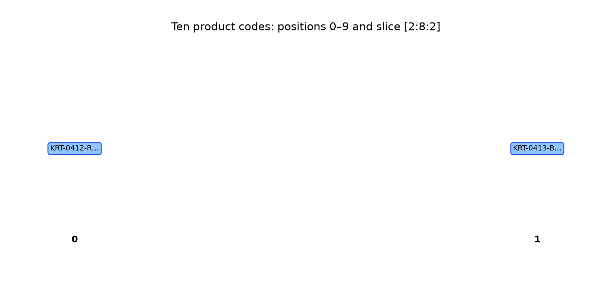
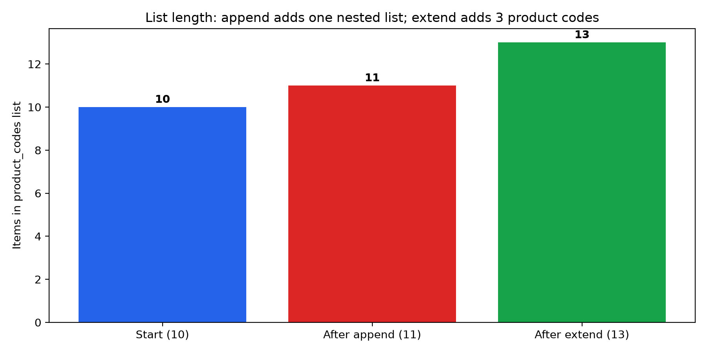
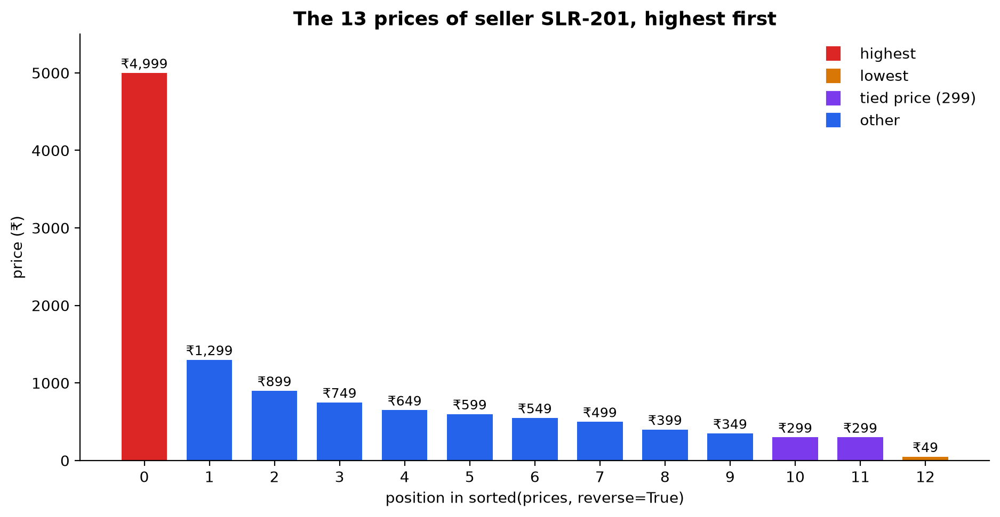
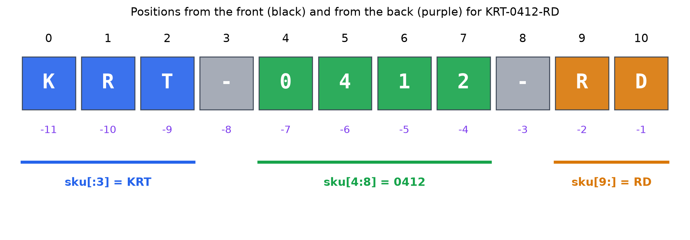
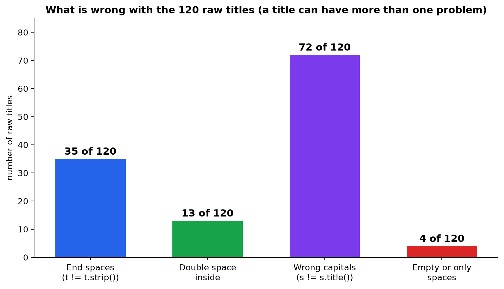
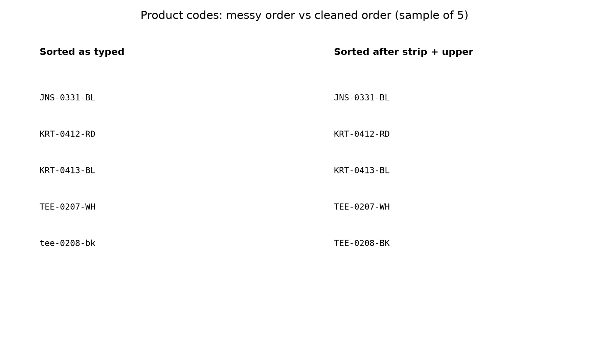

# <font color='#1d4ed8'>Lecture Script: Lists and String Handling</font>

---

## <font color='blue'>Agenda</font>

The lecture runs as four topics. Each topic ends with a quiz.

| Topic | What we do | Learning objectives covered | Minutes |
|:-:|:--|:--|:-:|
| 1 | Read the SKU list by position | Write a list and access its elements using positive and negative indexing<br>Extract a sub-list using slice notation with start, stop and step | 28 |
| 2 | Add late SKUs and rank prices | Apply append and extend to add items to the end of a list<br>Apply sorted to order a list, controlling direction with the reverse flag | 30 |
| 3 | Cut the SKU code apart | Extract a substring using indexing and slicing | 22 |
| 4 | Clean the title text | Apply string methods to normalise casing and whitespace in a text value | 30 |
| — | Closing: Outcome & Summary | | 10 |
| | **Total** | | **120** |

> <font color="red">**🎯 Instructor Note**</font> Pace: keep indexing quick (one example) and spend the time on slice stop and step in Topic 1, and on append versus extend in Topic 2.
> Topic 4 is the longest hands-on part: let learners run each method on the messy titles.

---

## <font color='blue'>Scenario</font>

**The risk:** a Meesho-style reselling app lets small sellers check a product list in a Colab notebook before uploading it. One wrong list or one badly typed title, and the product never appears in the catalogue that day.

> <font color="red">**🎯 Instructor Note**</font> Meesho is only the setting. Do not claim Meesho uses this data; the 120 seller rows in `data/seller_skus.csv` are invented for teaching.
> Share the file before class. It has messy SKU text, messy titles, four blank titles, tied prices and prices from ₹49 to ₹4,999.

---

## <font color='blue'>Problem Statement</font>

Seller SLR-201 pasted ten SKU codes into one Python list. Later, three more SKUs arrived in a second list. She joined them with the wrong call, so the last item in her list was itself a list. The catalogue could not read that item. Several titles were also typed with extra spaces and mixed capitals, such as `  graphic TEE `. No product went live that day.

> <font color='purple'>**How do we turn a seller's messy SKU text and price list into one clean, ordered list that the catalogue accepts?**</font>

> <font color="red">**🎯 Instructor Note**</font> Poll: "Which call put a list inside the list: append, extend or sorted?" Give learners 30 seconds to respond in chat. Reveal the answer in the Closing.

---

## <font color='blue'>What We Will Use</font>

A list holds many values in order under one name. A string holds text. Today you pick items and pieces by position, add items, sort, and clean text.

| Topic | Tools | In one line |
|:-:|:--|:--|
| 1 | `[ ]`, `[start:stop:step]`, `len` | Pick one item or a sub-list by position |
| 2 | `append`, `extend`, `sorted(..., reverse=)` | Add items to the end and order a list |
| 3 | `[ ]` and `[start:stop]` on text | Cut a piece out of a string |
| 4 | `strip`, `lower`, `upper`, `title`, `replace` | Fix spaces and capitals in text |

---

## <font color='blue'>How: Walking Through the Seller Upload Check</font>


---

## <font color='blue'>Topic 1: Read the SKU List by Position</font> `28 min`

> <font color='purple'>**Seller SLR-201 has ten SKUs in one list. How do we point at one SKU, and then at a few?**</font>

In Variables and Condition Logic in Colab you kept one value under one name. In Loops and Tracing What Runs you walked over a string one character at a time. A list keeps many values under one name, and every value has a position, so you can ask for any of them directly.

### <font color='green'>Example: write the list and read the first and last SKU</font>

> <font color='purple'>**Which SKU is first, which is last, and how many are there?**</font>

Positions start at 0 from the front. From the back they start at -1, so -1 is always the last item.

| Direction | Item 1 | Item 2 | Item 3 | Last item |
|:--|:-:|:-:|:-:|:-:|
| From the front | `0` | `1` | `2` | `9` |
| From the back | `-10` | `-9` | `-8` | `-1` |

**Predict before running: What will happen?**

> <font color="red">**🎯 Instructor Note**</font> Expected: `KRT-0412-RD` first and `SHO-0621-BK` last. Common wrong guess: position 1 is the first item.

```python
skus = ["KRT-0412-RD", "KRT-0413-BL", "TEE-0207-WH", " tee-0208-bk ",
        "JNS-0331-BL", "jns-0332-bk", "SAR-0905-RD", " bag-0118-gn",
        "SHO-0620-WH", "SHO-0621-BK"]
print(skus[0])
print(skus[-1])
print(skus[-2])
print(len(skus))
```

**Output**

```
KRT-0412-RD
SHO-0621-BK
SHO-0620-WH
10
```

#### <font color='#c2410c'>Code Explanation</font>

- **Lines 1 to 3** Square brackets with commas make a list of ten texts and store it in the name `skus`. These are rows 1 to 10 of `data/seller_skus.csv`.
- **Line 4** `skus[0]` is the item at position 0, the first one.
- **Line 5** `skus[-1]` counts from the back, so it is the last item.
- **Line 6** `skus[-2]` is the second item from the back.
- **Line 7** `len` counts the items in a list. It also counts the characters in a text.

> <font color='green'>**Result**</font> The first SKU is `KRT-0412-RD`, the last is `SHO-0621-BK`, the second from the back is `SHO-0620-WH`, and the list holds 10 items.

### <font color='green'>Extending it: ask for a position that does not exist</font>

> <font color='purple'>**Is `skus[9]` the same item as `skus[-1]`, and what does `skus[10]` give?**</font>

> <font color="red">**🎯 Instructor Note**</font> Ask learners for a prediction. Give learners 30 seconds to respond in chat. Expected: `True`, then an error, because the last position is 9.

```python
print(skus[9] == skus[-1])
print(skus[10])
```

**Output**

```
True
Traceback (most recent call last):
  File "<cell>", line 2, in <module>
IndexError: list index out of range
```

> <font color='green'>**Result**</font> Position 9 and position -1 point to the same last item. Position 10 does not exist, so Python stops with an `IndexError`.

> <font color='#b45309'>**Common mistake**</font> Counting from 1. A list of 10 items ends at position 9, or at -1 from the back.

### <font color='green'>Example: pick a sub-list with a slice</font>

> <font color='purple'>**Which SKUs sit at positions 2 to 7, which are the first three, and which are the last three?**</font>

A slice `skus[start:stop:step]` returns a new list. It starts at `start`, moves by `step` (1 if you leave it out), and stops before `stop`.

$$\boxed{\text{start} \le i < \text{stop}}$$

**Predict before running: What will happen?**

> <font color="red">**🎯 Instructor Note**</font> Expected: `skus[2:8]` gives 6 items, positions 2 to 7. Common wrong guess: 7 items, because 8 is also included.

```python
print(skus[2:8])
print(skus[:3])
print(skus[-3:])
```

**Output**

```
['TEE-0207-WH', ' tee-0208-bk ', 'JNS-0331-BL', 'jns-0332-bk', 'SAR-0905-RD', ' bag-0118-gn']
['KRT-0412-RD', 'KRT-0413-BL', 'TEE-0207-WH']
[' bag-0118-gn', 'SHO-0620-WH', 'SHO-0621-BK']
```

#### <font color='#c2410c'>Code Explanation</font>

- **Line 1** Start at position 2 and stop before position 8. Position 8 is not included.
- **Line 2** Leaving out `start` means start at the front. This gives the first three.
- **Line 3** `-3` as the start means three from the back. Leaving out `stop` means go to the end.

> <font color='green'>**Result**</font> `skus[2:8]` returns six SKUs, `skus[:3]` the first three, and `skus[-3:]` the last three.

<p align="center"></p>

### <font color='green'>Extending it: add a step</font>

> <font color='purple'>**What do we get if we take every second SKU from position 2 to 7, every third from the whole list, or the list reversed?**</font>

> <font color="red">**🎯 Instructor Note**</font> Ask for the positions picked by `skus[2:8:2]` before running. Expected: 2, 4 and 6. A step of -1 walks from the back.

```python
print(skus[2:8:2])
print(skus[::3])
print(skus[::-1])
```

**Output**

```
['TEE-0207-WH', 'JNS-0331-BL', 'SAR-0905-RD']
['KRT-0412-RD', ' tee-0208-bk ', 'SAR-0905-RD', 'SHO-0621-BK']
['SHO-0621-BK', 'SHO-0620-WH', ' bag-0118-gn', 'SAR-0905-RD', 'jns-0332-bk', 'JNS-0331-BL', ' tee-0208-bk ', 'TEE-0207-WH', 'KRT-0413-BL', 'KRT-0412-RD']
```

> <font color='green'>**Result**</font> A step of 2 picks positions 2, 4 and 6. A step of 3 picks 0, 3, 6 and 9. A step of -1 returns the whole list from last to first.

### <font color='green'>Extending it: slice past the end</font>

> <font color='purple'>**A slice may ask for more than the list holds. Does that fail like `skus[10]`?**</font>

> <font color="red">**🎯 Instructor Note**</font> Ask for a prediction. Give learners 30 seconds to respond in chat. Expected: no error, only the items that exist.

```python
part = skus[8:20]
print(part)
print(len(skus))
```

**Output**

```
['SHO-0620-WH', 'SHO-0621-BK']
10
```

> <font color='green'>**Result**</font> A slice that runs past the end returns what exists and gives no error. The original list still has 10 items, because a slice builds a new list.

### <font color='purple'>Quiz 1</font>

**Question:** For the ten-item list `skus`, which positions does `skus[1:9:2]` pick?

**Options:**
- A) Positions 1, 3, 5, 7 and 9
- B) Positions 1, 3, 5 and 7
- C) Positions 2, 4, 6 and 8
- D) Positions 1 to 8, every position

**Correct Answer:** B

**Explanation:**
- **A)** Wrong: the stop value 9 is not included, so position 9 is never picked.
- **B)** Correct: start at 1, step by 2, and stop before 9, giving 1, 3, 5 and 7.
- **C)** Wrong: the slice starts at 1, not 2.
- **D)** Wrong: the step is 2, so every second position is skipped.

---

## <font color='blue'>Topic 2: Add Late SKUs and Rank Prices</font> `30 min`

> <font color='purple'>**Three late SKUs arrived after the first ten. How do we add them without breaking the list, and which prices should the seller check first?**</font>

The list from Topic 1 can be read by position. Now the seller has a second list, `late`, with the three late SKUs. Both `append` and `extend` add to the end of a list, but they treat what you give them in different ways.

### <font color='green'>Example: append the whole late list</font>

> <font color='purple'>**How many items does a copy of `skus` have after we append the list `late`?**</font>

**Predict before running: What will happen?**

> <font color="red">**🎯 Instructor Note**</font> Expected: 11, not 13. Common wrong guess: 13, because learners expect the three SKUs to be added one by one.

```python
late = ["SAR-0910-GN", "TEE-0210-YL", "SAR-0911-RD"]
trial = skus[:]
trial.append(late)
print(len(trial))
print(trial[-1])
```

**Output**

```
11
['SAR-0910-GN', 'TEE-0210-YL', 'SAR-0911-RD']
```

#### <font color='#c2410c'>Code Explanation</font>

- **Line 1** The three late SKUs are rows 11 to 13 of `data/seller_skus.csv`.
- **Line 2** `skus[:]` is a slice of the whole list, so it makes a copy. We test on the copy and keep `skus` safe.
- **Line 3** `append` adds exactly one item to the end. Here that one item is the whole list `late`.
- **Lines 4 and 5** The length is 11, and the last item is a list inside the list.

> <font color='green'>**Result**</font> `append` added one item, the whole list `late`. This is the seller's bug: the catalogue sees a list where it expects a SKU text.

### <font color='green'>Extending it: extend with the late list</font>

> <font color='purple'>**Which call adds the three SKUs one by one?**</font>

> <font color="red">**🎯 Instructor Note**</font> Ask learners for the new length. Give learners 30 seconds to respond in chat. Expected: 13, with the three late SKUs as the last three items.

```python
skus.extend(late)
print(len(skus))
print(skus[-3:])
print(len(trial))
```

**Output**

```
13
['SAR-0910-GN', 'TEE-0210-YL', 'SAR-0911-RD']
11
```

> <font color='green'>**Result**</font> `extend` walks through the list it receives and adds each item. `skus` now has 13 flat items, while the trial copy still has 11.

### <font color='green'>Extending it: extend with a plain text</font>

> <font color='purple'>**What happens if we give `extend` one text such as `"TEE"`?**</font>

> <font color="red">**🎯 Instructor Note**</font> Ask for a prediction. Expected: three one-letter items, because a text is walked letter by letter.

```python
demo = ["KRT-0412-RD"]
demo.append("KRT-0413-BL")
demo.extend("TEE")
print(demo)
```

**Output**

```
['KRT-0412-RD', 'KRT-0413-BL', 'T', 'E', 'E']
```

> <font color='green'>**Result**</font> `append` added the text as one item. `extend` split `"TEE"` into the items `'T'`, `'E'` and `'E'`.

> <font color='#b45309'>**Common mistake**</font> Using `extend` for one SKU text. Use `append` for one item and `extend` for a list of items.

<p align="center"></p>

### <font color='green'>Example: sort the prices</font>

> <font color='purple'>**What do the 13 prices look like from lowest to highest, and does the original list change?**</font>

**Predict before running: What will happen?**

> <font color="red">**🎯 Instructor Note**</font> Expected: a new list from 49 to 4999, and the original order unchanged. Common wrong guess: `sorted` reorders `prices` itself.

```python
prices = [499, 549, 299, 349, 299, 899, 1299, 749, 599, 399]
prices.extend([649, 49, 4999])
print(sorted(prices))
print(prices[:3])
```

**Output**

```
[49, 299, 299, 349, 399, 499, 549, 599, 649, 749, 899, 1299, 4999]
[499, 549, 299]
```

#### <font color='#c2410c'>Code Explanation</font>

- **Line 1** The ten prices in rupees are rows 1 to 10. Two of them are 299, a tie.
- **Line 2** `extend` adds the prices of the late SKUs, rows 11 to 13, one by one.
- **Line 3** `sorted` returns a new list from smallest to largest.
- **Line 4** The first three items of `prices` are still in the seller's order.

> <font color='green'>**Result**</font> The sorted list runs from 49 to 4999, with the tie 299 and 299 side by side. `prices` itself was not changed.

### <font color='green'>Extending it: highest first</font>

> <font color='purple'>**Which three prices are the highest?**</font>

> <font color="red">**🎯 Instructor Note**</font> Ask for the highest price before running. Expected: 4999, then 1299, then 899.

```python
top = sorted(prices, reverse=True)
print(top[:3])
```

**Output**

```
[4999, 1299, 899]
```

> <font color='green'>**Result**</font> With `reverse=True` the largest price comes first, so the first three items are 4999, 1299 and 899. The slice from Topic 1 picks them.

### <font color='green'>Extending it: sort the SKU text</font>

> <font color='purple'>**Does `sorted` put the SKU texts in the order a person expects?**</font>

> <font color="red">**🎯 Instructor Note**</font> Ask where `jns-0332-bk` will land. Expected: last, because small letters sort after capitals and a leading space sorts first.

```python
ordered = sorted(skus)
print(ordered[:3])
print(ordered[-1])
```

**Output**

```
[' bag-0118-gn', ' tee-0208-bk ', 'JNS-0331-BL']
jns-0332-bk
```

> <font color='green'>**Result**</font> The two SKUs with a leading space come first, and `jns-0332-bk` comes last, far from `JNS-0331-BL`. `sorted` follows the exact characters, including spaces and capitals.

<p align="center"></p>

### <font color='purple'>Quiz 2</font>

**Question:** `ready = ["A1", "A2"]`, then `ready.extend(["A3", "A4"])`, then `ready.append(["A5", "A6"])`. What is `len(ready)`?

**Options:**
- A) 4
- B) 6
- C) 2
- D) 5

**Correct Answer:** D

**Explanation:**
- **A)** Wrong: this ignores the `append`, but `append` still adds one item.
- **B)** Wrong: this treats `append` like `extend`, but `append` adds the whole list as one item, not two.
- **C)** Wrong: this counts only the starting items, but both calls change the list.
- **D)** Correct: 2 starting items, plus 2 from `extend`, plus 1 list from `append`, makes 5.

---

## <font color='blue'>Topic 3: Cut the SKU Code Apart</font> `22 min`

> <font color='purple'>**The list is flat and ranked. Inside one SKU such as `KRT-0412-RD`, the first letters name the category. How do we cut a piece out of a text?**</font>

A text is ordered like a list: every character has a position, from 0 at the front and from -1 at the back. You already looped over a string one character at a time. Now you use the same positions to pick pieces, with the same slice rule as in Topic 1.

### <font color='green'>Example: category, style number and colour</font>

> <font color='purple'>**What are the category, the style number and the colour code inside the first SKU?**</font>

A clean SKU has 11 characters: three letters, a dash, four digits, a dash, and two letters.

**Predict before running: What will happen?**

> <font color="red">**🎯 Instructor Note**</font> Expected: `KRT`, `0412` and `RD`. Common wrong guess: `sku[4:8]` includes the dash at position 8.

```python
sku = skus[0]
print(sku[0])
print(sku[:3], sku[4:8], sku[9:])
print(sku[-2:])
```

**Output**

```
K
KRT 0412 RD
RD
```

#### <font color='#c2410c'>Code Explanation</font>

- **Line 1** Takes the first item of the list with `skus[0]` and stores that text in `sku`.
- **Line 2** `sku[0]` is the first character.
- **Line 3** `sku[:3]` is the first three characters. `sku[4:8]` is positions 4 to 7, the four digits. `sku[9:]` runs from position 9 to the end.
- **Line 4** `sku[-2:]` takes the last two characters, the same colour code.

> <font color='green'>**Result**</font> The SKU `KRT-0412-RD` splits into category `KRT`, style number `0412` and colour `RD`.

<p align="center"></p>

### <font color='green'>Extending it: the same slices on the last three SKUs</font>

> <font color='purple'>**Do the same slices work on the late SKUs we added in Topic 2?**</font>

> <font color="red">**🎯 Instructor Note**</font> Ask learners to predict the first line. Give learners 30 seconds to respond in chat. Expected: `SAR 0910 GN`.

```python
for item in skus[-3:]:
    print(item[:3], item[4:8], item[9:])
```

**Output**

```
SAR 0910 GN
TEE 0210 YL
SAR 0911 RD
```

> <font color='green'>**Result**</font> Every clean SKU has the same layout, so one set of slices cuts all of them.

### <font color='green'>Extending it: the same slices on a messy SKU</font>

> <font color='purple'>**Does the same cut work on `" tee-0208-bk "`, which has a space at each end?**</font>

> <font color="red">**🎯 Instructor Note**</font> Ask for a prediction. Expected: wrong pieces, because the extra space shifts every position by one.

```python
messy = skus[3]
print(messy[:3], messy[4:8], messy[9:])
print(len(messy))
```

**Output**

```
 te -020 -bk 
13
```

> <font color='green'>**Result**</font> The pieces are ` te`, `-020` and `-bk `, which are not the category, number or colour. The length is 13, not 11, so the positions moved.

> <font color='#b45309'>**Common mistake**</font> Slicing a SKU before its text is clean. Slice positions only work when the text has the layout you expect.

### <font color='purple'>Quiz 3</font>

**Question:** The text `s = "SAR-0905-RD"`. Which expression returns the style number `"0905"`?

**Options:**
- A) `s[4:8]`
- B) `s[5:9]`
- C) `s[4:7]`
- D) `s[4:9]`

**Correct Answer:** A

**Explanation:**
- **A)** Correct: positions 4, 5, 6 and 7 hold the digits 0, 9, 0 and 5, and the stop 8 is excluded.
- **B)** Wrong: this starts at position 5 and returns `"905-"`, which includes the dash.
- **C)** Wrong: the stop 7 is excluded, so this returns only `"090"`.
- **D)** Wrong: this goes one position too far and returns `"0905-"`.

---

## <font color='blue'>Topic 4: Clean the Title Text</font> `30 min`

> <font color='purple'>**The slice failed on `" tee-0208-bk "`, and `sorted` put a small-letter SKU last. How do we fix spaces and capitals in text before we use it?**</font>

In Variables and Condition Logic in Colab you stored text in named variables. Now you change how that text looks with string methods. A method is a call written after the text, like `text.strip()`.

### <font color='green'>Example: four methods on one messy title</font>

> <font color='purple'>**What do `strip`, `lower`, `upper` and `title` do to `"  cotton KURTA  set "`?**</font>

**Predict before running: What will happen?**

> <font color="red">**🎯 Instructor Note**</font> Expected: `strip` removes only the end spaces, `title` leaves the double space inside, and `messy` itself does not change. Common wrong guess: `strip` fixes the double space.

```python
messy = "  cotton KURTA  set "
print([messy.strip(), messy.lower()])
print([messy.upper(), messy.title()])
print([messy])
```

**Output**

```
['cotton KURTA  set', '  cotton kurta  set ']
['  COTTON KURTA  SET ', '  Cotton Kurta  Set ']
['  cotton KURTA  set ']
```

#### <font color='#c2410c'>Code Explanation</font>

- **Line 1** Stores a title with two spaces at the front, mixed capitals, a double space inside and one space at the end.
- **Line 2** `strip()` removes spaces at both ends. `lower()` makes every letter small. Square brackets show the exact text, spaces included.
- **Line 3** `upper()` makes every letter a capital. `title()` makes the first letter of each word a capital and the rest small.
- **Line 4** `messy` is unchanged. A method gives back new text and never edits the old one.

> <font color='green'>**Result**</font> `strip` fixed the ends only, `title` fixed the capitals only, and the double space inside `KURTA  set` survived every method.

### <font color='green'>Extending it: chain the methods in order</font>

> <font color='purple'>**Which chain turns `messy` into `Cotton Kurta Set`?**</font>

> <font color="red">**🎯 Instructor Note**</font> Ask which method fixes the double space. Expected: `replace`, which swaps every two spaces for one.

```python
tidy_title = messy.strip().replace("  ", " ").lower().title()
print([tidy_title])
print(len(messy), len(tidy_title))
```

**Output**

```
['Cotton Kurta Set']
20 16
```

> <font color='green'>**Result**</font> The chain gives `Cotton Kurta Set`. Each method works on the text the one before it returned, and the length fell from 20 to 16.

### <font color='green'>Extending it: clean the SKU, then slice it</font>

> <font color='purple'>**Does the Topic 3 slice work once `" tee-0208-bk "` is cleaned?**</font>

> <font color="red">**🎯 Instructor Note**</font> Ask for a prediction. Expected: `TEE`, `0208` and `BK`, because the clean text has the layout the slices expect.

```python
fixed = skus[3].strip().upper()
print(fixed)
print(fixed[:3], fixed[4:8], fixed[9:])
```

**Output**

```
TEE-0208-BK
TEE 0208 BK
```

> <font color='green'>**Result**</font> After `strip` and `upper` the SKU is `TEE-0208-BK`, and the same slices now return `TEE`, `0208` and `BK`.

### <font color='green'>Extending it: a title with only spaces</font>

> <font color='purple'>**What is left of a title that holds only spaces?**</font>

> <font color="red">**🎯 Instructor Note**</font> Ask for the length after `strip`. Expected: 0, an empty text, so the seller must supply a title.

```python
blank = "   "
print(len(blank), len(blank.strip()))
if blank.strip() == "":
    print("title missing: ask the seller")
```

**Output**

```
3 0
title missing: ask the seller
```

> <font color='green'>**Result**</font> Three spaces become an empty text of length 0. Cleaning cannot invent a title, so this row goes back to the seller.

### <font color='green'>Extending it: capitals after an apostrophe</font>

> <font color='purple'>**What does `title` do to `"women's printed kurti"`?**</font>

> <font color="red">**🎯 Instructor Note**</font> Ask for a prediction. Expected: `Women'S`, because `title` treats the letter after the apostrophe as a new word.

```python
text = "women's printed kurti"
print(text.title())
print(text.title().replace("'S", "'s"))
```

**Output**

```
Women'S Printed Kurti
Women's Printed Kurti
```

> <font color='green'>**Result**</font> `title` gave `Women'S`. A second `replace` turns `'S` back into `'s`.

> <font color='#b45309'>**Common mistake**</font> Trusting `title` without reading the result. Check the output on titles with an apostrophe.

### <font color='green'>Extending it: how messy are all 120 titles?</font>

> <font color='purple'>**How many of the 120 titles have end spaces, a double space, wrong capitals, or nothing at all?**</font>

> <font color="red">**🎯 Instructor Note**</font> Ask for a guess out of 120. Give learners 30 seconds to respond in chat. Reveal the counts after the run.
> Share `data/seller_skus.csv` before class for mentors; learners use the `catalog_blob` text in the cell until the Files session teaches `open()`.

```python
catalog_blob = "1,SLR-201,KRT-0412-RD,Cotton Kurta Set,499\n2,SLR-201,KRT-0413-BL,Printed Kurti,549\n3,SLR-201,TEE-0207-WH,Round Neck Tee,299\n4,SLR-201, tee-0208-bk ,  graphic TEE ,349\n5,SLR-201,JNS-0331-BL,Slim Fit Jeans,299\n6,SLR-201,jns-0332-bk,SLIM FIT JEANS,899\n7,SLR-201,SAR-0905-RD,Silk Saree,1299\n8,SLR-201, bag-0118-gn,Canvas Backpack,749\n9,SLR-201,SHO-0620-WH,Running Shoes,599\n10,SLR-201,SHO-0621-BK,running  shoes,399\n11,SLR-201,SAR-0910-GN,Cotton Saree,649\n12,SLR-201,TEE-0210-YL,Polo T-Shirt,49\n13,SLR-201,SAR-0911-RD,Zari Silk Saree,4999\n14,SLR-202,bag-0148-rd  ,canvas backpack,749\n15,SLR-202,BAG-0108-BL,Canvas Backpack,449\n16,SLR-202, KRT-0487-YL,WOMEN'S PRINTED KURTI,499\n17,SLR-202,SHO-0621-RD,Running Shoes,699\n18,SLR-202,JNS-0389-RD,slim fit jeans,649\n19,SLR-202,krt-0447-bk,women's printed kurti  ,449\n20,SLR-202,TEE-0224-RD,Polo T-Shirt,149\n21,SLR-202, KRT-0423-BL,women's printed kurti,499\n22,SLR-202,SHO-0615-BK ,Casual Sneakers,599\n23,SLR-202, jns-0312-rd ,Slim Fit Jeans  ,899\n24,SLR-203, BAG-0172-RD,Canvas Backpack,649\n25,SLR-203,KRT-0403-WH,Printed Kurti  ,599\n26,SLR-203,TEE-0253-BL,Graphic Tee  ,299\n27,SLR-203,TEE-0253-WH,graphic tee,249\n28,SLR-203,SHO-0613-WH,Casual Sneakers,699\n29,SLR-203,tee-0254-gn  ,Round Neck Tee,299\n30,SLR-203,krt-0480-gn  ,straight kurta,449\n31,SLR-203,JNS-0310-WH,men's denim jeans,649\n32,SLR-203,krt-0442-wh,cotton kurta set,349\n33,SLR-203,SAR-0928-BK, COTTON  SAREE ,699\n34,SLR-204,TEE-0283-BK,POLO T-SHIRT,199\n35,SLR-204,KRT-0429-WH,Straight Kurta  ,649\n36,SLR-204,KRT-0412-WH,Straight Kurta  ,649\n37,SLR-204,TEE-0239-RD, ROUND  NECK TEE ,299\n38,SLR-204,SAR-0907-RD,silk saree,1299\n39,SLR-204,TEE-0290-BL,  graphic tee,199\n40,SLR-204,KRT-0478-YL,,649\n41,SLR-204,BAG-0198-YL,CANVAS BACKPACK,449\n42,SLR-204,SHO-0604-WH,casual sneakers,599\n43,SLR-204,TEE-0249-GN,Round Neck Tee,199\n44,SLR-205,BAG-0186-WH, CANVAS  BACKPACK ,849\n45,SLR-205, KRT-0482-GN,cotton kurta set,649\n46,SLR-205, sho-0636-wh ,  casual sneakers,599\n47,SLR-205,TEE-0296-BK,  graphic tee,299\n48,SLR-205, jns-0380-bk ,slim fit jeans,899\n49,SLR-205,BAG-0149-BK,CANVAS BACKPACK,449\n50,SLR-205,JNS-0341-RD,  slim fit jeans,749\n51,SLR-205,SHO-0681-GN,running shoes,799\n52,SLR-205,JNS-0339-YL,slim fit jeans,899\n53,SLR-205,TEE-0210-WH,polo  t-shirt,149\n54,SLR-206,SAR-0946-BL,cotton  saree,1099\n55,SLR-206,BAG-0132-BL,  canvas backpack,649\n56,SLR-206,JNS-0305-BL,Slim Fit Jeans,649\n57,SLR-206,tee-0235-bl, ROUND  NECK TEE ,249\n58,SLR-206,SAR-0948-BL,  silk saree,2499\n59,SLR-206,TEE-0269-GN,Round Neck Tee,349\n60,SLR-206, TEE-0204-RD,GRAPHIC TEE,199\n61,SLR-206,SHO-0633-YL,running shoes,899\n62,SLR-206,TEE-0220-YL,round neck tee,299\n63,SLR-206,BAG-0159-BK,Canvas Backpack,449\n64,SLR-207,KRT-0411-BK,STRAIGHT KURTA,499\n65,SLR-207,KRT-0451-WH ,women's printed kurti,499\n66,SLR-207,jns-0380-gn,  slim fit jeans,149\n67,SLR-207,tee-0278-rd,Polo T-Shirt,249\n68,SLR-207,TEE-0239-BK,Graphic Tee,299\n69,SLR-207,KRT-0493-YL,printed kurti,399\n70,SLR-207,KRT-0488-YL,women's printed kurti,499\n71,SLR-207,SHO-0610-BL,running shoes,599\n72,SLR-207,JNS-0392-YL,slim  fit jeans,899\n73,SLR-207,TEE-0286-BL,  graphic tee,249\n74,SLR-208, SHO-0694-RD,Running Shoes  ,799\n75,SLR-208,JNS-0320-YL,Slim Fit Jeans,749\n76,SLR-208, BAG-0193-BL,  laptop sling bag,849\n77,SLR-208,jns-0309-bk,   ,799\n78,SLR-208, jns-0344-wh ,SLIM FIT JEANS,649\n79,SLR-208,SAR-0905-BL,silk  saree,799\n80,SLR-208, BAG-0175-GN,  laptop sling bag,749\n81,SLR-208,SHO-0635-BK,CASUAL SNEAKERS,999\n82,SLR-208,KRT-0453-RD,WOMEN'S PRINTED KURTI,599\n83,SLR-208,krt-0400-bl  ,women's printed kurti,349\n84,SLR-209,SAR-0903-WH ,Silk Saree,899\n85,SLR-209,JNS-0369-YL,  slim fit jeans,899\n86,SLR-209,sar-0955-rd  ,Silk Saree,1499\n87,SLR-209,KRT-0410-WH,STRAIGHT KURTA,649\n88,SLR-209,BAG-0114-RD,Laptop Sling Bag,549\n89,SLR-209,tee-0232-yl  ,Round Neck Tee  ,149\n90,SLR-209,KRT-0404-BL,straight kurta,399\n91,SLR-209, SAR-0991-YL,silk saree,1099\n92,SLR-209,KRT-0498-RD,STRAIGHT KURTA,349\n93,SLR-209,KRT-0406-WH,women's printed kurti,2499\n94,SLR-210,TEE-0238-BK,POLO T-SHIRT,199\n95,SLR-210,SAR-0904-BL,Silk Saree,1499\n96,SLR-210,BAG-0155-BL ,Laptop Sling Bag,849\n97,SLR-210,KRT-0440-RD ,Printed Kurti,399\n98,SLR-210,JNS-0337-GN,men's  denim jeans,899\n99,SLR-210, sar-0973-wh ,  silk saree,1499\n100,SLR-210, bag-0129-yl ,Laptop Sling Bag,449\n101,SLR-210,KRT-0468-BL,,599\n102,SLR-210,JNS-0325-BL,Slim Fit Jeans  ,649\n103,SLR-210,KRT-0404-YL, STRAIGHT  KURTA ,349\n104,SLR-211,SHO-0648-WH,Casual Sneakers  ,899\n105,SLR-211,sar-0972-wh,SILK SAREE,699\n106,SLR-211, BAG-0108-YL, CANVAS  BACKPACK ,749\n107,SLR-211,SAR-0988-GN,SILK SAREE,1499\n108,SLR-211,tee-0281-bl  ,  polo t-shirt,349\n109,SLR-211,SAR-0957-GN,COTTON SAREE,1499\n110,SLR-211,tee-0215-gn  ,  graphic tee,149\n111,SLR-211,KRT-0414-GN,printed kurti,399\n112,SLR-211,BAG-0118-WH, LAPTOP  SLING BAG ,749\n113,SLR-211,tee-0218-rd,Polo T-Shirt,149\n114,SLR-212,KRT-0478-BK,women's printed kurti,499\n115,SLR-212,SHO-0605-YL,   ,899\n116,SLR-212,TEE-0284-BL ,round neck tee,149\n117,SLR-212,tee-0275-bl,Polo T-Shirt  ,249\n118,SLR-212,sho-0668-yl,RUNNING SHOES,899\n119,SLR-212,SAR-0971-RD,Silk Saree,699\n120,SLR-212,TEE-0280-RD,Polo T-Shirt,299"
lines = catalog_blob.splitlines()
print(len(lines))
print(lines[0])
```

**Output**

```
120
1,SLR-201,KRT-0412-RD,Cotton Kurta Set,499
```

#### <font color='#c2410c'>Code Explanation</font>

- **Lines 1 to 2** `catalog_blob` is one text with one seller row on each line, the same 120 rows as in `data/seller_skus.csv`. `splitlines()` cuts it into a list called `lines`.
- **Line 3** `len` counts the rows.
- **Line 4** Position 0 of the list is the first data row, one text with five fields.

> <font color='green'>**Result**</font> `lines` is a list of 120 row texts. Each row is one text, so the string methods of this topic apply to it.

```python
edge = 0
inner = 0
case = 0
for line in lines:
    t = line.split(",")[3]
    s = t.strip()
    if t != s: edge += 1
    if s != s.replace("  ", " "): inner += 1
    if s != s.title(): case += 1
print(edge, inner, case)
```

**Output**

```
35 13 72
```

#### <font color='#c2410c'>Code Explanation</font>

- **Lines 1 to 3** Three counters start at 0.
- **Line 4** The loop from Loops and Tracing What Runs visits every row text.
- **Line 5** `split(",")` cuts a row at each comma into a list, and `[3]` picks the title.
- **Lines 6 to 9** `strip` removes end spaces. Each `if` compares the title with its fixed form and adds 1 when they differ.
- **Line 10** Prints the three counts.

> <font color='green'>**Result**</font> Of the 120 titles, 35 have end spaces, 13 have a double space inside, and 72 have wrong capitals.

```python
blank = 0
for line in lines:
    if line.split(",")[3].strip() == "":
        blank += 1
print(blank)
```

**Output**

```
4
```

> <font color='green'>**Result**</font> Four titles are empty or only spaces. Cleaning cannot fix those, so they return to the sellers.

<p align="center"></p>

### <font color='purple'>Quiz 4</font>

**Question:** What does `"  silk  SAREE ".strip().lower().title()` return?

**Options:**
- A) `"Silk Saree"`
- B) `"  Silk  Saree "`
- C) `"Silk  Saree"`
- D) `"SILK  SAREE"`

**Correct Answer:** C

**Explanation:**
- **A)** Wrong: this needs the double space inside collapsed, but neither `strip` nor `title` changes it.
- **B)** Wrong: `strip` runs first and removes the spaces at both ends.
- **C)** Correct: `strip` removes the end spaces, `lower` makes every letter small, and `title` capitalises each word. The double space inside stays.
- **D)** Wrong: this is what `upper` would give, but the chain ends with `title`.

---

## <font color='blue'>Closing: Outcome & Summary</font> `10 min`

Back to seller SLR-201 and the question: how do we turn messy SKU text and a price list into one clean, ordered list the catalogue accepts?

> <font color='purple'>**1. Is the late batch now one flat list, and where do the late SKUs sit? (Topic 1 and Topic 2)**</font>

```python
print(len(skus), skus[-3:])
```

**Output**

```
13 ['SAR-0910-GN', 'TEE-0210-YL', 'SAR-0911-RD']
```

#### <font color='#c2410c'>Code Explanation</font>

- **Line 1** `len` gives 13 items. The slice `[-3:]` from Topic 1 shows the three late SKUs at the end, added with `extend` from Topic 2.

> <font color='purple'>**2. Which three prices should the seller check first? (Topic 2)**</font>

```python
print(sorted(prices, reverse=True)[:3])
```

**Output**

```
[4999, 1299, 899]
```

#### <font color='#c2410c'>Code Explanation</font>

- **Line 1** `sorted(..., reverse=True)` from Topic 2 puts the highest price first, and the slice keeps three.

> <font color='purple'>**3. Are the 13 SKUs clean, in order, and ready to cut apart? (Topic 2, Topic 3 and Topic 4)**</font>

```python
clean = []
fixed = 0
for sku in skus:
    clean.append(sku.strip().upper())
    if clean[-1] != sku:
        fixed += 1
ordered = sorted(clean)
print(fixed, ordered[:3])
last = ordered[-1]
print(last, last[:3], last[4:8], last[9:])
```

**Output**

```
3 ['BAG-0118-GN', 'JNS-0331-BL', 'JNS-0332-BK']
TEE-0210-YL TEE 0210 YL
```

#### <font color='#c2410c'>Code Explanation</font>

- **Lines 1 and 2** An empty list `clean` and a counter `fixed` start the work.
- **Lines 3 and 4** The loop visits each SKU. `strip` and `upper` from Topic 4 clean it, and `append` from Topic 2 adds it to `clean`.
- **Lines 5 and 6** `clean[-1]` from Topic 1 is the SKU just added. If it differs from the raw text, `fixed` goes up by 1.
- **Lines 7 and 8** `sorted` from Topic 2 orders the clean list. The three first items show the order.
- **Lines 9 and 10** The slices from Topic 3 cut the last SKU into category, number and colour.

<p align="center"></p>

> <font color='purple'>**4. How many of the 120 titles does one tidy rule change? (Topic 4)**</font>

```python
def tidy(text):
    return text.strip().replace("  ", " ").lower().title().replace("'S", "'s")

fixed = 0
for line in lines:
    raw = line.split(",")[3]
    if tidy(raw) != raw:
        fixed += 1
print(fixed, tidy("WOMEN'S PRINTED KURTI"))
```

**Output**

```
84 Women's Printed Kurti
```

#### <font color='#c2410c'>Code Explanation</font>

- **Lines 1 and 2** A function with `def` and `return`, as in Functions for Reusable Code and Reading Classes, holds the chain from Topic 4.
- **Lines 4 to 8** The loop from Loops and Tracing What Runs compares every raw title with its tidy form and counts the ones that change.
- **Line 9** Prints the count and one apostrophe title cleaned by the same rule.

### <font color='green'>Outcome</font>

| | Seller's first upload | After today's fixes |
|:--|:-:|:-:|
| Items in the SKU list | 11, the last one a list | 13 single SKUs |
| SKUs with stray spaces or small letters (of 13) | 3 | 0 |
| Where `jns-0332-bk` sorts | last | 3rd, as `JNS-0332-BK` |
| Titles that need a fix (of 120) | 84 | 0 |
| Blank titles that go back to the seller | 4 | 4 |

> <font color='green'>**Therefore,**</font> use `extend` to add late SKUs, strip and upper-case each SKU before sorting or slicing, and run one tidy rule over every title. The list is then flat, ordered and readable, and only the 4 blank titles need the seller.

> <font color="red">**🎯 Instructor Note**</font> Poll reveal: `append` put the list inside the list; `extend` and `sorted` did not. Show the 11 versus 13 result from Topic 2.

### <font color='green'>Summary</font>

| Learning objective | Takeaway |
|:--|:--|
| Write a list and access its elements | Square brackets make a list; position 0 is first and -1 is last |
| Extract a sub-list using slice notation | `[start:stop:step]` includes start, excludes stop, and returns a new list |
| Apply append and extend | `append` adds one item; `extend` adds each item of a list |
| Apply sorted with the reverse flag | `sorted` returns a new ordered list; `reverse=True` puts the largest first |
| Extract a substring | The same positions and slices work on text, such as `sku[4:8]` |
| Apply string methods to casing and whitespace | `strip`, `lower`, `upper`, `title` and `replace` clean text and return new text |
| **Practical value** | Clean lists and text stop a bad upload before it reaches a catalogue, a report or a SQL table |

---

# <font color='red'>Launch the Feedback Poll</font>

> <font color="red">**🎯 Instructor Note**</font> Reminder: launch the feedback poll now to collect learner feedback.
