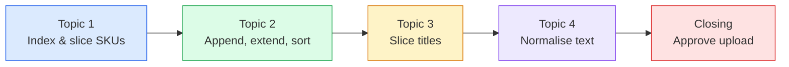

# <font color='#1d4ed8'>Lecture Script: Lists and String Handling</font>

## <font color='blue'>Agenda</font>

The lecture runs as four topics. Each topic ends with a quiz.

| Topic | What we do | Learning objectives covered | Minutes |
|:-:|:-|:-|:-:|
| 1 | Open the SKU list with indexes and slices | Write a list and access its elements using positive and negative indexing<br>Extract a sub-list using slice notation with start, stop and step | 32 |
| 2 | Grow and rank the catalog list | Apply append and extend to add items to the end of a list<br>Apply sorted to order a list, controlling direction with the reverse flag | 32 |
| 3 | Cut product titles apart | Extract a substring using indexing and slicing | 28 |
| 4 | Clean messy listing text | Apply string methods to normalise casing and whitespace in a text value | 18 |
| — | Closing: Outcome & Summary | | 10 |
| | **Total** | | **120** |

> <font color="red">**🎯 Instructor Note**</font> Pace: keep indexing quick; spend time on slice stop rules and append versus extend.
> Give learners 30 seconds to respond in chat after each poll.

---

## <font color='blue'>Scenario</font>

A Flipkart-style marketplace onboarded 127 new sellers this week. Each seller pastes a **SKU list** and a **product title** into a Colab checker before upload.

| Seller ID | SKUs uploaded (first five shown) | Title pasted |
|:-:|:-|:-|
| SLR-8841 | FK-SHIRT-014, FK-JEAN-022, FK-SOCK-003, FK-HAT-017, FK-BELT-008 | Flipkart Basics Cotton Tee |
| SLR-8842 | FK-KURTA-101, FK-KURTA-102 | `  fk-party KURTA  ` |
| SLR-8843 | FK-PHONE-77 (one SKU only) | NoiseCancel Buds |

> <font color="red">**🎯 Instructor Note**</font> Flipkart is framing only; these rows are invented for teaching. Run code in Google Colab Python 3.

---

## <font color='blue'>Problem Statement</font>

Seller SLR-8842 added two SKUs with **extend**, then used **append** on the whole batch list by mistake. The upload file now nests one list inside another. The title still has mixed case and spaces, so the catalog rejects the row.

> <font color='purple'>**How should SLR-8842 fix the SKU list order, add new codes safely, and normalise the title in one Colab pass?**</font>

> <font color="red">**🎯 Instructor Note**</font> Poll: "Was the bug caused by append, extend, or sorted?" Give learners 30 seconds to respond in chat. Reveal the answer in the Closing.

---

## <font color='blue'>What We Will Use</font>

Lists hold ordered catalog codes. Strings hold titles. You already store values in variables and run cells in Colab; last session you wrapped logic in a **def** function. Today you shape the data those functions will receive.

| Topic | Tools | In one line |
|:-:|:-|:-|
| 1 | `[ ]`, `[i]`, `[start:stop:step]` | Pick one SKU or a sub-list |
| 2 | `append`, `extend`, `sorted(..., reverse=)` | Add SKUs and rank prices |
| 3 | string `[ ]`, slices on `str` | Pull a brand or size token from a title |
| 4 | `strip`, `lower`, `title`, `replace` | Clean spaces and casing on titles |

---

## <font color='blue'>How: Walking Through the Flipkart-style catalog check</font>



---

## <font color='blue'>Topic 1: Index and slice the SKU list</font> `32 min`

> <font color='purple'>**Which SKU is first, which is last, and which three codes sit in the middle of SLR-8841’s upload?**</font>

Open from session 1.2: you stored one value per variable. A **list** keeps many SKUs in one name so a **for** loop from session 2.1 can visit each code without five separate variables.

### <font color='green'>Example: Read the first and last SKU</font>

> <font color='purple'>**What are the endpoints of the five-code list for SLR-8841?**</font>

**Predict before running: What will happen?**

> <font color="red">**🎯 Instructor Note**</font> Expect `FK-SHIRT-014` and `FK-BELT-008`. Wrong guess: index `5` for the last item.

```python
skus = ["FK-SHIRT-014", "FK-JEAN-022", "FK-SOCK-003", "FK-HAT-017", "FK-BELT-008"]
print("First SKU:", skus[0])
print("Last SKU:", skus[-1])
print("Count:", len(skus))
```

**Output**

```
First SKU: FK-SHIRT-014
Last SKU: FK-BELT-008
Count: 5
```

#### <font color='#c2410c'>Code Explanation</font>

- **Line 1** builds the ordered SKU list for one seller.
- **Line 2** uses index `0` for the first item; **line 3** uses `-1` for the last.
- **Line 4** reports length, which bounds every valid index.

> <font color='green'>**Result**</font> The catalog checker can flag empty lists and read endpoints without opening the whole file.

### <font color='green'>Extending it: Slice the middle three SKUs</font>

> <font color='purple'>**Which slice returns Jean, Sock, and Hat only?**</font>

**Predict before running: What will happen?**

> <font color="red">**🎯 Instructor Note**</font> Expect three strings. Common slip: include index `4` and pull Belt too.

```python
print(skus[1:4])
print(skus[::2])
print(skus[::-1])
```

**Output**

```
['FK-JEAN-022', 'FK-SOCK-003', 'FK-HAT-017']
['FK-SHIRT-014', 'FK-SOCK-003', 'FK-BELT-008']
['FK-BELT-008', 'FK-HAT-017', 'FK-SOCK-003', 'FK-JEAN-022', 'FK-SHIRT-014']
```

> <font color='green'>**Result**</font> Stop index `4` excludes Belt; step `2` skips every second code; `-1` step reverses order for audit logs.

> <font color='#b45309'>**Common mistake**</font> Using `skus[1:3]` returns only two items because the stop position is excluded.

### <font color='purple'>Quiz 1</font>

**Question:** For `codes = ["P", "Q", "R", "S", "T"]`, what does `codes[-2:]` return?

**Options:**
- A) `["S", "T"]`
- B) `["R", "S"]`
- C) `["T"]`
- D) `["Q", "R"]`

**Correct Answer:** A

**Explanation:**
- **A)** Correct: negative start counts from the end; the slice runs through the last item.
- **B)** Wrong: that needs stop index `4`, not start `-2` with default stop.
- **C)** Wrong: that is only the final element, not a two-item slice.
- **D)** Wrong: that pair sits earlier in the list.

---

## <font color='blue'>Topic 2: Append, extend, and sort</font> `32 min`

> <font color='purple'>**How do we add FK-CAP-099 and a two-SKU batch without nesting a list inside the catalog?**</font>

You traced loops in session 2.1; growing a list is how you feed the next iteration fresh data.

### <font color='green'>Example: One new SKU versus a batch</font>

> <font color='purple'>**What changes when append meets a string versus when extend meets a list?**</font>

**Predict before running: What will happen?**

> <font color="red">**🎯 Instructor Note**</font> The final append line should surprise anyone who expected a flat list.

```python
skus2 = ["FK-SHIRT-014", "FK-JEAN-022"]
skus2.append("FK-CAP-099")
extras = ["FK-SCARF-011", "FK-GLOVE-012"]
skus2.extend(extras)
skus2.append(extras)
print(skus2)
```

**Output**

```
['FK-SHIRT-014', 'FK-JEAN-022', 'FK-CAP-099', 'FK-SCARF-011', 'FK-GLOVE-012', ['FK-SCARF-011', 'FK-GLOVE-012']]
```

#### <font color='#c2410c'>Code Explanation</font>

- **Line 2** `append` adds one SKU string as a single new slot.
- **Line 4** `extend` unpacks the batch so each string gets its own slot.
- **Line 5** `append(extras)` stores the whole batch as one nested list.

> <font color='green'>**Result**</font> SLR-8842’s bug is the nested list at the end; **extend** was correct, the final **append** was not.

### <font color='green'>Extending it: Rank prices for the pricing widget</font>

> <font color='purple'>**Which order should the price picker show: low to high or high to low?**</font>

**Predict before running: What will happen?**

> <font color="red">**🎯 Instructor Note**</font> `sorted` leaves the original list unchanged; mention that before learners mutate data.

```python
prices = [1299, 499, 2499, 799, 199]
print(sorted(prices))
print(sorted(prices, reverse=True))
```

**Output**

```
[199, 499, 799, 1299, 2499]
[2499, 1299, 799, 499, 199]
```

> <font color='green'>**Result**</font> Finance can read the expensive SKUs first with `reverse=True`, matching how they review margins.

> <font color='#b45309'>**Common mistake**</font> Calling `prices.sort()` when you still need the original order for a return-value check.

### <font color='purple'>Quiz 2</font>

**Question:** `batch = ["A"]`; `batch.extend(["B", "C"])`. What is `len(batch)`?

**Options:**
- A) `3`
- B) `2`
- C) `1`
- D) `4`

**Correct Answer:** A

**Explanation:**
- **A)** Correct: extend adds two separate slots after the original one.
- **B)** Wrong: that would be true only if one item were added.
- **C)** Wrong: the list grows beyond the starting single element.
- **D)** Wrong: no fourth element is added in this call.

---

## <font color='blue'>Topic 3: Slice product titles</font> `28 min`

> <font color='purple'>**Which letters in the title identify the brand and the product family?**</font>

Strings behave like ordered sequences. Session 2.1 already looped over characters in a string; slicing picks a range without a loop.

### <font color='green'>Example: Letters and words inside one title</font>

> <font color='purple'>**What substring is `Basics` inside `Flipkart Basics Cotton Tee`?**</font>

**Predict before running: What will happen?**

> <font color="red">**🎯 Instructor Note**</font> Point out that space counts as a character when learners count by eye.

```python
title = "Flipkart Basics Cotton Tee"
print(title[0])
print(title[9:15])
print(title[:8])
print(title[-3:])
```

**Output**

```
F
Basics
Flipkart
Tee
```

#### <font color='#c2410c'>Code Explanation</font>

- **Line 2** reads the first character for a SKU prefix check.
- **Line 3** slices indices 9 through 14 to isolate the family name.
- **Line 4** takes the brand token from the start; **line 5** grabs the last three letters.

> <font color='green'>**Result**</font> SLR-8841’s title splits into brand, family, and size token without manual copy-paste.

### <font color='green'>Extending it: Match a size token at the end</font>

> <font color='purple'>**How would you pull only `Buds` from `NoiseCancel Buds`?**</font>

```python
short = "NoiseCancel Buds"
print(short[-4:])
print(short[12:])
```

**Output**

```
Buds
Buds
```

> <font color='green'>**Result**</font> Negative slice length matches the four-letter token; positive start skips the space after `NoiseCancel`.

### <font color='purple'>Quiz 3</font>

**Question:** For `word = "Flipkart"`, what is `word[2:5]`?

**Options:**
- A) `ipk`
- B) `lip`
- C) `Fla`
- D) `art`

**Correct Answer:** A

**Explanation:**
- **A)** Correct: index 2 through 4 yields three letters starting at `i`.
- **B)** Wrong: that starts one position too early.
- **C)** Wrong: that slice begins at index 0.
- **D)** Wrong: that slice sits at the end of the word.

---

## <font color='blue'>Topic 4: Normalise listing text</font> `18 min`

> <font color='purple'>**How do we turn `  fk-party KURTA  ` into a catalog-safe title?**</font>

In session 2.2 you returned cleaned values from a function. Today you prepare the string before that **return** runs.

### <font color='green'>Example: Strip and title-case a seller paste</font>

> <font color='purple'>**What sequence removes spaces then fixes casing?**</font>

**Predict before running: What will happen?**

> <font color="red">**🎯 Instructor Note**</font> Show `repr` so hidden spaces are visible before **strip**.

```python
raw = "  fk-party KURTA  "
print(repr(raw))
clean = raw.strip().lower().title()
print(clean)
```

**Output**

```
'  fk-party KURTA  '
Fk-Party Kurta
```

#### <font color='#c2410c'>Code Explanation</font>

- **Line 2** `repr` exposes leading and trailing spaces.
- **Line 3** chains **strip**, **lower**, and **title** for a consistent display form.

> <font color='green'>**Result**</font> SLR-8842’s title becomes readable; the hyphen stays because **title** works per word fragment.

### <font color='green'>Extending it: Standardise a code separator</font>

> <font color='purple'>**How can we swap `-` for `_` in a SKU token?**</font>

```python
code = "FK-TEE"
print(repr(code.replace("-", "_")))
```

**Output**

```
'FK_TEE'
```

> <font color='green'>**Result**</font> Downstream SQL loaders that ban hyphens accept the underscored token.

### <font color='purple'>Quiz 4</font>

**Question:** `messy = "  HELLO  "`; `tidy = messy.strip().lower()`. What is `tidy`?

**Options:**
- A) `hello`
- B) `  hello  `
- C) `Hello`
- D) `HELLO`

**Correct Answer:** A

**Explanation:**
- **A)** Correct: strip trims edges, then lower folds case.
- **B)** Wrong: strip removes the outer spaces first.
- **C)** Wrong: lower does not capitalise; title is not called.
- **D)** Wrong: lower changes every letter.

---

## <font color='blue'>Closing: Outcome & Summary</font> `10 min`

Return to SLR-8842: remove the nested list, keep the flat five SKUs plus batch, sort prices for review, and normalise the title.

> <font color='purple'>**1. Which index mistakes were ruled out for the first and last SKU?**</font>

Positive `0` and negative `-1` read the endpoints without an off-by-one error.

> <font color='purple'>**2. What fixed the nested list bug?**</font>

Use **extend** for batches; avoid **append** on a whole list. That matches the opening poll answer: **append** caused the nest.

> <font color='purple'>**3. Can one pipeline approve the seller row?**</font>

```python
skus_ok = ["FK-KURTA-101", "FK-KURTA-102", "FK-SCARF-011", "FK-GLOVE-012"]
title_ok = "  fk-party KURTA  ".strip().lower().title()
print(len(skus_ok), title_ok)
```

**Output**

```
4 Fk-Party Kurta
```

#### <font color='#c2410c'>Code Explanation</font>

- **Line 1** keeps a flat SKU list ready for a **def** upload helper from session 2.2.
- **Line 2** normalises the title before SQL or JSON work in the next session.

### <font color='green'>Outcome</font>

| Check | Before fix | After fix |
|:--|:-:|:-:|
| SKU list shape | Nested list inside list | Flat string codes |
| Price review order | Unsorted paste | High to low via `reverse=True` |
| Title casing | Mixed spaces and case | Stripped title form |

> <font color='green'>**Therefore,**</font> SLR-8842 can re-run the Colab checker: slice and index verify structure, **extend** adds batches safely, **sorted** ranks prices, and string methods clean titles for upload.

> <font color="red">**🎯 Instructor Note**</font> Reveal poll: append caused the nested list. Preview dictionaries in session 3.2 for JSON columns.

### <font color='green'>Summary</font>

| Learning objective | Takeaway |
|:--|:--|
| Write a list and access its elements using positive and negative indexing | `0` and `-1` reach the ends; `len` bounds every index |
| Extract a sub-list using slice notation with start, stop and step | Stop is excluded; step and negatives reverse or skip |
| Apply append and extend to add items to the end of a list | `append` adds one slot; `extend` flattens a batch |
| Apply sorted to order a list, controlling direction with the reverse flag | `sorted` returns a new order; `reverse=True` flips it |
| Extract a substring using indexing and slicing | Strings slice like lists; spaces count as characters |
| Apply string methods to normalise casing and whitespace in a text value | Chain `strip`, `lower`, `title`, and `replace` before upload |
| **Practical value** | Catalog teams catch seller mistakes in Colab before rows hit SQL |

---

# <font color='red'>Launch the Feedback Poll</font>

> <font color="red">**🎯 Instructor Note**</font> Reminder: launch the feedback poll now to collect learner feedback.