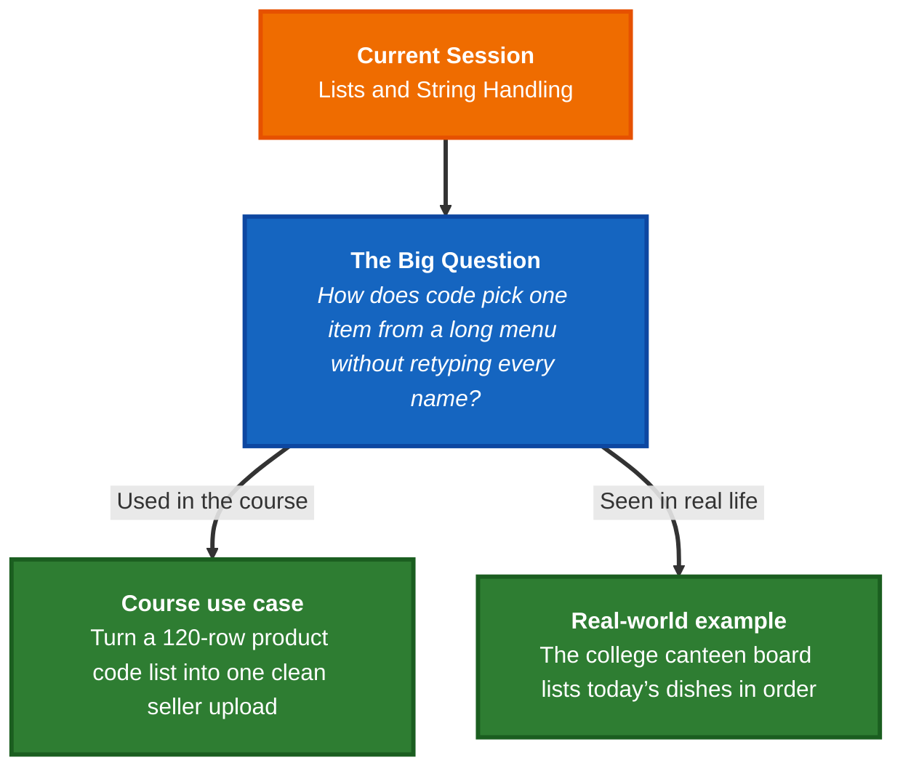

## <span style="color:#2F7DDE">Lists and String Handling</span>

### <span style="color:#2F7DDE">Mental Map</span>



---

### <span style="color:#2F7DDE">What You'll Learn</span>

Have you ever wondered how the canteen screen highlights only today’s specials?

By the end of this session, you will be able to:

- <span style="color:#D9660B">**Name**</span> the first and last dish on the canteen board using position numbers from either end.
- <span style="color:#D9660B">**Select**</span> a short run of dish names between Masala Dosa and Lemon Rice.
- <span style="color:#D9660B">**Add**</span> Gulab Jamun to the live list without erasing the four dishes already shown.
- <span style="color:#D9660B">**Order**</span> five lunch prices from ₹40 to ₹120 high to low for the cash counter.
- <span style="color:#D9660B">**Isolate**</span> the word Veg from the label Veg Biryani Bowl on the printed slip.
- <span style="color:#D9660B">**Transform**</span> the typed line `  masala DOSA  ` into a tidy title for the display.

> <span style="color:#2F7DDE">**Topics you will meet:**</span> List and indexing; List slicing; Append and extend; Sort a list; String slicing; String methods.
>
> Join the session to learn each of these in detail.

---

### <span style="color:#2F7DDE">Why You Are Learning This Topic</span>

You tap the canteen app at noon. The screen shows a fixed order of dishes.

The manager adds a festival thali at the end. The board must update without a full rewrite.

Cashiers need prices sorted before they open the register.

A printed slip says `  veg PULAO  ` with extra spaces. The screen needs a clean title.

A **list** means an ordered row of values stored under one name.

You will meet lists whenever you load rows from a sheet or build a column for SQL.

> <span style="color:#2F7DDE">**Think about it:**</span> What happens if you add one dish the wrong way and the whole board resets?

---

### <span style="color:#2F7DDE">The Canteen Screen Puzzle</span>

The digital board holds today’s five lunch slots in order.

| Position | Dish | Price (₹) |
|:--------:|:-----|:---------:|
| 1 | Masala Dosa | 80 |
| 2 | Veg Biryani Bowl | 120 |
| 3 | Lemon Rice | 70 |
| 4 | Paneer Wrap | 90 |
| 5 | Filter Coffee | 40 |

<span style="color:#D9660B">**What you want to happen:**</span>

- Show only the middle three dishes on the narrow side screen.
- Add Gulab Jamun after Coffee without losing the first five names.
- Show prices high to low on the cashier tablet.

Here is how it might start. You do not need to understand it yet.

```python
dishes = ["Masala Dosa", "Veg Biryani Bowl", "Lemon Rice", "Paneer Wrap", "Filter Coffee"]
print(dishes[0], dishes[-1])
```

> <span style="color:#D9660B">**Wonder about this:**</span>
>
> - How would you grab just Lemon Rice, Paneer Wrap, and Filter Coffee in one step?
> - Why might `  veg PULAO  ` look fine in chat but wrong on the board?

---

### <span style="color:#2F7DDE">Think It Through</span>

There is no wrong first try. Keep your guesses for the session.

**1. Which dish sits at position 1, and which sits at the last position?**
Hint: Count from the start, then count backward from the end.

**2. If you need three names in the middle, where would you start and stop counting?**
Hint: Think about the row for Lemon Rice and the row for Filter Coffee.

**3. What would you do so Gulab Jamun appears after Coffee but the first five names stay?**
Hint: You want to grow the list, not replace it.

---

### <span style="color:#2F7DDE">One Question to Carry Into the Session</span>

> <span style="color:#2F7DDE">**How can one ordered list feed a screen, a sort, and a clean title without retyping every value?**</span>
>
> What is the smallest change you would try first on the canteen dish list?