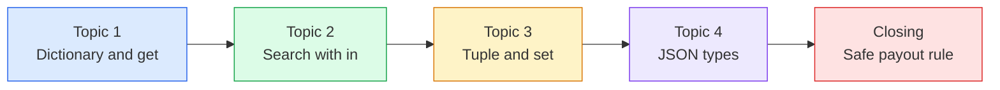

# <font color='#1d4ed8'>Lecture Script: Dictionaries and JSON with Tuples and Sets</font>

## <font color='blue'>Agenda</font>

The lecture runs as four topics. Each topic ends with a quiz.

| Topic | What we do | Learning objectives covered | Minutes |
|:-:|:--|:--|:-:|
| 1 | Merchant records with keys and safe lookup | Build a dictionary of key-value pairs, retrieving a value by its key<br>Retrieve a dictionary value with get, supplying a fallback for a missing key | 28 |
| 2 | Membership on lists and dictionaries | Write a membership test using the in operator on a list and a dictionary | 25 |
| 3 | Fixed rows, unique tags | Write a tuple and unpack it into named variables<br>Build a set to remove duplicate values from a list | 28 |
| 4 | API text into Python types | Classify JSON values by the Python types they become when parsed | 29 |
| — | Closing: Outcome & Summary | | 10 |
| | **Total** | | **120** |

> <font color="red">**🎯 Instructor Note**</font> Spend extra time on `get` fallbacks and on JSON type labels; keep tuple unpacking brisk if chat is confident.
> Leave five minutes at the end of Topic 4 for the closing poll reveal.

---

## <font color='blue'>Scenario</font>

**RupeeRing** is a PhonePe-style UPI app invented for teaching. The risk team must read merchant settings, allow only listed UPI ids, and parse payment events from an API string.

| Field | Sample value |
|:--|:--|
| Merchant UPI | `chai@rupeering` |
| Tier | `gold` |
| Fee (%) | `1.2` |
| Allowed ids (list from last session) | `pay@rupeering`, `shop@rupeering`, `chai@rupeering` |
| Event tags (with repeats) | `food`, `food`, `travel`, `food`, `upi`, `travel` |

> <font color="red">**🎯 Instructor Note**</font> RupeeRing is framing only; these numbers are invented for teaching. Run code in Colab with Python 3.10 or later.

---

## <font color='blue'>Problem Statement</font>

A mentor once credited cashback using `merchant["cashback"]` when that key was never stored. The notebook stopped with `KeyError`, and RupeeRing's training dashboard showed a failed run.

> <font color='purple'>**How should RupeeRing read merchant fields, check allowlists, dedupe tags, and parse API text without crashing on a missing key?**</font>

> <font color="red">**🎯 Instructor Note**</font> Poll: "Would you use `merchant[key]` or `merchant.get(key, default)` for optional fields?" Give learners 30 seconds to respond in chat. Reveal the answer in the Closing.

---

## <font color='blue'>What We Will Use</font>

Last session you stored payee ids in a **list**, sliced strings, and used `.strip()` on messy text. Today you add **labeled records**, **fixed-size rows**, **unique tags**, and **json** parsing.

| Topic | Tools | In one line |
|:-:|:--|:--|
| 1 | `{ }`, `[]`, `.get` | Map one key to one value; missing keys need a fallback |
| 2 | `in` on list and dict | Test membership without scanning by hand |
| 3 | `( )`, `set()`, unpacking | Keep order fixed in a tuple; unique values in a set |
| 4 | `import json`, `json.loads` | Turn API text into dict, list, and scalar types |

---

## <font color='blue'>How: Walking Through RupeeRing merchant checks</font>



---

## <font color='blue'>Topic 1: Merchant records with keys and safe lookup</font> `28 min`

> <font color='purple'>**What is the safest way to read RupeeRing's merchant tier and optional cashback?**</font>

### <font color='green'>Example: Read tier and a missing cashback key</font>

> <font color='purple'>**What prints when we read `tier` and ask for `cashback` with a default?**</font>

**Predict before running: What will happen?**

> <font color="red">**🎯 Instructor Note**</font> Expect `gold` then `0`. A common wrong guess is that missing keys return `None` without `.get`.

```python
merchant = {"upi_id": "chai@rupeering", "tier": "gold", "fee_pct": 1.2}
print(merchant["tier"])
print(merchant.get("cashback", 0))
```

**Output**

```
gold
0
```

#### <font color='#c2410c'>Code Explanation</font>

- **Line 1** Builds a dictionary with string keys and mixed value types.
- **Line 2** Uses `[]` when the key `tier` is always present.
- **Line 3** Uses `.get` so a missing `cashback` returns `0` instead of an error.

> <font color='green'>**Result**</font> RupeeRing reads the tier directly and treats missing cashback as zero.

### <font color='green'>Extending it: Add cashback, then read an unknown limit</font>

> <font color='purple'>**How does `.get` behave after we add a key versus when the key is still missing?**</font>

> <font color="red">**🎯 Instructor Note**</font> Ask chat to predict the third printed line before you run.

```python
merchant["cashback"] = 5
print(merchant.get("cashback", 0))
print(merchant.get("limit", "not set"))
```

**Output**

```
5
not set
```

> <font color='green'>**Result**</font> After assignment, `.get` returns the stored value; for `limit` it returns the string fallback.

> <font color='#b45309'>**Common mistake**</font> Using `merchant["limit"]` on an optional field raises `KeyError` and stops the whole notebook cell.

### <font color='purple'>Quiz 1</font>

**Question:** `merchant` has keys `upi_id` and `tier` only. Which line reads `tier` safely and returns `"bronze"` if `tier` were missing?

**Options:**
- A) `print(merchant.get("tier", "bronze"))`
- B) `print(merchant["tier", "bronze"])`
- C) `print(merchant.get("bronze", "tier"))`
- D) `print(merchant.tier)`

**Correct Answer:** A

**Explanation:**
- **A)** Correct: key first, fallback second.
- **B)** Wrong: `[]` accepts one key, not a pair.
- **C)** Wrong: the key name and fallback are swapped.
- **D)** Wrong: dictionaries use bracket or `.get` access, not dot names.

---

## <font color='blue'>Topic 2: Membership on lists and dictionaries</font> `25 min`

> <font color='purple'>**Is this payer on RupeeRing's allowlist, and does the merchant record already define `tier`?**</font>

### <font color='green'>Example: Test allowlist and dictionary keys</font>

> <font color='purple'>**What does `in` return for a listed UPI id versus a fake id versus a dict key?**</font>

**Predict before running: What will happen?**

> <font color="red">**🎯 Instructor Note**</font> Expect `True`, `False`, `True`. Remind learners that `in` on a dict checks keys, not values.

```python
allowed = ["pay@rupeering", "shop@rupeering", "chai@rupeering"]
payer = "chai@rupeering"
print(payer in allowed)
print("blocked@fake" in allowed)
print("tier" in merchant)
```

**Output**

```
True
False
True
```

#### <font color='#c2410c'>Code Explanation</font>

- **Line 1** Reuses a list shape from the last session for allowed UPI ids.
- **Lines 3–4** Membership on the list answers allowlist questions.
- **Line 5** `in merchant` tests whether the string `tier` is a dictionary key.

> <font color='green'>**Result**</font> RupeeRing can gate payouts with `in` on both lists and merchant maps.

### <font color='green'>Extending it: Spot a channel tag in recent payments</font>

> <font color='purple'>**Is `CARD` among recent channel strings, and is any allowed channel present?**</font>

```python
recent = ["UPI", "UPI", "CARD", "UPI", "WALLET"]
print("CARD" in recent)
print(any(x in recent for x in ["UPI", "NB"]))
```

**Output**

```
True
True
```

> <font color='green'>**Result**</font> List membership handles one id; combining tests covers multiple channels.

### <font color='purple'>Quiz 2</font>

**Question:** `allowed = ["a@rupeering", "b@rupeering"]`. What is `print("c@rupeering" in allowed)`?

**Options:**
- A) `True`
- B) `False`
- C) `KeyError`
- D) `None`

**Correct Answer:** B

**Explanation:**
- **A)** Wrong: `c@rupeering` is not in the two-item list.
- **B)** Correct: `in` returns `False` when no element matches.
- **C)** Wrong: `in` does not raise on a missing list item.
- **D)** Wrong: `in` returns a bool, not `None`.

---

## <font color='blue'>Topic 3: Fixed rows, unique tags</font> `28 min`

> <font color='purple'>**How do we keep one payment row fixed and count unique spend tags?**</font>

### <font color='green'>Example: Unpack one payment tuple</font>

> <font color='purple'>**What names receive id, amount, and status from one tuple?**</font>

**Predict before running: What will happen?**

> <font color="red">**🎯 Instructor Note**</font> Expect one line: `TXN8841 499 SUCCESS`.

```python
row = ("TXN8841", 499, "SUCCESS")
txn_id, amount, status = row
print(txn_id, amount, status)
```

**Output**

```
TXN8841 499 SUCCESS
```

#### <font color='#c2410c'>Code Explanation</font>

- **Line 1** A tuple holds three fields in fixed order.
- **Line 2** Unpacking assigns each position to a variable name.
- **Line 3** Prints the three values in one line.

> <font color='green'>**Result**</font> RupeeRing can pass one immutable row between functions without reordering fields.

### <font color='green'>Extending it: Dedupe RupeeRing tag strings</font>

> <font color='purple'>**How many unique tags appear in six history labels?**</font>

```python
tags = ["food", "food", "travel", "food", "upi", "travel"]
unique = set(tags)
print(sorted(unique))
print(len(tags), len(unique))
```

**Output**

```
['food', 'travel', 'upi']
6 3
```

> <font color='green'>**Result**</font> A set drops duplicate strings; the list length stays six while the set size is three.

### <font color='purple'>Quiz 3</font>

**Question:** `t = (10, 20)`. Which line sets `x` to `10` and `y` to `20`?

**Options:**
- A) `x, y = t`
- B) `x = t[0]; y = t[0]`
- C) `set(t)`
- D) `x, y = list(t, 2)`

**Correct Answer:** A

**Explanation:**
- **A)** Correct: unpacking matches position to name.
- **B)** Wrong: both variables would hold `10`.
- **C)** Wrong: `set` removes order and does not assign names.
- **D)** Wrong: `list` takes one iterable, not two arguments.

---

## <font color='blue'>Topic 4: API text into Python types</font> `29 min`

> <font color='purple'>**After `json.loads`, what Python type does each RupeeRing API field become?**</font>

### <font color='green'>Example: Classify types in one payment payload</font>

> <font color='purple'>**What type name prints for each key in the parsed dict?**</font>

**Predict before running: What will happen?**

> <font color="red">**🎯 Instructor Note**</font> Expect `str`, `int`, `bool`, `list`, `NoneType`. Stress that JSON `null` becomes Python `None`.

```python
import json
payload = '{"merchant":"chai@rupeering","amount":499,"paid":true,"tags":["food","upi"],"meta":null}'
data = json.loads(payload)
for key, value in data.items():
    print(key, type(value).__name__)
```

**Output**

```
merchant str
amount int
paid bool
tags list
meta NoneType
```

#### <font color='#c2410c'>Code Explanation</font>

- **Line 2** JSON must be a string with double quotes before parsing.
- **Line 3** `json.loads` returns a dictionary you can loop like any other dict.
- **Lines 4–5** `type(...).__name__` labels each value for logging rules.

> <font color='green'>**Result**</font> RupeeRing can route each API field to the right check once types are classified.

### <font color='green'>Extending it: Map common JSON scalars</font>

> <font color='purple'>**Which Python types match integer, float, string, boolean, and array JSON values?**</font>

```python
import json
sample = json.loads('{"count":3,"rate":1.5,"name":"RupeeRing","ok":false,"items":[1,2]}')
print(type(sample["count"]).__name__)
print(type(sample["rate"]).__name__)
print(type(sample["name"]).__name__)
print(type(sample["ok"]).__name__)
print(type(sample["items"]).__name__)
```

**Output**

```
int
float
str
bool
list
```

> <font color='green'>**Result**</font> Numbers without a decimal point are `int`; with a decimal they are `float`; JSON arrays become Python lists.

### <font color='purple'>Quiz 4</font>

**Question:** After `data = json.loads('{"active": true, "ids": [1, 2]}')`, what are the types of `data["active"]` and `data["ids"]`?

**Options:**
- A) `bool` and `list`
- B) `str` and `dict`
- C) `int` and `tuple`
- D) `bool` and `set`

**Correct Answer:** A

**Explanation:**
- **A)** Correct: JSON booleans and arrays map to `bool` and `list`.
- **B)** Wrong: `true` is not a string; `[1,2]` is not a dict.
- **C)** Wrong: JSON arrays become lists, not tuples.
- **D)** Wrong: `json.loads` does not build a set from JSON arrays.

---

## <font color='blue'>Closing: Outcome & Summary</font> `10 min`

RupeeRing's mistake was treating optional merchant fields like required ones. The fix chains every tool from today's four topics.

> <font color='purple'>**1. Can this merchant id pass if it is on the allowlist and cashback is optional?**</font>

Use `[]` or `.get` for known keys, and test the UPI id with `in` on the allowlist list.

> <font color='purple'>**2. Does one quick check show the payout rule without crashing?**</font>

```python
record = {"upi_id": "chai@rupeering", "amount": 499}
allowed = ["chai@rupeering", "shop@rupeering"]
print(record["upi_id"] in allowed)
print(record.get("risk", "low"))
```

**Output**

```
True
low
```

#### <font color='#c2410c'>Code Explanation</font>

- **Line 1** Dictionary holds the live payment fields (Topic 1).
- **Line 3** List membership gates the UPI id (Topic 2).
- **Line 4** `.get` supplies a default risk label when the key is absent (Topic 1).

### <font color='green'>Outcome</font>

| | Crashes on missing `cashback` | Uses `.get` and allowlist |
|:--|:-:|:-:|
| Notebook completes | No | Yes |
| Wrong merchant paid | Possible | Blocked when id not in list |
| Tag counts honest | No | Yes, after `set` on tags |

> <font color='green'>**Therefore,**</font> RupeeRing should read required keys with care, use `.get` for optional fields, test allowlists with `in`, unpack fixed tuples, dedupe with sets, and classify API JSON before rules run.

> <font color="red">**🎯 Instructor Note**</font> Reveal the poll: optional fields should use `.get` with a clear default. Give learners 30 seconds to respond in chat if you repeat the poll.

### <font color='green'>Summary</font>

| Learning objective | Takeaway |
|:--|:--|
| Build a dictionary of key-value pairs, retrieving a value by its key | `{}` maps one label to one value; use `[key]` when the key must exist. |
| Retrieve a dictionary value with get, supplying a fallback for a missing key | `.get(key, default)` avoids `KeyError` on optional fields. |
| Write a membership test using the in operator on a list and a dictionary | `in` on a list checks values; on a dict it checks keys. |
| Write a tuple and unpack it into named variables | Tuples keep field order; unpacking assigns each slot to a name. |
| Build a set to remove duplicate values from a list | `set(list)` keeps unique items; order may change. |
| Classify JSON values by the Python types they become when parsed | `json.loads` yields `dict`/`list`/scalars; `null` becomes `None`. |
| **Practical value** | You can read RupeeRing-style API payloads in Colab without stopping on missing keys or double-counted tags. |

---

# <font color='red'>Launch the Feedback Poll</font>

> <font color="red">**🎯 Instructor Note**</font> Reminder: launch the feedback poll now to collect learner feedback.