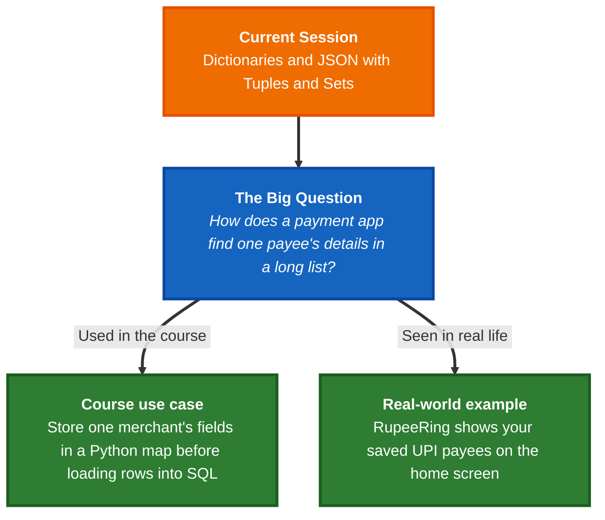

## Dictionaries and JSON with Tuples and Sets

### Mental Map

---

### What You'll Learn

Have you ever wondered how RupeeRing opens Anita's UPI card without mixing her up with Arun?

By the end of this session, you will be able to:

- **Build** a payee card for Anita at `anita@rupeering` and read her display name from it.
- **Retrieve** Anita's cashback value safely when that field is missing on her card.
- **Check** whether `shop@rupeering` sits on RupeeRing's allowed merchant list.
- **Write** one payment tuple and unpack its id, amount, and status into names.
- **Construct** a set from six favourite tags and count how many unique tags remain.
- **Classify** each field in a RupeeRing API message by the Python type it becomes.

> **Topics you will meet:** Dictionary (key and value); Safe lookup with get; Search with in; Tuple and unpacking; Set (remove duplicates); JSON as a dictionary.
>
> Join the session to learn each of these in detail.

---

### Why You Are Learning This Topic

You open RupeeRing to pay your college canteen. You tap a saved payee, not a search box.
The app must match one UPI id to one row of details. It must also skip repeat tags in your history.
Sometimes the server sends a text blob that your notebook must turn into Python values.
A **dictionary** is a labeled box: each label points to one value.
In this course you will meet the same shapes inside files and SQL steps later.
You already used lists and strings; now you add labeled records and deduped tags.

> **Think about it:** What breaks if two payees share the same label?

---

### RupeeRing Payee Puzzle

RupeeRing stores three recent payees for your phone.

| Payee label on screen | UPI id |
|:---------------------:|:------:|
| Anita | anita@rupeering |
| Canteen | canteen@rupeering |
| Metro card | metro@rupeering |

**What you want to happen:**

- Tap Anita and see her UPI id, not the canteen's id.
- Mark `metro@rupeering` as allowed without scanning the whole list by hand.
- Show three unique spend tags when the history lists `food` twice.

> **Wonder about this:**
>
> - How can the app return zero cashback when that field was never saved?
> - Why might six tag strings collapse to three unique labels?

---

### Think It Through

There is no wrong first try. Keep your guesses for the session.

**1. Anita's card holds `name` and `upi`. Which part is the label you look up?**
Hint: Think about the word you would say before the colon on a form.

**2. You have four saved ids in a list. How would you ask Python if `canteen@rupeering` is on it?**
Hint: You already tested truth values with `if` in an earlier session.

**3. The server sends `{"amount": 120, "paid": true}` as one text string. What Python type is the whole message after parsing?**
Hint: The topic name compares the message shape to another container you will meet today.

---

### One Question to Carry Into the Session

> **How do dictionaries, tuples, sets, and JSON text work together on one RupeeRing payment?**
>
> Which container would you pick first to store payee labels, and why?