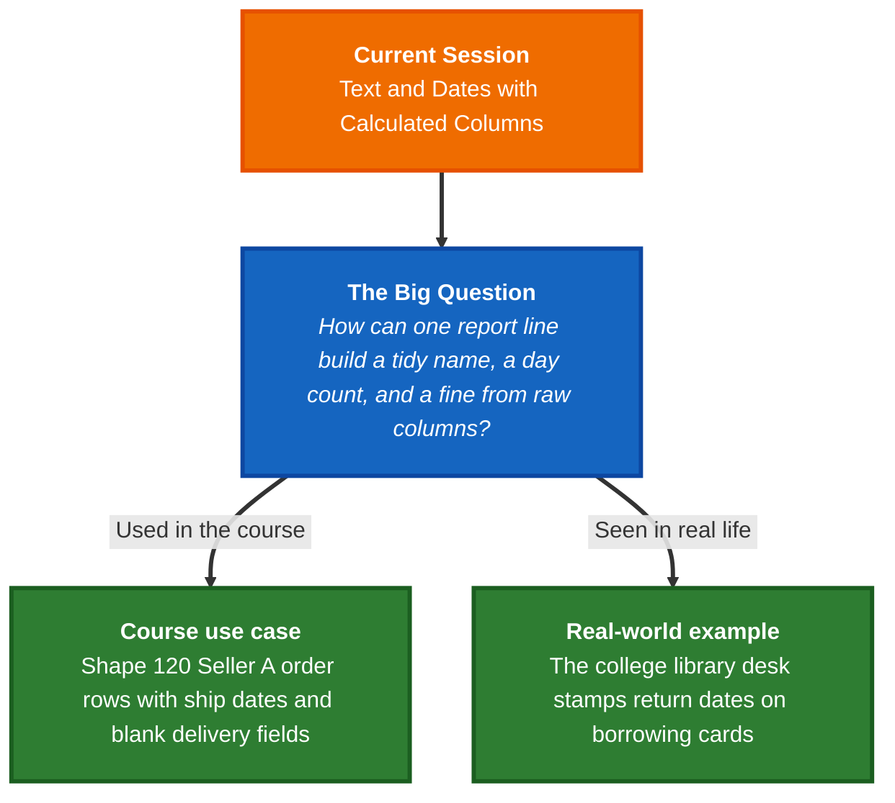

## Text and Dates with Calculated Columns

### Mental Map

---

### What You'll Learn

Have you ever wondered how the library slip shows a late fee without hand copying dates?

By the end of this session, you will be able to:

- **Identify** the month on card B-104 from its due date in the register.
- **Apply** a text clean-up to `  ananya rao  ` on card B-101 before printing.
- **Calculate** overdue days between due and return for card B-101 in February.
- **Determine** a ₹8 late fee from 4 days at ₹2 per day on card B-103.
- **Demonstrate** fee 8.00 rupees with two decimals on slip B-103.
- **Check** which cards still lack a return date, such as B-102 on the shelf list.

> **Topics you will meet:** Text functions; Date parts; Date difference; Calculated columns; ROUND and CAST; Missing values (IS NULL).
>
> Join the session to learn each of these in detail.

---

### Why You Are Learning This Topic

You return a novel on Thursday. The clerk types your name from the card.

Extra spaces hide in the saved name. The screen needs a neat title case line.

Due date and today’s stamp sit on one row. Days late must show without counting.

The fine is days late times ₹2. That total prints beside your card number.

Books still out need a short list. The clerk keeps only rows with an empty return date.

A **calculated column** means a new value built from other fields in the same row.

You will build columns when you clean Seller A shipment rows in a database tool.

> **Think about it:** What breaks if the clerk copies dates by hand?

---

### The Library Desk Puzzle

The register lists four loans from this week.

| Card | Borrower (as stored) | Due date | Return date |
|:----:|:---------------------|:--------:|:-----------:|
| B-101 | `  ananya rao  ` | 2026-02-01 | 2026-02-05 |
| B-102 | `PRIYA DAS` | 2026-02-10 | |
| B-103 | `karthik menon` | 2026-02-08 | 2026-02-12 |
| B-104 | `Meera Iyer` | 2026-03-01 | 2026-02-28 |

**What you want to happen:**

- Card B-101 prints borrower Ananya Rao from messy stored text.
- Card B-103 shows 4 overdue days and an ₹8 fine on the slip.
- The shelf list shows only cards with no return date, including B-102.

> **Wonder about this:**
>
> - How would you split one due date into year, month, and day?
> - How would you spot missing return dates without reading every row?

---

### Think It Through

There is no wrong first try. Keep your guesses for the session.

**1. Card B-104 was due 2026-03-01 but returned 2026-02-28. What sign might the day gap show?**
Hint: See which date comes first on the calendar.

**2. Card B-101 stores `  ananya rao  ` with edge spaces. What fixes run before print?**
Hint: Think about text edges and letter size.

**3. Card B-102 has an empty return date. How might you list only books still out?**
Hint: Ask which rows lack a return value.

---

### One Question to Carry Into the Session

> **How do text steps and date steps chain in one query to make a fine column?**
>
> Will the same pattern work on 120 Seller A orders with missing delivery dates?