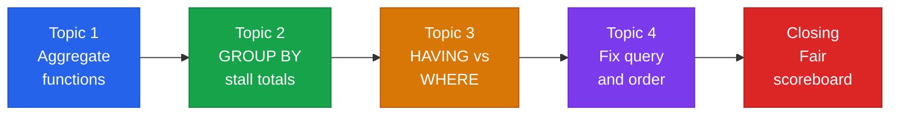
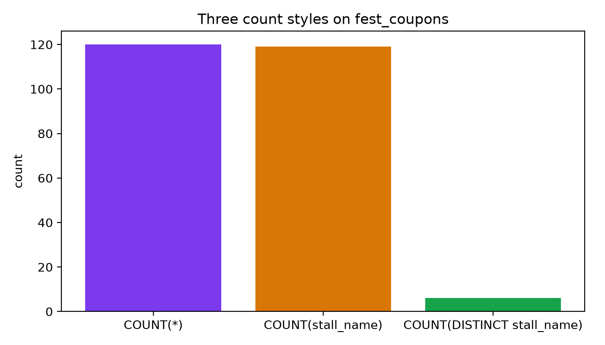
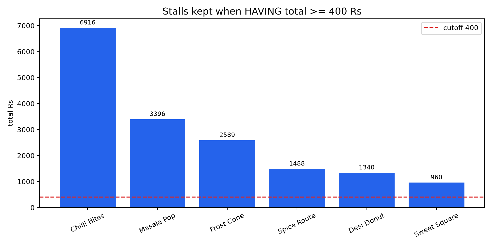
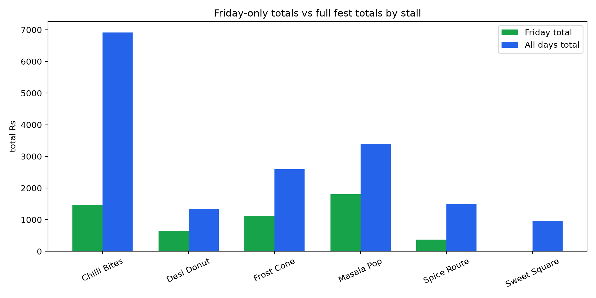
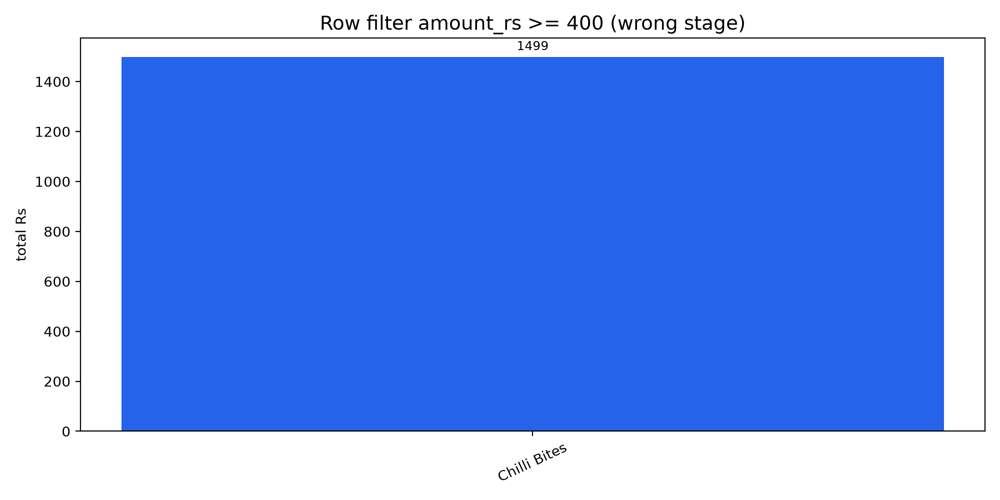

# <font color='#1d4ed8'>Lecture Script: Aggregation and GROUP BY</font>

---

## <font color='blue'>Agenda</font>

The lecture runs as four topics. Each topic ends with a quiz.

| Topic | What we do | Learning objectives covered | Minutes |
|:-:|:--|:--|:-:|
| 1 | Squash coupon rows into one number | Aggregate a column using COUNT, SUM, AVG, MIN and MAX<br>Explain the difference between COUNT(*), COUNT(column) and COUNT(DISTINCT column) | 32 |
| 2 | One summary row per stall | Aggregate rows per category using GROUP BY | 28 |
| 3 | Filter stalls after the total | Filter aggregated groups using HAVING<br>Compare WHERE and HAVING by the stage of the query each filters | 32 |
| 4 | Fix the broken scoreboard query | Debug a GROUP BY query that fails on a non-aggregated column<br>Trace the logical execution order of the clauses in a SELECT statement | 18 |
| — | Closing: Outcome & Summary | | 10 |
| | **Total** | | **120** |

> <font color="red">**🎯 Instructor Note**</font> Pace: keep COUNT variants brisk in Topic 1; spend time on **WHERE** before **GROUP BY** versus **HAVING** after in Topic 3.
> Topic 4 is short on purpose: run the failing query live in Workbench, then trace clause order on the fixed report.

---

## <font color='blue'>Scenario</font>

Saturday midnight at a **Zomato-style** campus food fest, volunteers tear rupee coupons at six stalls. Each slip becomes one row: coupon code, stall name, amount, and day (**Fri**, **Sat**, or **Sun**). The fest desk must print one fair scoreboard without adding 120 lines by hand.

> <font color="red">**🎯 Instructor Note**</font> Zomato is only the setting; do not claim it runs this booth. Use **MySQL Workbench** with **MySQL 8.0** or later (SQLite is fine for the same **SELECT** shapes). Load `data/fest_coupons.sql` first. Treat **today** in chat as **15 March 2026** (fest weekend **13–15 March 2026**).

---

## <font color='blue'>Problem Statement</font>

The fest coordinator copied coupon lines into a sheet and summed each stall by hand. On Sunday she filtered **amount_rs ≥ 400** on single slips, so only **Chilli Bites** appeared on the “top stall” board—even though **Masala Pop** and **Frost Cone** beat that mark when their slips were added. A second report listed **coupon_code** beside stall totals; MySQL refused to run it. Volunteers argued for an hour about whether Friday-only coupons should drop before or after stall totals.

> <font color='purple'>**When a fest report fails, is the row filter wrong, the group filter wrong, or a column left unsquashed?**</font>

> <font color="red">**🎯 Instructor Note**</font> Poll: “Should Friday-only coupons be dropped before or after stall totals are added?” Give learners 30 seconds to respond in chat. Reveal the answer in the Closing.

---

## <font color='blue'>What We Will Use</font>

Last session you cleaned shipment text and built calculated columns with **SELECT**, **WHERE**, and **IS NULL** in Workbench. The same pattern returns coupon rows; **aggregation** squashes many matching rows into one number, and **GROUP BY** keeps one summary row per stall.

| Topic | Tools | In one line |
|:-:|:--|:--|
| 1 | `COUNT`, `SUM`, `AVG`, `MIN`, `MAX` | Turn many amounts into one row of stats |
| 2 | `GROUP BY`, `ORDER BY` | One total per stall; sort scoreboards with a tie-breaker |
| 3 | `HAVING`, `WHERE` | Filter rows before grouping; filter stall groups after |
| 4 | Valid `GROUP BY` lists, clause order | Fix extra columns; read **FROM → WHERE → GROUP BY → HAVING → SELECT → ORDER BY** |

Load the table once: open `data/fest_coupons.sql` in Workbench and execute it. The table holds **120** coupon rows. Row **coupon_id 14** has a blank **stall_name** on purpose.

---

## <font color='blue'>How: Walking Through the Fest Coupon Booth</font>



---

## <font color='blue'>Topic 1: Squash Coupon Rows into One Number</font> `32 min`

> <font color='purple'>**Chilli Bites has dozens of coupons in the log. How do we ask one query for count, total, average, low, and high rupees?**</font>

In Relational Databases and SELECT Queries you counted products with `COUNT(*)` and filtered rows with `WHERE`. Here you keep **WHERE stall_name = 'Chilli Bites'** and add **SUM**, **AVG**, **MIN**, and **MAX** on **amount_rs** in the same **SELECT** list.

### <font color='green'>Example: five aggregate functions on one stall</font>

> <font color='purple'>**What is the coupon count and rupee total for Chilli Bites in the full 120-row log?**</font>

**Predict before running: What will happen?**

> <font color="red">**🎯 Instructor Note**</font> Expect **one result row** with five numbers. A common wrong guess is five separate rows—each function still returns a single value.

```sql
SELECT COUNT(*) AS coupon_rows, SUM(amount_rs) AS total_rs,
  ROUND(AVG(amount_rs), 1) AS avg_rs, MIN(amount_rs) AS min_rs,
  MAX(amount_rs) AS max_rs
FROM fest_coupons
WHERE stall_name = 'Chilli Bites';
```

**Output**

```
+-------------+----------+--------+--------+--------+
| coupon_rows | total_rs | avg_rs | min_rs | max_rs |
+-------------+----------+--------+--------+--------+
| 40          | 6916     | 172.9  | 40     | 1499   |
+-------------+----------+--------+--------+--------+
```

#### <font color='#c2410c'>Code Explanation</font>

- **Line 1** `COUNT(*)` counts every Chilli Bites row that passes **WHERE**.
- **Line 1** `SUM(amount_rs)` adds rupee amounts; **AVG** is the mean; **MIN** and **MAX** show the spread.
- **Lines 4–5** **WHERE** keeps one stall before aggregation runs.

> <font color='green'>**Result**</font> Forty coupons total **6916** rupees. The **1499** slip is a single outlier that pulls **MAX** up.

<p align="center"></p>

### <font color='green'>Extending it: three COUNT styles on the full table</font>

> <font color='purple'>**Row 14 has a blank stall name. How do COUNT(*), COUNT(stall_name), and COUNT(DISTINCT stall_name) differ?**</font>

**Predict before running: What will happen?**

> <font color="red">**🎯 Instructor Note**</font> Expect **120**, **119**, and **6**. NULL **stall_name** is counted by `COUNT(*)` but not by `COUNT(stall_name)` or `COUNT(DISTINCT stall_name)`.

```sql
SELECT COUNT(*) AS cnt_all, COUNT(stall_name) AS cnt_stall,
  COUNT(DISTINCT stall_name) AS cnt_distinct_stall
FROM fest_coupons;
```

**Output**

```
+---------+-----------+--------------------+
| cnt_all | cnt_stall | cnt_distinct_stall |
+---------+-----------+--------------------+
| 120     | 119       | 6                  |
+---------+-----------+--------------------+
```

> <font color='green'>**Result**</font> One orphan slip stays in the table but drops out of stall-labeled counts—use the right COUNT when the desk asks “how many stalls?” versus “how many slips?”.

<p align="center"></p>

### <font color='green'>Extending it: Friday-only rupees for Chilli Bites (pre-read slip C-101 to C-105)</font>

> <font color='purple'>**If Saturday coupon C-105 is ignored, does Chilli Bites reach 400 rupees on Friday alone?**</font>

```sql
SELECT SUM(amount_rs) AS fri_total_rs
FROM fest_coupons
WHERE stall_name = 'Chilli Bites' AND coupon_day = 'Fri';
```

**Output**

```
+--------------+
| fri_total_rs |
+--------------+
| 1460         |
+--------------+
```

> <font color='green'>**Result**</font> Friday-only Chilli total is **1460** on the full log (**270** on just slips C-101 and C-102 in the pre-read sample). Row filters on **coupon_day** belong before you judge stall groups.

### <font color='purple'>Quiz 1</font>

**Question:** The table has 120 rows and one NULL **stall_name**. What does `COUNT(DISTINCT stall_name)` return?

**Options:**
- A) 120, because DISTINCT still counts NULL as a stall
- B) 6, because six non-NULL stall names appear
- C) 119, because DISTINCT ignores NULL but counts every row
- D) 7, because NULL is treated as a seventh stall name

**Correct Answer:** B

**Explanation:**
- **A)** Wrong — DISTINCT stall names ignore NULL.
- **B)** Correct — six named stalls appear in the data.
- **C)** Wrong — that value matches `COUNT(stall_name)`, not DISTINCT.
- **D)** Wrong — NULL is not a distinct string label.

---

## <font color='blue'>Topic 2: One Summary Row per Stall</font> `28 min`

> <font color='purple'>**The desk needs six numbers on the scoreboard, not 120 coupon lines. How do we total rupees once per stall name?**</font>

**GROUP BY stall_name** splits rows into stall buckets. Each aggregate in **SELECT** runs inside its bucket, so you get one output row per stall.

### <font color='green'>Example: coupon count and rupee total per stall</font>

> <font color='purple'>**Which stall leads on total rupees, and how many coupons does each stall have?**</font>

**Predict before running: What will happen?**

> <font color="red">**🎯 Instructor Note**</font> Expect six rows. NULL **stall_name** is dropped here because the query is about named stalls only.

```sql
SELECT stall_name, COUNT(*) AS coupon_count, SUM(amount_rs) AS stall_total_rs
FROM fest_coupons
WHERE stall_name IS NOT NULL
GROUP BY stall_name
ORDER BY stall_total_rs DESC, stall_name ASC;
```

**Output**

```
+--------------+--------------+----------------+
| stall_name   | coupon_count | stall_total_rs |
+--------------+--------------+----------------+
| Chilli Bites | 40           | 6916           |
| Masala Pop   | 25           | 3396           |
| Frost Cone   | 21           | 2589           |
| Spice Route  | 11           | 1488           |
| Desi Donut   | 13           | 1340           |
| Sweet Square | 9            | 960            |
+--------------+--------------+----------------+
```

#### <font color='#c2410c'>Code Explanation</font>

- **Lines 3–4** **WHERE stall_name IS NOT NULL** removes the orphan slip before grouping.
- **Line 5** **GROUP BY stall_name** creates one bucket per stall.
- **Line 6** **ORDER BY** sorts by total high to low; **stall_name** breaks ties.

> <font color='green'>**Result**</font> **Chilli Bites** leads with **6916** rupees from 40 coupons. Every stall appears exactly once in the grid.

### <font color='purple'>Quiz 2</font>

**Question:** You want one row per **coupon_day** with the sum of **amount_rs**. Which query shape is correct?

**Options:**
- A) `SELECT coupon_day, SUM(amount_rs) FROM fest_coupons`
- B) `SELECT coupon_day, amount_rs FROM fest_coupons GROUP BY coupon_day`
- C) `SELECT coupon_day, SUM(amount_rs) FROM fest_coupons GROUP BY coupon_day`
- D) `SELECT SUM(amount_rs) FROM fest_coupons GROUP BY coupon_day`

**Correct Answer:** C

**Explanation:**
- **A)** Wrong — mixes a plain column with an aggregate without **GROUP BY**.
- **B)** Wrong — **amount_rs** is not aggregated inside each day bucket.
- **C)** Correct — **coupon_day** is in **GROUP BY** and **SUM** is aggregated per day.
- **D)** Wrong — **coupon_day** is missing from **SELECT** while still grouped.

---

## <font color='blue'>Topic 3: Filter Stalls After the Total</font> `32 min`

> <font color='purple'>**Only stalls with at least 400 combined rupees should get a trophy sticker. Do we filter slips or filter stall totals?**</font>

**WHERE** runs on single coupon rows **before** rows are grouped. **HAVING** runs on grouped results **after** **GROUP BY**. A 400-rupee rule on **SUM(amount_rs)** belongs in **HAVING**, not **WHERE amount_rs**.

### <font color='green'>Example: HAVING on stall totals</font>

> <font color='purple'>**Which named stalls reach 400 rupees or more when all fest days are included?**</font>

```sql
SELECT stall_name, SUM(amount_rs) AS stall_total_rs
FROM fest_coupons
WHERE stall_name IS NOT NULL
GROUP BY stall_name
HAVING SUM(amount_rs) >= 400
ORDER BY stall_total_rs DESC, stall_name ASC;
```

**Output**

```
+--------------+----------------+
| stall_name   | stall_total_rs |
+--------------+----------------+
| Chilli Bites | 6916           |
| Masala Pop   | 3396           |
| Frost Cone   | 2589           |
| Spice Route  | 1488           |
| Desi Donut   | 1340           |
| Sweet Square | 960            |
+--------------+----------------+
```

#### <font color='#c2410c'>Code Explanation</font>

- **Lines 3–4** **WHERE** drops NULL stall rows before grouping.
- **Line 6** **HAVING SUM(amount_rs) >= 400** keeps only stall groups whose total passes the cutoff.

> <font color='green'>**Result**</font> Every named stall clears 400 on the full fest weekend. The cutoff still matters when you restrict days first.

<p align="center"></p>

### <font color='green'>Extending it: WHERE Friday, then HAVING on Friday totals</font>

> <font color='purple'>**Which stalls beat 400 rupees if only Friday coupons count?**</font>

```sql
SELECT stall_name, SUM(amount_rs) AS fri_total_rs
FROM fest_coupons
WHERE coupon_day = 'Fri' AND stall_name IS NOT NULL
GROUP BY stall_name
HAVING SUM(amount_rs) >= 400
ORDER BY fri_total_rs DESC, stall_name ASC;
```

**Output**

```
+--------------+--------------+
| stall_name   | fri_total_rs |
+--------------+--------------+
| Masala Pop   | 1807         |
| Chilli Bites | 1460         |
| Frost Cone   | 1120         |
| Desi Donut   | 650          |
+--------------+--------------+
```

> <font color='green'>**Result**</font> Four stalls qualify on Friday alone. **Spice Route** and **Sweet Square** fall off the board when Saturday and Sunday coupons are removed first.

<p align="center"></p>

### <font color='green'>Extending it: row filter on amount_rs (the coordinator's mistake)</font>

> <font color='purple'>**What if we write WHERE amount_rs >= 400 before GROUP BY?**</font>

```sql
SELECT stall_name, SUM(amount_rs) AS stall_total_rs
FROM fest_coupons
WHERE stall_name IS NOT NULL AND amount_rs >= 400
GROUP BY stall_name
ORDER BY stall_total_rs DESC, stall_name ASC;
```

**Output**

```
+--------------+----------------+
| stall_name   | stall_total_rs |
+--------------+----------------+
| Chilli Bites | 1499           |
+--------------+----------------+
```

> <font color='green'>**Result**</font> Only the single **1499** outlier slip survives—**SUM** returns **1499**, not the real stall total **6916**. That is a row-stage filter, not a group-stage filter.

<p align="center"></p>
<p align="center"></p>

### <font color='purple'>Quiz 3</font>

**Question:** You need stalls whose **combined** rupees are at least 500. Which clause belongs in the query?

**Options:**
- A) `HAVING SUM(amount_rs) >= 500` after `GROUP BY stall_name`
- B) `WHERE amount_rs >= 500` before `GROUP BY stall_name`
- C) `WHERE SUM(amount_rs) >= 500` before `GROUP BY stall_name`
- D) `HAVING amount_rs >= 500` with no `GROUP BY`

**Correct Answer:** A

**Explanation:**
- **A)** Correct — **HAVING** filters grouped totals.
- **B)** Wrong — that drops individual slips, not stall totals.
- **C)** Wrong — **SUM** is illegal in **WHERE**.
- **D)** Wrong — **HAVING** without **GROUP BY** does not match this stall report.

---

## <font color='blue'>Topic 4: Fix the Broken Scoreboard Query</font> `18 min`

> <font color='purple'>**Why did MySQL refuse a report that listed coupon_code beside each stall total?**</font>

With **ONLY_FULL_GROUP_BY** (default in MySQL 8), every non-aggregated column in **SELECT** must appear in **GROUP BY** (or be functionally dependent). **coupon_code** is not aggregated, so the engine stops the query.

### <font color='green'>Example: the failing SELECT list</font>

> <font color='purple'>**What error appears when coupon_code stays in SELECT but only stall_name is grouped?**</font>

```sql
SELECT stall_name, coupon_code, SUM(amount_rs) AS stall_total_rs
FROM fest_coupons
WHERE stall_name IS NOT NULL
GROUP BY stall_name
ORDER BY stall_name ASC;
```

**Output**

```
ERROR 1055 (42000): Expression #2 of SELECT list is not in GROUP BY clause and contains nonaggregated column 'fest_coupons.coupon_code' which is not functionally dependent on columns in GROUP BY clause; this is incompatible with sql_mode=only_full_group_by
```

#### <font color='#c2410c'>Code Explanation</font>

- **Line 1** **SUM** is aggregated per stall; **coupon_code** is not, so the list is illegal under MySQL 8 rules.

> <font color='green'>**Result**</font> The desk must drop **coupon_code**, add it to **GROUP BY**, or wrap it in an aggregate such as `MIN(coupon_code)` when one example code per stall is enough.

### <font color='green'>Extending it: fixed scoreboard without extra columns</font>

```sql
SELECT stall_name, SUM(amount_rs) AS stall_total_rs
FROM fest_coupons
WHERE stall_name IS NOT NULL
GROUP BY stall_name
ORDER BY stall_total_rs DESC, stall_name ASC
LIMIT 3;
```

**Output**

```
+--------------+----------------+
| stall_name   | stall_total_rs |
+--------------+----------------+
| Chilli Bites | 6916           |
| Masala Pop   | 3396           |
| Frost Cone   | 2589           |
+--------------+----------------+
```

> <font color='green'>**Result**</font> Three clean summary rows—no stray per-coupon column in the grouped report.

### <font color='green'>Extending it: logical clause run order</font>

> <font color='purple'>**In what order does the engine apply FROM, WHERE, GROUP BY, HAVING, SELECT, and ORDER BY?**</font>

#### <font color='#c2410c'>Logic Explanation</font>

1. **FROM** — pick `fest_coupons`.
2. **WHERE** — keep rows (for example **coupon_day = 'Fri'**).
3. **GROUP BY** — build stall buckets.
4. **HAVING** — drop buckets under the rupee cutoff.
5. **SELECT** — show stall name and **SUM** columns.
6. **ORDER BY** — sort the scoreboard; **stall_name** breaks ties.

> <font color='green'>**Result**</font> Friday-only filters always run at step 2; a 400-rupee stall rule runs at step 4. Writing **WHERE** and **HAVING** in the other order in the editor does not change this run order.

### <font color='purple'>Quiz 4</font>

**Question:** A query has **WHERE coupon_day = 'Fri'**, **GROUP BY stall_name**, and **HAVING SUM(amount_rs) >= 400**. When is the Friday filter applied?

**Options:**
- A) After **HAVING**, when stall totals are already computed
- B) After **GROUP BY**, on one row per stall
- C) After **ORDER BY**, when the grid is sorted
- D) Before **GROUP BY**, on individual coupon rows

**Correct Answer:** D

**Explanation:**
- **A)** Wrong — **HAVING** runs after groups exist; **WHERE** already ran.
- **B)** Wrong — **WHERE** never runs on grouped rows only.
- **C)** Wrong — **ORDER BY** is the last step.
- **D)** Correct — **WHERE** trims individual coupon rows before buckets form.

---

## <font color='blue'>Closing: Outcome & Summary</font> `10 min`

The coordinator’s first board used **WHERE amount_rs >= 400**, which kept lone big slips—not stall totals. The broken report mixed **coupon_code** into a grouped **SELECT**. The poll asked when to drop Saturday coupons: **before** totals, with **WHERE coupon_day**, not after.

> <font color='purple'>**1. Which stall leads on rupees when every day counts?**</font>

**Chilli Bites** at **6916** rupees from 40 coupons (Topic 1 and Topic 2).

> <font color='purple'>**2. Which stalls stay on a Friday-only board with a 400-rupee stall cutoff?**</font>

```sql
SELECT stall_name, SUM(amount_rs) AS fri_total_rs
FROM fest_coupons
WHERE coupon_day = 'Fri' AND stall_name IS NOT NULL
GROUP BY stall_name
HAVING SUM(amount_rs) >= 400
ORDER BY fri_total_rs DESC, stall_name ASC;
```

**Output**

```
+--------------+--------------+
| stall_name   | fri_total_rs |
+--------------+--------------+
| Masala Pop   | 1807         |
| Chilli Bites | 1460         |
| Frost Cone   | 1120         |
| Desi Donut   | 650          |
+--------------+--------------+
```

#### <font color='#c2410c'>Code Explanation</font>

- **Line 3** **WHERE** drops non-Friday rows before grouping (Topic 3).
- **Line 5** **HAVING** applies the stall total rule after **GROUP BY** (Topic 3).

### <font color='green'>Outcome</font>

| | Row filter `amount_rs >= 400` | Group filter `HAVING SUM >= 400` |
|:--|:-:|:-:|
| Chilli Bites on board | Yes (1499 only) | Yes (6916 full total) |
| Masala Pop on board | No | Yes |
| Meaning | Top **slip**, not top **stall** | Fair stall scoreboard |

> <font color='green'>**Therefore,**</font> drop the day with **WHERE** first, sum with **GROUP BY**, then cut weak stalls with **HAVING**. Leave non-aggregated columns out of grouped **SELECT** lists, and the midnight fest board matches what volunteers tore on the ground.

> <font color="red">**🎯 Instructor Note**</font> Reveal the poll: Friday-only rows filter **before** grouping (**WHERE**), not after totals.

### <font color='green'>Summary</font>

| Learning objective | Takeaway |
|:--|:--|
| Aggregate a column using COUNT, SUM, AVG, MIN and MAX | One **SELECT** can return count, sum, average, low, and high for a filtered set |
| Explain the difference between COUNT(*), COUNT(column) and COUNT(DISTINCT column) | NULL stall names affect **COUNT(stall_name)** but not **COUNT(*)** |
| Aggregate rows per category using GROUP BY | **GROUP BY stall_name** returns one summary row per stall |
| Filter aggregated groups using HAVING | **HAVING** tests **SUM** after buckets are built |
| Compare WHERE and HAVING by the stage of the query each filters | **WHERE** trims coupon rows; **HAVING** trims stall groups |
| Debug a GROUP BY query that fails on a non-aggregated column | Remove extra columns or add them to **GROUP BY** |
| Trace the logical execution order of the clauses in a SELECT statement | **FROM → WHERE → GROUP BY → HAVING → SELECT → ORDER BY** |
| **Practical value** | Fest, sales, and delivery desks can trust one SQL scoreboard instead of hand-sorted sheets |

---

# <font color='red'>Launch the Feedback Poll</font>

> <font color="red">**🎯 Instructor Note**</font> Reminder: launch the feedback poll now to collect learner feedback.