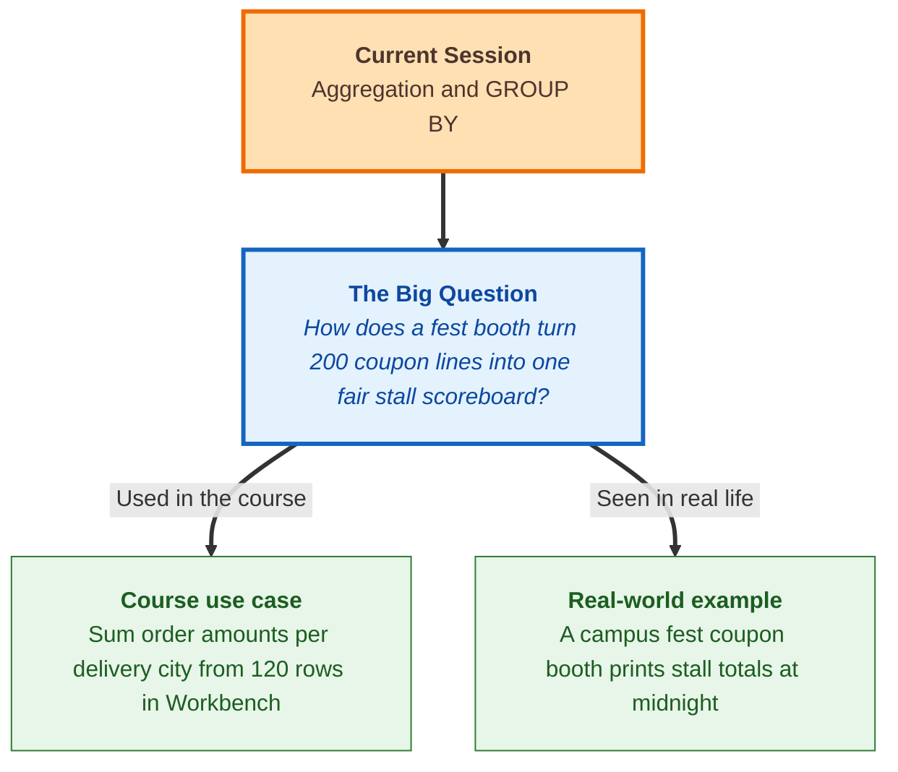

## Aggregation and GROUP BY

### Mental Map

---

### What You'll Learn

Have you ever wondered how the fest desk ranks stalls without reading each coupon slip?

By the end of this session, you will be able to:

- **Calculate** sum, average, high and low amounts for stall Chilli Bites in the coupon log.
- **Differentiate** three count styles when row 14 leaves the stall name blank.
- **Apply** one summary row per stall across five coupons in the sample log.
- **Determine** which stall groups stay when the board cutoff is 400 rupees.
- **Compare** a Friday row filter with a filter on stall totals over 400 rupees.
- **Trace** clause run order and spot the extra column that breaks stall totals.

> **Topics you will meet:** COUNT SUM AVG MIN and MAX; COUNT variations; GROUP BY; HAVING.
>
> WHERE vs HAVING; Fixing GROUP BY errors; The order a query's clauses run in.
>
> Join the session to learn each in detail.

---

### Why You Are Learning This Topic

Friday night at the campus fest, volunteers tear coupon slips at six food stalls.
Each slip records stall name, rupee amount, and day.
The coordinator cannot add 200 lines in a head count.
She needs one total per stall, then only stalls above a sales target.
An **aggregation** means squashing matching rows into one number, such as a stall total.
You will run that stall summary on shop tables here.
The session shows which filter hits single rows and which hits stall groups.

> **Think about it:** Should Friday-only coupons be dropped before or after the stall totals are added?

---

### The Fest Coupon Booth Puzzle

Each row below is one torn fest coupon.

| Coupon code | Stall | Amount (Rs) | Day |
|:-----------:|:-----:|:-----------:|:---:|
| C-101 | Chilli Bites | 120 | Fri |
| C-102 | Chilli Bites | 150 | Fri |
| C-103 | Frost Cone | 80 | Fri |
| C-104 | Frost Cone | 90 | Fri |
| C-105 | Chilli Bites | 200 | Sat |

**What you want to happen:**

- One rupee total for Chilli Bites and one for Frost Cone.
- Only stall groups with at least 400 rupees combined.
- Drop Saturday rows first, then build the scoreboard.

> **Wonder about this:**
>
> - Does Chilli Bites reach 400 rupees if Saturday row C-105 is ignored?
> - Why might coupon code and stall name in one report break stall totals?

---

### Think It Through

There is no wrong first try. Keep your guesses for the session.

**1. Count Chilli Bites rows in the table. What rupee sum do they make?**
Hint: Scan the stall column before you think about Friday or Saturday.

**2. Frost Cone shows 80 and 90 rupees. Does a 400 rupee cutoff keep that stall?**
Hint: Add the two amounts before you compare to 400.

**3. You want Friday-only totals, then stalls above 400 rupees. Which step comes first?**
Hint: Row pick by day comes before judging stall groups.

---

### One Question to Carry Into the Session

> **When a fest report fails, is the row filter wrong, the group filter wrong, or a column unsquashed?**
>
> Bring one guess about which clause runs before stall totals are added.