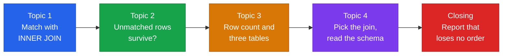
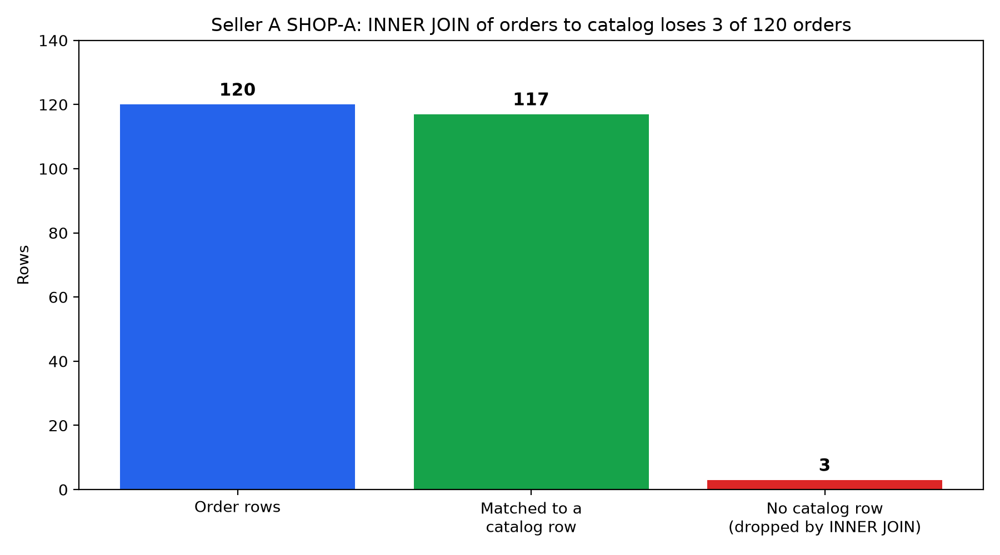
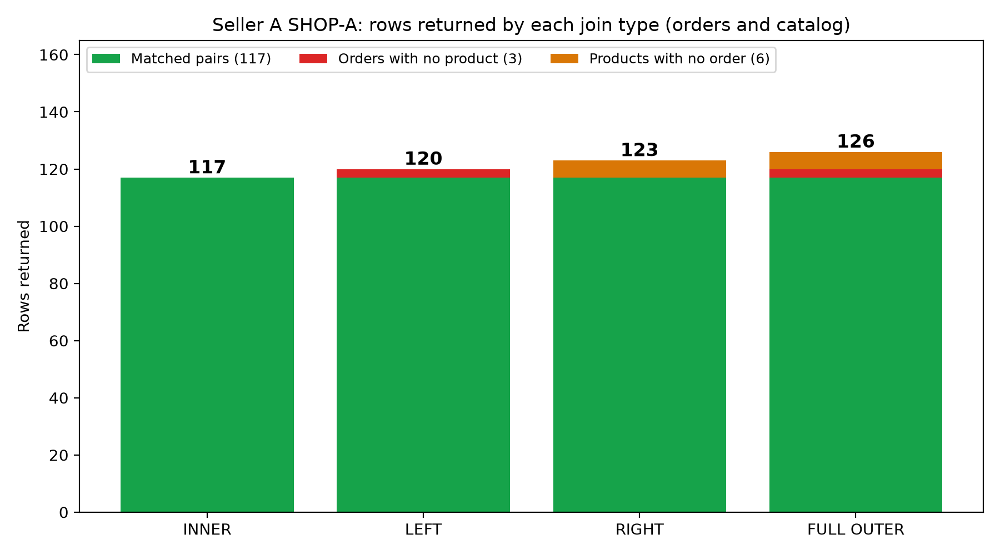
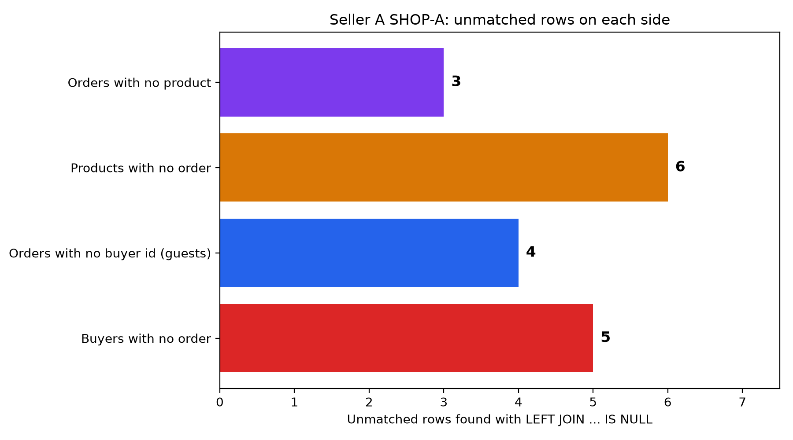
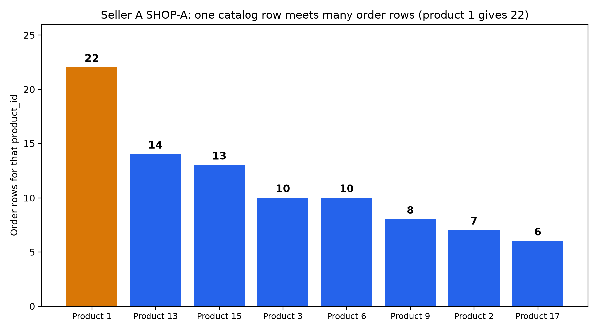
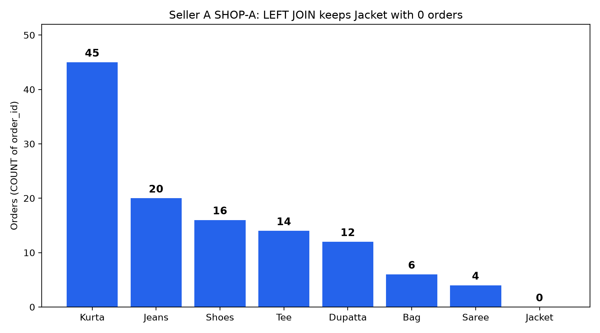
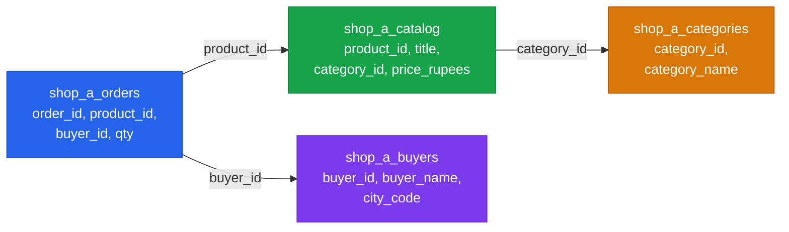
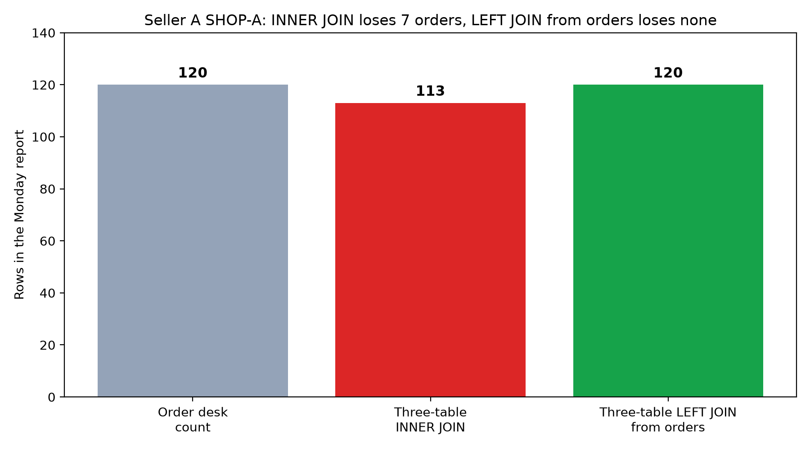

# <font color='#1d4ed8'>Lecture Script: Joins: Combining Multiple Tables</font>

---

## <font color='blue'>Agenda</font>

The lecture runs as four topics. Each topic ends with a quiz.

| Topic | What we do | Learning objectives covered | Minutes |
|:-:|:--|:--|:-:|
| 1 | Match orders to product names | Join two tables on a matching key using INNER JOIN | 24 |
| 2 | Keep or drop unmatched rows | Compare INNER, LEFT, RIGHT and FULL OUTER joins by which unmatched rows survive<br>Retrieve rows present in one table but absent from another using LEFT JOIN | 34 |
| 3 | Predict rows and chain three tables | Predict the row count of a join when the key repeats on one side<br>Write a query joining three tables through a shared key | 28 |
| 4 | Pick the join and read the schema | Select the join type for a stated reporting requirement, justifying by which rows must survive<br>Analyze a schema diagram for the tables, join keys and columns a question needs | 24 |
| — | Closing: Outcome & Summary | | 10 |
| | **Total** | | **120** |

> <font color="red">**🎯 Instructor Note**</font> Pace: keep the INNER JOIN syntax brisk in Topic 1; spend time on the unmatched rows in Topic 2 and on the row-count rule in Topic 3.
> Topic 4 is a decision topic: let learners name the rows that must survive before they pick a join.

---

## <font color='blue'>Scenario</font>

**The risk:** an **Ajio-style** fashion app lets Seller A's **SHOP-A** storefront export orders, the product list and the buyer list as separate tables. A Monday report that lines these tables up can quietly lose orders, and nobody sees an error.

The four tables are invented for teaching. The order table has 120 rows, 3 of them for retired products and 4 for guest checkouts with no buyer id.

> <font color="red">**🎯 Instructor Note**</font> Ajio is only the setting; do not claim it uses this data. Use **SQLite** (3.39 or later) or **MySQL Workbench** (MySQL 8.0 or later); load `data/shop_a_joins.sql` first. Treat **today** in chat as **15 March 2026**.

---

## <font color='blue'>Problem Statement</font>

On Monday, Seller A's analyst lined up the order table with the product list and the buyer list. The order desk counted **120** orders, but her report showed fewer lines and no warning. Three orders for retired products and four guest checkouts had vanished. The "never sold" list was typed by hand from memory, and the category called Jacket never appeared at all. Seller A almost cut a restock order on a report that was missing orders.

> <font color='purple'>**How do you combine the order, product and buyer tables so that the rows Seller A needs are never lost?**</font>

> <font color="red">**🎯 Instructor Note**</font> Poll: "The order table has 120 rows. After an INNER JOIN to the product list, will the result have 120 rows, fewer, or more?" Give learners 30 seconds to respond in chat. Reveal the answer in the Closing.

---

## <font color='blue'>What We Will Use</font>

Last session you used **GROUP BY** and **COUNT** on one table. Today the data sits in four tables, and you will run every query in **SQLite** or **MySQL Workbench**, not in Colab.

| Topic | Tools | In one line |
|:-:|:--|:--|
| 1 | `INNER JOIN … ON`, table nicknames (`AS o`) | Put two rows side by side when their keys match |
| 2 | `LEFT JOIN`, `RIGHT JOIN`, `FULL OUTER JOIN`, `IS NULL` | Choose which unmatched rows survive, and list the unmatched ones |
| 3 | Row-count rule, a second `JOIN … ON` | Predict the rows out, then chain a third table |
| 4 | Join choice, schema diagram | Pick the join from the report question, then find the tables and keys it needs |

Load the tables once: open `data/shop_a_joins.sql` in your tool and execute it. It creates four tables, and every order row has `shop_code` = `SHOP-A`.

| Table | Rows | Columns | Key it carries |
|:--|:-:|:--|:--|
| `shop_a_orders` | 120 | `order_id`, `shop_code`, `product_id`, `buyer_id`, `qty`, `order_date` | `product_id`, `buyer_id` |
| `shop_a_catalog` | 30 | `product_id`, `title`, `category_id`, `price_rupees` | `product_id`, `category_id` |
| `shop_a_buyers` | 36 | `buyer_id`, `buyer_name`, `city_code` | `buyer_id` |
| `shop_a_categories` | 8 | `category_id`, `category_name` | `category_id` |

> <font color="red">**🎯 Instructor Note**</font> Run `SELECT sqlite_version();` first: RIGHT and FULL OUTER JOIN need SQLite 3.39 or later. MySQL Workbench has RIGHT JOIN but no FULL OUTER JOIN; Topic 2 shows the MySQL way.

---

## <font color='blue'>How: Walking Through the Monday Order Report</font>



---

## <font color='blue'>Topic 1: Match Orders to Product Names</font> `24 min`

> <font color='purple'>**The order table shows product numbers like 3 and 16, not names. How do you bring in the title and price from the product list?**</font>

In Relational Databases and SELECT Queries you read one table at a time with **SELECT**, **WHERE** and **ORDER BY**. In Aggregation and GROUP BY you counted rows per group. Now the facts sit in two tables: `shop_a_orders` holds one row per order with only a `product_id`, and `shop_a_catalog` holds the title and price for each `product_id`.

A **key** is a column whose value points at a row in another table. Here `product_id` is the matching key. An **INNER JOIN** puts two rows side by side only when their keys match.

### <font color='green'>Example: list orders with product titles</font>

> <font color='purple'>**What do the first five orders look like before and after the join?**</font>

```sql
SELECT order_id, product_id, qty
FROM shop_a_orders
WHERE order_id <= 5
ORDER BY order_id;
```

**Output**

```
+----------+------------+-----+
| order_id | product_id | qty |
+----------+------------+-----+
| 1        | 3          | 1   |
| 2        | 16         | 1   |
| 3        | 20         | 3   |
| 4        | 27         | 1   |
| 5        | 9          | 2   |
+----------+------------+-----+
```

**Predict before running: What will happen?**

> <font color="red">**🎯 Instructor Note**</font> Expect 5 rows, each with the same product_id as above plus a title and price. A common wrong guess is that the title column appears without any rule telling SQL which row to take.

```sql
SELECT o.order_id, o.product_id, p.title, p.price_rupees
FROM shop_a_orders AS o
INNER JOIN shop_a_catalog AS p
  ON p.product_id = o.product_id
WHERE o.order_id <= 5
ORDER BY o.order_id;
```

**Output**

```
+----------+------------+-----------------------+--------------+
| order_id | product_id |         title         | price_rupees |
+----------+------------+-----------------------+--------------+
| 1        | 3          | Festival Kurta Green  | 799          |
| 2        | 16         | Running Shoes White   | 1199         |
| 3        | 20         | Festival Kurta Orange | 849          |
| 4        | 27         | Cotton Kurta White    | 479          |
| 5        | 9          | Silk Dupatta Gold     | 450          |
+----------+------------+-----------------------+--------------+
```

#### <font color='#c2410c'>Code Explanation</font>

- **Line 2** `FROM shop_a_orders AS o` starts from the order table. `o` is a short nickname for the table, the same way `AS` named a column in Text and Dates with Calculated Columns.
- **Lines 3–4** `INNER JOIN shop_a_catalog AS p ON p.product_id = o.product_id` adds the product table. `ON` states the matching rule: keep a pair of rows when the two `product_id` values are equal.
- **Line 1** `o.` and `p.` say which table each column comes from.
- **Lines 5–6** `WHERE` and `ORDER BY` work exactly as before, on the joined rows.

> <font color='green'>**Result**</font> Each of the five orders picked up the title and price from the one catalog row with the same `product_id`. Order 3 is a Festival Kurta Orange at ₹849.

### <font color='green'>Extending it: do all 120 orders find a match?</font>

> <font color='purple'>**The order desk counted 120 orders. How many rows does the join return?**</font>

> <font color="red">**🎯 Instructor Note**</font> Ask for a number in chat first. Expect many learners to say 120; the join returns 117.

```sql
SELECT COUNT(*) AS matched_rows
FROM shop_a_orders AS o
INNER JOIN shop_a_catalog AS p
  ON p.product_id = o.product_id;
```

**Output**

```
+--------------+
| matched_rows |
+--------------+
| 117          |
+--------------+
```

> <font color='green'>**Result**</font> Only 117 of 120 orders found a catalog row. INNER JOIN silently drops a row whose key has no partner on the other side.

<p align="center"></p>

### <font color='green'>Extending it: filter and calculate on joined rows</font>

> <font color='purple'>**Which kurta orders of 3 pieces are the biggest by rupee value?**</font>

> <font color="red">**🎯 Instructor Note**</font> Ask learners which table holds `qty` and which holds `price_rupees`. The calculated column needs both, so it needs the join.

```sql
SELECT o.order_id, p.title, o.qty,
  o.qty * p.price_rupees AS line_total_rs
FROM shop_a_orders AS o
INNER JOIN shop_a_catalog AS p ON p.product_id = o.product_id
WHERE p.category_id = 1 AND o.qty = 3
ORDER BY line_total_rs DESC, o.order_id;
```

**Output**

```
+----------+-----------------------+-----+---------------+
| order_id |         title         | qty | line_total_rs |
+----------+-----------------------+-----+---------------+
| 3        | Festival Kurta Orange | 3   | 2547          |
| 26       | Linen Kurta Blue      | 3   | 1950          |
| 17       | Cotton Kurta Red      | 3   | 1497          |
| 21       | Cotton Kurta Red      | 3   | 1497          |
| 30       | Cotton Kurta Red      | 3   | 1497          |
| 39       | Cotton Kurta Red      | 3   | 1497          |
| 81       | Cotton Kurta Red      | 3   | 1497          |
| 88       | Cotton Kurta Red      | 3   | 1497          |
+----------+-----------------------+-----+---------------+
```

> <font color='green'>**Result**</font> Eight kurta orders have 3 pieces. Order 3 leads at ₹2547 because `qty` comes from the order row and `price_rupees` from the matching catalog row.

### <font color='green'>Extending it: a column name that exists in both tables</font>

> <font color='purple'>**What happens if you write product_id without o. or p. in front of it?**</font>

> <font color="red">**🎯 Instructor Note**</font> SQLite prints the message below; MySQL Workbench shows Error Code 1052, "Column 'product_id' in field list is ambiguous".

```sql
SELECT product_id, title
FROM shop_a_orders AS o
INNER JOIN shop_a_catalog AS p
  ON p.product_id = o.product_id;
```

**Output**

```
Parse error near line 1: ambiguous column name: product_id
  SELECT product_id, title FROM shop_a_orders AS o INNER JOIN shop_a_catalog AS 
         ^--- error here
```

> <font color='#b45309'>**Common mistake**</font> Both tables have a `product_id` column, so the database cannot guess. Write `o.product_id` or `p.product_id`; columns that exist in only one table, like `title`, can stay bare.

### <font color='purple'>Quiz 1</font>

**Question:** Order 23 has `product_id` 41, but the catalog has no product 41. What does an INNER JOIN on `product_id` do with order 23?

**Options:**
- A) Shows order 23 with a blank title
- B) Leaves order 23 out of the result
- C) Matches it to the first catalog row
- D) Stops with an error

**Correct Answer:** B

**Explanation:**
- **A)** Wrong — a blank title for an unmatched row is what a LEFT JOIN does, not an INNER JOIN.
- **B)** Correct — INNER JOIN keeps only pairs whose keys are equal, so order 23 has no pair.
- **C)** Wrong — the `ON` rule needs equal keys; there is no fallback row.
- **D)** Wrong — an unmatched key is not an error; the row is simply absent.

---

## <font color='blue'>Topic 2: Keep or Drop Unmatched Rows</font> `34 min`

> <font color='purple'>**Three orders vanished from the join. Which join type keeps them, and which keeps the products nobody ordered?**</font>

Call the table written before `JOIN` the **left** table (orders) and the one after it the **right** table (catalog). A join type decides what happens to a row whose key has no partner. The missing side is filled with NULL, which you met in Text and Dates with Calculated Columns.

| Join type | Left rows with no partner | Right rows with no partner |
|:--|:-:|:-:|
| INNER JOIN | dropped | dropped |
| LEFT JOIN | kept, right columns NULL | dropped |
| RIGHT JOIN | dropped | kept, left columns NULL |
| FULL OUTER JOIN | kept | kept |

### <font color='green'>Example: LEFT JOIN keeps the left row</font>

> <font color='purple'>**What does order 23 look like when we swap INNER for LEFT?**</font>

**Predict before running: What will happen?**

> <font color="red">**🎯 Instructor Note**</font> Expect 3 rows; order 23 stays with a NULL title. A common wrong guess is that only 2 rows appear, as with INNER JOIN.

```sql
SELECT o.order_id, o.product_id, p.title
FROM shop_a_orders AS o
LEFT JOIN shop_a_catalog AS p ON p.product_id = o.product_id
WHERE o.order_id IN (22, 23, 24)
ORDER BY o.order_id;
```

**Output**

```
+----------+------------+-----------------------+
| order_id | product_id |         title         |
+----------+------------+-----------------------+
| 22       | 15         | Casual Sneakers Black |
| 23       | 41         | NULL                  |
| 24       | 14         | Straight Jeans Black  |
+----------+------------+-----------------------+
```

#### <font color='#c2410c'>Code Explanation</font>

- **Line 3** `LEFT JOIN` keeps every row of the left table (`shop_a_orders`) even when `ON` finds no partner.
- **Line 1** For order 23 the catalog columns have no row to read, so `p.title` shows NULL.
- **Lines 4–5** `IN (22, 23, 24)` picks three orders so the NULL row is easy to see.

> <font color='green'>**Result**</font> Orders 22 and 24 matched; order 23 survived with a NULL title because product 41 is not in the catalog.

### <font color='green'>Extending it: count the rows out of a LEFT JOIN</font>

> <font color='purple'>**How many rows does the LEFT JOIN return for the full order table?**</font>

> <font color="red">**🎯 Instructor Note**</font> Poll: 117, 120 or 123? Expect 120: all orders survive, and the catalog key is never repeated.

```sql
SELECT COUNT(*) AS rows_out
FROM shop_a_orders AS o
LEFT JOIN shop_a_catalog AS p
  ON p.product_id = o.product_id;
```

**Output**

```
+----------+
| rows_out |
+----------+
| 120      |
+----------+
```

> <font color='green'>**Result**</font> 120 rows: the 117 matched orders plus the 3 orders with no catalog row.

### <font color='green'>Extending it: RIGHT JOIN keeps the right row</font>

> <font color='purple'>**What if the catalog is the table that must keep all its rows?**</font>

> <font color="red">**🎯 Instructor Note**</font> RIGHT JOIN is a LEFT JOIN with the tables swapped. Expect 123: 117 matched plus the 6 products nobody ordered.

```sql
SELECT COUNT(*) AS rows_out
FROM shop_a_orders AS o
RIGHT JOIN shop_a_catalog AS p
  ON p.product_id = o.product_id;
```

**Output**

```
+----------+
| rows_out |
+----------+
| 123      |
+----------+
```

> <font color='green'>**Result**</font> 123 rows: the 117 matched pairs plus 6 catalog rows that no order points to.

### <font color='green'>Extending it: FULL OUTER JOIN keeps both sides</font>

> <font color='purple'>**What if neither table may lose a row?**</font>

> <font color="red">**🎯 Instructor Note**</font> MySQL has no FULL OUTER JOIN: take the LEFT JOIN rows and add the RIGHT JOIN rows where `o.order_id IS NULL`, joined with UNION ALL. Same 126.

```sql
SELECT COUNT(*) AS rows_out
FROM shop_a_orders AS o
FULL OUTER JOIN shop_a_catalog AS p
  ON p.product_id = o.product_id;
```

**Output**

```
+----------+
| rows_out |
+----------+
| 126      |
+----------+
```

> <font color='green'>**Result**</font> 126 rows = 117 matched + 3 orders with no product + 6 products with no order. INNER, LEFT, RIGHT and FULL OUTER differ only in which of those two unmatched groups they keep.

<p align="center"></p>

### <font color='green'>Extending it: list the orders that have no product</font>

> <font color='purple'>**Which exact orders point at a product that is not in the catalog?**</font>

> <font color="red">**🎯 Instructor Note**</font> Ask which column to test for NULL. The answer is the key column of the right table, `p.product_id`, which is never NULL on a real match.

```sql
SELECT o.order_id, o.product_id, o.qty
FROM shop_a_orders AS o
LEFT JOIN shop_a_catalog AS p
  ON p.product_id = o.product_id
WHERE p.product_id IS NULL
ORDER BY o.order_id;
```

**Output**

```
+----------+------------+-----+
| order_id | product_id | qty |
+----------+------------+-----+
| 23       | 41         | 2   |
| 58       | 41         | 1   |
| 97       | 42         | 1   |
+----------+------------+-----+
```

#### <font color='#c2410c'>Code Explanation</font>

- **Lines 2–4** The LEFT JOIN keeps all 120 orders and fills `p.product_id` with NULL where there is no partner.
- **Line 5** `WHERE p.product_id IS NULL` keeps only those filled-in rows, which are exactly the unmatched orders.

> <font color='green'>**Result**</font> Orders 23, 58 and 97 point at retired products 41 and 42. The mentor can now hand Seller A a list instead of a vague gap.

### <font color='green'>Extending it: list the products nobody ordered</font>

> <font color='purple'>**Swap the tables: which catalog products have no order at all?**</font>

> <font color="red">**🎯 Instructor Note**</font> The table that must keep its rows goes on the left. Expect 6 rows.

```sql
SELECT p.product_id, p.title, p.price_rupees
FROM shop_a_catalog AS p
LEFT JOIN shop_a_orders AS o
  ON o.product_id = p.product_id
WHERE o.order_id IS NULL
ORDER BY p.product_id;
```

**Output**

```
+------------+-----------------------+--------------+
| product_id |         title         | price_rupees |
+------------+-----------------------+--------------+
| 12         | Cotton Saree Blue     | 999          |
| 18         | Laptop Sling Bag Grey | 1099         |
| 23         | Silk Saree Green      | 2499         |
| 26         | Mini Backpack Pink    | 899          |
| 28         | Oversized Tee Cream   | 399          |
| 30         | Tote Bag Beige        | 599          |
+------------+-----------------------+--------------+
```

> <font color='green'>**Result**</font> Six products, from Cotton Saree Blue to Tote Bag Beige, have never been ordered. The same pattern, with the tables swapped, answers the opposite question.

<p align="center"></p>

### <font color='purple'>Quiz 2</font>

**Question:** Seller A wants the catalog products that no order points to. Which query is right?

**Options:**
- A) `FROM shop_a_orders AS o LEFT JOIN shop_a_catalog AS p ON p.product_id = o.product_id WHERE p.product_id IS NULL`
- B) `FROM shop_a_catalog AS p INNER JOIN shop_a_orders AS o ON o.product_id = p.product_id WHERE o.order_id IS NULL`
- C) `FROM shop_a_catalog AS p RIGHT JOIN shop_a_orders AS o ON o.product_id = p.product_id WHERE o.order_id IS NOT NULL`
- D) `FROM shop_a_catalog AS p LEFT JOIN shop_a_orders AS o ON o.product_id = p.product_id WHERE o.order_id IS NULL`

**Correct Answer:** D

**Explanation:**
- **A)** Wrong — the orders table is on the left, so this finds orders with no product (3 rows), not products with no order.
- **B)** Wrong — INNER JOIN drops unmatched rows, so no row can have a NULL `order_id`; it returns nothing.
- **C)** Wrong — RIGHT JOIN keeps all orders, and `IS NOT NULL` keeps only the matched ones.
- **D)** Correct — the catalog is on the left and survives; `o.order_id IS NULL` keeps the products with no order.

---

## <font color='blue'>Topic 3: Predict Rows and Chain Three Tables</font> `28 min`

> <font color='purple'>**The catalog has 30 rows and the order table 120. How many rows will the join return, and how do you add the category name as a third table?**</font>

When a key repeats, every left row with that key pairs with every right row with that key. For one key value, let $L$ be the left rows and $R$ the right rows that carry it:

$$\boxed{\text{rows for one key value} = L \times R}$$

The catalog has one row per product, so $L = 1$ and the rows for a product equal its orders. With LEFT JOIN, a key with $R = 0$ still gives 1 row, filled with NULL.

### <font color='green'>Example: one product, many rows</font>

> <font color='purple'>**How many rows does each of products 1, 12 and 28 produce in a LEFT JOIN from the catalog to the orders?**</font>

**Predict before running: What will happen?**

> <font color="red">**🎯 Instructor Note**</font> Product 1 has 22 orders, so $1 \times 22 = 22$ rows. Products 12 and 28 have no orders, so each gives 1 row.

```sql
SELECT p.product_id, p.title, COUNT(*) AS rows_out,
  COUNT(o.order_id) AS orders_found
FROM shop_a_catalog AS p
LEFT JOIN shop_a_orders AS o ON o.product_id = p.product_id
WHERE p.product_id IN (1, 12, 28)
GROUP BY p.product_id, p.title
ORDER BY p.product_id;
```

**Output**

```
+------------+---------------------+----------+--------------+
| product_id |        title        | rows_out | orders_found |
+------------+---------------------+----------+--------------+
| 1          | Cotton Kurta Red    | 22       | 22           |
| 12         | Cotton Saree Blue   | 1        | 0            |
| 28         | Oversized Tee Cream | 1        | 0            |
+------------+---------------------+----------+--------------+
```

#### <font color='#c2410c'>Code Explanation</font>

- **Line 1** `COUNT(*)` counts every joined row, including the NULL-filled one.
- **Line 2** `COUNT(o.order_id)` counts only real orders, because COUNT of a column skips NULL, as you saw in Aggregation and GROUP BY.
- **Lines 6–7** `GROUP BY` gives one result row per product so the counts are easy to read.

> <font color='green'>**Result**</font> Product 1 repeats its key 22 times, so one catalog row turns into 22 joined rows. Products 12 and 28 show `rows_out` 1 but `orders_found` 0: the single row is the NULL-filled placeholder.

### <font color='green'>Extending it: predict the whole catalog join</font>

> <font color='purple'>**How many rows does the catalog LEFT JOIN orders return in total?**</font>

> <font color="red">**🎯 Instructor Note**</font> Ask for a number first. Rule: 117 matched order rows, plus 1 row for each of the 6 products with no orders, gives 123.

```sql
SELECT COUNT(*) AS rows_out
FROM shop_a_catalog AS p
LEFT JOIN shop_a_orders AS o
  ON o.product_id = p.product_id;
```

**Output**

```
+----------+
| rows_out |
+----------+
| 123      |
+----------+
```

> <font color='green'>**Result**</font> 123 rows, not 30: the key repeats on the order side, so the output follows the orders, not the catalog. Starting from orders instead, each order meets at most one catalog row, so a LEFT JOIN stays at 120.

<p align="center"></p>

### <font color='green'>Example: chain a third table through a shared key</font>

> <font color='purple'>**How do you show the category name beside each order when the category lives in a third table?**</font>

**Predict before running: What will happen?**

> <font color="red">**🎯 Instructor Note**</font> Expect 5 rows. The catalog carries `category_id`, so the catalog is the bridge between orders and categories.

```sql
SELECT o.order_id, c.category_name, p.title, o.qty
FROM shop_a_orders AS o
INNER JOIN shop_a_catalog AS p ON p.product_id = o.product_id
INNER JOIN shop_a_categories AS c ON c.category_id = p.category_id
WHERE o.order_id <= 5
ORDER BY o.order_id;
```

**Output**

```
+----------+---------------+-----------------------+-----+
| order_id | category_name |         title         | qty |
+----------+---------------+-----------------------+-----+
| 1        | Kurta         | Festival Kurta Green  | 1   |
| 2        | Shoes         | Running Shoes White   | 1   |
| 3        | Kurta         | Festival Kurta Orange | 3   |
| 4        | Kurta         | Cotton Kurta White    | 1   |
| 5        | Dupatta       | Silk Dupatta Gold     | 2   |
+----------+---------------+-----------------------+-----+
```

#### <font color='#c2410c'>Code Explanation</font>

- **Line 3** The first join links orders to the catalog through `product_id`, as in Topic 1.
- **Line 4** The second join links the catalog to categories through `category_id`; the `ON` names a column of a table already in the query (`p`).
- **Line 1** Columns can now come from all three tables, each with its nickname.

> <font color='green'>**Result**</font> Every order now carries a product title and a category name. Order 2 is Running Shoes White in the Shoes category.

### <font color='green'>Extending it: three tables with buyers and a total per city</font>

> <font color='purple'>**Which buyer city brings in the most rupees, using orders, catalog and buyers?**</font>

> <font color="red">**🎯 Instructor Note**</font> The join pattern is the same: each new table needs one `ON` line to a table already present. Ask learners to guess the total of the city orders before you run it.

```sql
SELECT b.city_code, COUNT(*) AS orders_n,
  SUM(o.qty * p.price_rupees) AS sales_rs
FROM shop_a_orders AS o
INNER JOIN shop_a_catalog AS p ON p.product_id = o.product_id
INNER JOIN shop_a_buyers AS b ON b.buyer_id = o.buyer_id
GROUP BY b.city_code
ORDER BY sales_rs DESC, b.city_code;
```

**Output**

```
+-----------+----------+----------+
| city_code | orders_n | sales_rs |
+-----------+----------+----------+
| BLR       | 51       | 56396    |
| MUM       | 28       | 26900    |
| PNQ       | 15       | 19480    |
| DEL       | 13       | 12635    |
| HYD       | 6        | 6866     |
+-----------+----------+----------+
```

> <font color='green'>**Result**</font> The city orders add up to $51 + 28 + 15 + 13 + 6 = 113$, so 7 of the 120 orders are missing: the 3 with no product and the 4 guest checkouts with no buyer id. Bengaluru (BLR) leads with ₹56396.

### <font color='purple'>Quiz 3</font>

**Question:** The catalog has 30 products, 6 of them never ordered, and 117 order rows match a catalog row. How many rows does `shop_a_catalog LEFT JOIN shop_a_orders` return?

**Options:**
- A) 123
- B) 117
- C) 30
- D) 126

**Correct Answer:** A

**Explanation:**
- **A)** Correct — 117 matched order rows plus 1 row for each of the 6 unordered products is 123.
- **B)** Wrong — 117 is the INNER JOIN count; LEFT JOIN adds the unmatched catalog rows.
- **C)** Wrong — 30 would need one row per product, but products with orders repeat once per order.
- **D)** Wrong — 126 is the FULL OUTER JOIN count, which also adds the 3 orders with no product.

---

## <font color='blue'>Topic 4: Pick the Join and Read the Schema</font> `24 min`

> <font color='purple'>**The manager sends three report requests. For each one, which rows must survive, and so which join do you write?**</font>

Pick the join by asking one question: **which rows must still appear if they have no partner?** Start the query from the table that owns those rows, then use `LEFT JOIN` toward the others.

| Report question | Rows that must survive | Join to write |
|:--|:--|:--|
| Orders per category, all 8 categories listed | Every category, even Jacket | `categories` LEFT JOIN `catalog` LEFT JOIN `orders` |
| Buyers who never ordered | Every buyer | `buyers` LEFT JOIN `orders`, then `IS NULL` |
| Orders per buyer city, guests included | Every order | `orders` LEFT JOIN `buyers` |

### <font color='green'>Example: the same category report with INNER and with LEFT</font>

> <font color='purple'>**The category report must list all 8 categories. What does INNER JOIN give us first?**</font>

**Predict before running: What will happen?**

> <font color="red">**🎯 Instructor Note**</font> Expect 7 rows. Jacket has no products, so it has no partner and an INNER JOIN drops it.

```sql
SELECT c.category_name, COUNT(*) AS orders_n
FROM shop_a_categories AS c
INNER JOIN shop_a_catalog AS p ON p.category_id = c.category_id
INNER JOIN shop_a_orders AS o ON o.product_id = p.product_id
GROUP BY c.category_name
ORDER BY orders_n DESC, c.category_name;
```

**Output**

```
+---------------+----------+
| category_name | orders_n |
+---------------+----------+
| Kurta         | 45       |
| Jeans         | 20       |
| Shoes         | 16       |
| Tee           | 14       |
| Dupatta       | 12       |
| Bag           | 6        |
| Saree         | 4        |
+---------------+----------+
```

> <font color='green'>**Result**</font> Seven categories appear and Jacket is missing, so this join cannot answer "list all 8 categories".

### <font color='green'>Extending it: LEFT JOIN from the table that must survive</font>

> <font color='purple'>**How do we keep Jacket in the report with an order count of 0?**</font>

> <font color="red">**🎯 Instructor Note**</font> Point at `COUNT(o.order_id)`: it skips the NULL placeholder row, so Jacket shows 0, not 1.

```sql
SELECT c.category_name, COUNT(o.order_id) AS orders_n
FROM shop_a_categories AS c
LEFT JOIN shop_a_catalog AS p ON p.category_id = c.category_id
LEFT JOIN shop_a_orders AS o ON o.product_id = p.product_id
GROUP BY c.category_name
ORDER BY orders_n DESC, c.category_name;
```

**Output**

```
+---------------+----------+
| category_name | orders_n |
+---------------+----------+
| Kurta         | 45       |
| Jeans         | 20       |
| Shoes         | 16       |
| Tee           | 14       |
| Dupatta       | 12       |
| Bag           | 6        |
| Saree         | 4        |
| Jacket        | 0        |
+---------------+----------+
```

> <font color='green'>**Result**</font> All 8 categories appear. Jacket shows 0 orders, which is a true statement the INNER JOIN hid. The orders still add up to 117, the matched orders.

<p align="center"></p>

### <font color='green'>Extending it: buyers who never ordered</font>

> <font color='purple'>**Which buyers have never placed an order?**</font>

> <font color="red">**🎯 Instructor Note**</font> Ask learners to name the table that must survive (buyers). Expect 5 rows.

```sql
SELECT b.buyer_id, b.buyer_name, b.city_code
FROM shop_a_buyers AS b
LEFT JOIN shop_a_orders AS o ON o.buyer_id = b.buyer_id
WHERE o.order_id IS NULL
ORDER BY b.buyer_id;
```

**Output**

```
+----------+-------------+-----------+
| buyer_id | buyer_name  | city_code |
+----------+-------------+-----------+
| 9        | Lakshmi Das | PNQ       |
| 17       | Ananya Shah | DEL       |
| 24       | Priya Nair  | DEL       |
| 31       | Sneha Patel | PNQ       |
| 35       | Suresh Iyer | DEL       |
+----------+-------------+-----------+
```

> <font color='green'>**Result**</font> Five of the 36 buyers have no order. This is the same LEFT JOIN plus `IS NULL` pattern from Topic 2, now on a different pair of tables.

### <font color='green'>Extending it: orders per city with guest checkouts kept</font>

> <font color='purple'>**What if the manager wants every one of the 120 orders in the city report?**</font>

> <font color="red">**🎯 Instructor Note**</font> The orders must survive, so they go on the left. The guests appear as one NULL city group.

```sql
SELECT b.city_code, COUNT(*) AS orders_n
FROM shop_a_orders AS o
LEFT JOIN shop_a_buyers AS b ON b.buyer_id = o.buyer_id
GROUP BY b.city_code
ORDER BY orders_n DESC, b.city_code;
```

**Output**

```
+-----------+----------+
| city_code | orders_n |
+-----------+----------+
| BLR       | 52       |
| MUM       | 30       |
| PNQ       | 15       |
| DEL       | 13       |
| HYD       | 6        |
| NULL      | 4        |
+-----------+----------+
```

> <font color='green'>**Result**</font> The rows add up to 120. The 4 guest checkouts form a NULL city group, which is honest: the city is unknown, not lost.

### <font color='green'>Example: read the schema before you write the query</font>

> <font color='purple'>**Which tables, keys and columns does the question "How many kurta pieces did each buyer city order?" need?**</font>

The schema diagram shows each table, its columns and the key that links it to the next table.



#### <font color='#c2410c'>Logic Explanation</font>

- **What the question needs** `qty` (orders), `category_name` (categories) and `city_code` (buyers).
- **Tables** `shop_a_orders`, `shop_a_catalog`, `shop_a_categories`, `shop_a_buyers`. The catalog is needed even though no column of it is shown: it carries `category_id`.
- **Keys** `product_id` links orders to the catalog, `category_id` links the catalog to categories, `buyer_id` links orders to buyers.
- **Joins** Four tables need three `ON` lines. Start from orders, because it touches two of the others.

> <font color='green'>**Result**</font> The schema turns the question into a plan before any SQL is typed. Learners can name the three `ON` lines from the diagram.

**Predict before running: What will happen?**

> <font color="red">**🎯 Instructor Note**</font> Expect 5 rows, one per city, because every kurta order that has a buyer lands in one city. Guest orders drop out under INNER JOIN.

```sql
SELECT b.city_code, SUM(o.qty) AS units
FROM shop_a_orders AS o
INNER JOIN shop_a_catalog AS p ON p.product_id = o.product_id
INNER JOIN shop_a_categories AS c ON c.category_id = p.category_id
INNER JOIN shop_a_buyers AS b ON b.buyer_id = o.buyer_id
WHERE c.category_name = 'Kurta'
GROUP BY b.city_code
ORDER BY units DESC, b.city_code;
```

**Output**

```
+-----------+-------+
| city_code | units |
+-----------+-------+
| BLR       | 30    |
| MUM       | 19    |
| PNQ       | 15    |
| DEL       | 6     |
| HYD       | 1     |
+-----------+-------+
```

> <font color='green'>**Result**</font> Bengaluru ordered 30 kurta pieces, Mumbai 19, Pune 15, Delhi 6 and Hyderabad 1.

### <font color='green'>Extending it: a question that needs only two tables</font>

> <font color='purple'>**Which category does the product titled Silk Saree Green belong to?**</font>

> <font color="red">**🎯 Instructor Note**</font> Ask which tables hold `title` and `category_name`. The diagram shows the order table is not needed.

```sql
SELECT p.title, c.category_name
FROM shop_a_catalog AS p
INNER JOIN shop_a_categories AS c
  ON c.category_id = p.category_id
WHERE p.title = 'Silk Saree Green';
```

**Output**

```
+------------------+---------------+
|      title       | category_name |
+------------------+---------------+
| Silk Saree Green | Saree         |
+------------------+---------------+
```

> <font color='green'>**Result**</font> Two tables and one `ON` line are enough. Reading the schema first stops you from joining tables the question never touches.

### <font color='purple'>Quiz 4</font>

**Question:** A report must list every buyer with how many orders they placed, including buyers with zero orders. Which join does it need?

**Options:**
- A) `shop_a_buyers` INNER JOIN `shop_a_orders`
- B) `shop_a_orders` INNER JOIN `shop_a_buyers`
- C) `shop_a_buyers` LEFT JOIN `shop_a_orders`
- D) `shop_a_buyers` RIGHT JOIN `shop_a_orders`

**Correct Answer:** C

**Explanation:**
- **A)** Wrong — INNER JOIN drops the 5 buyers who have no order.
- **B)** Wrong — the order of tables does not matter for INNER JOIN; it still drops buyers with no order.
- **C)** Correct — the buyers table must survive, so it goes on the left of a LEFT JOIN.
- **D)** Wrong — RIGHT JOIN keeps every order but drops buyers with no order.

---

## <font color='blue'>Closing: Outcome & Summary</font> `10 min`

Back to the Monday report: the order desk counted 120 orders and the report showed fewer. Each topic explains part of the gap.

> <font color='purple'>**1. How many orders survive when the three tables are matched with INNER JOIN?**</font>

An INNER JOIN of orders, catalog and buyers keeps only orders that find a partner in both tables. The city report in Topic 3 added up to 113.

> <font color='purple'>**2. Which join keeps all 120 orders, and what does it show for the rows without a partner?**</font>

```sql
SELECT COUNT(*) AS rows_out,
  COUNT(p.product_id) AS with_product,
  COUNT(b.buyer_id) AS with_buyer
FROM shop_a_orders AS o
LEFT JOIN shop_a_catalog AS p ON p.product_id = o.product_id
LEFT JOIN shop_a_buyers AS b ON b.buyer_id = o.buyer_id;
```

**Output**

```
+----------+--------------+------------+
| rows_out | with_product | with_buyer |
+----------+--------------+------------+
| 120      | 117          | 116        |
+----------+--------------+------------+
```

#### <font color='#c2410c'>Code Explanation</font>

- **Lines 5–6** Starting from orders with LEFT JOIN keeps every order (Topic 4), through both tables (Topic 3).
- **Line 1** `COUNT(*)` counts all 120 rows.
- **Lines 2–3** `COUNT(column)` skips NULL, so `with_product` is 117 and `with_buyer` is 116. The gaps are the 3 retired products and 4 guest checkouts found with `IS NULL` in Topic 2.

<p align="center"></p>

### <font color='green'>Outcome</font>

| | Three-table INNER JOIN | Three-table LEFT JOIN from orders |
|:--|:-:|:-:|
| Rows in the report | 113 | 120 |
| Orders lost | 7 | 0 |
| Orders with no product title | hidden | 3, shown with NULL |
| Guest checkouts | hidden | 4, shown with NULL city |

> <font color='green'>**Therefore,**</font> To avoid losing orders, start from the table whose rows must survive and LEFT JOIN the others, then use `IS NULL` to list what has no partner. Use INNER JOIN only when a row without a partner should not appear.

> <font color="red">**🎯 Instructor Note**</font> Reveal the poll: an INNER JOIN of orders and the catalog returns fewer rows, 117 of 120.

### <font color='green'>Summary</font>

| Learning objective | Takeaway |
|:--|:--|
| INNER JOIN on a matching key | `ON` states the key rule; only pairs with equal keys appear |
| Compare INNER, LEFT, RIGHT and FULL OUTER | The join type decides which unmatched side survives: 117, 120, 123 or 126 rows |
| Unmatched rows with LEFT JOIN | `LEFT JOIN … WHERE right_key IS NULL` lists rows with no partner |
| Row count when the key repeats | Rows per key = left rows × right rows; the catalog join returned 123, not 30 |
| Join three tables | Each new table needs one `ON` line to a table already in the query |
| Select the join for a report | Ask which rows must survive, and start from the table that owns them |
| Read the schema | Trace tables, keys and columns first; include a table only if a key or column needs it |
| **Practical value** | Reports no longer lose orders silently, and "never sold" or "never ordered" lists come from a query, not memory |

---

# <font color='red'>Launch the Feedback Poll</font>

> <font color="red">**🎯 Instructor Note**</font> Reminder: launch the feedback poll now to collect learner feedback.
