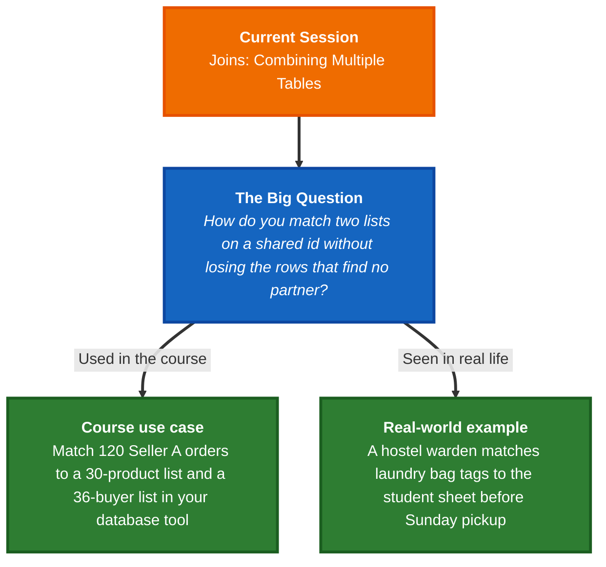

## Joins: Combining Multiple Tables

### Mental Map

---

### What You'll Learn

Have you ever wondered how the hostel warden matches each laundry bag to the right student?

By the end of this session, you will be able to:

- **Identify** the shared student id that links bag B-1 to Ananya on the sheet.
- **Predict** the number of report lines when Ananya has two bags, B-1 and B-2.
- **Determine** which students, such as Priya and Meera, have no bag in the log.
- **Compare** four ways to treat bag B-4, whose student id is missing from the sheet.
- **Trace** which three lists and which id columns a bag, student and wing question needs.
- **Justify** which list must keep every row when the warden asks for all students or all bags.

> **Topics you will meet:** Keys and INNER JOIN; LEFT RIGHT and FULL JOIN; Unmatched rows (IS NULL); Row count after a join; Join three tables.
>
> Choosing the join a reporting question needs; Reading the schema a question needs.
>
> Join the session to learn each of these in detail.

---

### Why You Are Learning This Topic

On Sunday, the hostel warden collects one laundry bag from each student.
Every bag carries a tag with a student id.
The student sheet holds names and wings. The laundry log holds bag tags and kilograms.
A tag alone does not tell the warden whose bag it is.
She must match each tag id to an id on the sheet.

A **join** means placing two lists side by side by matching a shared column.

You will use the same match on Seller A orders, products and buyers.

> **Think about it:** What should the warden do with a bag whose student id is not on the sheet?

---

### The Hostel Laundry Puzzle

The warden keeps two small lists. A third list maps each wing letter to a wing warden.

**Student sheet**

| Student id | Name | Wing |
|:----------:|:----:|:----:|
| S-01 | Ananya | A |
| S-02 | Priya | A |
| S-03 | Karthik | B |
| S-04 | Meera | B |

**Laundry log**

| Bag | Student id | Weight (kg) |
|:---:|:----------:|:-----------:|
| B-1 | S-01 | 3 |
| B-2 | S-01 | 2 |
| B-3 | S-03 | 4 |
| B-4 | S-07 | 5 |

**What you want to happen:**

- Bag B-1 shows Ananya's name beside 3 kg.
- Bag B-4 stays on the report, even though S-07 is missing from the sheet.
- Priya and Meera appear on a list of students with no bag.

> **Wonder about this:**
>
> - How long is the report when Ananya owns two bags?
> - What shows in the name box for bag B-4?

---

### Think It Through

There is no wrong first try. Keep your guesses for the session.

**1. Which column links a laundry bag to a student?**
Hint: Find the value that both lists share.

**2. Ananya has bags B-1 and B-2. What is the line count with her name on a bag report?**
Hint: Count one line per bag, not one per student.

**3. Which students never handed in a bag?**
Hint: Look for ids on the sheet that the log never uses.

---

### One Question to Carry Into the Session

> **When two lists share an id, which rows must stay if they find no partner?**
>
> Would your answer change if the warden wants every student listed, or every bag?
