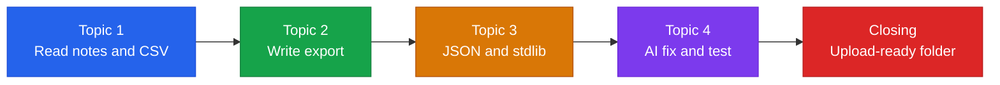
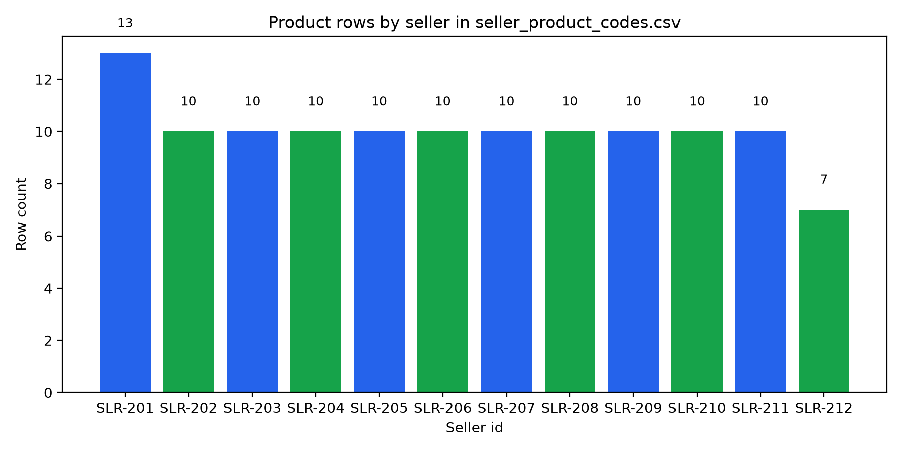
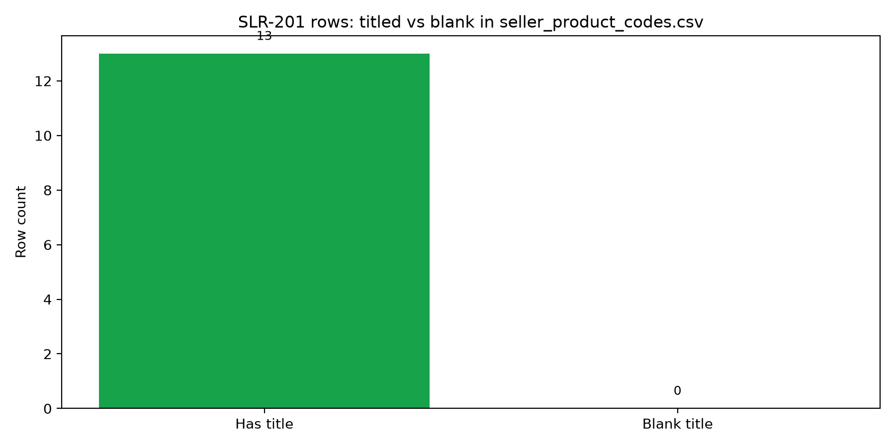
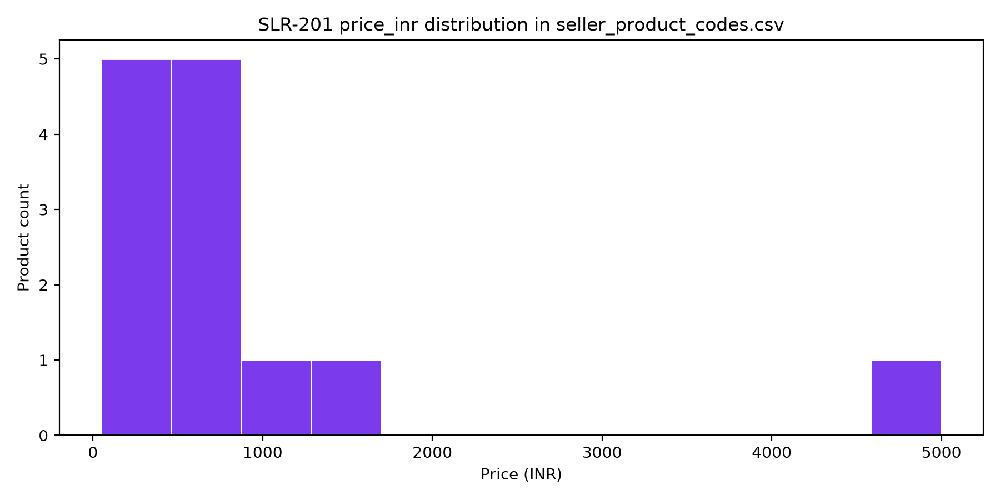
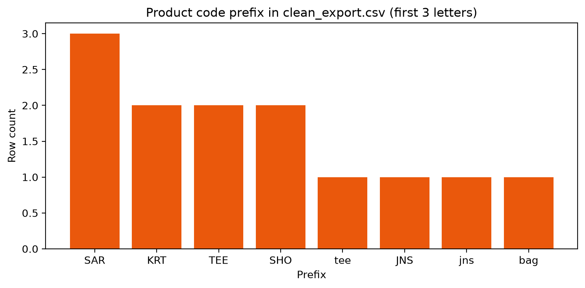
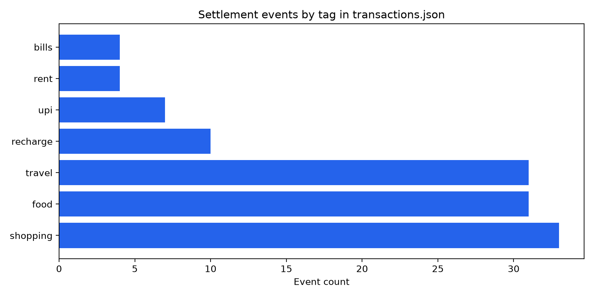
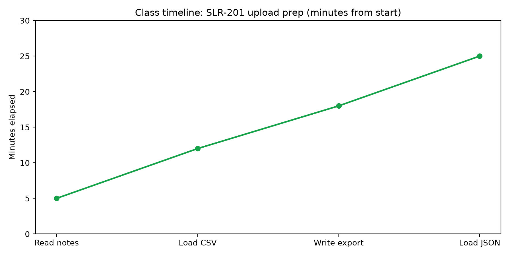

# <font color='#1d4ed8'>Lecture Script: Python Files and Data Handling</font>

---

## <font color='blue'>Agenda</font>

The lecture runs as four topics. Each topic ends with a quiz.

| Topic | What we do | Learning objectives covered | Minutes |
|:-:|:--|:--|:-:|
| 1 | Read notes and the product table | Write a script that reads a text file into a string using a with-block<br>Parse a CSV file into rows using the csv module's reader | 28 |
| 2 | Build clean_export.csv on disk | Write a list of records to a CSV file including a header row | 30 |
| 3 | Load JSON and count settlement tags | Parse a JSON file from disk into Python dictionaries and lists<br>Apply a standard library module such as datetime, random or collections to a stated task | 30 |
| 4 | Fix a broken total script with AI help | Debug a failing script, query or formula with an AI tool's fix, testing it before accepting | 22 |
| — | Closing: Outcome & Summary | | 10 |
| | **Total** | | **120** |

> <font color="red">**🎯 Instructor Note**</font> Pace: spend the most time on `csv.DictWriter` and `writeheader()` in Topic 2, and on paste-fix-run in Topic 4.
> Keep the notes file read in Topic 1 quick; learners need hands-on time on file paths.

---

## <font color='blue'>Scenario</font>

| Before (pasted in Colab) | After (files on disk) |
|:--|:--|
| Seller A kept one long `catalog_blob` string in a cell | Same 120 product rows now live in `data/seller_product_codes.csv` |
| Upload reminders were retyped each morning | `data/upload_notes.txt` holds tomorrow's checklist |
| Settlement events were pasted JSON text | `data/transactions.json` is read with `json.load` |

A Flipkart-style marketplace upload team checks Seller A's folder before the evening window. One wrong copy of the table file, and yesterday's prices go live again.

> <font color="red">**🎯 Instructor Note**</font> Flipkart is only the setting; do not claim it uses this data. All rows are invented for teaching.
> Upload the whole `data/` folder to Colab. Run code with the notebook working folder set to this session folder.

---

## <font color='blue'>Problem Statement</font>

Seller A still opened an old notebook that summed prices from a pasted table. She edited row 4 in the cell, not the saved CSV. The upload script read the file on disk, so the marketplace showed the old price. Her manager also found four blank titles in the shared product table file. Nothing was blocked, but three products went live with missing names.

> <font color='purple'>**How do we read Seller A's saved text, table and JSON files, write a clean export, and trust an AI fix only after we re-run the script?**</font>

> <font color="red">**🎯 Instructor Note**</font> Poll: "How many product rows does Seller A have in seller_product_codes.csv: 13, 60, or 120?" Give learners 30 seconds to respond in chat. Reveal the answer in the Closing.

---

## <font color='blue'>What We Will Use</font>

Files on disk hold text, comma tables and JSON. The same list and dictionary ideas from earlier sessions now arrive through `open`, `with`, and three standard library tools.

| Topic | Tools | In one line |
|:-:|:--|:--|
| 1 | `with open`, `read()`, `csv.reader`, `csv.DictReader` | Read plain text and table rows safely from disk |
| 2 | `csv.DictWriter`, `writeheader`, `writerows` | Save a list of dictionaries as a CSV with column titles |
| 3 | `json.load`, `collections.Counter`, `datetime.strftime` | Load JSON from a file and summarise or stamp rows |
| 4 | AI chat paste, re-run, compare output | Test a suggested fix before keeping it |

---

## <font color='blue'>How: Walking Through Seller A's Saved Folder</font>



---

## <font color='blue'>Topic 1: Read Notes and the Product Table</font> `28 min`

> <font color='purple'>**The checklist lives in upload_notes.txt. How do we load it without retyping, then open the 120-row product table?**</font>

In Lists and String Handling you split a `catalog_blob` string into lines. In Dictionaries and JSON with Tuples and Sets you parsed JSON text with `json.loads`. Today the same seller rows sit in named files, and Python reads them from disk.

### <font color='green'>Example: read the upload notes into one string</font>

> <font color='purple'>**How long is the notes file, and what is the first line?**</font>

**Predict before running: What will happen?**

> <font color="red">**🎯 Instructor Note**</font> Expected: one string with several lines; first line is the dated checklist title. Wrong guess: `read()` returns a list of lines.

```python
with open("data/upload_notes.txt", encoding="utf-8") as f:
    notes = f.read()
print(len(notes), notes.splitlines()[0])
```

**Output**

```
349 Seller A — upload checklist for 19 March 2026
```

#### <font color='#c2410c'>Code Explanation</font>

- **Lines 1 to 2** `with open(...)` opens the file and closes it when the block ends. `read()` loads the full text into `notes`.
- **Line 3** `len` counts characters; `splitlines()[0]` is the first line without manual typing.

> <font color='green'>**Result**</font> The mentor can print upload rules from disk in one cell, with no copy-paste drift.

### <font color='green'>Extending it: parse the CSV with csv.reader</font>

> <font color='purple'>**What are the column names, how many data rows are there, and what is the first product code?**</font>

```python
import csv
with open("data/seller_product_codes.csv", newline="", encoding="utf-8") as f:
    rows = list(csv.reader(f))
print(rows[0])
print(len(rows) - 1, rows[1][2], rows[1][4])
```

**Output**

```
['row_id', 'seller_id', 'product_code_raw', 'title_raw', 'price_inr']
120 KRT-0412-RD 499
```

#### <font color='#c2410c'>Code Explanation</font>

- **Line 1** imports the `csv` module for table files.
- **Lines 2 to 3** `csv.reader` yields each line as a list of fields; row 0 is the header.
- **Line 4** subtract 1 for the header; index 2 is product code, index 4 is price.

> <font color='green'>**Result**</font> The table has 120 product rows plus a header, matching the old `catalog_blob` size.

<p align="center"></p>

### <font color='green'>Extending it: keep only Seller A rows</font>

> <font color='purple'>**How many rows use shop code SHOP-A, and how many of those have a blank title?**</font>

```python
import csv
seller_a_rows = []
with open("data/seller_product_codes.csv", newline="", encoding="utf-8") as f:
    for row in csv.DictReader(f):
        if row["seller_id"] == "SHOP-A":
            seller_a_rows.append(row)
blanks = sum(1 for r in seller_a_rows if not r["title_raw"].strip())
print(len(seller_a_rows), blanks, seller_a_rows[0]["product_code_raw"])
```

**Output**

```
13 0 KRT-0412-RD
```

#### <font color='#c2410c'>Code Explanation</font>

- **Lines 3 to 5** `DictReader` uses the header row as keys, so `row["seller_id"]` is readable.
- **Line 6** `strip()` treats spaces-only titles as blank; Seller A rows today all have text.

> <font color='green'>**Result**</font> Thirteen rows are Seller A's; the poll answer is 13, not 120.

<p align="center"></p>

### <font color='green'>Extending it: count blank titles in the full product table</font>

> <font color='purple'>**The notes file mentions four blank titles in the shared file. Does the CSV match?**</font>

```python
import csv
with open("data/seller_product_codes.csv", newline="", encoding="utf-8") as f:
    rows = list(csv.DictReader(f))
blanks = sum(1 for r in rows if not r["title_raw"].strip())
print(blanks, len(rows))
```

**Output**

```
4 120
```

> <font color='#b45309'>**Common mistake**</font> Reading the file without `newline=""` can add extra blank lines on some systems; always pass `newline=""` for CSV.

### <font color='purple'>Quiz 1</font>

**Question:** Why use `with open(...) as f` instead of `f = open(...)` and no `close`?

**Options:**
- A) It makes the file read faster on every OS
- B) It closes the file when the block ends, even after an error
- C) It converts the file into a JSON object
- D) It only works for CSV files, not text files

**Correct Answer:** B

**Explanation:**
- **A)** Wrong: speed is not the reason; safety is.
- **B)** Correct: the context manager closes the handle for you.
- **C)** Wrong: you still choose `read`, `csv`, or `json` yourself.
- **D)** Wrong: `with` works for any text or binary file mode.

---

## <font color='blue'>Topic 2: Build clean_export.csv on Disk</font> `30 min`

> <font color='purple'>**Seller A needs a smaller table file with a header row. How do we write her thirteen cleaned rows to clean_export.csv?**</font>

In Dictionaries and JSON with Tuples and Sets you held each product as a dictionary in a list. The same shape now becomes a file other tools can open.

### <font color='green'>Example: build a list of records and write the CSV</font>

> <font color='purple'>**How many rows are written, and which product code is first?**</font>

**Predict before running: What will happen?**

> <font color="red">**🎯 Instructor Note**</font> Expected: a new file appears under `data/clean_export.csv` with 13 data rows and a header line. Wrong guess: the old seller file is overwritten.

```python
import csv
clean = []
with open("data/seller_product_codes.csv", newline="", encoding="utf-8") as f:
    for r in csv.DictReader(f):
        if r["seller_id"] == "SHOP-A" and r["title_raw"].strip():
            clean.append({"product_code": r["product_code_raw"].strip(), "title": r["title_raw"].strip().title(), "price_inr": r["price_inr"]})
with open("data/clean_export.csv", "w", newline="", encoding="utf-8") as g:
    w = csv.DictWriter(g, fieldnames=["product_code", "title", "price_inr"])
    w.writeheader(); w.writerows(clean); print(len(clean), clean[0]["product_code"])
```

**Output**

```
13 KRT-0412-RD
```

#### <font color='#c2410c'>Code Explanation</font>

- **Lines 2 to 6** build `clean`, a list of dictionaries with normalised text fields.
- **Lines 7 to 10** `DictWriter` writes the header once, then every record.
- **Line 11** confirms count and the first product code in list order.

> <font color='green'>**Result**</font> Seller A gets a fresh export file with column names on line one.

<p align="center"></p>

### <font color='green'>Extending it: read the export back</font>

> <font color='purple'>**Did the header survive, and does the first title use title case?**</font>

```python
import csv
with open("data/clean_export.csv", newline="", encoding="utf-8") as f:
    rows = list(csv.DictReader(f))
print(rows[0]["product_code"], rows[0]["title"], len(rows))
```

**Output**

```
KRT-0412-RD Cotton Kurta Set 13
```

#### <font color='#c2410c'>Code Explanation</font>

- **Lines 2 to 3** `DictReader` skips the header row automatically when building dicts.
- **Line 4** checks the first kurta row and the row count.

> <font color='green'>**Result**</font> Reading the file proves the write step created a valid table another analyst can open.

<p align="center"></p>

### <font color='purple'>Quiz 2</font>

**Question:** Which call writes the column names as the first line of the new CSV?

**Options:**
- A) `writerows` before `writeheader`
- B) `print` of the fieldnames list
- C) `writeheader` before `writerows`
- D) `json.dump` with `indent=2`

**Correct Answer:** C

**Explanation:**
- **A)** Wrong: rows would appear before any column titles.
- **B)** Wrong: printing does not change the file on disk.
- **C)** Correct: `writeheader()` emits the header row once.
- **D)** Wrong: that serialises JSON, not CSV columns.

---

## <font color='blue'>Topic 3: Load JSON and Count Settlement Tags</font> `30 min`

> <font color='purple'>**A kurta detail file and a settlement JSON sit in the same folder. How do we load them and summarise tags with a stdlib helper?**</font>

You already turned JSON strings into dicts with `json.loads`. `json.load` does the same when the JSON is stored in a file.

### <font color='green'>Example: read kurta_detail.json</font>

> <font color='purple'>**What product code is in the file, and what Python type is price_inr?**</font>

```python
import json
with open("data/kurta_detail.json", encoding="utf-8") as f:
    detail = json.load(f)
print(detail["product_code"], type(detail["price_inr"]), detail["upload_date"])
```

**Output**

```
KRT-0412-RD <class 'int'> 2026-03-19
```

#### <font color='#c2410c'>Code Explanation</font>

- **Lines 2 to 3** `json.load` reads the whole file and returns a dictionary.
- **Line 4** shows string, integer, and date text fields.

> <font color='green'>**Result**</font> One small JSON file carries the golden row Seller A checks against the CSV.

### <font color='green'>Extending it: load the 120 settlement events</font>

> <font color='purple'>**How many events are in transactions.json, and what type is amount_inr on row one?**</font>

```python
import json
with open("data/transactions.json", encoding="utf-8") as f:
    txns = json.load(f)
print(len(txns), txns[0]["txn_id"], type(txns[0]["amount_inr"]))
```

**Output**

```
120 T001 <class 'int'>
```

#### <font color='#c2410c'>Code Explanation</font>

- **Line 3** `json.load` on a list root returns a Python list of dicts.
- **Line 4** confirms 120 events and integer amounts.

> <font color='green'>**Result**</font> The settlement file matches the list shape you parsed from pasted text last session.

### <font color='green'>Extending it: count tags with collections.Counter</font>

> <font color='purple'>**Which tag appears most often, and how many distinct tags are there?**</font>

```python
import json
from collections import Counter
with open("data/transactions.json", encoding="utf-8") as f:
    txns = json.load(f)
tags = Counter(t["tag"] for t in txns)
top = tags.most_common(3)
print(top[0][0], top[0][1], len(tags))
```

**Output**

```
shopping 33 7
```

#### <font color='#c2410c'>Code Explanation</font>

- **Line 2** `Counter` is a standard library tool for tallies.
- **Lines 5 to 6** build counts per `tag` and show the busiest tag.

> <font color='green'>**Result**</font> Thirty-three shopping-tagged events dominate the file; seven tags appear in total.

<p align="center"></p>

### <font color='green'>Extending it: stamp the export time with datetime</font>

> <font color='purple'>**What timestamp and export row count should appear on the upload log line?**</font>

```python
import csv
from datetime import datetime
stamp = datetime(2026, 3, 19, 17, 45).strftime("%Y-%m-%d %H:%M")
with open("data/clean_export.csv", newline="", encoding="utf-8") as f:
    n = sum(1 for _ in csv.DictReader(f))
print(stamp, n)
```

**Output**

```
2026-03-19 17:45 13
```

> <font color="red">**🎯 Instructor Note**</font> Fixed clock 19 March 2026, 5:45 PM keeps every learner's stamp identical in class.

### <font color='purple'>Quiz 3</font>

**Question:** What is the difference between `json.loads` and `json.load` in this session?

**Options:**
- A) `loads` reads a file path; `load` reads a string
- B) Both require the `pandas` library
- C) `loads` only works on lists; `load` only on dicts
- D) `loads` parses a string already in memory; `load` parses from an open file object

**Correct Answer:** D

**Explanation:**
- **A)** Wrong: the roles are the other way around.
- **B)** Wrong: both are in the standard library `json` module.
- **C)** Wrong: either function can return dicts, lists, numbers, or null.
- **D)** Correct: `load(f)` reads JSON text from the file handle `f`.

---

## <font color='blue'>Topic 4: Fix a Broken Total Script with AI Help</font> `22 min`

> <font color='purple'>**Seller A wants the sum of all prices in seller_product_codes.csv. Her script crashes. How do we use an AI fix and only keep it after a test run?**</font>

In How AI and LLMs Work with Prompts you wrote task, context, format and constraints. Use the same pattern when you ask for a code fix: paste the error, the file name, and ask for a short explanation.

### <font color='green'>Example: run the broken total script</font>

> <font color='purple'>**What fails, and on which value?**</font>

**Predict before running: What will happen?**

> <font color="red">**🎯 Instructor Note**</font> Expected: `ValueError` on the word `price_inr`. Wrong guess: the sum prints 79,980 on the first try.

```python
import csv
total = 0
with open("data/seller_product_codes.csv", newline="", encoding="utf-8") as f:
    for row in csv.reader(f):
        total += int(row[4])
print(total)
```

**Output**

```
Traceback (most recent call last):
  File "<stdin>", line 5, in <module>
ValueError: invalid literal for int() with base 10: 'price_inr'
```

#### <font color='#c2410c'>Code Explanation</font>

- **Lines 3 to 5** treat every row, including the header, as data.
- **Line 5** tries to turn the column name `price_inr` into an integer.

> <font color='green'>**Result**</font> The script stops before printing a total; the header row is the bug.

### <font color='green'>Extending it: paste the error into an AI tool and test the fix</font>

> <font color='purple'>**After skipping the header, what is the price sum across all 120 products?**</font>

Sample prompt for chat (mentor reads aloud; learners do not need a live API): "Task: fix this Python 3 script that sums column index 4 in data/seller_product_codes.csv. Context: ValueError on price_inr header row. Format: return only the corrected code block under ten lines. Constraint: use csv.reader and skip the header."

```python
import csv
total = 0
with open("data/seller_product_codes.csv", newline="", encoding="utf-8") as f:
    rows = csv.reader(f)
    next(rows)
    for row in rows:
        total += int(row[4])
print(total, "all_sellers")
```

**Output**

```
79980 all_sellers
```

#### <font color='#c2410c'>Code Explanation</font>

- **Line 5** `next(rows)` drops the header row before the loop.
- **Line 7** now adds only numeric price fields.

> <font color='green'>**Result**</font> The mentor re-ran the cell after pasting the fix and only then trusted the total.

> <font color='#b45309'>**Common mistake**</font> Accepting AI code without re-running it on your file path; always check the printed number and row count.

### <font color='purple'>Quiz 4</font>

**Question:** What should you do right after an AI tool rewrites your script?

**Options:**
- A) Run the script on your data and compare the output to what you expect
- B) Delete the original file so only the AI version remains
- C) Share the fix in chat before running it locally
- D) Change the file path to a shorter name only

**Correct Answer:** A

**Explanation:**
- **A)** Correct: test on your folder and verify numbers before accepting.
- **B)** Wrong: you still need the source data file intact.
- **C)** Wrong: running locally comes before sharing.
- **D)** Wrong: renaming paths does not validate the fix.

---

## <font color='blue'>Closing: Outcome & Summary</font> `10 min`

Seller A moved from pasted cells to a small folder on disk. Each topic added one piece: read text and the shared table, write her export, load JSON with a stdlib tally, then test an AI fix on the price sum.

> <font color='purple'>**1. Did we answer the lecture question about text, table, JSON, export, and a tested AI fix?**</font>

Yes. Notes came from `upload_notes.txt`, the 120-row product table from `seller_product_codes.csv`, the golden kurta row from `kurta_detail.json`, settlement checks from `transactions.json`, and the price total only after skipping the header.

> <font color='purple'>**2. How many Seller A rows are in the export file?**</font>

```python
import csv
with open("data/clean_export.csv", newline="", encoding="utf-8") as f:
    n = sum(1 for _ in csv.DictReader(f))
print("Seller A export rows:", n)
```

**Output**

```
Seller A export rows: 13
```

#### <font color='#c2410c'>Code Explanation</font>

- **Lines 2 to 4** Topic 2's export is re-read to confirm the upload file row count.

<p align="center"></p>

### <font color='green'>Outcome</font>

| | Paste in a cell | Files in data/ |
|:--|:-:|:-:|
| Rows Seller A can upload | Hard to track | 13 in clean_export.csv |
| Blank titles in full product table | Hidden in a long string | 4 found with `strip()` check |
| Settlement events | Pasted JSON text | 120 in transactions.json |
| Price sum script | Crashes on header | 79,980 after `next(rows)` |

> <font color='green'>**Therefore,**</font> Seller A should keep one `data/` folder, write `clean_export.csv` after cleanup, and treat any AI fix as a draft until a re-run matches these checks.

> <font color="red">**🎯 Instructor Note**</font> Reveal the poll answer: **13** Seller A product rows in `seller_product_codes.csv` (120 rows belong to all sellers combined).

### <font color='green'>Summary</font>

| Learning objective | Takeaway |
|:--|:--|
| Write a script that reads a text file into a string using a with-block | `with open` plus `read()` loads the whole notes file and closes safely |
| Parse a CSV file into rows using the csv module's reader | `csv.reader` or `DictReader` turns each line into Python values |
| Write a list of records to a CSV file including a header row | `DictWriter` with `writeheader()` saves dictionaries as a table file |
| Parse a JSON file from disk into Python dictionaries and lists | `json.load(f)` replaces pasted JSON strings for kurta and settlement data |
| Apply a standard library module such as datetime, random or collections to a stated task | `Counter` and `datetime.strftime` summarise tags and stamp the export |
| Debug a failing script, query or formula with an AI tool's fix, testing it before accepting | Paste error plus context, re-run on `data/`, then keep the fix |
| **Practical value** | Your portfolio scripts can read real CSV and JSON downloads instead of one giant notebook cell |

---

# <font color='red'>Launch the Feedback Poll</font>

> <font color="red">**🎯 Instructor Note**</font> Reminder: launch the feedback poll now to collect learner feedback.