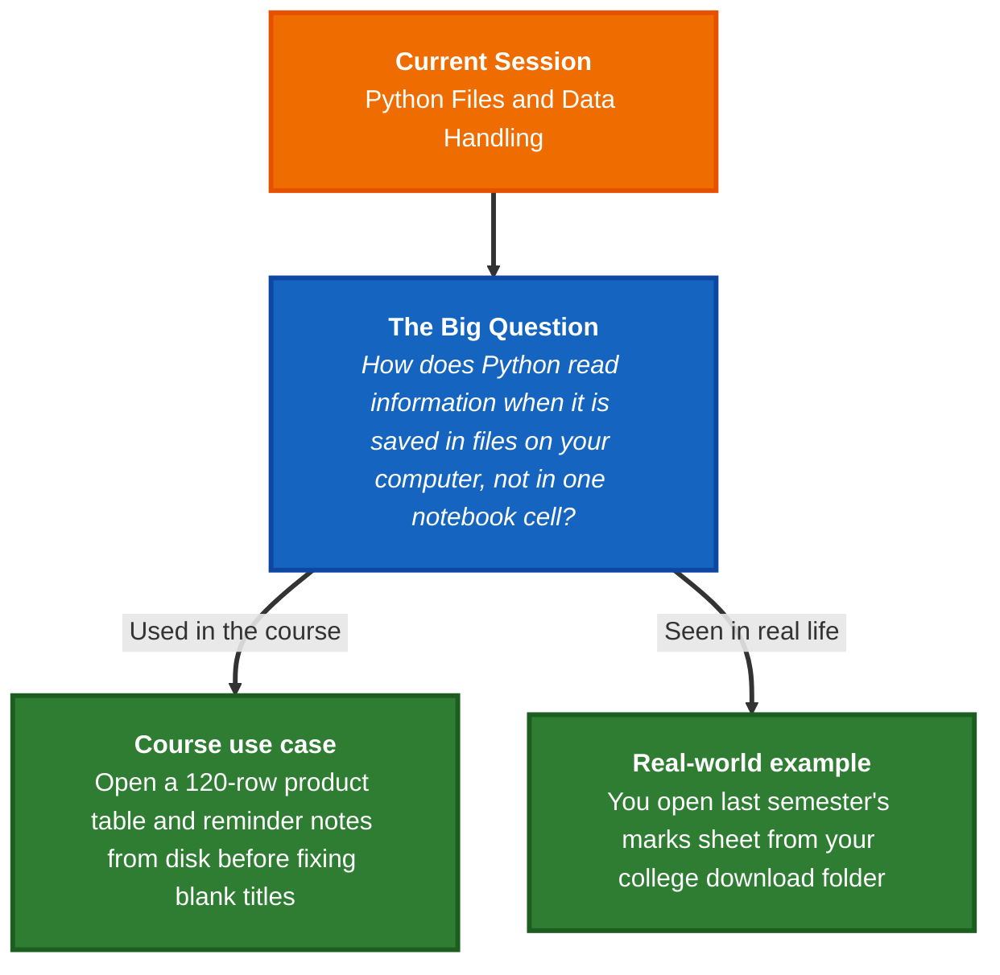

## <span style="color:#2F7DDE">Python Files and Data Handling</span>

### <span style="color:#2F7DDE">Mental Map</span>



---

### <span style="color:#2F7DDE">What You'll Learn</span>

Have you ever opened a saved marks sheet and wondered how your notes program could read it without you retyping every row?

By the end of this session, you will be able to:

- <span style="color:#D9660B">**Identify**</span> which text file holds today's reminder about four blank product names.
- <span style="color:#D9660B">**Interpret**</span> one saved message file as Python lists and dictionaries.
- <span style="color:#D9660B">**Trace**</span> one product name through rows in a saved spreadsheet file.
- <span style="color:#D9660B">**Apply**</span> a built-in helper to stamp today's date on a three-row export.
- <span style="color:#D9660B">**Build**</span> a new spreadsheet file with a title row and three cleaned products.
- <span style="color:#D9660B">**Judge**</span> an AI-suggested fix on a broken script before you keep it.

> <span style="color:#2F7DDE">**Topics you will meet:**</span> Read a text file; Read a CSV file; Write a CSV file; Read a JSON file; Standard library modules; Fix code with AI and test the fix.
>
> Join the session to learn each of these in detail.

---

### <span style="color:#2F7DDE">Why You Are Learning This Topic</span>

You used to paste one long product list into Colab.
Now the same information sits in named files in a folder on your laptop.
You need to read tables safely and save a cleaned copy for upload.
A <span style="color:#D9660B">**file**</span> is named text stored on your computer. It stays after you close the notebook.
In this course, the product table now lives on disk, not only in a cell.
You parsed JSON inside the notebook last time. Now the same shape can wait in a folder, like a marks sheet in Downloads.

> <span style="color:#2F7DDE">**Think about it:**</span> What breaks if you edit the wrong saved copy?

---

### <span style="color:#2F7DDE">The Download Folder Puzzle</span>

You keep three files in one folder for tomorrow's class project (the same shapes you will use in the live session).

| Saved file name | What it holds |
|:---------------:|:--------------|
| upload_notes.txt | Reminder to fix 4 blank product titles |
| seller_product_codes.csv | Names, product codes, and prices for the course table |
| kurta_detail.json | Title and price for one cotton kurta |

<span style="color:#D9660B">**What you want to happen:**</span>

- Read the reminder text without retyping it into a cell.
- Pull only the rows you need from the table file.
- Write a new table file with a header row for three approved products.

Here is how it might start. You do not need to understand it yet.

```python
import json
detail_text = '{"title": "Cotton Kurta", "price_rupees": 499}'
row = json.loads(detail_text)
print(row["title"])
```

> <span style="color:#D9660B">**Wonder about this:**</span>
>
> - How does Python read upload_notes.txt into one string without leaving the file open?
> - Why load kurta_detail.json instead of typing every field by hand?

---

### <span style="color:#2F7DDE">Think It Through</span>

There is no wrong first try. Keep your guesses for the session.

**1. upload_notes.txt holds plain sentences. What Python type fits the whole file?**
Hint: You already stored one long message as a single text value.

**2. seller_product_codes.csv lists column names on line one. Why keep that line separate from data?**
Hint: Picture a marks sheet with a title row above the scores.

**3. A script crashes on row 4. What do you check after an AI suggests a change?**
Hint: Re-run the cell and read the error before you trust the output.

---

### <span style="color:#2F7DDE">One Question to Carry Into the Session</span>

> <span style="color:#2F7DDE">**How do text, table, and JSON files work together in one saved folder?**</span>
>
> Which file would you open first to fix the 4 blank titles, and why?