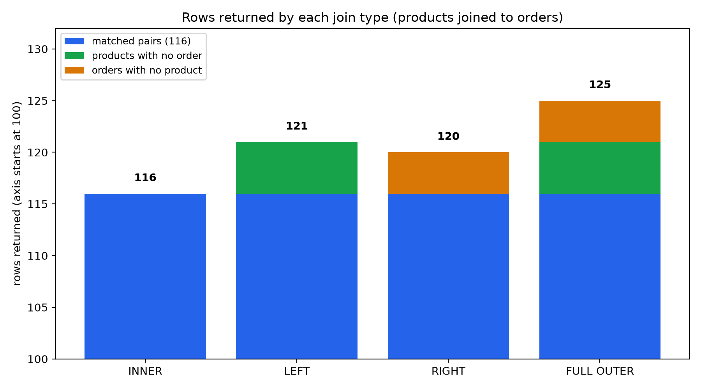
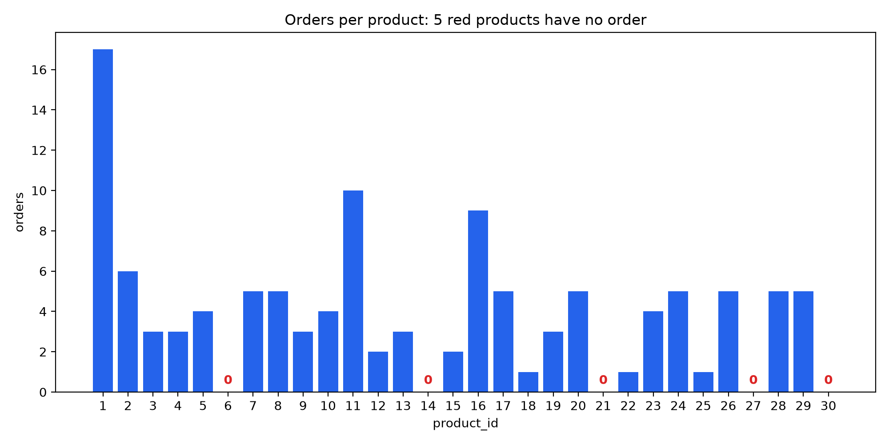
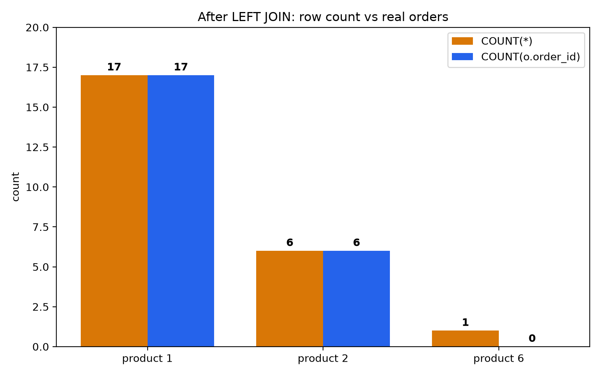
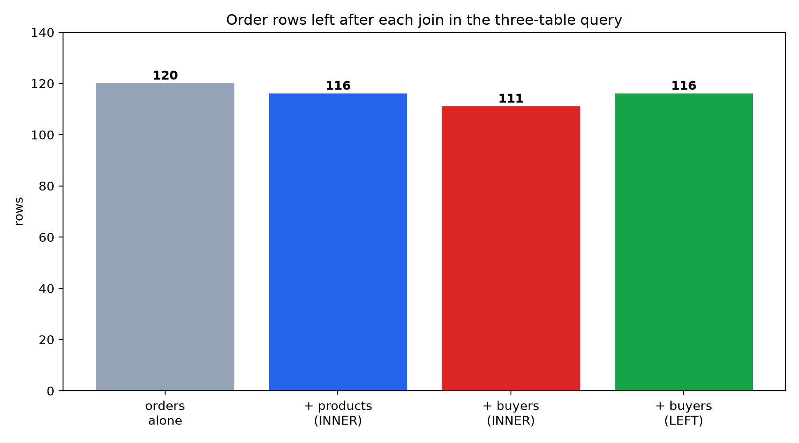
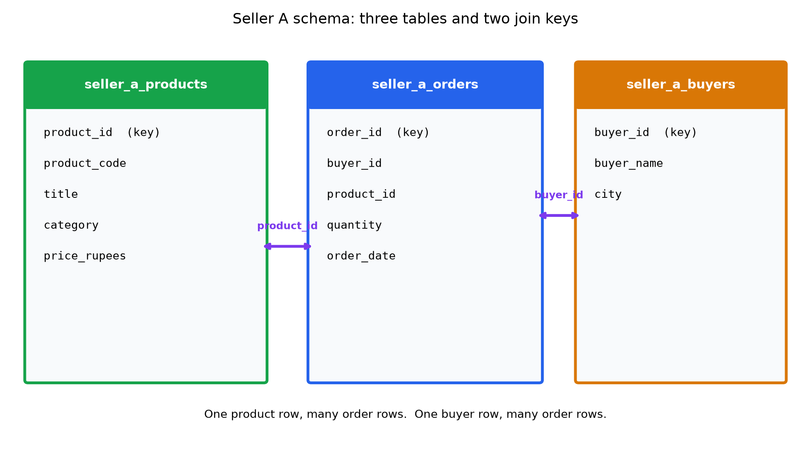
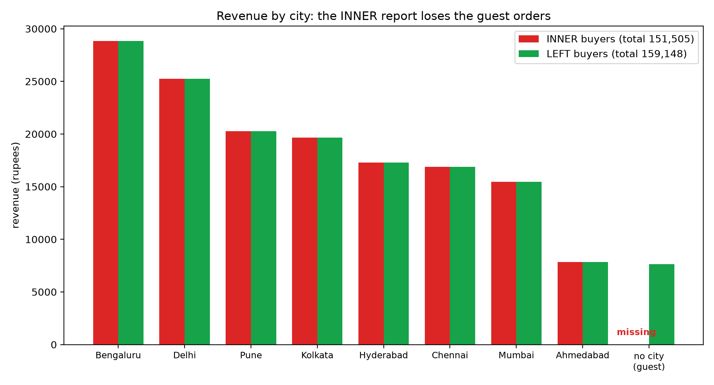

# <font color='#1d4ed8'>Lecture Script: Joins: Combining Multiple Tables</font>

---

## <font color='blue'>Agenda</font>

The lecture runs as four topics. Each topic ends with a quiz.

| Topic | What we do | Learning objectives covered | Minutes |
|:-:|:--|:--|:-:|
| 1 | Match orders to products and compare join types | Join two tables on a matching key using INNER JOIN<br>Compare INNER, LEFT, RIGHT and FULL OUTER joins by which unmatched rows survive | 32 |
| 2 | Find rows with no partner and predict row counts | Retrieve rows present in one table but absent from another using LEFT JOIN<br>Predict the row count of a join when the key repeats on one side | 28 |
| 3 | Bring buyers in with a third table | Write a query joining three tables through a shared key | 24 |
| 4 | Pick the join and read the schema | Select the join type for a stated reporting requirement, justifying by which rows must survive<br>Analyze a schema diagram for the tables, join keys and columns a question needs | 26 |
| — | Closing: Outcome & Summary | | 10 |
| | **Total** | | **120** |

> <font color="red">**🎯 Instructor Note**</font> Pace: spend the time in Topic 1 on the four row counts side by side, and in Topic 2 on the **IS NULL** filter and the row-count rule.
> Topic 3 is quick because the second **JOIN** repeats the first. Keep the decision table in Topic 4 brisk and let learners argue each choice.

---

## <font color='blue'>Scenario</font>

An **Amazon-style marketplace** keeps Seller A's **SHOP-A** numbers in three small tables. Every row is for SHOP-A, so no table needs a shop column.

| Table | Rows | One row means |
|:--|:-:|:--|
| `seller_a_products` | 30 | One product Seller A lists |
| `seller_a_orders` | 120 | One order line: which buyer, which product, how many |
| `seller_a_buyers` | 36 | One buyer: name and city |

**The one risk:** the order log stores only a `product_id` number and a `buyer_id` number. A report that matches those numbers the wrong way can drop rows without any error message.

> <font color="red">**🎯 Instructor Note**</font> The marketplace is only the setting; do not claim any company uses this data. It is invented for teaching. Use **MySQL Workbench** with **MySQL 8.0** or later, or **SQLite** 3.39 or later; load `data/seller_a_joins.sql` first. Treat **today** in chat as **15 March 2026**.

---

## <font color='blue'>Problem Statement</font>

On Monday Seller A's analyst built three reports, and every one used **INNER JOIN** because it was the only join she knew. Her "slow movers" list never showed five products that no buyer had ordered, so Seller A kept paying to store them. Four order lines pointed to products that had been delisted, and they quietly vanished from the sales report. Her city report matched orders to buyers and lost five guest checkouts worth ₹7,643. No report showed an error, and each looked complete.

> <font color='purple'>**Which rows must survive in a report, and which join keeps exactly those rows?**</font>

> <font color="red">**🎯 Instructor Note**</font> Poll: "Seller A has 30 products and 120 orders, and 5 products have no order. How many rows does a LEFT JOIN from products to orders return: 116, 120 or 121?" Give learners 30 seconds to respond in chat. Reveal the answer in the Closing.

---

## <font color='blue'>What We Will Use</font>

You already read one table with **SELECT** and **WHERE**, used **IS NULL** in Text and Dates with Calculated Columns, and counted with **GROUP BY** in Aggregation and GROUP BY. A **join** places two tables side by side by matching a shared column, and this session adds it.

| Topic | Tools | In one line |
|:-:|:--|:--|
| 1 | `INNER JOIN`, `LEFT JOIN`, `RIGHT JOIN`, `FULL OUTER JOIN`, `ON` | Match rows by a key and choose which unmatched rows stay |
| 2 | `IS NULL`, `COUNT(*)`, `COUNT(column)` | Keep only rows with no partner, and count rows after a join |
| 3 | Two `JOIN` clauses, `SUM`, `GROUP BY` | Chain a third table through its own key |
| 4 | Join choice table, schema diagram | Pick the join from the rows that must survive, and read the keys |

Open `data/seller_a_joins.sql` in Workbench or SQLite and run it once. It builds `seller_a_products` (30 rows), `seller_a_buyers` (36 rows) and `seller_a_orders` (120 rows).

> <font color="red">**🎯 Instructor Note**</font> MySQL has no `FULL OUTER JOIN` keyword, so run the two FULL OUTER queries in SQLite 3.39 or later. In Workbench, a `LEFT JOIN` and a `RIGHT JOIN` joined by `UNION` give the same rows.

---

## <font color='blue'>How: Walking Through Seller A's Three Tables</font>


---

## <font color='blue'>Topic 1: Match Orders to Products and Compare Join Types</font> `32 min`

> <font color='purple'>**An order row holds only a product number. How do we ask for the product title next to each order?**</font>

In Relational Databases and SELECT Queries you read tables, rows and a schema, one table at a time. A **key** is a column whose value names a row. In `seller_a_products`, `product_id` is the key: each id appears once. The orders table keeps the same number in its own `product_id` column to point at a product. `AS o` gives a table a short nickname, so `o.product_id` means "the `product_id` column of orders".

### <font color='green'>Example: INNER JOIN on product_id</font>

> <font color='purple'>**Which product title and price belong to orders 1001 to 1005?**</font>

**Predict before running: What will happen?**

> <font color="red">**🎯 Instructor Note**</font> Expect five rows, one per order, each with a title and price. A common wrong guess is that every order pairs with every product.

```sql
SELECT o.order_id, o.product_id, p.title, p.price_rupees
FROM seller_a_orders AS o
INNER JOIN seller_a_products AS p ON o.product_id = p.product_id
WHERE o.order_id BETWEEN 1001 AND 1005
ORDER BY o.order_id;
```

**Output**

```
+----------+------------+-------------------------+--------------+
| order_id | product_id | title                   | price_rupees |
+----------+------------+-------------------------+--------------+
| 1001     | 24         | Running Shoes White     | 1199         |
| 1002     | 29         | Georgette Dupatta Green | 299          |
| 1003     | 16         | Slim Fit Jeans Black    | 1299         |
| 1004     | 17         | Slim Fit Jeans Grey     | 999          |
| 1005     | 28         | Orange Anarkali Kurta   | 1799         |
+----------+------------+-------------------------+--------------+
```

#### <font color='#c2410c'>Code Explanation</font>

- **Line 1** `o.` and `p.` say which table each column comes from.
- **Line 3** `INNER JOIN ... ON o.product_id = p.product_id` pairs an order row with the product row that has the same number.
- **Line 4** `WHERE` trims the orders before the final list is built, as in earlier sessions.
- **Line 5** `ORDER BY o.order_id` keeps the five rows in a fixed order.

> <font color='green'>**Result**</font> Each order now shows a title and a price. A row appears only when the two key values match.

### <font color='green'>Extending it: the same column name in both tables</font>

> <font color='purple'>**What happens if we write product_id without saying which table it belongs to?**</font>

**Predict before running: What will happen?**

> <font color="red">**🎯 Instructor Note**</font> Expect an error, because both tables have a `product_id` column. Workbench reports Error Code 1052, "Column 'product_id' in field list is ambiguous".

```sql
SELECT order_id, product_id, title
FROM seller_a_orders AS o
INNER JOIN seller_a_products AS p ON o.product_id = p.product_id
WHERE o.order_id = 1001;
```

**Output**

```
Parse error near line 1: ambiguous column name: product_id
  SELECT order_id, product_id, title FROM seller_a_orders AS o INNER JOIN seller
                   ^--- error here
```

> <font color='green'>**Result**</font> The engine cannot pick a table for `product_id`. Write `o.product_id` or `p.product_id` every time a name exists in both tables.

### <font color='green'>Extending it: how many rows does INNER JOIN keep?</font>

> <font color='purple'>**The orders table has 120 rows. How many rows come back when every order must find its product?**</font>

**Predict before running: What will happen?**

> <font color="red">**🎯 Instructor Note**</font> Expect **116**, not 120. Four orders carry `product_id` 31 or 32, which Seller A has delisted, so those orders have no partner row.

```sql
SELECT COUNT(*) AS rows_returned, COUNT(p.product_id) AS with_product,
  COUNT(o.order_id) AS with_order
FROM seller_a_products AS p
INNER JOIN seller_a_orders AS o ON p.product_id = o.product_id;
```

**Output**

```
+---------------+--------------+------------+
| rows_returned | with_product | with_order |
+---------------+--------------+------------+
| 116           | 116          | 116        |
+---------------+--------------+------------+
```

#### <font color='#c2410c'>Code Explanation</font>

- **Line 1** `COUNT(*)` counts every row the join returns.
- **Lines 1-2** `COUNT(p.product_id)` and `COUNT(o.order_id)` count only rows where that side is filled, because `COUNT(column)` skips empty values, as in Aggregation and GROUP BY.

> <font color='green'>**Result**</font> INNER JOIN returns **116** rows, and both sides are filled in every one. Unmatched rows from either table disappear.

### <font color='green'>Extending it: LEFT JOIN keeps every product</font>

> <font color='purple'>**What if every product must stay in the list, even when no order mentions it?**</font>

**Predict before running: What will happen?**

> <font color="red">**🎯 Instructor Note**</font> Expect **121**: the 116 matched pairs plus the 5 products with no order. `LEFT` means keep every row of the table written before the word `JOIN`.

```sql
SELECT COUNT(*) AS rows_returned, COUNT(p.product_id) AS with_product,
  COUNT(o.order_id) AS with_order
FROM seller_a_products AS p
LEFT JOIN seller_a_orders AS o ON p.product_id = o.product_id;
```

**Output**

```
+---------------+--------------+------------+
| rows_returned | with_product | with_order |
+---------------+--------------+------------+
| 121           | 121          | 116        |
+---------------+--------------+------------+
```

> <font color='green'>**Result**</font> There are **121** rows. All 121 have a product, but only 116 have an order, so 5 rows show empty order columns.

### <font color='green'>Extending it: RIGHT JOIN keeps every order</font>

> <font color='purple'>**What if every order must stay, even when its product is gone from the catalog?**</font>

**Predict before running: What will happen?**

> <font color="red">**🎯 Instructor Note**</font> Expect **120**. `RIGHT` keeps every row of the table written after `JOIN`, which is the orders table here.

```sql
SELECT COUNT(*) AS rows_returned, COUNT(p.product_id) AS with_product,
  COUNT(o.order_id) AS with_order
FROM seller_a_products AS p
RIGHT JOIN seller_a_orders AS o ON p.product_id = o.product_id;
```

**Output**

```
+---------------+--------------+------------+
| rows_returned | with_product | with_order |
+---------------+--------------+------------+
| 120           | 116          | 120        |
+---------------+--------------+------------+
```

> <font color='green'>**Result**</font> There are **120** rows. All 120 have an order, but 4 have no product, so `with_product` is **116**.

### <font color='green'>Extending it: FULL OUTER JOIN keeps both sides</font>

> <font color='purple'>**What if the audit needs every product and every order, matched or not?**</font>

**Predict before running: What will happen?**

> <font color="red">**🎯 Instructor Note**</font> Expect **125**: 116 matched pairs, plus 5 products with no order, plus 4 orders with no product. Run this one in SQLite.

```sql
SELECT COUNT(*) AS rows_returned, COUNT(p.product_id) AS with_product,
  COUNT(o.order_id) AS with_order
FROM seller_a_products AS p
FULL OUTER JOIN seller_a_orders AS o ON p.product_id = o.product_id;
```

**Output**

```
+---------------+--------------+------------+
| rows_returned | with_product | with_order |
+---------------+--------------+------------+
| 125           | 121          | 120        |
+---------------+--------------+------------+
```

> <font color='green'>**Result**</font> There are **125** rows, and nothing from either table is lost.

| Join type | Rows returned | Products with no order | Orders with no product |
|:--|:-:|:-:|:-:|
| INNER | 116 | dropped | dropped |
| LEFT (products first) | 121 | kept | dropped |
| RIGHT (products first) | 120 | dropped | kept |
| FULL OUTER | 125 | kept | kept |

<p align="center"></p>

### <font color='purple'>Quiz 1</font>

**Question:** You write `FROM seller_a_products AS p ___ JOIN seller_a_orders AS o ON p.product_id = o.product_id`. Which keyword returns exactly 120 rows, one for every order?

**Options:**
- A) `INNER`
- B) `RIGHT`
- C) `LEFT`
- D) `FULL OUTER`

**Correct Answer:** B

**Explanation:**
- **A)** Wrong: INNER returns 116 rows and drops the 4 orders with no product.
- **B)** Correct: RIGHT keeps every row of the orders table, which has 120 rows.
- **C)** Wrong: LEFT keeps every product, which gives 116 + 5 = 121 rows.
- **D)** Wrong: FULL OUTER keeps both sides, which gives 125 rows.

---

## <font color='blue'>Topic 2: Find Rows with No Partner and Predict Row Counts</font> `28 min`

> <font color='purple'>**Five products fell out of the INNER JOIN list. Which five are they?**</font>

A LEFT JOIN fills the right-hand columns with empty values (NULL) for a left row that found no partner. You used **IS NULL** to find blank cells in Text and Dates with Calculated Columns. Here the same filter finds rows that had no partner.

### <font color='green'>Example: products that no order mentions</font>

> <font color='purple'>**Which catalog products have never been ordered?**</font>

**Predict before running: What will happen?**

> <font color="red">**🎯 Instructor Note**</font> Expect **5** rows: product ids 6, 14, 21, 27 and 30. A common wrong guess is to filter `o.product_id = p.product_id`, which is the join condition and not a filter.

```sql
SELECT p.product_id, p.product_code, p.title
FROM seller_a_products AS p
LEFT JOIN seller_a_orders AS o ON p.product_id = o.product_id
WHERE o.order_id IS NULL
ORDER BY p.product_id;
```

**Output**

```
+------------+--------------+-------------------+
| product_id | product_code | title             |
+------------+--------------+-------------------+
| 6          | KRT-1402-MR  | Maroon Silk Kurta |
| 14         | TOP-2390-GR  | Linen Top Green   |
| 21         | BAG-1788-BK  | Sling Bag Black   |
| 27         | SHO-1811-GL  | Gold Juttis       |
| 30         | TOP-2455-LV  | Lavender Crop Top |
+------------+--------------+-------------------+
```

#### <font color='#c2410c'>Code Explanation</font>

- **Lines 2-3** `LEFT JOIN` keeps all 30 products; products with no order get empty `o.` columns.
- **Line 4** `WHERE o.order_id IS NULL` keeps only those rows. `order_id` is the key of the orders table, so it is empty only when no order was found.

> <font color='green'>**Result**</font> Five products have never been ordered. Seller A can now decide to reprice or remove them.

<p align="center"></p>

### <font color='green'>Extending it: orders whose product is missing</font>

> <font color='purple'>**Which orders point to a product that is not in the catalog?**</font>

**Predict before running: What will happen?**

> <font color="red">**🎯 Instructor Note**</font> Expect **4** rows, all with `product_id` 31 or 32. Swapping the table order flips the question.

```sql
SELECT o.order_id, o.product_id, o.quantity
FROM seller_a_orders AS o
LEFT JOIN seller_a_products AS p ON o.product_id = p.product_id
WHERE p.product_id IS NULL
ORDER BY o.order_id;
```

**Output**

```
+----------+------------+----------+
| order_id | product_id | quantity |
+----------+------------+----------+
| 1052     | 31         | 1        |
| 1069     | 31         | 2        |
| 1117     | 32         | 1        |
| 1119     | 31         | 2        |
+----------+------------+----------+
```

> <font color='green'>**Result**</font> Orders 1052, 1069, 1117 and 1119 have no product row. The same pattern works in both directions: keep the table you care about on the left.

### <font color='green'>Extending it: the equals NULL trap</font>

> <font color='purple'>**Does WHERE o.order_id = NULL find the same five products?**</font>

**Predict before running: What will happen?**

> <font color="red">**🎯 Instructor Note**</font> Ask for a guess first. Expect **0**: a comparison with NULL is never true, so only `IS NULL` works.

```sql
SELECT COUNT(*) AS rows_found
FROM seller_a_products AS p
LEFT JOIN seller_a_orders AS o ON p.product_id = o.product_id
WHERE o.order_id = NULL;
```

**Output**

```
+------------+
| rows_found |
+------------+
| 0          |
+------------+
```

> <font color='green'>**Result**</font> The count is **0** rows. Use `IS NULL`, never `= NULL`.

### <font color='green'>Extending it: how many rows does a join create when the key repeats?</font>

> <font color='purple'>**Product 1 appears in many orders. How many rows does product 1 produce after the join, and what about product 6?**</font>

In `seller_a_products` each `product_id` appears once, but in `seller_a_orders` it can repeat. The join creates one result row for every matching pair, and a LEFT JOIN adds one row for a left row with no match.

$$\boxed{\text{LEFT JOIN rows} = \sum_{\text{left rows}} \max(1,\ \text{matches})}$$

For INNER JOIN, a row with no match counts 0 instead of 1.

**Predict before running: What will happen?**

> <font color="red">**🎯 Instructor Note**</font> Expect product 1 to give **17** rows, product 2 to give **6**, and product 6 to give **1** row but **0** real orders. `COUNT(*)` counts the empty row too.

```sql
SELECT p.product_id, COUNT(*) AS joined_rows, COUNT(o.order_id) AS real_orders
FROM seller_a_products AS p
LEFT JOIN seller_a_orders AS o ON p.product_id = o.product_id
WHERE p.product_id IN (1, 2, 6)
GROUP BY p.product_id
ORDER BY p.product_id;
```

**Output**

```
+------------+-------------+-------------+
| product_id | joined_rows | real_orders |
+------------+-------------+-------------+
| 1          | 17          | 17          |
| 2          | 6           | 6           |
| 6          | 1           | 0           |
+------------+-------------+-------------+
```

#### <font color='#c2410c'>Code Explanation</font>

- **Line 1** `COUNT(*)` counts joined rows, and `COUNT(o.order_id)` counts only real orders.
- **Lines 5-6** `GROUP BY` and `ORDER BY` give one fixed-order line per product.

> <font color='green'>**Result**</font> One product row became **17** result rows because its key repeats in orders. Product 6 shows **1** row yet **0** orders, so use `COUNT(o.order_id)` when you need real orders.

<p align="center"></p>

### <font color='green'>Extending it: predict a count before you run it</font>

> <font color='purple'>**If we flip the join so orders are on the left and products on the right, how many rows come back?**</font>

**Predict before running: What will happen?**

> <font color="red">**🎯 Instructor Note**</font> Give learners 30 seconds to respond in chat. Expect **120**: each order matches at most one product, so the rule gives 116 matches plus 4 rows with no match.

```sql
SELECT COUNT(*) AS rows_returned, COUNT(p.product_id) AS with_product
FROM seller_a_orders AS o
LEFT JOIN seller_a_products AS p ON o.product_id = p.product_id;
```

**Output**

```
+---------------+--------------+
| rows_returned | with_product |
+---------------+--------------+
| 120           | 116          |
+---------------+--------------+
```

> <font color='green'>**Result**</font> There are **120** rows, the same as the orders table. A table whose key appears once on the right can never add rows to the left side.

### <font color='purple'>Quiz 2</font>

**Question:** Which query lists the products that no order mentions?

**Options:**
- A) `products INNER JOIN orders ... WHERE o.order_id IS NULL`
- B) `products LEFT JOIN orders ... WHERE o.order_id = NULL`
- C) `orders LEFT JOIN products ... WHERE p.product_id IS NULL`
- D) `products LEFT JOIN orders ... WHERE o.order_id IS NULL`

**Correct Answer:** D

**Explanation:**
- **A)** Wrong: INNER JOIN already removed every product with no order, so no row is left to test.
- **B)** Wrong: `= NULL` is never true, so it returns 0 rows.
- **C)** Wrong: with orders on the left, this finds the 4 orders with no product instead.
- **D)** Correct: LEFT JOIN keeps all products, and `IS NULL` keeps the 5 without an order.

---

## <font color='blue'>Topic 3: Bring Buyers in with a Third Table</font> `24 min`

> <font color='purple'>**The city lives in the buyers table, not in orders. How do we reach it from an order row?**</font>

The orders table is the middle table: it holds `product_id` for products and `buyer_id` for buyers. Add one more `JOIN ... ON` after the first, and each join uses its own key.

### <font color='green'>Example: orders, products and buyers in one query</font>

> <font color='purple'>**Which buyer, city and product title belong to orders 1001 to 1005?**</font>

**Predict before running: What will happen?**

> <font color="red">**🎯 Instructor Note**</font> Expect five rows with four columns. Each `ON` names the two columns that match for that join.

```sql
SELECT o.order_id, b.buyer_name, b.city, p.title
FROM seller_a_orders AS o
INNER JOIN seller_a_products AS p ON o.product_id = p.product_id
INNER JOIN seller_a_buyers AS b ON o.buyer_id = b.buyer_id
WHERE o.order_id BETWEEN 1001 AND 1005
ORDER BY o.order_id;
```

**Output**

```
+----------+--------------+---------+-------------------------+
| order_id | buyer_name   | city    | title                   |
+----------+--------------+---------+-------------------------+
| 1001     | Karthik Shah | Mumbai  | Running Shoes White     |
| 1002     | Vikram Shah  | Mumbai  | Georgette Dupatta Green |
| 1003     | Tara Nair    | Pune    | Slim Fit Jeans Black    |
| 1004     | Isha Das     | Delhi   | Slim Fit Jeans Grey     |
| 1005     | Pooja Menon  | Kolkata | Orange Anarkali Kurta   |
+----------+--------------+---------+-------------------------+
```

#### <font color='#c2410c'>Code Explanation</font>

- **Line 2** The first table, `o`, is the hub.
- **Line 3** The first join reaches products through `product_id`.
- **Line 4** The second join reaches buyers through `buyer_id`.

> <font color='green'>**Result**</font> Order 1001 now shows its buyer, city and product title in one row.

### <font color='green'>Extending it: what the third join does to the row count</font>

> <font color='purple'>**Five orders have no buyer id (guest checkout). How many rows survive with INNER JOIN, and with LEFT JOIN on buyers?**</font>

**Predict before running: What will happen?**

> <font color="red">**🎯 Instructor Note**</font> Expect **111** with INNER on buyers and **116** with LEFT on buyers. Both start from the 116 orders that found a product.

```sql
SELECT COUNT(*) AS rows_returned
FROM seller_a_orders AS o
INNER JOIN seller_a_products AS p ON o.product_id = p.product_id
INNER JOIN seller_a_buyers AS b ON o.buyer_id = b.buyer_id;
```

**Output**

```
+---------------+
| rows_returned |
+---------------+
| 111           |
+---------------+
```

```sql
SELECT COUNT(*) AS rows_returned, COUNT(b.buyer_id) AS with_buyer
FROM seller_a_orders AS o
INNER JOIN seller_a_products AS p ON o.product_id = p.product_id
LEFT JOIN seller_a_buyers AS b ON o.buyer_id = b.buyer_id;
```

**Output**

```
+---------------+------------+
| rows_returned | with_buyer |
+---------------+------------+
| 116           | 111        |
+---------------+------------+
```

> <font color='green'>**Result**</font> INNER on buyers keeps **111** rows. LEFT on buyers keeps **116**, and 5 of them have no buyer. Each join in a chain can remove rows.

<p align="center"></p>

### <font color='green'>Extending it: revenue by city across three tables</font>

> <font color='purple'>**How many rupees did each city spend if we join all three tables with INNER JOIN?**</font>

**Predict before running: What will happen?**

> <font color="red">**🎯 Instructor Note**</font> Expect eight cities. The price sits in products, the quantity in orders and the city in buyers, so all three tables are needed.

```sql
SELECT b.city, SUM(o.quantity * p.price_rupees) AS revenue_rs
FROM seller_a_orders AS o
INNER JOIN seller_a_products AS p ON o.product_id = p.product_id
INNER JOIN seller_a_buyers AS b ON o.buyer_id = b.buyer_id
GROUP BY b.city
ORDER BY revenue_rs DESC, b.city ASC;
```

**Output**

```
+-----------+------------+
| city      | revenue_rs |
+-----------+------------+
| Bengaluru | 28829      |
| Delhi     | 25262      |
| Pune      | 20275      |
| Kolkata   | 19664      |
| Hyderabad | 17278      |
| Chennai   | 16881      |
| Mumbai    | 15476      |
| Ahmedabad | 7840       |
+-----------+------------+
```

#### <font color='#c2410c'>Code Explanation</font>

- **Line 1** `o.quantity * p.price_rupees` mixes columns from two tables in one calculation.
- **Lines 5-6** `GROUP BY b.city` and `ORDER BY` give one fixed-order line per city, as in Aggregation and GROUP BY.

> <font color='green'>**Result**</font> Bengaluru leads with **₹28,829**. The eight cities add up to **₹151,505**, and the 5 guest orders are not in that total.

### <font color='purple'>Quiz 3</font>

**Question:** A query joins orders to products with INNER JOIN, then to buyers with LEFT JOIN. How many rows does it return, and how many have no buyer name?

**Options:**
- A) 116 rows, and 5 have no buyer name
- B) 111 rows, and 0 have no buyer name
- C) 120 rows, and 9 have no buyer name
- D) 116 rows, and 0 have no buyer name

**Correct Answer:** A

**Explanation:**
- **A)** Correct: INNER on products leaves 116 orders, and LEFT on buyers keeps the 5 guest orders with an empty name.
- **B)** Wrong: 111 is the count when buyers are joined with INNER JOIN.
- **C)** Wrong: INNER on products already dropped the 4 orders with no product, so 120 never appears.
- **D)** Wrong: LEFT keeps the 116 rows, but the 5 guest orders have no buyer to name.

---

## <font color='blue'>Topic 4: Pick the Join and Read the Schema</font> `26 min`

> <font color='purple'>**Three requests reach Seller A on Monday morning. How do we choose the join from the rows each one must keep?**</font>

Ask one question before you write a join: "Which rows must still be in the report?" The answer names the join.

### <font color='green'>Example: three reporting requirements</font>

> <font color='purple'>**Which join does each request need?**</font>

#### <font color='#c2410c'>Logic Explanation</font>

| Request | Rows that must survive | Join |
|:--|:--|:--|
| Every catalog product with its order count, zero included | All products, matched or not | `LEFT JOIN` with products first |
| Revenue for orders whose product is still listed | Only orders that found a product | `INNER JOIN` |
| Audit every mismatch between the catalog and the order log | Unmatched rows on both sides | `FULL OUTER JOIN` |

**Predict before running: What will happen?**

> <font color="red">**🎯 Instructor Note**</font> Request 1 should show all six categories with their full product counts. Expect kurta to show **7** products.

```sql
SELECT p.category, COUNT(DISTINCT p.product_id) AS products,
  COUNT(o.order_id) AS orders
FROM seller_a_products AS p
LEFT JOIN seller_a_orders AS o ON p.product_id = o.product_id
GROUP BY p.category
ORDER BY p.category;
```

**Output**

```
+----------+----------+--------+
| category | products | orders |
+----------+----------+--------+
| bag      | 4        | 9      |
| dupatta  | 5        | 22     |
| jeans    | 4        | 17     |
| kurta    | 7        | 38     |
| shoes    | 5        | 15     |
| top      | 5        | 15     |
+----------+----------+--------+
```

#### <font color='#c2410c'>Code Explanation</font>

- **Line 1** `COUNT(DISTINCT p.product_id)` counts each product once, however many orders repeat it.
- **Line 2** `COUNT(o.order_id)` counts real orders, so a product with no order adds 0.
- **Line 5** `GROUP BY p.category` gives one line per category.

> <font color='green'>**Result**</font> Seven kurtas, four bags and five tops appear with their real order counts, including the products nobody ordered.

### <font color='green'>Extending it: the same request with the wrong join</font>

> <font color='purple'>**What does request 1 show if we use INNER JOIN?**</font>

**Predict before running: What will happen?**

> <font color="red">**🎯 Instructor Note**</font> Expect the order counts to stay the same but the product counts to drop in bag, kurta, shoes and top. Ask learners which categories shrank.

```sql
SELECT p.category, COUNT(DISTINCT p.product_id) AS products,
  COUNT(o.order_id) AS orders
FROM seller_a_products AS p
INNER JOIN seller_a_orders AS o ON p.product_id = o.product_id
GROUP BY p.category
ORDER BY p.category;
```

**Output**

```
+----------+----------+--------+
| category | products | orders |
+----------+----------+--------+
| bag      | 3        | 9      |
| dupatta  | 5        | 22     |
| jeans    | 4        | 17     |
| kurta    | 6        | 38     |
| shoes    | 4        | 15     |
| top      | 3        | 15     |
+----------+----------+--------+
```

> <font color='green'>**Result**</font> Kurta falls from 7 products to 6, bag from 4 to 3, shoes from 5 to 4 and top from 5 to 3. The order counts do not change, which is why the report looks fine.

### <font color='green'>Extending it: audit both sides at once</font>

> <font color='purple'>**Which products and which orders have no partner in the other table?**</font>

**Predict before running: What will happen?**

> <font color="red">**🎯 Instructor Note**</font> Expect **9** rows: 4 orders with no product and 5 products with no order. Run this one in SQLite.

```sql
SELECT p.product_id AS catalog_id, p.title, o.order_id, o.product_id AS order_product_id
FROM seller_a_products AS p
FULL OUTER JOIN seller_a_orders AS o ON p.product_id = o.product_id
WHERE p.product_id IS NULL OR o.order_id IS NULL
ORDER BY p.product_id, o.order_id;
```

**Output**

```
+------------+-------------------+----------+------------------+
| catalog_id | title             | order_id | order_product_id |
+------------+-------------------+----------+------------------+
| NULL       | NULL              | 1052     | 31               |
| NULL       | NULL              | 1069     | 31               |
| NULL       | NULL              | 1117     | 32               |
| NULL       | NULL              | 1119     | 31               |
| 6          | Maroon Silk Kurta | NULL     | NULL             |
| 14         | Linen Top Green   | NULL     | NULL             |
| 21         | Sling Bag Black   | NULL     | NULL             |
| 27         | Gold Juttis       | NULL     | NULL             |
| 30         | Lavender Crop Top | NULL     | NULL             |
+------------+-------------------+----------+------------------+
```

> <font color='green'>**Result**</font> Nine rows hold every mismatch. The empty cells show which side had no partner.

### <font color='green'>Extending it: read the schema before you write the query</font>

> <font color='purple'>**Which kurta revenue did each city bring in, and which tables, keys and columns does that question need?**</font>

<p align="center"></p>

#### <font color='#c2410c'>Logic Explanation</font>

| Question part | Where it lives | Needed? |
|:--|:--|:-:|
| City | `seller_a_buyers.city` | Yes |
| Kurta only | `seller_a_products.category` | Yes |
| Rupees | `seller_a_orders.quantity` times `seller_a_products.price_rupees` | Yes |
| Link orders to products | `product_id` in orders and products | Yes |
| Link orders to buyers | `buyer_id` in orders and buyers | Yes |
| Title, order date, buyer name | products, orders, buyers | No |

**Predict before running: What will happen?**

> <font color="red">**🎯 Instructor Note**</font> Expect eight cities, each with a kurta total. Bengaluru should lead.

```sql
SELECT b.city, SUM(o.quantity * p.price_rupees) AS kurta_revenue_rs
FROM seller_a_orders AS o
INNER JOIN seller_a_products AS p ON o.product_id = p.product_id
INNER JOIN seller_a_buyers AS b ON o.buyer_id = b.buyer_id
WHERE p.category = 'kurta'
GROUP BY b.city
ORDER BY kurta_revenue_rs DESC, b.city ASC;
```

**Output**

```
+-----------+------------------+
| city      | kurta_revenue_rs |
+-----------+------------------+
| Bengaluru | 13288            |
| Pune      | 6894             |
| Kolkata   | 5894             |
| Delhi     | 5791             |
| Chennai   | 5745             |
| Hyderabad | 5593             |
| Ahmedabad | 5345             |
| Mumbai    | 5094             |
+-----------+------------------+
```

> <font color='green'>**Result**</font> Bengaluru brings in **₹13,288** of kurta revenue, and Mumbai brings in **₹5,094**. The diagram told us all three tables and both keys were needed before we typed any SQL.

### <font color='purple'>Quiz 4</font>

**Question:** Seller A wants every buyer in `seller_a_buyers` with an order count, including buyers who never ordered. Which join fits, with buyers written first?

**Options:**
- A) `INNER JOIN` to orders
- B) `RIGHT JOIN` to orders
- C) `LEFT JOIN` to orders
- D) `FULL OUTER JOIN` to orders

**Correct Answer:** C

**Explanation:**
- **A)** Wrong: INNER keeps only buyers with an order, so the 4 buyers who never ordered disappear.
- **B)** Wrong: RIGHT keeps every order, including the 5 guest orders, and drops the 4 buyers with no order.
- **C)** Correct: all 36 buyers must survive, and LEFT keeps every row of the table written first.
- **D)** Wrong: FULL OUTER also adds a row for each of the 5 guest orders, which are not buyers.

---

## <font color='blue'>Closing: Outcome & Summary</font> `10 min`

The analyst's reports lost rows because INNER JOIN keeps matches only. The slow movers list needed a LEFT JOIN from products, the sales report needed to show the 4 orders with no product, and the city report needed a LEFT JOIN on buyers to keep guest checkouts.

> <font color='purple'>**1. Which rows fall out of a plain INNER JOIN of products and orders, and what does each join return?**</font>

Five products with no order and four orders with no product fall out (Topics 1 and 2). INNER returns 116 rows, LEFT from products returns 121, RIGHT returns 120 and FULL OUTER returns 125.

> <font color='purple'>**2. What does the city revenue report look like when every priced order must appear?**</font>

```sql
SELECT b.city, SUM(o.quantity * p.price_rupees) AS revenue_rs
FROM seller_a_orders AS o
INNER JOIN seller_a_products AS p ON o.product_id = p.product_id
LEFT JOIN seller_a_buyers AS b ON o.buyer_id = b.buyer_id
GROUP BY b.city
ORDER BY revenue_rs DESC, b.city ASC;
```

**Output**

```
+-----------+------------+
| city      | revenue_rs |
+-----------+------------+
| Bengaluru | 28829      |
| Delhi     | 25262      |
| Pune      | 20275      |
| Kolkata   | 19664      |
| Hyderabad | 17278      |
| Chennai   | 16881      |
| Mumbai    | 15476      |
| Ahmedabad | 7840       |
| NULL      | 7643       |
+-----------+------------+
```

#### <font color='#c2410c'>Code Explanation</font>

- **Line 3** `INNER JOIN` to products stays, because an order with no product has no price (Topics 1 and 4).
- **Line 4** `LEFT JOIN` to buyers keeps the 5 guest orders, and their `city` is NULL (Topic 3).
- **Lines 1-4** The schema told us price, quantity and city live in three tables joined by two keys (Topic 4).

<p align="center"></p>

### <font color='green'>Outcome</font>

| | INNER on buyers | LEFT on buyers |
|:--|:-:|:-:|
| Order rows in the report | 111 | 116 |
| Cities shown | 8 | 8 plus one empty-city line |
| Revenue shown | ₹151,505 | ₹159,148 |
| Guest orders visible | No | Yes (₹7,643) |

> <font color='green'>**Therefore,**</font> decide which rows must survive, then pick the join: LEFT to keep every row of the first table, INNER when only matches count, and FULL OUTER to audit both sides. Predict the row count first, and the report stops losing rows without an error.

> <font color="red">**🎯 Instructor Note**</font> Reveal the poll: **121** rows (116 matched pairs plus 5 products with no order). Give learners 30 seconds to respond in chat.

### <font color='green'>Summary</font>

| Learning objective | Takeaway |
|:--|:--|
| Join two tables on a matching key using INNER JOIN | `INNER JOIN ... ON` pairs rows with equal keys and keeps only the matches |
| Compare INNER, LEFT, RIGHT and FULL OUTER joins by which unmatched rows survive | 116, 121, 120 and 125 rows show which unmatched side each join keeps |
| Retrieve rows present in one table but absent from another using LEFT JOIN | `LEFT JOIN` plus `WHERE ... IS NULL` on the other table's key lists the rows with no partner |
| Predict the row count of a join when the key repeats on one side | Each left row gives one result row per match, and a LEFT JOIN adds one row when there is no match |
| Write a query joining three tables through a shared key | Chain a second `JOIN ... ON` from the middle table, one key per join |
| Select the join type for a stated reporting requirement, justifying by which rows must survive | Name the rows that must survive first, then choose the join |
| Analyze a schema diagram for the tables, join keys and columns a question needs | List the columns the question uses, then the tables and keys that link them |
| **Practical value** | Reports for a shop, a canteen or a delivery desk stop dropping rows silently when you pick the join on purpose |

---

# <font color='red'>Launch the Feedback Poll</font>

> <font color="red">**🎯 Instructor Note**</font> Reminder: launch the feedback poll now to collect learner feedback.
