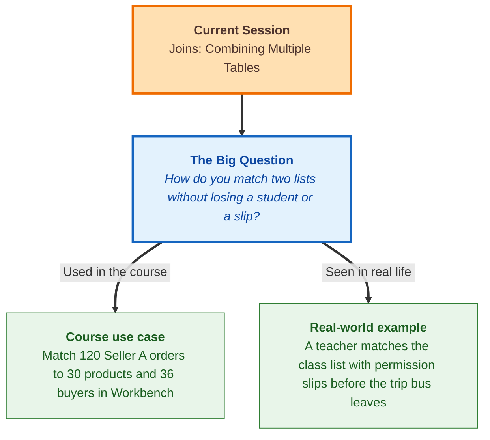

## Joins: Combining Multiple Tables

### Mental Map

---

### What You'll Learn

Have you ever wondered how a teacher knows which students have not handed in a trip slip?

By the end of this session, you will be able to:

- **Identify** which roll numbers appear in both the class list and the slip box, and which students have no slip.
- **Predict** the line count of a combined sheet when roll number 101 handed in two slips.
- **Use** a third list, the bus seat chart, to add each student's seat to the same sheet.
- **Compare** four ways to line up two lists by which unmatched names stay on the page.
- **Examine** a drawing of three lists to name the shared column and the columns a question needs.
- **Justify** which way of lining up the lists answers "who still owes a slip?"

> **Topics you will meet:** Keys and INNER JOIN; LEFT RIGHT and FULL JOIN; Unmatched rows (IS NULL).
>
> Row count after a join; Join three tables; Choosing the join a reporting question needs; Reading the schema a question needs.
>
> Join the session to learn each of these in detail.

---

### Why You Are Learning This Topic

Before a class trip, the teacher holds a class list in one hand. A box of permission slips sits on the desk.

Each slip has a roll number. She matches every slip to a name, one by one.

One slip carries a roll number that is not on the list. Two students have no slip at all.

A **join** means placing two tables side by side by matching a shared column, such as a roll number.

You will join Seller A's order, product and buyer tables in this course.

> **Think about it:** If the teacher only keeps students who have a slip, who disappears from her sheet?

---

### The Class Trip Puzzle

Here is the class list and the slip box, matched by roll number.

| Roll number | Name on the class list | Slip in the box |
|:-----------:|:----------------------:|:---------------:|
| 101 | Asha | Yes, two copies |
| 102 | Bilal | No |
| 103 | Chitra | Yes |
| 104 | Dev | No |
| 109 | Not on the class list | Yes |

**What you want to happen:**

- One sheet that shows each student next to their slip.
- A short list of the students who still owe a slip.
- A way to spot the slip that has no name.

> **Wonder about this:**
>
> - Does Asha's name print once or twice when she handed in two slips?
> - What should the sheet do with the slip for roll number 109?

---

### Think It Through

There is no wrong first try. Keep your guesses for the session.

**1. Which roll numbers appear on both the class list and in the slip box?**
Hint: Tick the numbers that you find in both places.

**2. What is the line count of the sheet if all four students stay and Asha's two slips each get a line?**
Hint: Count four students, then add one extra line for Asha's second slip.

**3. The teacher also has a bus seat chart with a roll number beside each seat. How could it join the same sheet?**
Hint: Use the shared roll number again.

---

### One Question to Carry Into the Session

> **Which lines must stay on the sheet, and which way of matching keeps exactly those lines?**
>
> Bring one guess about what happens to Bilal and Dev when only matching lines are kept.
