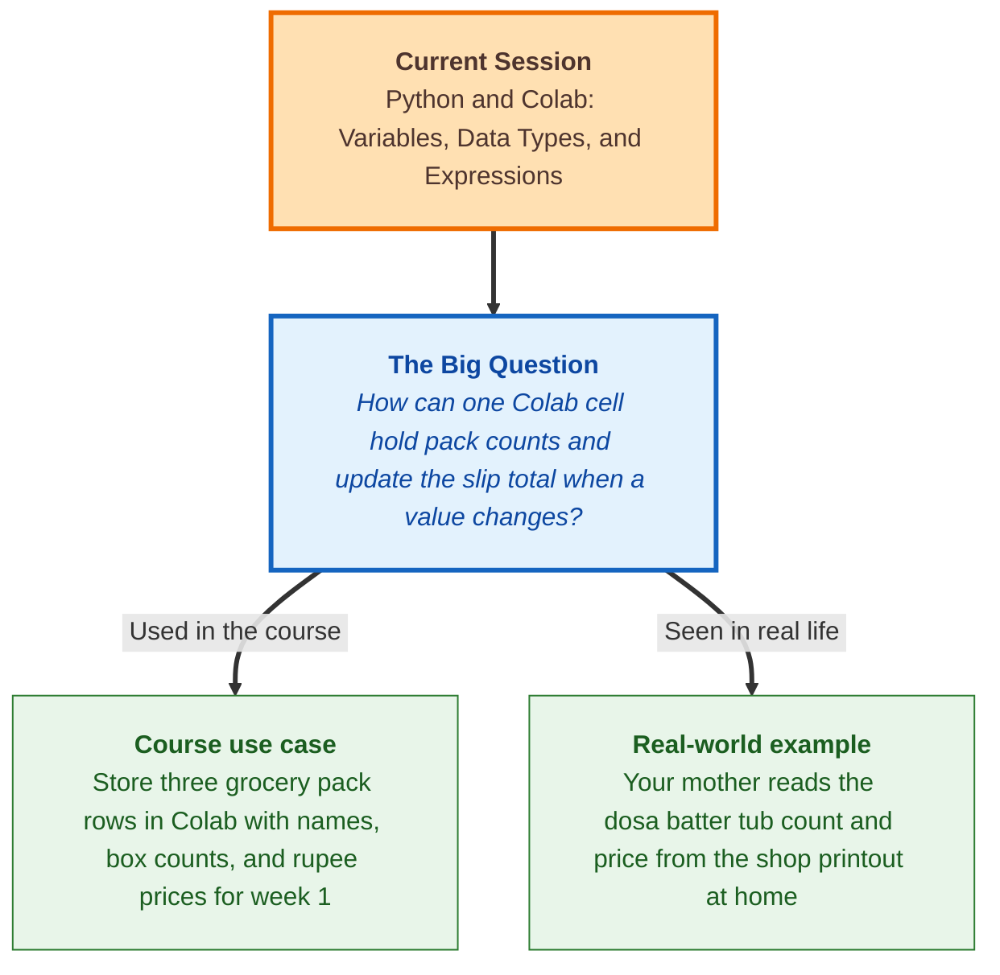

## <span style="color:#2F7DDE">Python and Colab: Variables, Data Types, and Expressions</span>

### <span style="color:#2F7DDE">Mental Map</span>



---

### <span style="color:#2F7DDE">What You'll Learn</span>

Have you ever wondered why the hub screen updates when the helper fixes one number?

By the end of this session, you will be able to:

- <span style="color:#D9660B">**Identify**</span> whole numbers, decimals, quoted text, and true or false flags on one pack row for mango.
- <span style="color:#D9660B">**Use**</span> a Google Colab code cell to run one short print line for pack name Alphonso Mango.
- <span style="color:#D9660B">**Calculate**</span> a line total for mango at 180 rupees times 2 boxes.
- <span style="color:#D9660B">**Compare**</span> the curd line total against 100 rupees using one comparison step.
- <span style="color:#D9660B">**Determine**</span> when box count in quotes must become a whole number before you multiply prices.
- <span style="color:#D9660B">**Check**</span> printed output so pack name, box count, and line total match the rider slip.

> <span style="color:#2F7DDE">**Topics you will meet:**</span> Python; Google Colab; Variables; Data Types; Expressions.
>
> Join the session to learn each of these in detail.

---

### <span style="color:#2F7DDE">Why You Are Learning This Topic</span>

You queue at the weekend movie counter on Saturday evening.

The clerk types show name, ticket count, and price per seat.

Last week ticket count was saved as text in quotes. The screen showed a wrong line total.

A **variable** means a named box in your notebook that holds one value your code can read and change.

You will use variables whenever you label rows in a course Colab sheet.

> <span style="color:#2F7DDE">**Think about it:**</span> What breaks first when ticket count stays as quoted text during addition?

---

### <span style="color:#2F7DDE">The Movie Ticket Counter Puzzle</span>

The counter tablet shows three lines for one student order.

| Show | Tickets | Price per ticket (₹) |
|:-----|:-------:|:--------------------:|
| Skyfall Eve | 2 | 180 |
| Comedy Night | 1 | 220 |
| Late Show | `"4"` | 150 |

<span style="color:#D9660B">**What you want to happen:**</span>

- Show 360 rupees for the Skyfall Eve line without retyping both numbers.
- Answer whether the Late Show line crosses 500 rupees before you pay.
- Hand in one Colab file with your notes and running cells.

Here is how it might start. You do not need to understand it yet.

```python
ticket_count = "4"
seat_price = 150
print(ticket_count, seat_price)
```

> <span style="color:#D9660B">**Wonder about this:**</span>
>
> - Why might `"4"` and `4` behave differently when you multiply by 150?
> - What would you print first so you can trust the Skyfall Eve total of 360?

---

### <span style="color:#2F7DDE">Think It Through</span>

There is no wrong first try. Keep your guesses for the session.

**1. Skyfall Eve shows 2 tickets at 180 rupees each. What single line total do you expect?**
Hint: Multiply count by price for one row only.

**2. Late Show ticket count appears as `"4"` in quotes in the table. Is that ready for multiply by 150?**
Hint: Picture text on the slip versus a counted number.

**3. Does the Late Show line cross 500 rupees? Which two values must your notebook hold?**
Hint: Name ticket count and per-seat price from the table.

---

### <span style="color:#2F7DDE">One Question to Carry Into the Session</span>

> <span style="color:#2F7DDE">**How do named values and expressions let Colab fix a ticket bill without redoing every step?**</span>
>
> Which row would you test first: Skyfall Eve, Comedy Night, or Late Show?