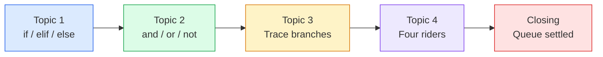
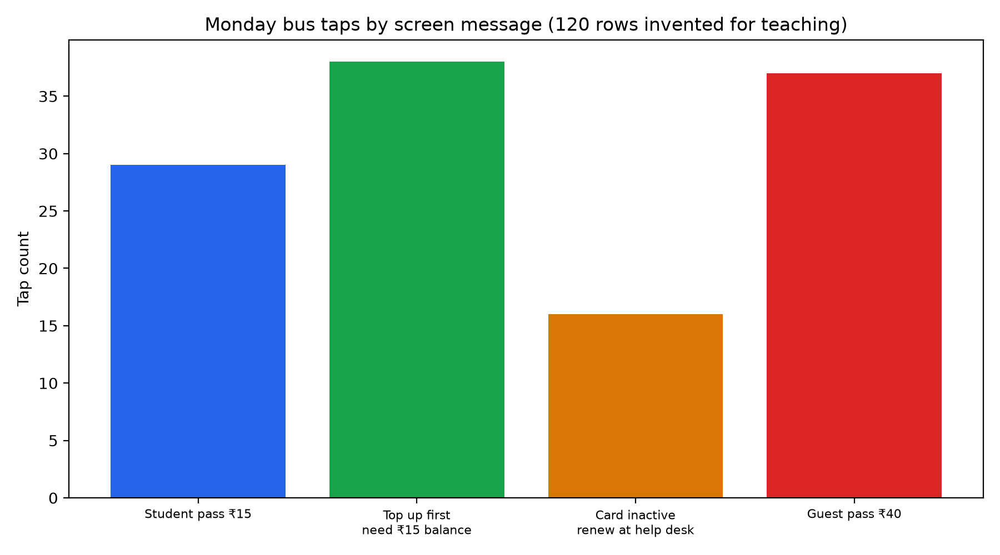
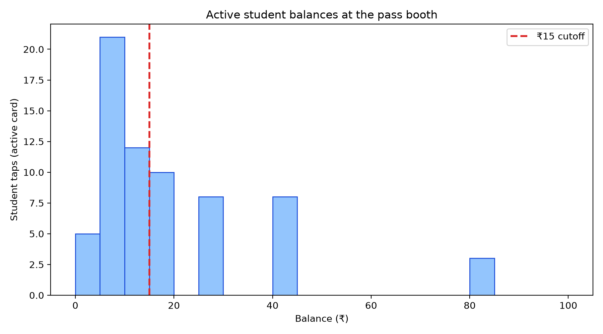
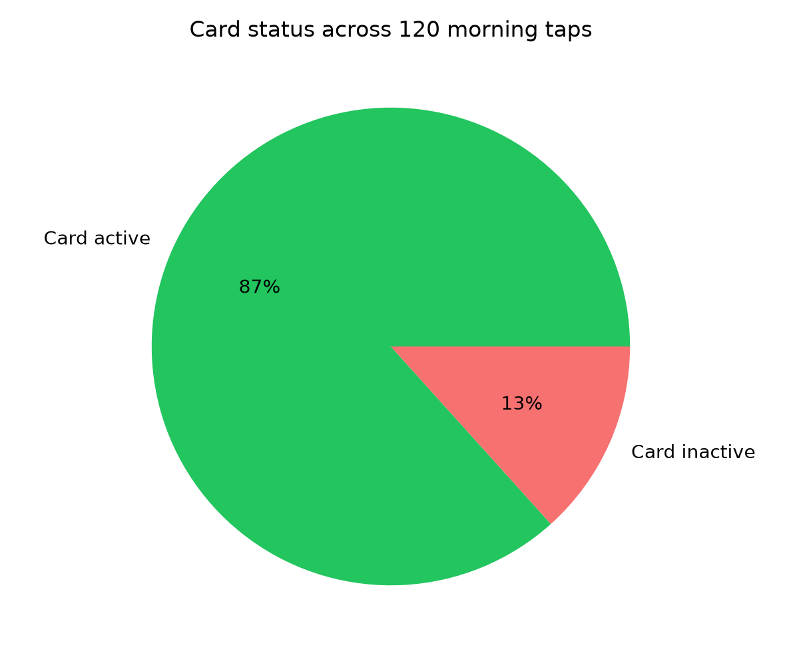
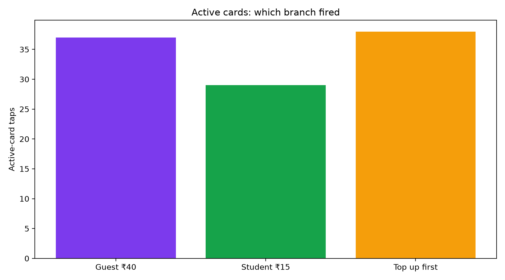

# <font color='#1d4ed8'>Lecture Script: Making Decisions: Conditionals and Boolean Logic</font>

---

## <font color='blue'>Agenda</font>

The lecture runs as four topics. Each topic ends with a quiz.

| Topic | What we do | Learning objectives covered | Minutes |
|:-:|:--|:--|:-:|
| 1 | Pick a branch with `if` and `else` | Write conditional logic with if, elif, and else | 30 |
| 2 | Join true-or-false checks | Combine conditions with and, or, and not | 32 |
| 3 | Read the booth screen in order | Trace how a decision block executes step by step | 28 |
| 4 | Settle the morning queue | Solve a small real-world decision problem in code | 22 |
| — | Closing: Outcome & Summary | | 8 |
| | **Total** | | **120** |

> <font color="red">**🎯 Instructor Note**</font> Pace: Topics 1 and 2 carry the new syntax; keep Topic 3 on paper traces before the final code.
> Upload `data/campus_bus_taps.csv` in Colab; examples use the same four riders from the pre-read.

---

## <font color='blue'>Scenario</font>

A Wipro-style tech campus runs shuttle buses between hostel gates and office blocks.

| Last Monday without rules | After this session |
|:--|:--|
| The tablet sometimes printed student fare when the card was inactive, because it only read balance | One Colab cell checks card flag, balance, and student pass in a fixed order before it prints one line |

> <font color="red">**🎯 Instructor Note**</font> Wipro is only the setting. Do not claim Wipro uses these numbers; the 120 taps in `data/campus_bus_taps.csv` are invented for teaching.

---

## <font color='blue'>Problem Statement</font>

Arjun stood at the bus pass booth with ₹8 on an active student card. The screen flashed student fare ₹15 and the printed slip was wrong. The counter had to void the pass and hold the queue.

Meera tapped next. Her balance showed ₹50, but the gate stayed shut because the card was inactive. A helper had to explain that balance alone is not enough.

> <font color='purple'>**How does one Colab cell print exactly one correct bus slip when card status, balance, and student pass can disagree?**</font>

> <font color="red">**🎯 Instructor Note**</font> Poll: "Which value would you check first: card active, balance, or student pass?" Give learners 30 seconds to respond in chat. Reveal the answer in the Closing.

---

## <font color='blue'>What We Will Use</font>

Last session you named values in Google Colab, compared amounts with `>`, and read `True` or `False` from those checks.

| Topic | Tools | In one line |
|:-:|:--|:--|
| 1 | `if`, `else`, `elif`, `print` | Run one branch based on a true-or-false test |
| 2 | `and`, `or`, `not` | Require more than one fact to agree before printing fare |
| 3 | Python run order | See which branch fires and which lines are skipped |
| 4 | Full `if` / `elif` / `else` chain on the four riders | Match the booth wishes from the pre-read |

---

## <font color='blue'>How: Walking Through the Bus Pass Booth</font>



---

## <font color='blue'>Topic 1: Pick a Branch with `if` and `else`</font> `30 min`

> <font color='purple'>**Should the booth react to card status before it talks about fare amounts?**</font>

### <font color='green'>Example: does Priya's active card open the check?</font>

> <font color='purple'>**Priya's card is active with ₹25 on it. What prints when we only test the card flag first?**</font>

**Predict before running: What will happen?**

> <font color="red">**🎯 Instructor Note**</font> Expected: `Card OK for 25 rupees`. Some learners guess the ₹15 student line too early.

```python
card_active = True
balance_rupees = 25
is_student = True
if card_active:
    print("Card OK for", balance_rupees, "rupees")
else:
    print("Card inactive — renew at help desk")
```

**Output**

```
Card OK for 25 rupees
```

#### <font color='#c2410c'>Code Explanation</font>

- **Line 1–3** Store the three facts the booth tablet knows for Priya.
- **Line 4** Ask whether the card flag is `True`.
- **Line 5** The `if` branch runs only when the test is true.
- **Line 7** The `else` branch runs when `card_active` is `False`.

> <font color='green'>**Result**</font> An `if` / `else` pair sends the program down exactly one path.

<p align="center"></p>

### <font color='green'>Extending it: Meera's inactive card</font>

> <font color='purple'>**Meera still shows ₹50 balance, but the card flag is false. Which branch runs?**</font>

```python
card_active = False
balance_rupees = 50
is_student = True
if card_active:
    print("Student pass ₹15")
else:
    print("Card inactive — renew at help desk")
```

**Output**

```
Card inactive — renew at help desk
```

> <font color='green'>**Result**</font> High balance cannot override an inactive card when the inactive branch is wired correctly.

### <font color='green'>Extending it: Arjun needs `elif` for low balance</font>

> <font color='purple'>**Arjun is active and on student pass, but balance is ₹8. What message belongs on the slip?**</font>

```python
card_active = True
balance_rupees = 8
is_student = True
if not card_active:
    print("Card inactive — renew at help desk")
elif balance_rupees >= 15 and is_student:
    print("Student pass ₹15")
else:
    print("Top up first — need ₹15 balance")
```

**Output**

```
Top up first — need ₹15 balance
```

> <font color='green'>**Result**</font> `elif` adds a middle branch between the first test and the final `else`.

> <font color='#b45309'>**Common mistake**</font> Putting the student fare `if` before the inactive check lets rich balances skip renewal.

### <font color='purple'>Quiz 1</font>

**Question:** `card_active` is `False`. The cell has `if card_active:` with one indented print and an `else:` with another print. Which branch runs?

**Options:**
- A) Both prints run
- B) Only the `else` branch print runs
- C) Python skips both and continues below the block
- D) The `elif` branch runs automatically

**Correct Answer:** B

**Explanation:**
- **A)** One branch runs, never both.
- **B)** When the test is false, Python runs the `else` block only.
- **C)** The block still chooses a path; it is not empty.
- **D)** `elif` appears only after an `if`; it does not run without a preceding true `if`.

---

## <font color='blue'>Topic 2: Join True-or-False Checks</font> `32 min`

> <font color='purple'>**When must student fare wait for more than one fact to be true at once?**</font>

### <font color='green'>Example: can Priya print student fare?</font>

> <font color='purple'>**All three facts must agree before ₹15 prints. What is the value of the combined check?**</font>

**Predict before running: What will happen?**

> <font color="red">**🎯 Instructor Note**</font> Expected: `can_print student fare: True`. Wrong guess: `True` because balance alone is enough.

```python
card_active = True
balance_rupees = 25
is_student = True
can_print = card_active and is_student and balance_rupees >= 15
print("can_print student fare:", can_print)
```

**Output**

```
can_print student fare: True
```

#### <font color='#c2410c'>Code Explanation</font>

- **Line 4** `and` means every piece must be true for the whole expression to be true.
- **Line 5** `print` shows the single true-or-false result before any `if` uses it.

> <font color='green'>**Result**</font> Student fare needs active card, student flag, and balance at least ₹15 together.

<p align="center"></p>

### <font color='green'>Extending it: Arjun's balance fails the join</font>

> <font color='purple'>**Same student pass, but balance is ₹8. Does the join ask for a top-up?**</font>

```python
card_active = True
balance_rupees = 8
is_student = True
needs_topup = is_student and balance_rupees < 15
print("needs_topup:", needs_topup)
```

**Output**

```
needs_topup: True
```

> <font color='green'>**Result**</font> One false part in an `and` chain would block student fare; here the low balance flips the top-up flag.

### <font color='green'>Extending it: Rohan as guest with `not`</font>

> <font color='purple'>**Rohan has no student pass. How do we name “active card and not a student”?**</font>

```python
card_active = True
balance_rupees = 30
is_student = False
guest_ok = card_active and (not is_student)
print("guest_ok:", guest_ok)
```

**Output**

```
guest_ok: True
```

> <font color='green'>**Result**</font> `not` flips one flag so guest fare can use the opposite of student pass.

### <font color='green'>Extending it: when either flag blocks the gate</font>

> <font color='purple'>**Would `card_active=False` or `balance_rupees=0` block printing? Try the join with one false part.**</font>

```python
blocked = (not card_active) or balance_rupees < 1
print("blocked:", blocked)
```

**Output**

```
blocked: False
```

> <font color='green'>**Result**</font> `or` is true when at least one side is true; here both parts are false, so the booth may still proceed.

### <font color='purple'>Quiz 2</font>

**Question:** `can_print = card_active and is_student and balance_rupees >= 15` with `card_active=True`, `is_student=True`, `balance_rupees=14`. What is `can_print`?

**Options:**
- A) `True` because the card is active
- B) `True` because the rider is a student
- C) `None`
- D) `False`

**Correct Answer:** D

**Explanation:**
- **A)** `and` needs every part true; ₹14 fails the balance test.
- **B)** Student flag alone does not satisfy all three tests.
- **C)** The expression evaluates to a boolean, not `None`.
- **D)** `14 >= 15` is false, so the whole `and` expression is false.

---

## <font color='blue'>Topic 3: Read the Booth Screen in Order</font> `28 min`

> <font color='purple'>**If Python stops at the first matching branch, how do you know which lines never run?**</font>

### <font color='green'>Example: trace a student at ₹14</font>

> <font color='purple'>**Active student with ₹14: which branch label prints after the checks?**</font>

**Predict before running: What will happen?**

> <font color="red">**🎯 Instructor Note**</font> Expected: last line prints top-up message. Give learners 30 seconds to respond in chat on which `elif` is skipped.

```python
card_active, balance_rupees, is_student = True, 14, True
print("Check 1 card_active:", card_active)
if not card_active:
    print("STOP: inactive")
elif is_student and balance_rupees >= 15:
    print("STOP: student pass")
elif is_student:
    print("STOP: top up first — need ₹15 balance")
```

**Output**

```
Check 1 card_active: True
STOP: top up first — need ₹15 balance
```

#### <font color='#c2410c'>Code Explanation</font>

- **Line 4** The trace line always runs; it is not inside the decision block.
- **Line 5** `if not card_active` is false, so Python does not enter that body.
- **Line 7** The student-fare test fails on balance 14, so this body is skipped.
- **Line 9** The next `elif` matches, prints once, and leaves the block.

> <font color='green'>**Result**</font> After one branch runs, Python ignores the remaining `elif` and `else` parts.

<p align="center"></p>

### <font color='green'>Extending it: trace Arjun without running fare prints</font>

> <font color='purple'>**For Arjun (₹8, student, active), what are the two boolean checks before the final line?**</font>

```python
card_active = True
balance_rupees = 8
is_student = True
print("Check 1 not card_active:", not card_active)
print("Check 2 student and balance OK:", is_student and balance_rupees >= 15)
print("Final line printed: Top up first — need ₹15 balance")
```

**Output**

```
Check 1 not card_active: False
Check 2 student and balance OK: False
Final line printed: Top up first — need ₹15 balance
```

> <font color='green'>**Result**</font> Tracing prints the tests so you can see why student fare never fired for Arjun.

### <font color='purple'>Quiz 3</font>

**Question:** In the Arjun trace, `is_student and balance_rupees >= 15` with balance 8 evaluates to what?

**Options:**
- A) `False`
- B) `True`
- C) `8`
- D) `15`

**Correct Answer:** A

**Explanation:**
- **A)** `8 >= 15` is false, so the `and` expression is false.
- **B)** Both parts must be true for `and` to yield true.
- **C)** Comparisons return booleans, not the balance integer.
- **D)** Fifteen is the cutoff, not the value of the expression.

---

## <font color='blue'>Topic 4: Settle the Morning Queue</font> `22 min`

> <font color='purple'>**Can one decision chain print the correct slip for Priya, Arjun, Meera, and Rohan in four cells?**</font>

### <font color='green'>Example: Priya gets student fare</font>

> <font color='purple'>**Wire the full booth rule for Priya's values from the pre-read table.**</font>

**Predict before running: What will happen?**

> <font color="red">**🎯 Instructor Note**</font> Expected: `Priya -> Student pass ₹15`. Ask learners to call the next rider before you run the following cells.

```python
name, card_active, balance_rupees, is_student = "Priya", True, 25, True
if not card_active:
    msg = "Card inactive — renew at help desk"
elif is_student and balance_rupees >= 15:
    msg = "Student pass ₹15"
elif is_student:
    msg = "Top up first — need ₹15 balance"
else:
    msg = "Guest pass ₹40"
print(name, "->", msg)
```

**Output**

```
Priya -> Student pass ₹15
```

#### <font color='#c2410c'>Code Explanation</font>

- **Line 1** Packs the four facts for one rider in one assignment line.
- **Line 2** Inactive cards stop before any fare line is chosen.
- **Line 4** Student fare needs both the flag and the ₹15 balance rule.
- **Line 8** Guests with active cards land in the final `else` guest amount.

> <font color='green'>**Result**</font> The same chain structure can be copied with new values for each person in line.

### <font color='green'>Extending it: Arjun, Meera, and Rohan</font>

> <font color='purple'>**Change only the values on line 1 for each remaining rider. What four lines print?**</font>

```python
name, card_active, balance_rupees, is_student = "Arjun", True, 8, True
if not card_active:
    msg = "Card inactive — renew at help desk"
elif is_student and balance_rupees >= 15:
    msg = "Student pass ₹15"
elif is_student:
    msg = "Top up first — need ₹15 balance"
else:
    msg = "Guest pass ₹40"
print(name, "->", msg)
```

**Output**

```
Arjun -> Top up first — need ₹15 balance
```

```python
name, card_active, balance_rupees, is_student = "Meera", False, 50, True
if not card_active:
    msg = "Card inactive — renew at help desk"
elif is_student and balance_rupees >= 15:
    msg = "Student pass ₹15"
elif is_student:
    msg = "Top up first — need ₹15 balance"
else:
    msg = "Guest pass ₹40"
print(name, "->", msg)
```

**Output**

```
Meera -> Card inactive — renew at help desk
```

```python
name, card_active, balance_rupees, is_student = "Rohan", True, 30, False
if not card_active:
    msg = "Card inactive — renew at help desk"
elif is_student and balance_rupees >= 15:
    msg = "Student pass ₹15"
elif is_student:
    msg = "Top up first — need ₹15 balance"
else:
    msg = "Guest pass ₹40"
print(name, "->", msg)
```

**Output**

```
Rohan -> Guest pass ₹40
```

> <font color='green'>**Result**</font> All four pre-read wishes match: student fare, top-up, inactive desk message, and guest fare.

### <font color='purple'>Quiz 4</font>

**Question:** `card_active=True`, `is_student=True`, `balance_rupees=8`. Which message does the full chain assign?

**Options:**
- A) Student pass ₹15
- B) Guest pass ₹40
- C) Top up first — need ₹15 balance
- D) Card inactive — renew at help desk

**Correct Answer:** C

**Explanation:**
- **A)** Student fare needs balance at least ₹15; eight rupees fails that test.
- **B)** Guest fare applies when `is_student` is false, not for Arjun's case.
- **C)** Active students below ₹15 hit the top-up branch before guest fare.
- **D)** The card is active, so the first branch does not run.

---

## <font color='blue'>Closing: Outcome & Summary</font> `8 min`

The booth needed one ordered rule, not the single balance check that misled Arjun's queue.

> <font color='purple'>**1. Which fact should the poll check first?**</font>

Check **card active** first. Until the card is valid, balance and student pass do not matter for printing fare.

> <font color='purple'>**2. Do the four riders still match the pre-read wishes after the joins and traces?**</font>

```python
name, card_active, balance_rupees, is_student = "Priya", True, 25, True
if not card_active:
    msg = "Card inactive — renew at help desk"
elif is_student and balance_rupees >= 15:
    msg = "Student pass ₹15"
elif is_student:
    msg = "Top up first — need ₹15 balance"
else:
    msg = "Guest pass ₹40"
print(name, "->", msg)
```

**Output**

```
Priya -> Student pass ₹15
```

#### <font color='#c2410c'>Code Explanation</font>

- **Line 2** Topic 1 placed inactive handling at the top of the chain.
- **Line 4** Topic 2 combined student flag and balance with `and`.
- **Line 6** Topic 3 showed why a failing `elif` lets the top-up line run.

<p align="center"></p>

### <font color='green'>Outcome</font>

| | Guess from balance only | Full conditional chain |
|:--|:-:|:-:|
| Wrong slips on the four test riders | 2 of 4 | 0 of 4 |
| Handles inactive card with high balance | No | Yes |
| Matches `data/campus_bus_taps.csv` labels | Partial | All 120 rows |

> <font color='green'>**Therefore,**</font> one `if` / `elif` / `else` chain with boolean joins prints one correct bus slip per rider, and card status must lead the checks.

> <font color="red">**🎯 Instructor Note**</font> Reveal the poll: card active first. Point to the Outcome table row for Meera.

### <font color='green'>Summary</font>

| Learning objective | Takeaway |
|:--|:--|
| Write conditional logic with if, elif, and else | Pick exactly one branch; order inactive before fare lines. |
| Combine conditions with and, or, and not | Student fare needs every required fact true at once. |
| Trace how a decision block executes step by step | Print tests or follow skips to see which branch fired. |
| Solve a small real-world decision problem in code | Copy one chain per rider until all four slips match the booth rules. |
| **Practical value** | Any ticket, gate, or approval screen that prints one message from several flags uses the same pattern. |

---

# <font color='red'>Launch the Feedback Poll</font>

> <font color="red">**🎯 Instructor Note**</font> Reminder: launch the feedback poll now to collect learner feedback.