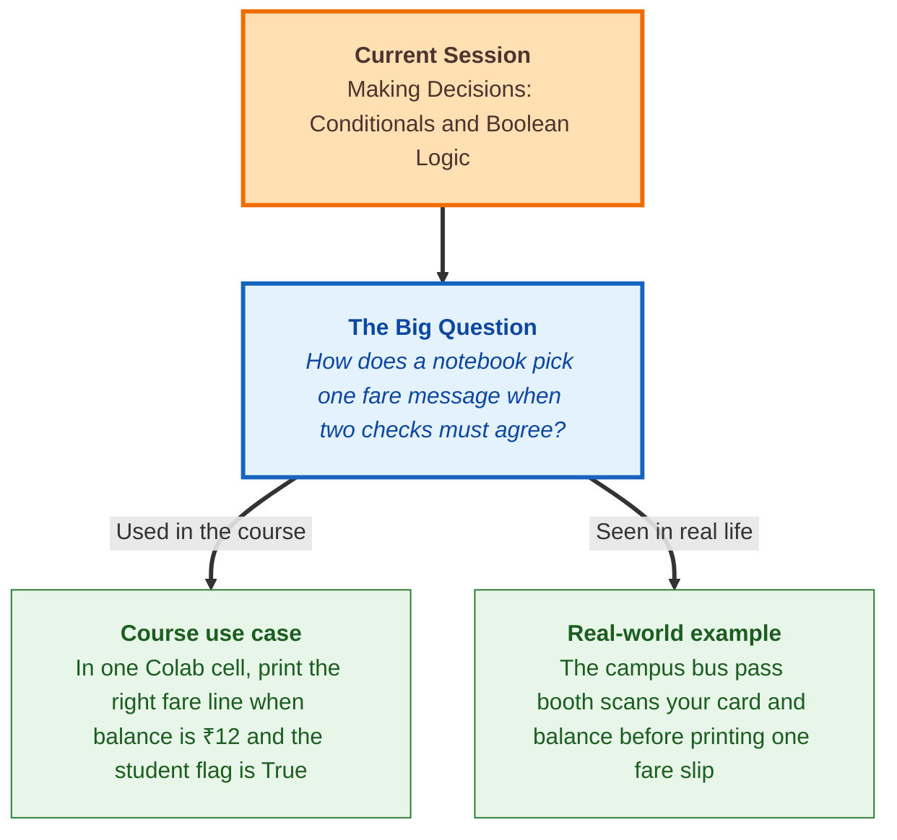

## <span style="color:#2F7DDE">Making Decisions: Conditionals and Boolean Logic</span>

### <span style="color:#2F7DDE">Mental Map</span>



---

### <span style="color:#2F7DDE">What You'll Learn</span>

Have you ever wondered why the bus booth looks at your card and balance before it prints a fare?

By the end of this session, you will be able to:

- <span style="color:#D9660B">**Write**</span> a decision block in a Colab cell that picks Priya's ₹15 student line when her balance is 25.
- <span style="color:#D9660B">**Apply**</span> true-or-false joins so the booth tests card active and balance together for Arjun.
- <span style="color:#D9660B">**Trace**</span> which lines would run when Meera's card shows inactive at the counter.
- <span style="color:#D9660B">**Solve**</span> the fare puzzle for Rohan when he is a guest and balance is ₹30.

> <span style="color:#2F7DDE">**Topics you will meet:**</span> Conditionals; if/else; Boolean Logic.
>
> Join the session to learn each of these in detail.

---

### <span style="color:#2F7DDE">Why You Are Learning This Topic</span>

You reach the campus bus pass booth ten minutes before class.

The tablet shows whether your card is active, your balance in rupees, and whether you get student fare.

Arjun had ₹8 left this morning. The screen nearly printed student pass until a second check saw low balance.

Meera tapped an expired card. The gate stayed shut even though her balance read ₹50.

A **conditional** means code that runs only when a true-or-false check passes.

You will use conditionals in Colab whenever one cell must pick the right message from your values.

> <span style="color:#2F7DDE">**Think about it:**</span> What message should appear when the card is active but balance is ₹8?

---

### <span style="color:#2F7DDE">The Campus Bus Pass Puzzle</span>

The booth tablet lists four riders in line on Monday at 8 am.

| Rider | Card active | Balance (₹) | Student pass |
|:-----:|:-----------:|:---------:|:------------:|
| Priya | yes | 25 | yes |
| Arjun | yes | 8 | yes |
| Meera | no | 50 | yes |
| Rohan | yes | 30 | no |

<span style="color:#D9660B">**What you want to happen:**</span>

- Print student fare ₹15 when the card is active, student pass is yes, and balance is at least 15.
- Print top up first when balance is below ₹15 and student pass is yes.
- Print guest fare ₹40 when student pass is no but the card is active.

Here is how it might start. You do not need to understand it yet.

```python
card_active = True
balance_rupees = 8
is_student = True
```

> <span style="color:#D9660B">**Wonder about this:**</span>
>
> - Why might the booth need balance and student pass before it prints ₹15?
> - What changes if card_active is no but balance is ₹50?

---

### <span style="color:#2F7DDE">Think It Through</span>

There is no wrong first try. Keep your guesses for the session.

**1. Priya has balance ₹25 and student pass yes. Which wish from the list fits her?**
Hint: Compare her balance to ₹15.

**2. Arjun has balance ₹8 and student pass yes. What should the screen say?**
Hint: Read the second wish about low balance.

**3. Rohan has student pass no and card active. Which fare amount matches the third wish?**
Hint: Guest fare is named in the table above the wishes.

---

### <span style="color:#2F7DDE">One Question to Carry Into the Session</span>

> <span style="color:#2F7DDE">**How do decision steps and true-false joins let one Colab cell print the right bus slip every time?**</span>
>
> Which fact would you check first: card active, balance, or student pass?