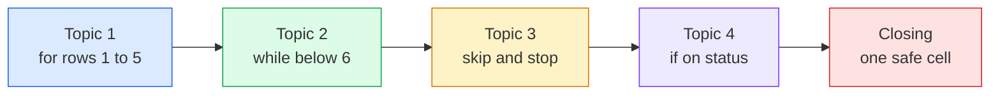
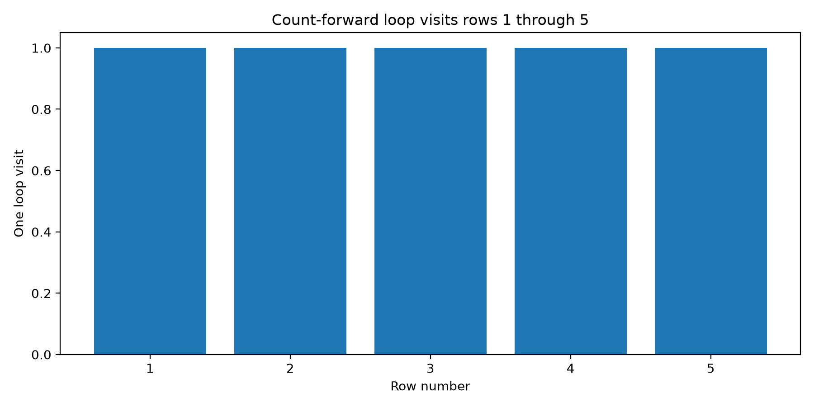
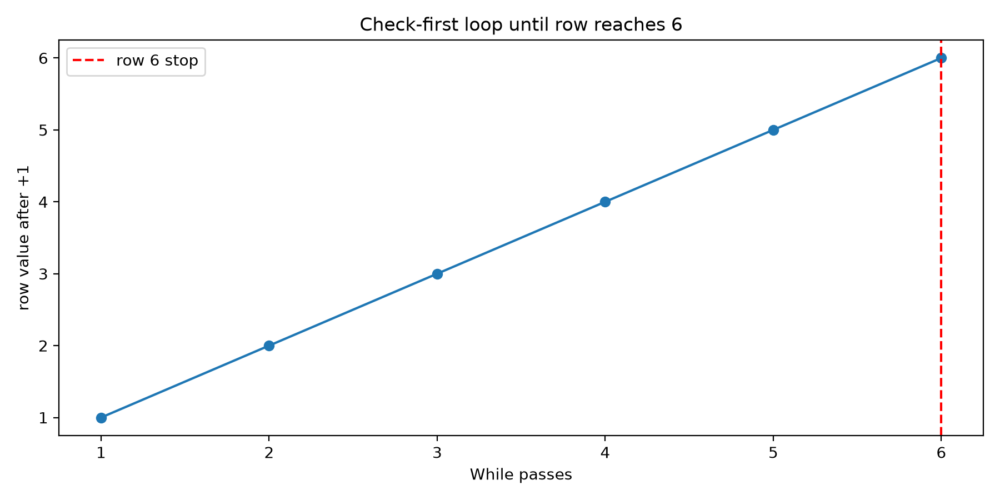
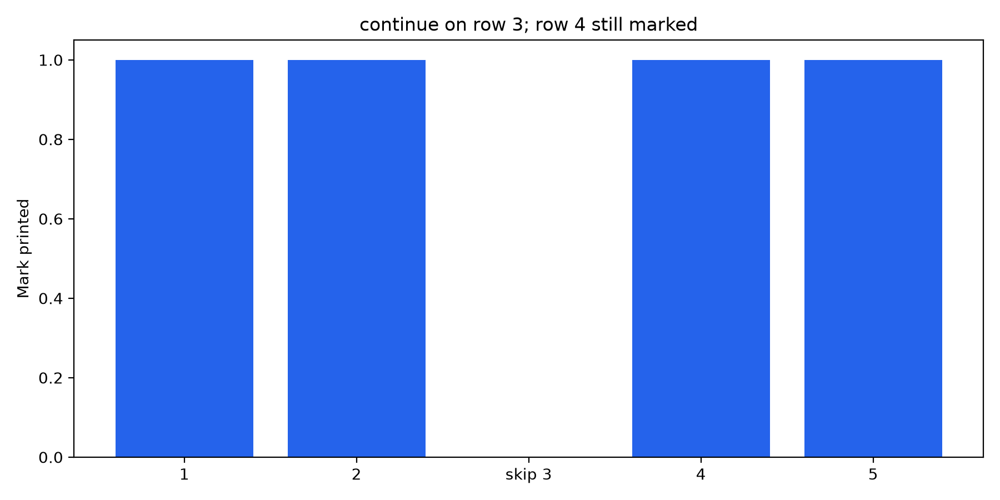
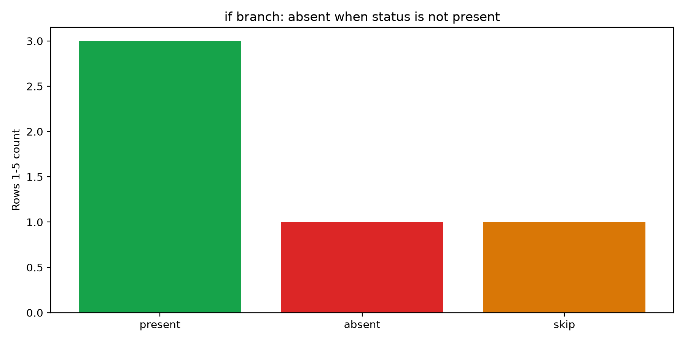
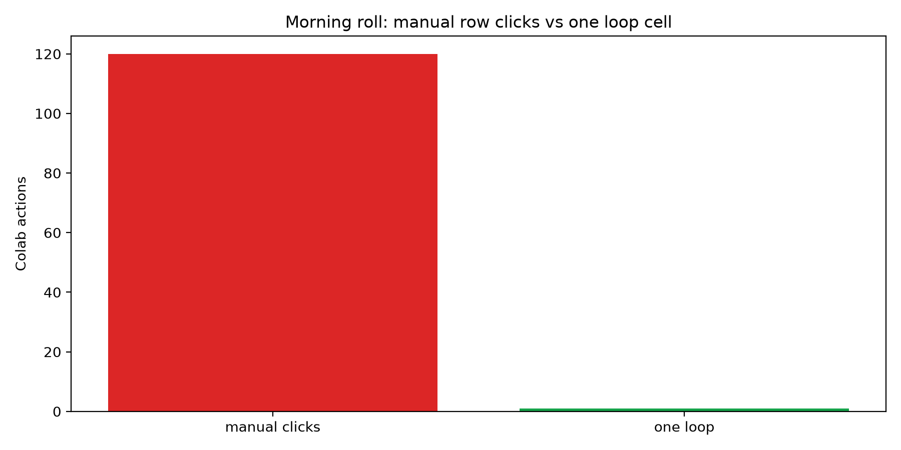

# <font color='#1d4ed8'>Lecture Script: Repeating Work: Loops and Control Flow</font>

---

## <font color='blue'>Agenda</font>

The lecture runs as four topics. Each topic ends with a quiz.

| Topic | What we do | Learning objectives covered | Minutes |
|:-:|:--|:--|:-:|
| 1 | Visit rows with `for` | List row numbers 1 through 5 that a count-forward loop should visit in order. | 30 |
| 2 | Walk the roll with `while` | Explain when a check-first loop should keep running while rows remain below 6. | 32 |
| 3 | Skip one row and stop on time | Demonstrate skipping row 3, still marking row 4, and halting at row 6 when class ends. | 28 |
| 4 | Branch on status inside the loop | Use an if step inside a loop to print absent when status is not present. | 25 |
| — | Closing: Outcome & Summary | | 5 |
| | **Total** | | **120** |

> <font color="red">**🎯 Instructor Note**</font> Pace: spend extra time in Topic 2 on the stop rule and the missing row update.
> Topic 3 pairs **continue** and **break** on the same six-row roll learners saw in the pre-read.

---

## <font color='blue'>Scenario</font>

**Before:** A PhysicsWallah-style offline lab mentor taps each name on a projector roll by hand.

**After:** One Google Colab cell walks the same sheet while the class watches.

| Moment | What the screen shows |
|:--|:--|
| 9:00 am | Row 1 (**Meera**) highlighted |
| 9:01 am | Row 3 is blank; mentor jumps ahead |
| 9:04 am | Row 6 line reads **class end**; bell rings |

The file `data/pw_lab_attendance.csv` holds **120** invented lab rows (one morning plus history). Today's six-row slice matches the pre-read table. Numbers are invented for teaching.

> <font color="red">**🎯 Instructor Note**</font> PhysicsWallah is only the setting; this roll is invented for teaching. Learners work in Google Colab with new code cells only.

---

## <font color='blue'>Problem Statement</font>

Last Monday the mentor pasted **120** copies of `print("mark row", …)` into Colab. The file was huge and easy to break.

On Tuesday a helper ran `while row < 120` but never added **1** to `row`. The projector kept scrolling long after row **6** and class had ended.

Row **3** was blank, yet the broken cell still printed a mark there. Row **5** (**Vijay**) was **absent**, but the screen showed **present** for everyone.

> <font color='purple'>**How can one Colab cell walk rows 1 to 5 in order, keep checking while rows stay below 6, skip row 3, stop at row 6, and print absent only when the status is not present?**</font>

> <font color="red">**🎯 Instructor Note**</font> Poll: "A for loop uses `range(1, 6)`. How many `visit row` lines should print?" Give learners 30 seconds to respond in chat. Reveal the answer in the Closing.

---

## <font color='blue'>What We Will Use</font>

Everything below runs in **Google Colab**. You already store names and status in variables and pick messages with **if/else** from the bus-pass and canteen cells. Today we repeat those same checks down the roll.

| Topic | Tools | In one line |
|:-:|:--|:--|
| 1 | `for`, `range()` | Visit row numbers 1 to 5 without retyping each line |
| 2 | `while`, comparison in the header | Keep walking while the row counter stays below 6 |
| 3 | `continue`, `break` | Skip row 3 but still mark row 4; leave the loop at row 6 |
| 4 | `if` inside a loop | Print **present** or **absent** from the status cell |

---

## <font color='blue'>How: Walking Through the Morning Roll</font>



---

## <font color='blue'>Topic 1: Visit Rows with `for`</font> `30 min`

> <font color='purple'>**Last session you stored `status = "present"` and branched on it. How do we visit row 1, row 2, row 3, row 4 and row 5 without five copy-pasted print cells?**</font>

### <font color='green'>Example: count-forward over the roll slice</font>

> <font color='purple'>**Which row numbers should a loop list if class ends at row 6 and only rows 1 to 5 hold names?**</font>

**Predict before running: What will happen?**

> <font color="red">**🎯 Instructor Note**</font> Expected: five lines, rows 1 through 5. Common guess: six lines because learners count row 6.

```python
for row in range(1, 6):
    print("visit row", row)
```

**Output**

```
visit row 1
visit row 2
visit row 3
visit row 4
visit row 5
```

#### <font color='#c2410c'>Code Explanation</font>

- **Line 1** `range(1, 6)` supplies 1, 2, 3, 4 and 5. The number 6 is the stop value and is not visited.
- **Line 2** Prints once per pass. The loop body runs five times in order.

> <font color='green'>**Result**</font> The count-forward loop listed row numbers 1 through 5 in order.

<p align="center"></p>

### <font color='green'>Extending it: shorter range for practice marks</font>

> <font color='purple'>**A teaching assistant only wants rows 1, 2 and 3 marked before demo. What does `range(1, 4)` visit?**</font>

**Predict before running: What will happen?**

> <font color="red">**🎯 Instructor Note**</font> Expected: three `mark` lines. Give learners 30 seconds to respond in chat before you run the cell.

```python
for row in range(1, 4):
    print("mark", row)
```

**Output**

```
mark 1
mark 2
mark 3
```

#### <font color='#c2410c'>Code Explanation</font>

- **Line 1** The stop value 4 is excluded, so only 1, 2 and 3 run.
- **Line 2** Same `for` line as the first example; only the range end changed.

> <font color='green'>**Result**</font> Listing rows 1 through 5 means choosing `range(1, 6)`, not typing each integer by hand.

### <font color='purple'>Quiz 1</font>

**Question:** In the first example, which row numbers does `range(1, 6)` visit in order?

**Options:**
- A) 1, 2, 3, 4, 5
- B) 1, 2, 3, 4, 5, 6
- C) 0, 1, 2, 3, 4
- D) 2, 3, 4, 5, 6

**Correct Answer:** A

**Explanation:**
- **A)** Correct: the stop value 6 is not included, so the last visit is row 5.
- **B)** Wrong: row 6 is the class-end line, not part of this range.
- **C)** Wrong: `range(1, 6)` starts at 1, not 0.
- **D)** Wrong: row 1 is included.

---

## <font color='blue'>Topic 2: Walk the Roll with `while`</font> `32 min`

> <font color='purple'>**The for loop knew the list upfront. What if the mentor keeps checking the next row only while the counter stays below 6?**</font>

### <font color='green'>Example: check-first loop until row 6</font>

> <font color='purple'>**`row` starts at 1. While `row < 6` is true, which rows get a `check row` line?**</font>

**Predict before running: What will happen?**

> <font color="red">**🎯 Instructor Note**</font> Expected: checks for rows 1 to 5, then `stop at row 6`. Common guess: the loop never stops.

```python
row = 1
while row < 6:
    print("check row", row)
    row = row + 1
print("stop at row", row)
```

**Output**

```
check row 1
check row 2
check row 3
check row 4
check row 5
stop at row 6
```

#### <font color='#c2410c'>Code Explanation</font>

- **Line 1** The counter starts at row 1.
- **Line 2** The loop keeps running while rows remain below 6.
- **Line 3** Each pass prints the current row before moving on.
- **Line 4** Adding 1 is what turns the header false after row 5.
- **Line 5** After the loop, `row` is 6 and class-end logic can run.

> <font color='green'>**Result**</font> The check-first loop ran while `row` was 1, 2, 3, 4 and 5, then stopped when `row` reached 6.

<p align="center"></p>

### <font color='green'>Extending it: the missing row update</font>

> <font color='purple'>**What if the `row = row + 1` line were deleted? Would `row < 6` ever turn false?**</font>

#### <font color='#c2410c'>Logic Explanation</font>

- With `row` stuck at 1, the header `row < 6` stays true and Colab keeps running until someone stops the cell.
- That matches Tuesday’s all-night projector: no update means no stop at row 6.
- The fix is the same every time: change the variable the header checks on each pass.

**Predict before running: What will happen?**

> <font color="red">**🎯 Instructor Note**</font> Expected: prints 2 and 3 when the safe update is kept (short demo).

```python
row = 1
while row < 3:
    row = row + 1
    print(row)
```

**Output**

```
2
3
```

> <font color='green'>**Result**</font> The update line is what lets a check-first loop stop. Without it, the roll never reaches row 6.

> <font color='#b45309'>**Common mistake**</font> Forgetting `row = row + 1` inside the loop. The header never sees row 6.

### <font color='purple'>Quiz 2</font>

**Question:** `row = 1` and `while row < 6:` includes `row = row + 1` each pass. When should this loop keep running?

**Options:**
- A) Only when `row` is already 6
- B) Only when `row` is 0
- C) While `row` is 1, 2, 3, 4 or 5
- D) Forever, even after `row` is 6

**Correct Answer:** C

**Explanation:**
- **A)** Wrong: when `row` is 6, `row < 6` is false.
- **B)** Wrong: the counter starts at 1, not 0.
- **C)** Correct: those are exactly the rows below 6 in the example.
- **D)** Wrong: after the update, `row` becomes 6 and the header is false.

---

## <font color='blue'>Topic 3: Skip One Row and Stop on Time</font> `28 min`

> <font color='purple'>**Row 3 is blank on the sheet. Can we skip it, still mark row 4, and halt when row 6 means class end?**</font>

### <font color='green'>Example: skip row 3 with `continue`</font>

> <font color='purple'>**Which rows still get `mark` when row 3 hits `continue`?**</font>

**Predict before running: What will happen?**

> <font color="red">**🎯 Instructor Note**</font> Expected: rows 1, 2, 4 and 5. Common guess: the loop stops at 3.

```python
for row in range(1, 6):
    if row == 3:
        continue
    print("mark", row)
```

**Output**

```
mark 1
mark 2
mark 4
mark 5
```

#### <font color='#c2410c'>Code Explanation</font>

- **Lines 2 and 3** On row 3, `continue` skips the print and jumps to the next row number.
- **Line 4** Runs on rows 1, 2, 4 and 5 only.

> <font color='green'>**Result**</font> Row 3 printed nothing, but row 4 still marked.

### <font color='green'>Extending it: halt at row 6 with `break`</font>

> <font color='purple'>**When the bell rings at row 6, how do we leave the loop without marking the class-end line?**</font>

**Predict before running: What will happen?**

> <font color="red">**🎯 Instructor Note**</font> Expected: rows 1 to 5 show `ok`, then `class ends at row 6`.

```python
row = 1
while row < 7:
    if row == 6:
        break
    print("row", row, "ok")
    row = row + 1
print("class ends at row", row)
```

**Output**

```
row 1 ok
row 2 ok
row 3 ok
row 4 ok
row 5 ok
class ends at row 6
```

#### <font color='#c2410c'>Code Explanation</font>

- **Lines 3 and 4** `break` leaves the loop when the counter reaches 6.
- **Lines 5 and 6** Update the counter on rows 1 to 5 only.

<p align="center"></p>

> <font color='green'>**Result**</font> Skipping row 3 and stopping at row 6 are different tools: **continue** skips one pass; **break** ends the loop.

### <font color='purple'>Quiz 3</font>

**Question:** In the `continue` example, why does `mark 4` still print?

**Options:**
- A) The loop moves to the next row after skipping row 3
- B) `break` ran on row 4
- C) `range(1, 6)` excludes row 4
- D) Row 4 is always present on the roll

**Correct Answer:** A

**Explanation:**
- **A)** Correct: pass 3 skipped the print, pass 4 ran normally.
- **B)** Wrong: there is no `break` in that cell.
- **C)** Wrong: 4 is inside `range(1, 6)`.
- **D)** Wrong: presence is not what drives the `mark` print there.

---

## <font color='blue'>Topic 4: Branch on Status Inside the Loop</font> `25 min`

> <font color='purple'>**Vijay on row 5 is absent. Where does the same if idea from the bus booth fit inside the row loop?**</font>

### <font color='green'>Example: print absent when status is not present</font>

> <font color='purple'>**For rows 1 to 5, which lines should read `absent`?**</font>

**Predict before running: What will happen?**

> <font color="red">**🎯 Instructor Note**</font> Expected: rows 3 and 5 show `absent` because **skip** and **absent** are not **present**. Give learners 30 seconds to respond in chat.

```python
status_by_row = {1: "present", 2: "present", 3: "skip", 4: "present", 5: "absent"}
for row in range(1, 6):
    if status_by_row[row] != "present":
        print(row, "absent")
    else:
        print(row, "present")
```

**Output**

```
1 present
2 present
3 absent
4 present
5 absent
```

#### <font color='#c2410c'>Code Explanation</font>

- **Line 1** A small map holds the morning status for rows 1 to 5.
- **Line 2** The count-forward loop visits each row number.
- **Lines 3 to 6** The if step compares the status cell to **present** and picks the label.

> <font color='green'>**Result**</font> Vijay on row 5 prints **absent**. Any status that is not **present** takes the absent branch.

<p align="center"></p>

### <font color='purple'>Quiz 4</font>

**Question:** In the status example, what prints for row 5 (Vijay)?

**Options:**
- A) `5 present`
- B) `5 skip`
- C) `5 end`
- D) `5 absent`

**Correct Answer:** D

**Explanation:**
- **A)** Wrong: Vijay’s status is **absent**, not **present**.
- **B)** Wrong: the code prints **absent** or **present**, not the raw status word.
- **C)** Wrong: row 6 holds **class end**; this loop stops at row 5.
- **D)** Correct: the if branch fires because **absent** is not **present**.

---

## <font color='blue'>Closing: Outcome & Summary</font> `5 min`

> <font color='purple'>**1. Opening poll — how many `visit row` lines for `range(1, 6)`?**</font>

Five lines, matching Topic 1.

> <font color='purple'>**2. Can one cell combine while, continue, break and the if branch on the six-row roll?**</font>

```python
row = 1
stat = {1: "present", 2: "present", 3: "skip", 4: "present", 5: "absent"}
while row < 7:
    if row == 6: break
    if row == 3:
        row += 1
        continue
    print(row, "absent" if stat[row] != "present" else "present")
    row += 1
print("closed at row", row)
```

**Output**

```
1 present
2 present
4 present
5 absent
closed at row 6
```

#### <font color='#c2410c'>Code Explanation</font>

- **Lines 3 to 4** Check-first loop with **break** at row 6 (Topic 3).
- **Lines 5 to 7** **continue** skips the blank row 3 but row 4 still prints (Topic 3).
- **Line 8** The if idea labels absent when status is not present (Topic 4).

<p align="center"></p>

### <font color='green'>Outcome</font>

| | Monday hand-tap roll | Today’s one Colab cell |
|:--|:-:|:-:|
| Rows walked in order | sometimes skipped 4 | 1, 2, 4, 5 then stop at 6 |
| Stopped at row 6 | no (ran overnight) | yes |
| Vijay shown correctly | no | yes (`5 absent`) |

> <font color='green'>**Therefore,**</font> a safe roll cell lists rows 1 through 5 with **for**, keeps checking while rows stay below 6 with **while**, uses **continue** and **break** for row 3 and row 6, and prints **absent** whenever status is not **present**.

> <font color="red">**🎯 Instructor Note**</font> Reveal the poll answer: **five** visit lines. Point to row 4 still printing after row 3 was skipped.

### <font color='green'>Summary</font>

| Learning objective | Takeaway |
|:--|:--|
| List row numbers 1 through 5 that a count-forward loop should visit in order. | `for row in range(1, 6):` visits 1, 2, 3, 4, 5 in order. |
| Explain when a check-first loop should keep running while rows remain below 6. | `while row < 6:` stays true for rows 1–5 and stops when `row` reaches 6. |
| Demonstrate skipping row 3, still marking row 4, and halting at row 6 when class ends. | `continue` skips row 3; `break` at row 6 ends the walk. |
| Use an if step inside a loop to print absent when status is not present. | Compare each status to **present** inside the loop body. |
| **Practical value** | You can read a lab roll cell and predict every printed line before the bell. |

---

# <font color='red'>Launch the Feedback Poll</font>

> <font color="red">**🎯 Instructor Note**</font> Reminder: launch the feedback poll now to collect learner feedback.