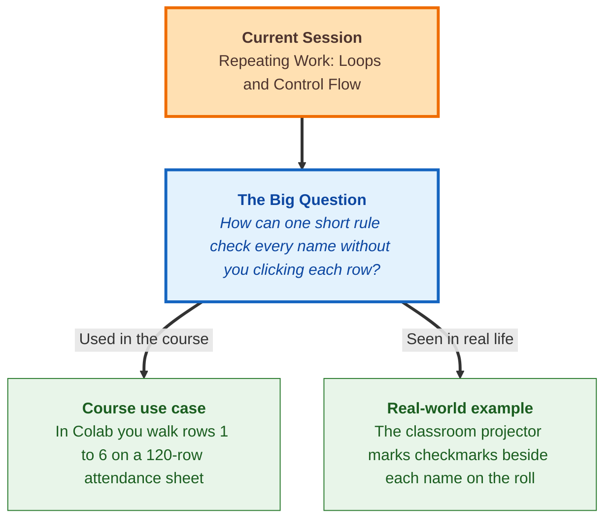

## <span style="color:#2F7DDE">Repeating Work: Loops and Control Flow</span>

### <span style="color:#2F7DDE">Mental Map</span>



---

### <span style="color:#2F7DDE">What You'll Learn</span>

Have you ever wondered how the projector moves to the next name without the teacher tapping each row?

By the end of this session, you will be able to:

- <span style="color:#D9660B">**List**</span> row numbers **1** through **5** that a count-forward loop should visit in order.
- <span style="color:#D9660B">**Explain**</span> when a check-first loop should keep running while rows remain below **6**.
- <span style="color:#D9660B">**Demonstrate**</span> skipping row **3**, still marking row **4**, and halting at row **6** when class ends.
- <span style="color:#D9660B">**Use**</span> an if step inside a loop to print **absent** when status is not present.

> <span style="color:#2F7DDE">**Topics you will meet:**</span> Loops; for; while; Control Flow.
>
> Join the session to learn each of these in detail.

---

### <span style="color:#2F7DDE">Why You Are Learning This Topic</span>

Your teacher opens the **CS101** attendance roll at the start of lab.

The screen highlights **Meera**, then **Rohan**, then the next row down.

Row **3** is blank, so the teacher jumps ahead and keeps going.

The roll stops at row **6** when the bell rings.

A **loop** means the same few lines in Python run again until a clear stop rule fires.

In this course you run those lines in **Google Colab** and read each printed line.

> <span style="color:#2F7DDE">**Think about it:**</span> What tells the screen to stop at row **6** instead of running all night?

---

### <span style="color:#2F7DDE">The Attendance Roll Puzzle</span>

Six rows from one morning lab.

| Row | Student | Status |
|:---:|:-------:|:------:|
| 1 | Meera | present |
| 2 | Rohan | present |
| 3 | blank | skip |
| 4 | Sita | present |
| 5 | Vijay | absent |
| 6 | end | stop |

<span style="color:#D9660B">**What you want to happen:**</span>

- Mark rows **1** through **5** without retyping each number.
- Skip row **3** but still mark row **4**.
- Stop at row **6** when class ends, not at row **100**.

Here is how it might start. You do not need to understand it yet.

```python
row = 1
while row < 3:
    row = row + 1
```

> <span style="color:#D9660B">**Wonder about this:**</span>
>
> - Which row should print nothing if row **3** is blank?
> - What changes if the counter never adds **1** inside the loop?

---

### <span style="color:#2F7DDE">Think It Through</span>

There is no wrong first try. Keep your guesses for the session.

**1. The roll lists rows 1 through 5 with data. What pass count should the loop reach if each row gets one mark?**
Hint: Count the table rows above **end**.

**2. Row counter is at 5 and class ends at row 6. Should the check-first loop run once more?**
Hint: Compare row number to **6** with **<** or **>=**.

**3. Vijay is absent on row 5. Which branch name would you expect: present or absent?**
Hint: Read the status cell for Vijay.

---

### <span style="color:#2F7DDE">One Question to Carry Into the Session</span>

> <span style="color:#2F7DDE">**Can you tell which row number prints last before you run the cell?**</span>
>
> What would you write on paper to prove your guess?

---

### <span style="color:#2F7DDE">Set Up Before the Session</span>

> <span style="color:#2F7DDE">**Do this before the session starts.**</span> You will write code in Google Colab during the session. Open https://colab.research.google.com/ and sign in with your Google account.