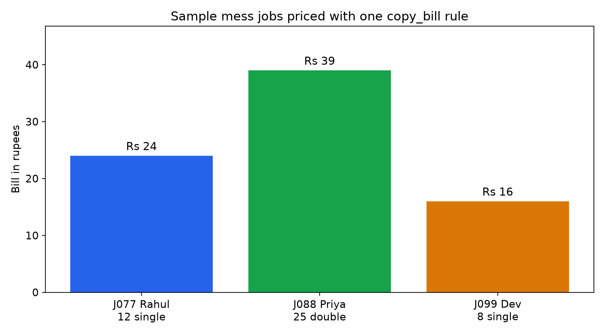
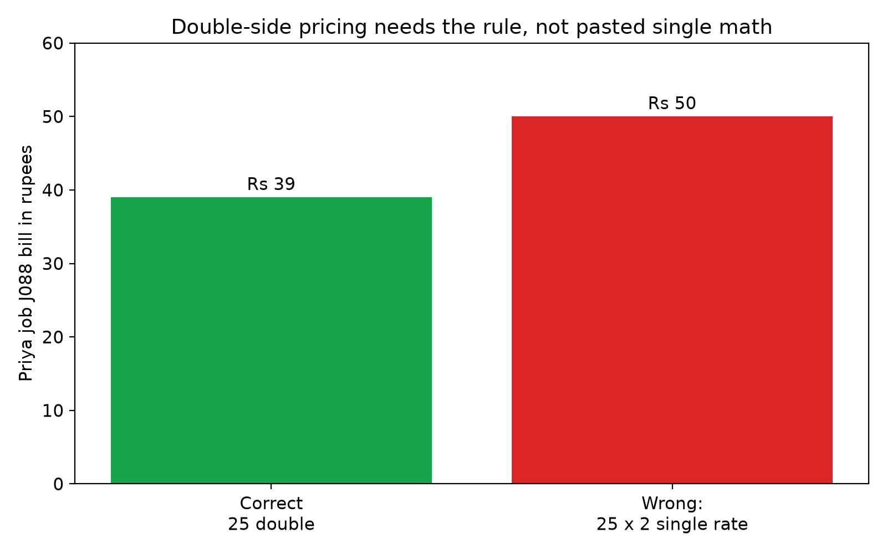
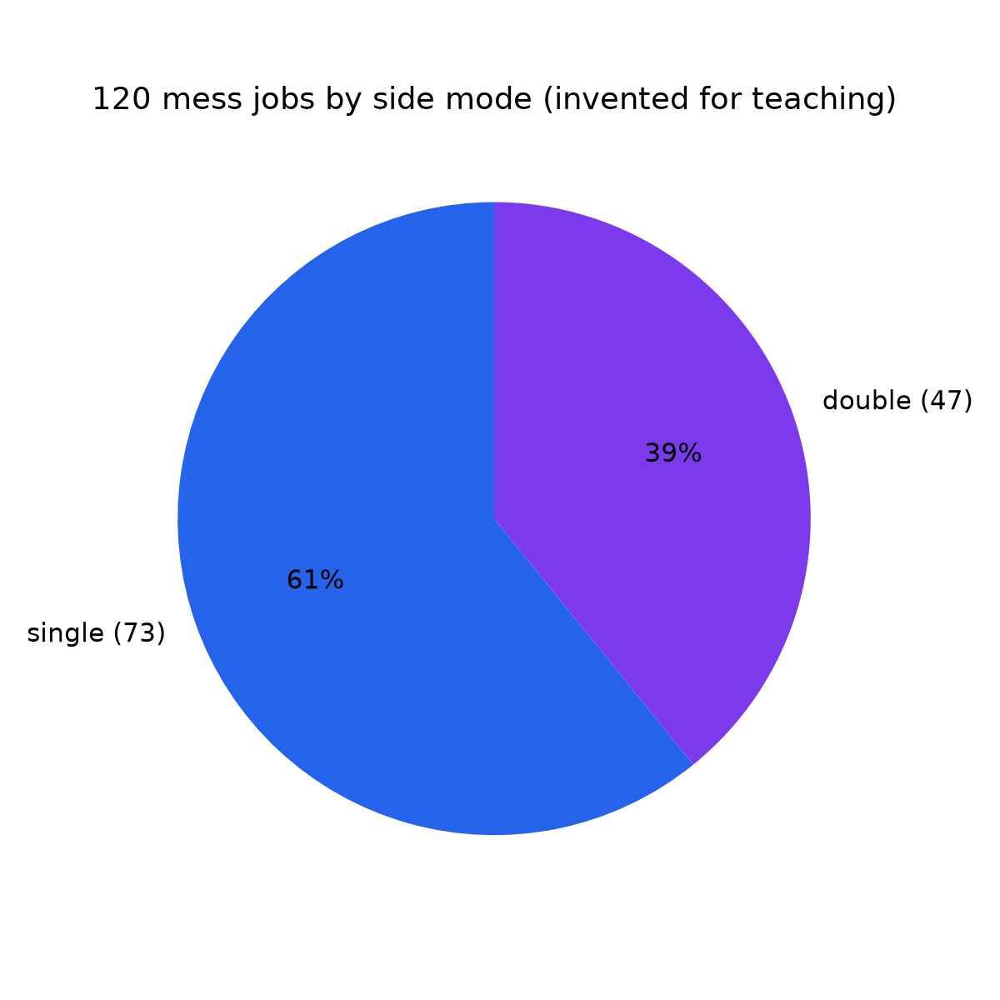
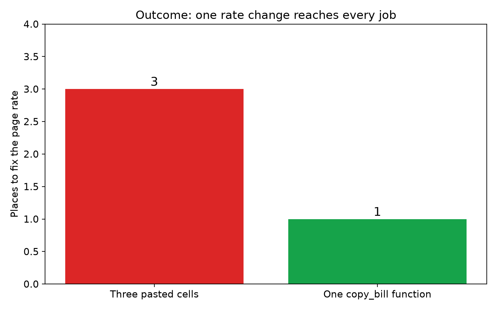
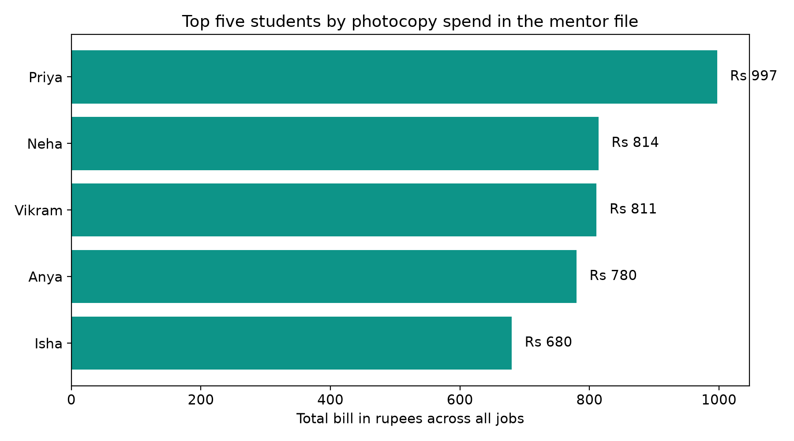
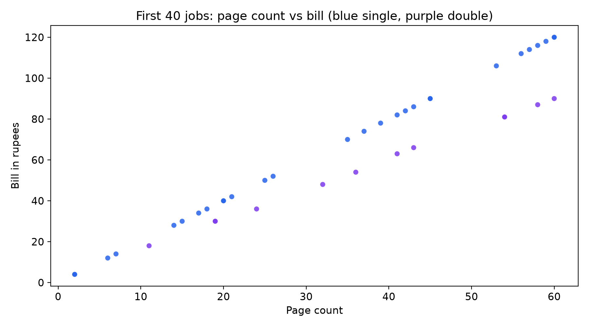

# <font color='#1d4ed8'>Lecture Script: Functions: Reusable Building Blocks</font>

---

## <font color='blue'>Agenda</font>

The lecture runs as four topics. Each topic ends with a quiz.

| Topic | What we do | Learning objectives covered | Minutes |
|:-:|:--|:--|:-:|
| 1 | Name the photocopy rule | Define a function with parameters and call it | 30 |
| 2 | Hand the rupee total back | Return values from a function and use them | 35 |
| 3 | One rule for every student | Explain why functions make code reusable and readable | 25 |
| 4 | Split count and multiply | Break a small task into functions | 20 |
| — | Closing: Outcome & Summary | | 10 |
| | **Total** | | **120** |

> <font color="red">**🎯 Instructor Note**</font> Pace: spend most of Topic 2 on `return` versus `print`, then keyword calls and one default. Keep Topic 3 short and visual with scope.
> Topic 4 is the only place learners define two helpers; keep each code block under ten lines.

---

## <font color='blue'>Scenario</font>

| Before class | At the Printo-style counter beside an Allen Career Institute-style coaching campus |
|:--|:--|
| **Who walks in** | Rahul, Priya, and Dev with mess notes to photocopy |
| **What changes each time** | Page count and whether they want single-side or double-side |
| **What stays fixed** | One rupee rate the clerk applies the same way every time |

The clerk does not redo the arithmetic from scratch for each stack. One short rule on a sticky note prices every job in seconds.

> <font color="red">**🎯 Instructor Note**</font> Printo and Allen Career Institute are only the setting; do not claim they use this data. All 120 rows in `data/mess_slips.csv` are invented for teaching. Learners work from three sample jobs in Colab lists; upload the CSV for the mentor only.

---

## <font color='blue'>Problem Statement</font>

Before today's lab, three friends priced the same three jobs in separate Colab cells. Rahul pasted `12 * 2` correctly and saw Rs 24. Priya pasted single-side math on a double-side stack (`25 * 2`) and saw Rs 50 instead of Rs 39. Dev renamed a variable inside one cell and an earlier cell still showed an old total.

The shop clerk charged Priya Rs 50. She paid Rs 11 extra before anyone noticed the typo.

> <font color='purple'>**What belongs inside a pricing rule, and what stays in the cell above it?**</font>

> <font color="red">**🎯 Instructor Note**</font> Poll: "Rahul prints 12 pages, single-side, at Rs 2 per page. What bill should the notebook show?" Give learners 30 seconds to respond in chat. Reveal the answer in the Closing.

---

## <font color='blue'>What We Will Use</font>

Everything below runs in **Google Colab**. Each topic adds tools without repeating the full list.

| Topic | Tools | In one line |
|:-:|:--|:--|
| 1 | `def`, parameters, call | Give a set of steps a name and pass fresh inputs each time |
| 2 | `return`, keyword arguments, default value | Get a number back, name the inputs, and skip inputs that usually stay the same |
| 3 | local variable, `NameError`, one function versus pasted lines | Names made inside a rule stay inside; one rule beats many copies |
| 4 | two small functions, `return` chaining | Count sheets in one function, multiply by the rate in another |

---

## <font color='blue'>How: Walking Through the Photocopy Counter</font>


---

## <font color='blue'>Topic 1: Name the Photocopy Rule</font> `30 min`

> <font color='purple'>**Last session you walked lists with loops and used `if` to pick single-side or double-side. How do we write that pricing once, like the clerk's sticky note instead of three pasted lines?**</font>

In **Python and Notebooks** you stored page counts in variables. A function packs the same steps under one name you can call again.

### <font color='green'>Example: the three sample jobs</font>

> <font color='purple'>**What inputs does each mess job give the notebook?**</font>

We keep three jobs as parallel lists. The mentor file has 120 rows with the same columns.

**Predict before running: What will happen?**

> <font color="red">**🎯 Instructor Note**</font> Expected: `3 sample jobs` and three printed rows. Common guess: learners forget the side mode in the print line.

```python
job_ids = ["J077", "J088", "J099"]
students = ["Rahul", "Priya", "Dev"]
pages_list = [12, 25, 8]
modes = ["single", "double", "single"]
RATE = 2
print(len(job_ids), "sample jobs in the notebook")
for i in range(3):
    print(job_ids[i], students[i], pages_list[i], modes[i])
```

**Output**

```
3 sample jobs in the notebook
J077 Rahul 12 single
J088 Priya 25 double
J099 Dev 8 single
```

#### <font color='#c2410c'>Code Explanation</font>

- **Lines 1 to 5** Parallel lists hold job id, student name, page count, and side mode for each sample row.
- **Line 6** `RATE = 2` is the rupees per page for single-side jobs in today's notebook.
- **Line 7** `len(job_ids)` counts how many sample jobs sit in memory.
- **Lines 8 and 9** The loop prints the first three jobs, one field at a time.

> <font color='green'>**Result**</font> Each job has a page count and a side mode. Rahul's job is the poll question: 12 pages, single-side.

### <font color='green'>Example: a function with one parameter</font>

> <font color='purple'>**How do we turn page count into one named rule that gives back the single-side bill?**</font>

For Rahul's 12 pages at Rs 2 per page:

$$\text{bill} = 12 \times 2 = 24$$

$$\boxed{\text{bill} = \text{pages} \times \text{RATE}}$$

**Predict before running: What will happen?**

> <font color="red">**🎯 Instructor Note**</font> Expected: `24`, matching the poll. Common guess: nothing prints until the call runs.

```python
def copy_bill(pages):
    return pages * RATE

print(copy_bill(12))
```

**Output**

```
24
```

#### <font color='#c2410c'>Code Explanation</font>

- **Line 1** `def` starts the function. `copy_bill` is its name. `pages` is a parameter, an empty slot for the page count.
- **Line 2** The indented line is the body. It multiplies `pages` by `RATE`.
- **Line 4** The call passes `12` as the argument. `print` shows the value that came back.

> <font color='green'>**Result**</font> One call priced Rahul at Rs 24. The rule is stored once and can run again with new page counts.

### <font color='green'>Extending it: add the side mode parameter</font>

> <font color='purple'>**Priya chose double-side. What parameter must the rule accept besides page count?**</font>

Double-side jobs bill by sheet: both sides of one sheet count as one unit. For 25 pages that is 13 sheets at Rs 3 each.

$$\text{sheets} = \left\lfloor\frac{25 + 1}{2}\right\rfloor = 13,\quad \text{bill} = 13 \times 3 = 39$$

**Predict before running: What will happen?**

> <font color="red">**🎯 Instructor Note**</font> Expected: 24 then 39. Common guess: learners multiply 25 by 2 and expect 50, which is Priya's wrong paste from the Problem Statement.

```python
def copy_bill(pages, side_mode):
    if side_mode == "single":
        return pages * RATE
    sheets = (pages + 1) // 2
    return sheets * 3

print(copy_bill(12, "single"))
print(copy_bill(25, "double"))
```

**Output**

```
24
39
```

#### <font color='#c2410c'>Code Explanation</font>

- **Line 1** Two parameters: `pages` and `side_mode`, the text label for single or double.
- **Lines 2 and 3** The `if` branch uses the same single-versus-double choice from the conditionals session.
- **Lines 4 and 5** The `else` path counts sheets with integer division, then multiplies by Rs 3 per sheet.
- **Lines 7 and 8** Two calls pass different arguments. The first matches Rahul; the second matches Priya.

<p align="center"></p>

> <font color='green'>**Result**</font> The same function name now prices both side modes. Priya's correct bill is Rs 39, not Rs 50.

### <font color='green'>Extending it: call the rule on every sample job</font>

> <font color='purple'>**What if we call `copy_bill` for each row in our lists instead of retyping the math?**</font>

```python
for i in range(len(job_ids)):
    bill = copy_bill(pages_list[i], modes[i])
    print(job_ids[i], bill)
```

**Output**

```
J077 24
J088 39
J099 16
```

#### <font color='#c2410c'>Code Explanation</font>

- **Line 1** Loops over index 0, 1, and 2, reusing the `for` pattern from the loops session.
- **Line 2** Reads page count and side mode at index `i`, passes them as arguments, and stores the returned bill.
- **Line 3** Prints the job id and the bill.

> <font color='green'>**Result**</font> Dev's eight single-side pages cost Rs 16. Three calls, one function body.

### <font color='purple'>Quiz 1</font>

**Question:** With `RATE = 2`, what does `copy_bill(15, "single")` return when `copy_bill` is the two-parameter version above?

**Options:**
- A) 39
- B) None
- C) 30
- D) 7

**Correct Answer:** C

**Explanation:**
- **A)** Wrong: 39 is Priya's double-side bill, not 15 single-side pages.
- **B)** Wrong: `None` appears only when a function has no `return`; this function returns a number.
- **C)** Correct: $15 \times 2 = 30$.
- **D)** Wrong: 7 would come from sheet math on a small double job, not single-side pages.

---

## <font color='blue'>Topic 2: Hand the Rupee Total Back</font> `35 min`

> <font color='purple'>**The next cell needs Priya's rupee total in a variable. Does `print` inside the rule hand that value back?**</font>

### <font color='green'>Example: print is not return</font>

> <font color='purple'>**What if the rule only prints the bill and does not return it?**</font>

**Predict before running: What will happen?**

> <font color="red">**🎯 Instructor Note**</font> Expected: 24 prints during the call, then `None 24`. Common guess: both variables hold 24.

```python
def show_bill(pages, side_mode):
    print(copy_bill(pages, side_mode))

a = show_bill(12, "single")
b = copy_bill(12, "single")
print(a, b)
```

**Output**

```
24
None 24
```

#### <font color='#c2410c'>Code Explanation</font>

- **Lines 1 and 2** `show_bill` calls `copy_bill` and prints, but has no `return`, so the call gives back `None`.
- **Line 4** Stores that `None` in `a` after the printed line.
- **Line 5** `copy_bill` returns the number, so `b` holds 24.
- **Line 6** Prints both side by side.

> <font color='green'>**Result**</font> `print` shows a value on screen. `return` hands it back so the next cell can store and reuse it.

### <font color='green'>Extending it: add returned bills</font>

> <font color='purple'>**What is the total of all three sample jobs?**</font>

```python
grand = 0
for i in range(len(job_ids)):
    row_bill = copy_bill(pages_list[i], modes[i])
    grand += row_bill
print(grand)
```

**Output**

```
79
```

#### <font color='#c2410c'>Code Explanation</font>

- **Line 1** Starts the running total at 0.
- **Line 2** Loops over each sample job.
- **Line 3** Stores the returned bill in `row_bill`.
- **Line 4** Adds that bill to `grand`.
- **Line 5** Prints the sum of the three bills.

> <font color='green'>**Result**</font> Rs 79 for the three friends. This works only because `copy_bill` returns a value the loop can add.

> <font color='#b45309'>**Common mistake**</font> Using `print` inside the rule instead of `return`. The call then gives back `None`, and `grand += None` fails.

### <font color='green'>Example: positional order</font>

> <font color='purple'>**Arguments match parameters by position. What if we swap page count and side mode by mistake?**</font>

**Predict before running: What will happen?**

> <font color="red">**🎯 Instructor Note**</font> Expected: 24, then a `TypeError` on the second call. Common guess: Python warns before running.

```python
print(copy_bill(12, "single"))
copy_bill("single", 12)
```

**Output**

```
24
Traceback (most recent call last):
  File "<cell>", line 2, in <module>
    copy_bill("single", 12)
  File "<cell>", line 4, in copy_bill
    sheets = (pages + 1) // 2
TypeError: can only concatenate str (not "int") to str
```

#### <font color='#c2410c'>Code Explanation</font>

- **Line 1** Correct order: page count first, side mode second.
- **Line 2** Swapped values send the text `"single"` into `pages`, so the sheet math breaks.

<p align="center"></p>

> <font color='green'>**Result**</font> Positional order matters. The swap errors instead of quietly showing Rs 50.

### <font color='green'>Extending it: keyword arguments</font>

> <font color='purple'>**What if we name each value so the order stops mattering?**</font>

```python
print(copy_bill(pages=12, side_mode="single"))
print(copy_bill(side_mode="double", pages=25))
print(copy_bill(12, side_mode="single"))
```

**Output**

```
24
39
24
```

#### <font color='#c2410c'>Code Explanation</font>

- **Line 1** Every value carries its parameter name as `name=value`.
- **Line 2** Keyword order is reversed; each value still lands in the right slot.
- **Line 3** Mixing is allowed: one positional value, then a keyword.

> <font color='green'>**Result**</font> All three calls match the shop bills: 24, 39, and 24.

### <font color='green'>Extending it: a missing argument</font>

> <font color='purple'>**What if we forget the side mode before we add a default?**</font>

```python
def copy_bill(pages, side_mode):
    if side_mode == "single":
        return pages * RATE
    sheets = (pages + 1) // 2
    return sheets * 3

copy_bill(12)
```

**Output**

```
Traceback (most recent call last):
  File "<cell>", line 7, in <module>
    copy_bill(12)
TypeError: copy_bill() missing 1 required positional argument: 'side_mode'
```

#### <font color='#c2410c'>Logic Explanation</font>

- Read the last line of a traceback first. It names the missing parameter `side_mode`.
- Two required slots, one value: Python does not guess the side mode.

> <font color='green'>**Result**</font> A function with two required parameters needs two arguments.

### <font color='green'>Extending it: default single-side</font>

> <font color='purple'>**Most jobs in the mentor file are single-side. Can the rule assume single unless we say otherwise?**</font>

In `data/mess_slips.csv`, 73 of 120 jobs are single-side and 47 are double-side.

```python
def copy_bill(pages, side_mode="single"):
    if side_mode == "single":
        return pages * RATE
    sheets = (pages + 1) // 2
    return sheets * 3

print(copy_bill(8))
print(copy_bill(25, "double"))
```

**Output**

```
16
39
```

#### <font color='#c2410c'>Code Explanation</font>

- **Line 1** `side_mode="single"` is a default parameter used when the caller leaves that argument out.
- **Line 6** One argument only, so Dev's eight pages bill as $8 \times 2 = 16$.
- **Line 7** A second argument overrides the default for Priya's double-side job.

<p align="center"></p>

> <font color='green'>**Result**</font> The default fills in the common case. Passing `"double"` overrides it.

### <font color='purple'>Quiz 2</font>

**Question:** After `def copy_bill(pages, side_mode="single")` is defined as above, what does `copy_bill(8)` return?

**Options:**
- A) 39
- B) 16
- C) 8
- D) A `TypeError`

**Correct Answer:** B

**Explanation:**
- **A)** Wrong: 39 is a double-side bill, but the default side mode is single.
- **B)** Correct: $8 \times 2 = 16$, Dev's sample job.
- **C)** Wrong: 8 is the page count, not the bill in rupees.
- **D)** Wrong: `side_mode` has a default, so one argument is enough.

---

## <font color='blue'>Topic 3: One Rule for Every Student</font> `25 min`

> <font color='purple'>**You fixed `RATE` inside the rule. Why might Dev's total in an earlier pasted cell stay wrong?**</font>

### <font color='green'>Example: a name inside the function</font>

> <font color='purple'>**Inside `copy_bill` we could use a local name `base`. Can the notebook read it after the call?**</font>

**Predict before running: What will happen?**

> <font color="red">**🎯 Instructor Note**</font> Expected: 24, then `NameError` for `base`. Common guess: the notebook keeps every name the function used.

```python
def copy_bill(pages, side_mode="single"):
    if side_mode == "single":
        base = pages * RATE
    else:
        base = ((pages + 1) // 2) * 3
    return base

total = copy_bill(12, "single")
print(total)
print(base)
```

**Output**

```
24
Traceback (most recent call last):
  File "<cell>", line 9, in <module>
    print(base)
          ^^^^
NameError: name 'base' is not defined
```

#### <font color='#c2410c'>Code Explanation</font>

- **Lines 2 to 6** `base` is created inside the function and used to hold the bill.
- **Line 7** `return base` sends the value out; the name itself stays inside.
- **Line 10** The notebook has no `base` of its own, so Python raises `NameError`.

> <font color='green'>**Result**</font> Names made inside a function are local. The notebook only sees the returned number.

### <font color='green'>Extending it: the same name outside</font>

> <font color='purple'>**What if the notebook already has a variable called `base`?**</font>

```python
base = 1
print(copy_bill(12, "single"))
print(base)
```

**Output**

```
24
1
```

#### <font color='#c2410c'>Code Explanation</font>

- **Line 1** Creates `base = 1` in the notebook.
- **Line 2** The function makes its own `base` while it runs, then returns 24.
- **Line 3** The notebook's `base` is still 1.

> <font color='green'>**Result**</font> Fixing the rate inside the function does not change an old pasted cell that used its own copy of the math.

### <font color='green'>Example: one function versus pasted copies</font>

> <font color='purple'>**Why does one `copy_bill` beat three separate paste blocks for readability and reuse?**</font>

#### <font color='#c2410c'>Logic Explanation</font>

- **Readability:** `copy_bill(pages_list[i], modes[i])` states the job in one line. Pasted blocks hide which number is the rate, which is the page count, and which branch is double-side.
- **Reuse:** A loop over 120 jobs calls one body. Pasted blocks mean 120 places to fix when `RATE` changes from 2 to 2.5.
- **Same answer:** Everyone who calls `copy_bill(12, "single")` gets 24. Pasted cells diverge when one friend typo'd `25 * 2`.

<p align="center"></p>

> <font color='green'>**Result**</font> One tested rule is reusable: call it with new inputs. It is readable: the name `copy_bill` tells the next reader what the cell does.

### <font color='green'>Extending it: who spends the most in the mentor file?</font>

> <font color='purple'>**If every row calls the same rule, can we trust student totals in the 120-row file?**</font>

```python
def bill_for_row(pages, side_mode):
    return copy_bill(pages, side_mode)

print(bill_for_row(12, "single"), bill_for_row(25, "double"))
```

**Output**

```
24 39
```

#### <font color='#c2410c'>Code Explanation</font>

- **Lines 1 and 2** A thin wrapper shows that even helper names call the same rule.
- **Line 4** Two calls price Rahul and Priya again without pasting arithmetic.

<p align="center"></p>

> <font color='green'>**Result**</font> The mentor file sums to Rs 6,526 across 120 jobs when every row uses `copy_bill`. One rule keeps those totals aligned with the shop.

### <font color='purple'>Quiz 3</font>

**Question:** A cell defines `def f(p): t = p + 1; return t`. It runs `f(4)`, then runs `print(t)`. What happens?

**Options:**
- A) It prints 5
- B) It prints 4
- C) It prints None
- D) It raises `NameError: name 't' is not defined`

**Correct Answer:** D

**Explanation:**
- **A)** Wrong: 5 is what `f(4)` returns, but the name `t` is not kept in the notebook.
- **B)** Wrong: 4 was the argument inside the function, not a notebook variable.
- **C)** Wrong: `None` would mean `t` existed but held nothing; here the name does not exist outside.
- **D)** Correct: `t` was local to `f`, so the notebook cannot see it after the call.

---

## <font color='blue'>Topic 4: Split Count and Multiply</font> `20 min`

> <font color='purple'>**The clerk counts sheets first, then multiplies by the rate. How do we split those two steps into two small functions?**</font>

### <font color='green'>Example: count sheets, then bill</font>

> <font color='purple'>**What should each helper return so `copy_bill` stays short?**</font>

**Predict before running: What will happen?**

> <font color="red">**🎯 Instructor Note**</font> Ask how many sheets Priya's 25 pages need. Expected: 13. Then expect bills 24 and 39.

```python
def count_sheets(pages, side_mode):
    if side_mode == "single":
        return pages
    return (pages + 1) // 2

def bill_from_sheets(sheets, side_mode):
    return sheets * (RATE if side_mode == "single" else 3)

print(count_sheets(25, "double"), bill_from_sheets(13, "double"))
```

**Output**

```
13 39
```

#### <font color='#c2410c'>Code Explanation</font>

- **Lines 1 to 4** `count_sheets` returns page count for single jobs or sheet count for double jobs.
- **Lines 6 and 7** `bill_from_sheets` multiplies sheets by `RATE` or by Rs 3 in one return line.
- **Line 9** Priya's job needs 13 sheets, then Rs 39 at the sheet rate.

> <font color='green'>**Result**</font> Counting and multiplying are separate callable steps before we wire them together.

### <font color='green'>Extending it: wire one top-level rule</font>

> <font color='purple'>**How does `copy_bill` call both helpers and return one total?**</font>

```python
def copy_bill(pages, side_mode="single"):
    return bill_from_sheets(count_sheets(pages, side_mode), side_mode)

print(copy_bill(12, "single"), copy_bill(25, "double"))
```

**Output**

```
24 39
```

#### <font color='#c2410c'>Code Explanation</font>

- **Lines 1 and 2** `copy_bill` passes the sheet count into `bill_from_sheets` and returns the bill.
- **Line 4** Rahul and Priya match Topic 1 answers on one print line.

> <font color='green'>**Result**</font> The top-level rule stays short. Each helper stays small enough to read in one glance.

### <font color='green'>Extending it: five quick jobs through one pipeline</font>

> <font color='purple'>**Does the split still work on mixed page counts?**</font>

```python
sample_pages = [12, 25, 8, 40, 3]
sample_modes = ["single", "double", "single", "single", "double"]
for p, m in zip(sample_pages, sample_modes):
    print(p, m, copy_bill(p, m))
```

**Output**

```
12 single 24
25 double 39
8 single 16
40 single 80
3 double 6
```

#### <font color='#c2410c'>Code Explanation</font>

- **Lines 1 and 2** Two small lists hold mixed jobs, including a tiny three-page double job.
- **Line 3** `zip` walks both lists together, as in prior list work.
- **Line 4** Each pair flows through `count_sheets` then `bill_from_sheets`.

<p align="center"></p>

> <font color='green'>**Result**</font> Three pages double-side become two sheets and bill Rs 6. Forty single pages bill Rs 80.

### <font color='purple'>Quiz 4</font>

**Question:** For `side_mode="double"`, what does `count_sheets(25, "double")` return before `bill_from_sheets` runs?

**Options:**
- A) 13
- B) 25
- C) 39
- D) 2

**Correct Answer:** A

**Explanation:**
- **A)** Correct: $(25 + 1) // 2 = 13$ sheets.
- **B)** Wrong: 25 is the page count passed in, not the sheet count returned.
- **C)** Wrong: 39 is the final bill in rupees after multiplying sheets by 3.
- **D)** Wrong: 2 is the single-side rate per page, not a sheet count.

---

## <font color='blue'>Closing: Outcome & Summary</font> `10 min`

Back to the Problem Statement: Priya was charged Rs 50 because a pasted cell used single-side math. We answer the purple question using each topic once.

> <font color='purple'>**1. What stays in the cell above the rule?**</font>

The job lists (`job_ids`, `pages_list`, `modes`) and `RATE` live in the notebook. They are the inputs you pass into the rule (Topic 1).

> <font color='purple'>**2. What belongs inside the pricing rule?**</font>

The steps that turn page count and side mode into one rupee total, plus `return` so the next cell can store the bill (Topic 2). Priya's correct total is Rs 39, not Rs 50.

> <font color='purple'>**3. Why did Dev's old pasted cell stay wrong when you fixed `RATE` inside the function?**</font>

Names like `base` are local (Topic 3). Only the returned total leaves the function. Pasted cells do not update when the rule changes.

> <font color='purple'>**4. How did we split counting from multiplying?**</font>

```python
day_total = 0
for i in range(len(job_ids)):
    day_total += copy_bill(pages_list[i], modes[i])
print(day_total)
```

**Output**

```
79
```

#### <font color='#c2410c'>Code Explanation</font>

- **Line 3** Each sample job flows through `count_sheets` and `bill_from_sheets` inside `copy_bill` (Topic 4).
- **Line 4** Returned bills add into `day_total`.
- **Line 5** Prints Rs 79 for Rahul, Priya, and Dev together.

### <font color='green'>Outcome</font>

| | Three pasted cells | One `copy_bill` rule |
|:--|:-:|:-:|
| Priya's bill | Rs 50 (wrong paste) | Rs 39 |
| Places to fix when `RATE` changes | 3 cells | 1 function |
| Afternoon total for the three friends | Depends on typos | Rs 79 |

> <font color='green'>**Therefore,**</font> keep lists and rates in the notebook, put counting and multiplying inside named functions with `return`, and call one rule from a loop. Everyone gets Rs 24 for Rahul's 12-page job, and Priya pays Rs 39—not Rs 50. The trade-off: one mistake in the shared rule reaches every call, so test it once on Rahul, Priya, and Dev before you loop 120 rows.

> <font color="red">**🎯 Instructor Note**</font> Reveal the opening poll: the correct answer is Rs 24. Compare guesses to the Outcome table.

### <font color='green'>Summary</font>

| Learning objective | Takeaway |
|:--|:--|
| Define a function with parameters and call it | `def copy_bill(pages, side_mode)` stores the rule; `copy_bill(12, "single")` passes fresh inputs |
| Return values from a function and use them | `return` hands back Rs 24 or Rs 39; `print` alone leaves `None` |
| Explain why functions make code reusable and readable | One name and one body beat pasted copies; loops call the same rule 120 times |
| Break a small task into functions | `count_sheets` then `bill_from_sheets` split counting from multiplying |
| **Practical value** | The photocopy counter, and every Colab notebook after it, stays consistent when the rate or the job changes |

---

# <font color='red'>Launch the Feedback Poll</font>

> <font color="red">**🎯 Instructor Note**</font> Reminder: launch the feedback poll now to collect learner feedback.