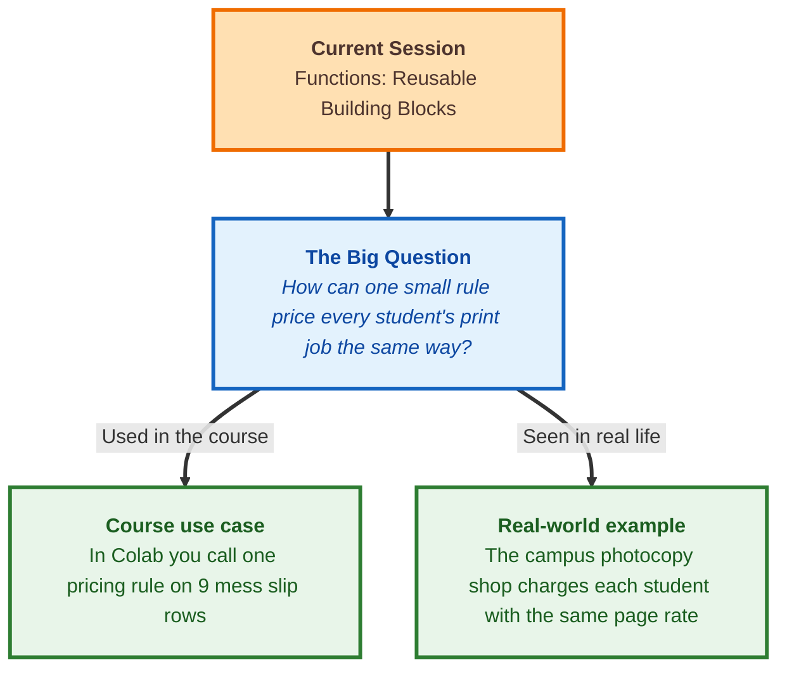

## <span style="color:#2F7DDE">Functions: Reusable Building Blocks</span>

### <span style="color:#2F7DDE">Mental Map</span>



---

### <span style="color:#2F7DDE">What You'll Learn</span>

Have you ever wondered how the photocopy shop clerk prices every stack in seconds without redoing the math each time?

By the end of this session, you will be able to:

- <span style="color:#D9660B">**Identify**</span> inputs, steps, and the rupee answer in Dev's 8-page Colab cell.
- <span style="color:#D9660B">**Explain**</span> why one named rule beats copying the same five lines into five notebook cells.
- <span style="color:#D9660B">**Use**</span> a returned total from a pricing rule to fill the next cell for Priya's 25-page stack.
- <span style="color:#D9660B">**Plan**</span> how to split counting pages from multiplying by the shop rate.
- <span style="color:#D9660B">**Build**</span> a function with page count and side mode you can call for Rahul, Priya, and Dev.

> <span style="color:#2F7DDE">**Topics you will meet:**</span> Functions; Parameters; Return Values; Scope.
>
> Join the session to learn each of these in detail.

---

### <span style="color:#2F7DDE">Why You Are Learning This Topic</span>

You stand at the photocopy counter between two lectures.
Each student asks for a total before class starts.
The clerk uses one page rate, and only the page count changes.
Last week you pasted the same math into four Colab cells.
One typo made Rahul's total differ from the shop receipt.
A **function** means a named set of steps you can run again with new inputs.
You will rely on that pattern as your data notebooks grow in this course.

> <span style="color:#2F7DDE">**Think about it:**</span> What breaks first when the same math sits in four separate cells?

---

### <span style="color:#2F7DDE">The Photocopy Counter Puzzle</span>

Three students print notes before the afternoon lab. The shop uses one rate per page.

| Student | Pages | Side mode |
|:-------:|:-----:|:---------:|
| Rahul | 12 | single |
| Priya | 25 | double |
| Dev | 8 | single |

<span style="color:#D9660B">**What you want to happen:**</span>

- Each order runs through the same pricing steps, not three copy-paste blocks.
- You change the rate once and every total updates in the notebook.
- A name picked inside the rule does not leak into the cell above it.

Here is how it might start. You do not need to understand it yet.

```python
def copy_bill(pages):
    return pages * 2
copy_bill(12)
```

> <span style="color:#D9660B">**Wonder about this:**</span>
>
> - Where does the number 24 come from when Rahul prints 12 pages?
> - Why might the name `copy_bill` matter more than the number 2 inside?

---

### <span style="color:#2F7DDE">Think It Through</span>

There is no wrong first try. Keep your guesses for the session.

**1. Rahul's job uses 12 pages. Which table column would you pass as a fresh input for Priya's job?**
Hint: Pick the column that changes per student, not the side mode label alone.

**2. The notebook cell after the rule needs Priya's rupee total. What must the rule hand back?**
Hint: Think about what the next cell can store in a variable.

**3. You fix the shop rate inside the rule. Why might Dev's total in an earlier cell stay unchanged?**
Hint: Picture names that exist only while the rule runs.

---

### <span style="color:#2F7DDE">One Question to Carry Into the Session</span>

> <span style="color:#2F7DDE">**What belongs inside a pricing rule, and what stays in the cell above it?**</span>
>
> Bring one guess about which student order you would price first in Colab.