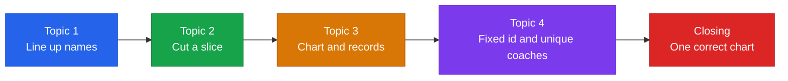

# <font color='#1d4ed8'>Lecture Script: Core Data Structures</font>

---

## <font color='blue'>Agenda</font>

The lecture runs as four topics. Each topic ends with a quiz.

| Topic | What we do | Learning objectives covered | Minutes |
|:-:|:--|:--|:-:|
| 1 | Line up passenger names in order | Create and modify 1D lists and access items by index | 32 |
| 2 | Cut a slice of the manifest | Slice a list to retrieve a range of items | 28 |
| 3 | Map berths on a coach chart | Build and navigate 2D lists by row and column<br>Store and look up data with dictionaries using key-value pairs | 35 |
| 4 | Lock the train id and dedupe coaches | Create and use tuples for fixed, ordered data<br>Use sets for uniqueness and membership operations | 15 |
| — | Closing: Outcome & Summary | | 10 |
| | **Total** | | **120** |

> <font color="red">**🎯 Instructor Note**</font> Pace: spend Topic 1 on index 0, negative index, and `append`. Spend Topic 3 on `coach[row][col]` and `dict.get`.
> Keep Topic 4 brisk; tuples and sets appear again in the Closing.

---

## <font color='blue'>Scenario</font>

**The risk:** an IRCTC-style group-booking desk at a coaching-hostel travel club checks sleeper berths in **Google Colab** before it prints the final chart. One wrong list index, one shared berth cell marked twice, or one missing dictionary key, and two students show up for the same bunk.

The full morning manifest has **120** invented rows in `data/coach_manifest.csv`. Today's notebook keeps six sample passengers, a small coach grid, and a few booking records.

> <font color="red">**🎯 Instructor Note**</font> IRCTC is only the setting; do not claim it uses this data. Upload `data/coach_manifest.csv` for the mentor. Learners type lists and dicts in Colab cells only.

---

## <font color='blue'>Problem Statement</font>

Volunteer Ananya copied six names into one Python list. She printed `passengers[1]` thinking it was the first student on the trip and sent the wrong name to the chart printer. She also stored two passengers at the same row and column in a hand-drawn grid because she treated the grid like a flat list. The club reprinted the chart and held the queue for twenty minutes.

> <font color='purple'>**Which data shape fits each part of a group train booking: a line of names, a table of berths, a labelled record, a fixed train id, or a deduped coach list?**</font>

> <font color="red">**🎯 Instructor Note**</font> Poll: "Six names sit in a list. What index is the first name?" Give learners 30 seconds to respond in chat. Reveal the answer in the Closing.

---

## <font color='blue'>What We Will Use</font>

Everything below runs in **Google Colab**. Each topic adds tools without repeating the full list.

| Topic | Tools | In one line |
|:-:|:--|:--|
| 1 | `[ ]`, index, `append`, assignment | Keep ordered items and change one slot |
| 2 | `[start:stop:step]` | Copy a range without typing each index |
| 3 | nested lists, `{key: value}`, `.get` | Read a berth by row and column; look up a field by name |
| 4 | `( )`, `in`, `{ }` set, `&` `|` | Hold fixed trip facts; keep unique coach codes |

---

## <font color='blue'>How: Walking Through the Group Berth Chart</font>



---

## <font color='blue'>Topic 1: Line Up Passenger Names in Order</font> `32 min`

> <font color='purple'>**Last session you wrote functions that took page counts and side mode as inputs. How do we hold six passenger names in one ordered line instead of six separate variables?**</font>

In **Repeating Work** you walked a sequence with a `for` loop. A **list** keeps many values in order under one name, and each value has a position you can read or change.

### <font color='green'>Example: build the list and read position 0</font>

> <font color='purple'>**Who is first on the trip, and how do we add a late joiner?**</font>

Positions start at **0** from the front. From the back, **-1** is always the last item.

**Predict before running: What will happen?**

> <font color="red">**🎯 Instructor Note**</font> Expected: `Meera 420` then `6 Kiran 280`. Common guess: position `1` is the first name.

```python
passengers = ["Meera", "Arjun", "Priya", "Dev", "Riya"]
berth_fees = [420, 420, 350, 350, 280]
print(passengers[0], berth_fees[0])
passengers[2] = "Priya S."
passengers.append("Kiran")
berth_fees.append(280)
print(len(passengers), passengers[-1], berth_fees[-1])
```

**Output**

```
Meera 420
6 Kiran 280
```

#### <font color='#c2410c'>Code Explanation</font>

- **Lines 1 and 2** Two parallel lists hold names and berth fees for five students.
- **Line 3** `passengers[0]` is the first name; Python counts from 0.
- **Line 4** Assignment replaces the item at index 2 with an updated spelling.
- **Lines 5 and 6** `append` adds one new item at the end of each list.
- **Line 7** `len` counts items; `-1` reads the last passenger and last fee.

> <font color='green'>**Result**</font> Meera stays first, the list grows to six names, and Kiran sits at the end with fee 280.

### <font color='green'>Extending it: negative index and in-place fee fix</font>

> <font color='purple'>**How do we reach the last two names without counting forward, and how do we fix Arjun's fee?**</font>

> <font color="red">**🎯 Instructor Note**</font> Ask learners which index is the last name before you run the cell.

```python
print(passengers[-2], passengers[-1])
passengers[-1] = "Kiran M."
berth_fees[1] = 400
print(passengers[1], berth_fees[1])
```

**Output**

```
Riya Kiran
Arjun 400
```

> <font color='green'>**Result**</font> Index `-2` and `-1` hit the last two names. Assignment on `berth_fees[1]` changes only Arjun's fee to 400.

### <font color='green'>Extending it: index past the end</font>

> <font color='purple'>**What happens at index 9 when only six names exist?**</font>

**Predict before running: What will happen?**

> <font color="red">**🎯 Instructor Note**</font> Expected: traceback with `IndexError`. Give learners 30 seconds to respond in chat.

```python
print(passengers[9])
```

**Output**

```
Traceback (most recent call last):
  File "<cell>", line 1, in <module>
    print(passengers[9])
          ~~~~~~~~~~^^^
IndexError: list index out of range
```

> <font color='green'>**Result**</font> Valid positions for six items are `0` through `5` (or `-1` through `-6`). Index `9` does not exist.

> <font color='#b45309'>**Common mistake**</font> Treating the first name as index `1`. A six-item list ends at index `5`.

### <font color='purple'>Quiz 1</font>

**Question:** `names = ["A", "B", "C"]`. What does `names[1]` print?

**Options:**
- A) `A`
- B) `B`
- C) `C`
- D) An error

**Correct Answer:** B

**Explanation:**
- **A)** Wrong: index `0` holds `A`.
- **B)** Index `1` is the second item, `B`.
- **C)** Wrong: `C` sits at index `2`.
- **D)** Wrong: index `1` exists in a three-item list.

---

## <font color='blue'>Topic 2: Cut a Slice of the Manifest</font> `28 min`

> <font color='purple'>**Ananya needs the first three names for coach S1 and every second name for a meal count. Must she type six separate indexes?**</font>

A **slice** `list[start:stop:step]` builds a new list. It starts at `start`, stops before `stop`, and moves by `step` (1 if you leave it out).

### <font color='green'>Example: three slices on the passenger list</font>

> <font color='purple'>**Which names sit in the first three slots, the last two, and every second name?**</font>

**Predict before running: What will happen?**

> <font color="red">**🎯 Instructor Note**</font> Expected: three printed lists. Common guess: `last_two` includes only one name.

```python
first_three = passengers[0:3]
last_two = passengers[-2:]
every_second = passengers[::2]
print(first_three)
print(last_two)
print(every_second)
```

**Output**

```
['Meera', 'Arjun', 'Priya S.']
['Riya', 'Kiran M.']
['Meera', 'Priya S.', 'Riya']
```

#### <font color='#c2410c'>Code Explanation</font>

- **Line 1** `0:3` takes positions `0`, `1`, and `2` and stops before `3`.
- **Line 2** `-2:` starts at the second name from the end and runs to the end.
- **Line 3** `::2` keeps positions `0`, `2`, `4`, … with step 2.
- **Lines 4 to 6** Each slice is its own new list; the original `passengers` list stays unchanged.

> <font color='green'>**Result**</font> Three compact lists come from one passenger line without retyping names.

### <font color='green'>Extending it: slice fees and a middle group</font>

> <font color='purple'>**Can we sort fees high to low, then take the middle band and names in positions 2 through 4?**</font>

```python
fees_hi_to_lo = sorted(berth_fees, reverse=True)
print(fees_hi_to_lo[1:4])
print(fees_hi_to_lo[:2])
print(passengers[2:5])
```

**Output**

```
[400, 350, 350]
[420, 400]
['Priya S.', 'Dev', 'Riya']
```

> <font color='green'>**Result**</font> `sorted` makes a new ordered list; slices on that list and on `passengers` copy ranges only.

> <font color='#b45309'>**Common mistake**</font> Forgetting that `stop` is excluded. Slice `2:5` takes indices `2`, `3`, and `4`, not `5`.

### <font color='purple'>Quiz 2</font>

**Question:** `nums = [10, 20, 30, 40, 50]`. What is `nums[1:4]`?

**Options:**
- A) `[10, 20, 30, 40]`
- B) `[20, 30, 40, 50]`
- C) `[20, 30, 40]`
- D) `[10, 20, 30]`

**Correct Answer:** C

**Explanation:**
- **A)** Wrong: index `0` (`10`) is not included when `start` is `1`.
- **B)** Wrong: index `4` (`50`) is excluded because `stop` is `4`.
- **C)** Starts at `1`, stops before `4`, so `20`, `30`, `40`.
- **D)** Wrong: that slice would be `nums[0:3]`.

---

## <font color='blue'>Topic 3: Map Berths on a Coach Chart</font> `35 min`

> <font color='purple'>**A sleeper coach is not one long line: it is rows and columns of berth codes. How do we store that grid, and how do we attach a PNR to one student's details?**</font>

A **two-dimensional list** is a list of rows; each row is a list of cells. A **dictionary** maps a **key** (like a PNR) to a **value** (like a name or fee).

### <font color='green'>Example: read and update one berth cell</font>

> <font color='purple'>**What code sits at row 0 column 1, and how do we mark row 1 column 2 as booked?**</font>

**Predict before running: What will happen?**

> <font color="red">**🎯 Instructor Note**</font> Expected: `MB SL` then row 1 printed with `booked` in the last cell.

```python
coach = [["LB", "MB", "UB"], ["LB", "MB", "UB"], ["SL", "SU", ""]]
print(coach[0][1], coach[2][0])
coach[1][2] = "booked"
print(coach[1])
```

**Output**

```
MB SL
['LB', 'MB', 'booked']
```

#### <font color='#c2410c'>Code Explanation</font>

- **Line 1** Three inner lists model three rows with three berth codes each.
- **Line 2** `coach[0][1]` is row 0, column 1 (`MB`). `coach[2][0]` is row 2, column 0 (`SL`).
- **Line 3** Assignment replaces the cell at row 1, column 2.
- **Line 4** Printing `coach[1]` shows the full middle row after the update.

> <font color='green'>**Result**</font> Double indexing `coach[row][col]` targets one bunk on the chart.

### <font color='green'>Extending it: scan the grid with nested loops</font>

> <font color='purple'>**Where did we mark `booked` when we do not remember the indexes?**</font>

```python
for r in range(len(coach)):
    for c in range(len(coach[r])):
        if coach[r][c] == "booked":
            print("booked", r, c)
```

**Output**

```
booked 1 2
```

> <font color='green'>**Result**</font> The nested loop walks every row and column once and reports row `1`, column `2`.

### <font color='green'>Example: one booking record as a dictionary</font>

> <font color='purple'>**How do we read Meera's name by key, and what if the phone field is missing?**</font>

**Predict before running: What will happen?**

> <font color="red">**🎯 Instructor Note**</font> Expected: `Meera none` then key list plus `confirmed`.

```python
booking = {"pnr": "4829103", "name": "Meera", "row": 1, "col": 2}
print(booking["name"], booking.get("phone", "none"))
booking["status"] = "confirmed"
print(list(booking.keys()), booking["status"])
```

**Output**

```
Meera none
['pnr', 'name', 'row', 'col', 'status'] confirmed
```

#### <font color='#c2410c'>Code Explanation</font>

- **Line 1** Curly braces build a dict with string and integer values.
- **Line 2** Brackets read a key that must exist; `.get` returns a default when the key is missing.
- **Line 3** A new key `status` is added after the dict is created.
- **Line 4** `keys()` lists field names; brackets read the new status value.

> <font color='green'>**Result**</font> The chart row came from the grid; the passenger label came from the dict.

### <font color='green'>Extending it: manifest dict of records</font>

> <font color='purple'>**How do we store two PNRs and read Arjun's fee inside the nested record?**</font>

```python
manifest = {
    "4829103": {"name": "Meera", "fee": 420},
    "4829104": {"name": "Arjun", "fee": 400},
}
print(manifest["4829104"]["name"])
for pnr in manifest:
    print(pnr, manifest[pnr]["fee"])
```

**Output**

```
Arjun
4829103 420
4829104 400
```

> <font color='green'>**Result**</font> Outer keys are PNR strings; inner dicts hold fields for each passenger.

### <font color='purple'>Quiz 3</font>

**Question:** `grid = [["a", "b"], ["c", "d"]]`. What does `grid[1][0]` return?

**Options:**
- A) `"c"`
- B) `"a"`
- C) `"d"`
- D) `["c", "d"]`

**Correct Answer:** A

**Explanation:**
- **A)** Row index `1`, column `0` is the first cell of the second row, `"c"`.
- **B)** Wrong: `"a"` is `grid[0][0]`.
- **C)** Wrong: `"d"` is `grid[1][1]`.
- **D)** Wrong: the whole row would be `grid[1]` without a second index.

---

## <font color='blue'>Topic 4: Lock the Train Id and Dedupe Coaches</font> `15 min`

> <font color='purple'>**The train number and route must not change mid-notebook, and the coach list must not list S2 twice. Which tools fit those two jobs?**</font>

A **tuple** holds a fixed, ordered group of values. A **set** keeps **unique** items and answers `in` checks quickly.

### <font color='green'>Example: trip facts in a tuple</font>

> <font color='purple'>**What are the train number, destination, and coach count, and how do we unpack them?**</font>

**Predict before running: What will happen?**

> <font color="red">**🎯 Instructor Note**</font> Expected: first line `12627 NDLS 4`; second line unpack prints the same destination and coach count.

```python
train = ("12627", "MAS", "NDLS", 24)
print(train[0], train[2], len(train))
num, src, dst, coaches = train
print(num, dst, coaches)
```

**Output**

```
12627 NDLS 4
12627 NDLS 24
```

#### <font color='#c2410c'>Code Explanation</font>

- **Line 1** Parentheses build a tuple with four ordered values.
- **Line 2** Indexing reads the train number, destination, and item count.
- **Line 3** Unpacking assigns four names in one step.
- **Line 4** Prints the number, destination, and coach count from those names.

> <font color='green'>**Result**</font> The trip header stays one grouped object learners can unpack.

### <font color='green'>Extending it: tuple assignment fails</font>

> <font color='purple'>**Can we change the source station string inside the tuple?**</font>

```python
train[1] = "SBC"
```

**Output**

```
Traceback (most recent call last):
  File "<cell>", line 1, in <module>
    train[1] = "SBC"
    ~~~~~^^^
TypeError: 'tuple' object does not support item assignment
```

> <font color='green'>**Result**</font> Tuples are fixed after creation; build a new tuple if the route changes.

### <font color='green'>Example: unique coach codes in a set</font>

> <font color='purple'>**How many distinct coaches appear after we drop the duplicate S2?**</font>

```python
coaches_seen = {"S1", "S2", "S3", "S2", "S4"}
print(len(coaches_seen), "S2" in coaches_seen)
coaches_seen.add("S5")
print(sorted(coaches_seen))
```

**Output**

```
4 True
['S1', 'S2', 'S3', 'S4', 'S5']
```

> <font color='green'>**Result**</font> The set keeps four unique codes even though `S2` was written twice; `add` grows the set to five.

### <font color='green'>Extending it: overlap of morning and evening PNR sets</font>

> <font color='purple'>**Which PNR was edited in both shifts, and how many PNRs appear across both sets?**</font>

```python
morning = {"4829103", "4829104", "4829105"}
evening = {"4829104", "4829106", "4829107"}
print(morning & evening)
print(len(morning | evening))
```

**Output**

```
{'4829104'}
5
```

> <font color='green'>**Result**</font> `&` keeps PNRs in both sets; `|` counts every unique PNR across shifts.

### <font color='purple'>Quiz 4</font>

**Question:** Which line adds a coach code only if it is not already in the set?

**Options:**
- A) `coaches.append("S6")`
- B) `coaches[0] = "S6"`
- C) `coaches.extend("S6")`
- D) `coaches.add("S6")`

**Correct Answer:** D

**Explanation:**
- **A)** Wrong: `append` belongs to lists, not sets.
- **B)** Wrong: sets do not use position assignment.
- **C)** Wrong: `extend` is a list method and would split text into letters.
- **D)** `add` inserts one unique item into a set.

---

## <font color='blue'>Closing: Outcome & Summary</font> `10 min`

Ananya's mistake was picking the wrong **index**, sharing one **grid cell**, and mixing **list** and **dict** lookups. The fix uses the right shape at each step.

> <font color='purple'>**1. Six names in one list — which index is first?**</font>

Index **0** holds the first name. Index `1` is the second name, which is why her print showed Arjun when she wanted Meera.

> <font color='purple'>**2. Can one short cell prove every structure on the trip header?**</font>

```python
trip = (train[0], train[2], sorted(coaches_seen)[:3])
print(trip)
print(len(passengers), passengers[::2])
print(manifest["4829103"]["name"], booking["status"])
print(len(morning & evening), "4829104" in morning)
```

**Output**

```
('12627', 'NDLS', ['S1', 'S2', 'S3'])
6 ['Meera', 'Priya S.', 'Riya']
Meera confirmed
1 True
```

#### <font color='#c2410c'>Code Explanation</font>

- **Line 1** Topic 4 tuple fields join with a slice of Topic 4 set coaches into one summary tuple.
- **Line 3** Topic 1 `len` and Topic 2 slice `::2` count and sample passengers.
- **Line 4** Topic 3 nested dict lookup plus booking status from the dict example.
- **Line 5** Topic 4 set overlap count and membership on the morning PNR set.

### <font color='green'>Outcome</font>

| | Manual sticky notes | Colab structures |
|:--|:-:|:-:|
| Wrong berth from off-by-one index | Yes | No — index `0` is explicit |
| Two names on one grid cell | Easy | Hard — `coach[r][c]` is one cell |
| Duplicate coach codes in a tally | Easy | No — set keeps unique codes |

> <font color='green'>**Therefore,**</font> a **list** holds the passenger line, a **slice** copies ranges, a **2D list** maps the bunk grid, a **dict** labels each PNR, a **tuple** locks the train header, and a **set** dedupes coach codes — so the club prints one chart before the queue backs up.

> <font color="red">**🎯 Instructor Note**</font> Reveal the poll answer **0** next to the table. Ask who guessed `1`.

### <font color='green'>Summary</font>

| Learning objective | Takeaway |
|:--|:--|
| Create and modify 1D lists and access items by index | Brackets read or change one slot; `append` grows the list at the end |
| Slice a list to retrieve a range of items | `[start:stop:step]` copies a range; `stop` is left out |
| Build and navigate 2D lists by row and column | `grid[row][col]` is one bunk; loops walk the chart |
| Store and look up data with dictionaries using key-value pairs | Keys name fields; `.get` avoids a crash on a missing key |
| Create and use tuples for fixed, ordered data | Parentheses group fixed trip facts; unpacking assigns many names |
| Use sets for uniqueness and membership operations | Sets drop duplicates; `in`, `&`, and `|` answer overlap questions |
| **Practical value** | Picking the right structure stops double-booked berths and wrong names on a group travel chart |

---

# <font color='red'>Launch the Feedback Poll</font>

> <font color="red">**🎯 Instructor Note**</font> Reminder: launch the feedback poll now to collect learner feedback.