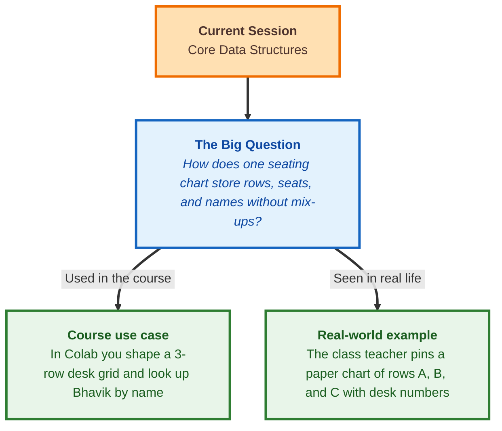

## <span style="color:#2F7DDE">Core Data Structures</span>

### <span style="color:#2F7DDE">Mental Map</span>



---

### <span style="color:#2F7DDE">What You'll Learn</span>

Have you ever wondered how the teacher finds your desk during a surprise quiz?

By the end of this session, you will be able to:

- <span style="color:#D9660B">**list**</span> row A in desk order and change the name at index 2 without rewriting the row.
- <span style="color:#D9660B">**describe**</span> a fixed row-and-seat pair like ("B", 2) that must not change after it is set.
- <span style="color:#D9660B">**determine**</span> which slice of row A picks Chitra and Dev from seats 3 and 4.
- <span style="color:#D9660B">**use**</span> a name-to-seat chart to find Bhavik's row letter and desk number.
- <span style="color:#D9660B">**build**</span> a 2D chart with three rows and four desks per row in Colab.
- <span style="color:#D9660B">**check**</span> whether two roll numbers claim the same seat on the chart.

> <span style="color:#2F7DDE">**Topics you will meet:**</span> Lists; Dictionaries; Tuples; Sets; Indexing; Slicing.
>
> Join the session to learn each of these in detail.

---

### <span style="color:#2F7DDE">Why You Are Learning This Topic</span>

The teacher hands out a seating chart before the unit test.

Row A is full. Row B has an empty desk.

A **data structure** means an organised way to keep names, numbers, or rows together in code.

You will use these shapes in Colab for seat plans and lab marks.

> <span style="color:#2F7DDE">**Think about it:**</span> What would go wrong if every name sat in its own separate variable?

---

### <span style="color:#2F7DDE">The Classroom Seating Chart Puzzle</span>

The table matches the board chart for rows A through C.

| Student | Row | Seat |
|:-------:|:---:|:----:|
| Anaya | A | 1 |
| Bhavik | A | 2 |
| Chitra | A | 3 |
| Dev | A | 4 |
| Esha | B | 2 |

<span style="color:#D9660B">**What you want to happen:**</span>

- Hold row A as one ordered line of names.
- Pull only seats 2 and 3 when you call the middle students forward.
- Find Bhavik fast by name instead of scanning every row.

Here is how it might start. You do not need to understand it yet.

```python
row_a = ["Anaya", "Bhavik", "Chitra", "Dev"]
print(row_a[1])
print(row_a[1:3])
```

> <span style="color:#D9660B">**Wonder about this:**</span>
>
> - Why might the second print show two names, not one?
> - How would you store Esha's row and seat so they stay fixed after you set them?

---

### <span style="color:#2F7DDE">Think It Through</span>

There is no wrong first try. Keep your guesses for the session.

**1. Row A lists four names left to right. Which index marks the first desk when counting starts at zero?**
Hint: Picture the leftmost seat on the chart.

**2. You want only Bhavik and Chitra from row A. Which two index numbers might your slice use?**
Hint: Match Bhavik at seat 2 and Chitra at seat 3 to index numbers.

**3. Two students claim seat B-2 on the chart. What structure would flag a double booking?**
Hint: Picture a group that keeps only one copy of each seat code.

---

### <span style="color:#2F7DDE">One Question to Carry Into the Session</span>

> <span style="color:#2F7DDE">**How do ordered rows, name lookups, fixed pairs, and unique groups fit on one seating chart?**</span>
>
> Which row would you model first in Colab?

---

### <span style="color:#2F7DDE">Set Up Before the Session</span>

> <span style="color:#2F7DDE">**Do this before the session starts.**</span> You will write code in Google Colab during the session. Open https://colab.research.google.com/ and sign in with your Google account.