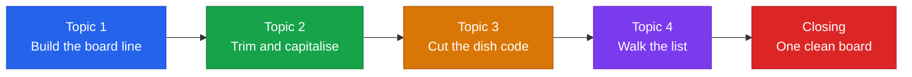
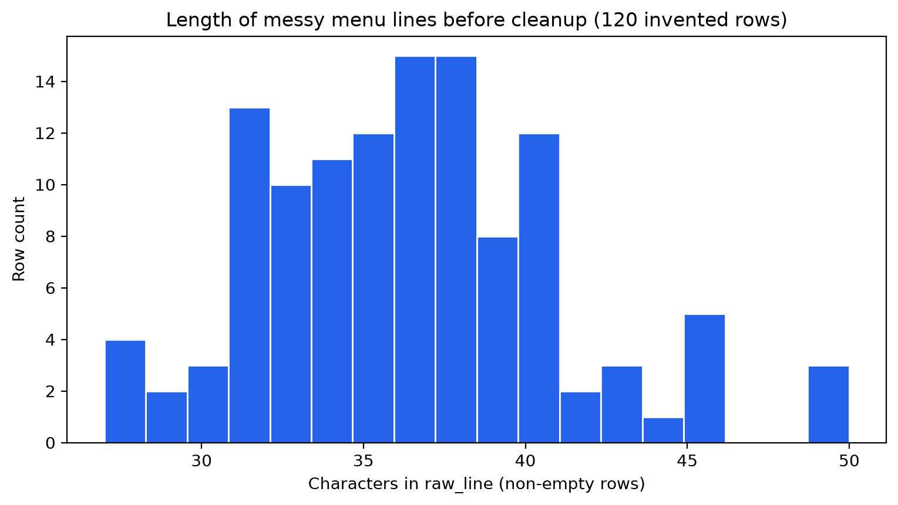
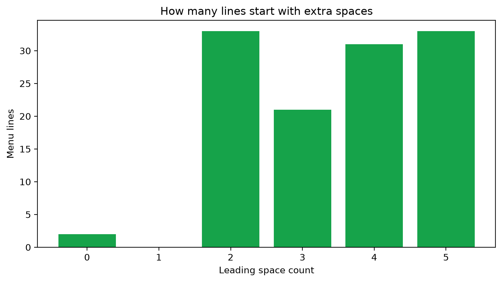
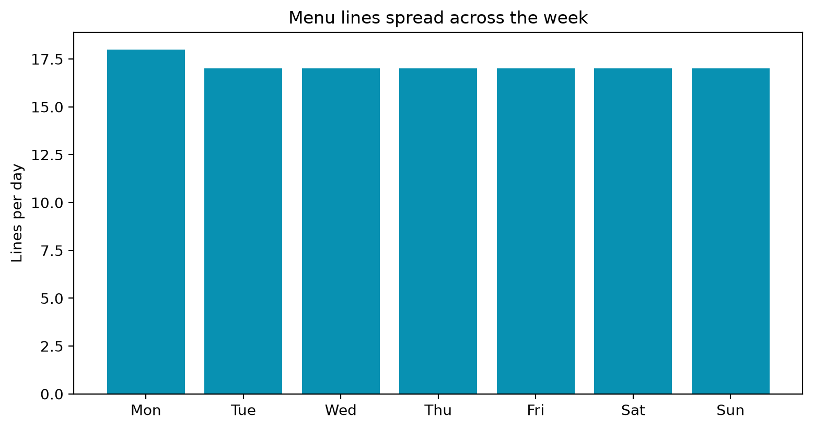
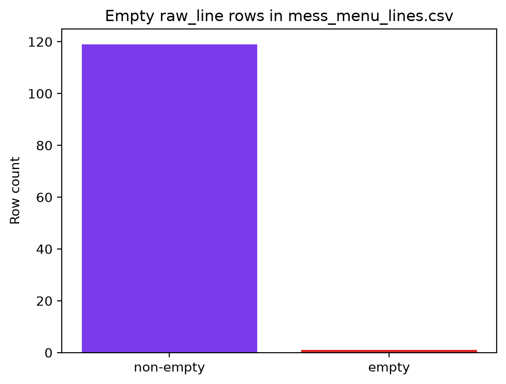
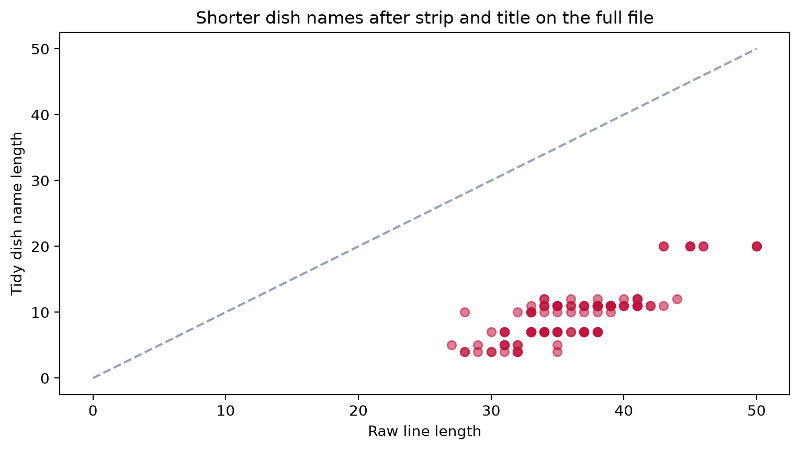
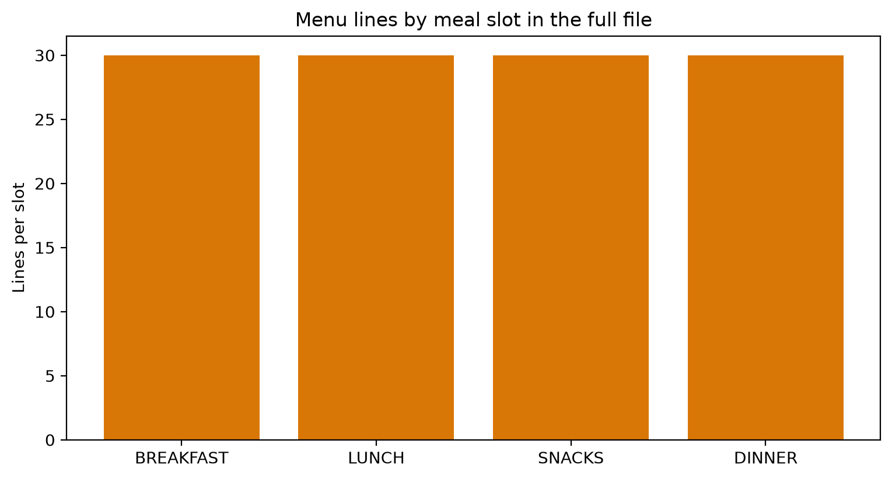

# <font color='#1d4ed8'>Lecture Script: Strings and String Methods</font>

---

## <font color='blue'>Agenda</font>

The lecture runs as four topics. Each topic ends with a quiz.

| Topic | What we do | Learning objectives covered | Minutes |
|:-:|:--|:--|:-:|
| 1 | Build the board line from dish text | Create, combine, and index into strings | 30 |
| 2 | Trim spaces and fix capitals | Use common string methods for cleaning and formatting | 35 |
| 3 | Cut out the dish code | Slice strings to extract parts | 25 |
| 4 | Walk the list of messy lines | Apply string operations to messy text data | 20 |
| — | Closing: Outcome & Summary | | 10 |
| | **Total** | | **120** |

> <font color="red">**🎯 Instructor Note**</font> Pace: spend Topic 2 on method chains and the fact that `strip` does not fix double spaces inside.
> Topic 4 reuses a list like Core Data Structures; keep the loop to five sample lines, not all 120 rows.

---

## <font color='blue'>Scenario</font>

| What the volunteer pasted into the chat | What the Haldiram's-style campus canteen board should show |
|:--|:--|
| `  jeera RICE  (jee-007-veg) ₹65 ` | `Jeera Rice` |
| `  PANEER  butter  MASALA  (pan-044-veg) ₹85  ` | `Paneer Butter Masala` |
| *(blank line)* | *(nothing posted)* |

A student union runs the weekly mess menu in **Google Colab** before it goes on the notice app. The full file has **120** invented rows in `data/mess_menu_lines.csv`. The notebook uses five sample lines that match rows 7, 22, 44, 88, and 60.

> <font color="red">**🎯 Instructor Note**</font> Haldiram's is only the setting; do not claim it uses this data. Upload `data/mess_menu_lines.csv` for the mentor. Learners type the five sample lines into a list in Colab cells.

---

## <font color='blue'>Problem Statement</font>

Volunteer Rohit pasted five menu lines from WhatsApp into one Colab cell. He joined lunch and dinner titles with `+`, but the line still started with a space, so search on the app skipped `Dal Fry`. He also posted `jeera RICE` and `Jeera Rice` on two days because he never ran `title()`. One blank line became an empty card on the board.

Students queued at the wrong counter on Wednesday because the canteen screen and the paper board did not match.

> <font color='purple'>**How do we turn pasted mess menu text into tidy dish names and matching codes the board and kitchen both accept?**</font>

> <font color="red">**🎯 Instructor Note**</font> Poll: "You set `full_board = lunch_line + ' + ' + evening_line` and `lunch_line` starts with two spaces. What is the first character of `full_board`?" Give learners 30 seconds to respond in chat. Reveal the answer in the Closing.

---

## <font color='blue'>What We Will Use</font>

Everything below runs in **Google Colab**. Each topic adds tools without repeating the full list.

| Topic | Tools | In one line |
|:-:|:--|:--|
| 1 | `" "`, `+`, `[ ]`, `len` | Build text, pick one character, and count length |
| 2 | `.strip()`, `.lower()`, `.upper()`, `.title()`, `.replace()` | Trim ends, fix capitals, swap repeated spaces |
| 3 | `[start:stop]`, `[-n:]` | Cut a piece out of ordered text |
| 4 | `for`, `.strip()`, list of strings | Clean each list item before posting |

---

## <font color='blue'>How: Walking Through the Mess Menu Cleanup</font>



---

## <font color='blue'>Topic 1: Build the Board Line from Dish Text</font> `30 min`

> <font color='purple'>**Last session you lined up names in a list. Each menu row is one text value inside that list. How do we join two dish titles and read the first and last character?**</font>

In **Repeating Work** you walked a list with a `for` loop. In **Core Data Structures** you read one list slot with `menu_lines[0]`. A **string** holds text in order: every character has a position starting at **0** from the front.

### <font color='green'>Example: join lunch and dinner titles</font>

> <font color='purple'>**What is the first character of the joined board line, and how long is each piece?**</font>

The operator `+` joins two text values into one new text value. The old values stay unchanged.

**Predict before running: What will happen?**

> <font color="red">**🎯 Instructor Note**</font> Expected: first character is a space and last is `e` from `Rice`. Common wrong guess: first character is `D`.

```python
lunch_line = "  Dal Fry  "
evening_line = "Jeera Rice"
dash = " + "
full_board = lunch_line + dash + evening_line
print(full_board[0], full_board[-1])
print(len(full_board), len(lunch_line))
```

**Output**

```
  e
24 11
```

#### <font color='#c2410c'>Code Explanation</font>

- **Lines 1 to 2** Store two dish lines. `lunch_line` has two spaces at the front and two at the end.
- **Line 3** `dash` is a short joiner text with spaces around `+`.
- **Line 4** `+` builds one new text from the three parts.
- **Line 5** Position `0` is the first character. `-1` is always the last character.
- **Line 6** `len` counts every character, including spaces.

> <font color='green'>**Result**</font> The joined line is 24 characters long. It still starts with a space because `lunch_line` brought those spaces into the join.

<p align="center"></p>

### <font color='green'>Extending it: read inside one dish line</font>

> <font color='purple'>**Where is the letter D in `lunch_line`, and what three characters sit in the middle slice?**</font>

> <font color="red">**🎯 Instructor Note**</font> Give learners 30 seconds to respond in chat. Expected: first index is a space; slice `4:7` is `l F`.

```python
print(lunch_line[0], lunch_line[-1])
print(lunch_line[4:7])
```

**Output**

```
   
l F
```

> <font color='green'>**Result**</font> Position `0` and position `-1` are both spaces. Characters at positions 4, 5, and 6 spell `l F`, not the full word `Fry`.

### <font color='green'>Extending it: strip before you join</font>

> <font color='purple'>**Does trimming the ends before `+` fix the first character of the board line?**</font>

> <font color="red">**🎯 Instructor Note**</font> Ask for a prediction. Expected: the first printed character is `D`.

```python
board_line = lunch_line.strip() + " | " + evening_line
print(board_line)
print(board_line[0], len(board_line))
```

**Output**

```
Dal Fry | Jeera Rice
D 20
```

> <font color='green'>**Result**</font> After `strip`, the first character is `D` and the line is shorter because the end spaces on `lunch_line` are gone from this join only.

> <font color='#b45309'>**Common mistake**</font> Joining before cleaning. `+` keeps every space from the left-hand text.

### <font color='purple'>Quiz 1</font>

**Question:** `a = "ab"`, `b = "cd"`, and `c = a + b`. What are `c[0]` and `len(a)` after the join?

**Options:**
- A) `c[0]` is `b`, and `len(a)` is 4
- B) `c[0]` is `a`, and `len(a)` is 2
- C) `c[0]` is `a`, and `len(a)` is 3
- D) `c[0]` is `c`, and `len(a)` is 0

**Correct Answer:** B

**Explanation:**
- **A)** Wrong: `+` copies characters from `a` first, so the first character is from `a`, not the name `b`.
- **B)** Correct: `c` is `"abcd"`, so `c[0]` is `a`, and `a` still has length 2 because `+` never changes `a`.
- **C)** Wrong: `a` holds two letters only.
- **D)** Wrong: `a` is not empty after the join.

---

## <font color='blue'>Topic 2: Trim Spaces and Fix Capitals</font> `35 min`

> <font color='purple'>**The joined line still carried spaces from the chat paste. Which calls clean the ends, the capitals, or the double spaces inside?**</font>

A **method** is a tool written after the text with a dot, like `text.strip()`. It returns new text and leaves the old text unchanged.

### <font color='green'>Example: four methods on one messy dish line</font>

> <font color='purple'>**What does each of `strip`, `lower`, `upper`, and `title` return for `  paneer  butter  MASALA  `?**</font>

**Predict before running: What will happen?**

> <font color="red">**🎯 Instructor Note**</font> Expected: `strip` removes only end spaces; `title` leaves the double space inside; `messy` is unchanged on the last print.

```python
messy = "  paneer  butter  MASALA  "
print([messy.strip(), messy.lower()])
print([messy.upper(), messy.title()])
print([messy])
```

**Output**

```
['paneer  butter  MASALA', '  paneer  butter  masala  ']
['  PANEER  BUTTER  MASALA  ', '  Paneer  Butter  Masala  ']
['  paneer  butter  MASALA  ']
```

#### <font color='#c2410c'>Code Explanation</font>

- **Line 1** Stores one pasted dish line with mixed capitals and extra spaces.
- **Line 2** `strip()` trims both ends. `lower()` makes every letter small.
- **Line 3** `upper()` makes every letter a capital. `title()` capitalises each word.
- **Line 4** `messy` is the same object as in line 1; methods do not edit it in place.

> <font color='green'>**Result**</font> Each method fixes one kind of mess. The double space between `butter` and `MASALA` survives every call so far.

<p align="center"></p>

### <font color='green'>Extending it: chain methods in order</font>

> <font color='purple'>**Which order turns `messy` into `Paneer Butter Masala` with single spaces?**</font>

> <font color="red">**🎯 Instructor Note**</font> Ask which step removes double spaces. Expected: `replace("  ", " ")` after `strip`.

```python
tidy = messy.strip().replace("  ", " ").lower().title()
print(tidy, len(messy), len(tidy))
```

**Output**

```
Paneer Butter Masala 26 20
```

> <font color='green'>**Result**</font> The chain returns tidy text 20 characters long. Each step works on the text the step before returned.

### <font color='green'>Extending it: clean the name before the bracket</font>

> <font color='purple'>**A line keeps the dish code in brackets. How do we trim the name part only for display?**</font>

> <font color="red">**🎯 Instructor Note**</font> Expected output keeps the code in lower case inside the string for now; Topic 4 slices the code out.

```python
with_code = "  rajma  curry  (raj-012-veg)  "
print(with_code.strip().replace("  ", " "))
```

**Output**

```
rajma curry (raj-012-veg)
```

> <font color='green'>**Result**</font> The ends and double spaces are fixed, but the code still needs slicing if you want `RAJ-012-VEG` on its own.

> <font color='#b45309'>**Common mistake**</font> Running `title()` before `replace`. Title runs on the messy double spaces and leaves odd gaps.

### <font color='purple'>Quiz 2</font>

**Question:** `t = "  roti  "`. After `x = t.strip()`, which statement is true?

**Options:**
- A) `t` becomes `"roti"` with no spaces anywhere
- B) `t` is still `"  roti  "` and `x` is `"roti"`
- C) `strip` removes the space between letters inside `roti`
- D) `x` is the number 4 because `len` always runs

**Correct Answer:** B

**Explanation:**
- **A)** Wrong: `strip` does not assign back to `t` unless you write `t = t.strip()`.
- **B)** Correct: methods return new text; `t` keeps the original spaces until you reassign it.
- **C)** Wrong: `strip` only trims ends, not the middle of a word.
- **D)** Wrong: `strip` returns text, not a length.

---

## <font color='blue'>Topic 3: Cut Out the Dish Code</font> `25 min`

> <font color='purple'>**Each dish code follows `DAL-007-VEG`. How do we pull the category, the number, and the tag with slices?**</font>

Text uses the same slice rule as a list: `text[start:stop]` starts at `start`, stops before `stop`, and step `1` when omitted.

### <font color='green'>Example: category, number, and tag on a clean code</font>

> <font color='purple'>**What are the three-letter category, the three-digit number, and the three-letter tag?**</font>

Positions for `DAL-007-VEG` (length 11):

| Part | Positions |
|:--|:--|
| `DAL` | 0 to 2 |
| `007` | 4 to 6 |
| `VEG` | 8 to 10 |

**Predict before running: What will happen?**

> <font color="red">**🎯 Instructor Note**</font> Expected: `DAL`, `007`, `VEG`, and `VEG` again from `[-3:]`. Common wrong guess: `item_code[9:]` for the full tag on an 11-character code.

```python
item_code = "DAL-007-VEG"
print(item_code[0])
print(item_code[:3], item_code[4:7], item_code[8:])
print(item_code[-3:])
```

**Output**

```
D
DAL 007 VEG
VEG
```

#### <font color='#c2410c'>Code Explanation</font>

- **Line 1** Stores an 11-character code with two dashes.
- **Line 2** `item_code[0]` is the first character `D`.
- **Line 3** Three slices cut category, digits, and tag. Stop index 7 is excluded, so the dash at 7 is not in the number slice.
- **Line 4** `[-3:]` takes the last three characters, the same tag slice from the back.

> <font color='green'>**Result**</font> One layout of dashes and letters makes every slice meaningful on a clean code.

<p align="center"></p>

### <font color='green'>Extending it: slices on a spaced paste</font>

> <font color='purple'>**What happens if the code is pasted as ` dal - 007 - veg ` with extra spaces?**</font>

> <font color="red">**🎯 Instructor Note**</font> Ask for a prediction. Expected: pieces do not match `DAL`, `007`, and `VEG`.

```python
messy_code = " dal - 007 - veg "
print(messy_code[:3], messy_code[4:8], messy_code[9:])
print(len(messy_code))
```

**Output**

```
 da  - 0 7 - veg 
17
```

> <font color='green'>**Result**</font> The length is 17, not 11, so the same slice positions cut the wrong pieces.

### <font color='green'>Extending it: clean, then slice</font>

> <font color='purple'>**After `strip`, `upper`, and `replace`, do the Topic 3 slices work again?**</font>

> <font color="red">**🎯 Instructor Note**</font> Expected: `DAL 007 VEG` from the three slices after fix.

```python
fixed = messy_code.strip().upper().replace(" - ", "-")
print(fixed)
print(fixed[:3], fixed[4:7], fixed[8:])
```

**Output**

```
DAL-007-VEG
DAL 007 VEG
```

> <font color='green'>**Result**</font> Cleaning first restores the layout the slices expect, matching the clean example.

> <font color='#b45309'>**Common mistake**</font> Slicing before spaces and dashes are normalised. Always check `len` when a paste looks wrong.

### <font color='purple'>Quiz 3</font>

**Question:** `s = "PAN-044-VEG"`. Which expression returns the digits `044`?

**Options:**
- A) `s[4:7]`
- B) `s[5:8]`
- C) `s[4:6]`
- D) `s[3:6]`

**Correct Answer:** A

**Explanation:**
- **A)** Correct: indices 4, 5, and 6 are `0`, `4`, and `4`.
- **B)** Wrong: starting at 5 returns `440`, which drops the first zero.
- **C)** Wrong: stop 6 excludes the third `4`.
- **D)** Wrong: starting at 3 includes the dash in the slice.

---

## <font color='blue'>Topic 4: Walk the List of Messy Lines</font> `20 min`

> <font color='purple'>**Core Data Structures gave you a list of lines. How do we skip blanks, tidy each dish name, and pull every code for the kitchen sheet?**</font>

The five sample lines match messy rows from the CSV. The loop combines `strip`, `replace`, and `title` with the slice ideas from Topic 3.

### <font color='green'>Example: build a cleaned dish list</font>

> <font color='purple'>**How many lines get posted, and what are the tidy titles?**</font>

**Predict before running: What will happen?**

> <font color="red">**🎯 Instructor Note**</font> Expected: four titles; the blank line is skipped. `Fruit  Bowl` may keep a double space if only one `replace` runs.

```python
raw_lines = ["  jeera RICE  (jee-007-veg) ₹65 ", "  PANEER  butter  MASALA  (pan-044-veg) ₹85  ",
             "    fruit   bowl   (fru-088-veg) ₹55   ", "", "Masala Dosa (dos-015-veg) ₹55"]
cleaned = []
for line in raw_lines:
    if line.strip() == "":
        continue
    name = line.strip().split("(")[0]
    cleaned.append(name.strip().replace("  ", " ").title())
print(len(cleaned), cleaned)
```

**Output**

```
4 ['Jeera Rice', 'Paneer Butter Masala', 'Fruit  Bowl', 'Masala Dosa']
```

#### <font color='#c2410c'>Code Explanation</font>

- **Lines 1 to 6** Five sample strings, including one empty paste.
- **Lines 7 to 8** Start an empty list to collect tidy names.
- **Lines 9 to 12** Skip empty lines. Take text before `(` as the dish name.
- **Line 13** Print the count and the list.

> <font color='green'>**Result**</font> Four dish names are ready for the board. The empty line never enters `cleaned`.

<p align="center"></p>

### <font color='green'>Extending it: pull normalized codes</font>

> <font color='purple'>**What dish codes sit inside the brackets after upper case?**</font>

> <font color="red">**🎯 Instructor Note**</font> Expected: four codes in upper case, one per non-empty line with brackets.

```python
codes = []
for line in raw_lines:
    if "(" not in line:
        continue
    start = line.index("(") + 1
    end = line.index(")")
    codes.append(line[start:end].strip().upper())
print(codes)
```

**Output**

```
['JEE-007-VEG', 'PAN-044-VEG', 'FRU-088-VEG', 'DOS-015-VEG']
```

> <font color='green'>**Result**</font> Each code matches the slice layout from Topic 3 once spaces around dashes are removed.

<p align="center"></p>

### <font color='purple'>Quiz 4</font>

**Question:** `raw_lines` has five items and one is `""`. The loop uses `if line.strip() == "": continue`. How many lines reach `cleaned.append(...)`?

**Options:**
- A) 5
- B) 0
- C) 4
- D) 1

**Correct Answer:** C

**Explanation:**
- **A)** Wrong: the blank line never passes the `strip` check.
- **B)** Wrong: four non-empty lines still run the body.
- **C)** Correct: five minus one blank equals four appended names.
- **D)** Wrong: more than one line has text.

---

## <font color='blue'>Closing: Outcome & Summary</font> `10 min`

Rohit's mistake was paste order: he joined and posted before trimming. Topic 1 showed that `+` keeps leading spaces. Topic 2 fixed capitals and double spaces. Topic 3 cut `JEE-007-VEG` only after the layout matched `DAL-007-VEG`. Topic 4 walked the same list shape you used for passenger names and skipped the blank row.

> <font color='purple'>**1. What is the first character of `lunch_line + evening_line` when `lunch_line` is `  Dal Fry  `?**</font>

A space, because `+` copies the two leading spaces from `lunch_line` first.

> <font color='purple'>**2. What tidy name and length come from the paneer line after one cleaning rule?**</font>

```python
def tidy_line(raw):
    if raw.strip() == "":
        return ""
    name = raw.strip().split("(")[0].strip().replace("  ", " ")
    return name.title()

sample = raw_lines[1]
print([tidy_line(sample), len(sample), len(tidy_line(sample))])
```

**Output**

```
['Paneer Butter Masala', 45, 20]
```

#### <font color='#c2410c'>Code Explanation</font>

- **`tidy_line`** (Topic 2 and 4) Reuses strip, replace, and title on the name before the bracket.
- **`sample`** (Topic 4) Row 2 of `raw_lines`, the long paneer paste.
- **Last line** The tidy name is 20 characters; the raw paste was 45.

<p align="center"></p>

### <font color='green'>Outcome</font>

| | Paste by hand | Clean in Colab |
|:--|:-:|:-:|
| Lines posted to the app | 5 (includes blank card) | 4 |
| Matching codes for kitchen | 3 (one paste lacked brackets) | 4 |
| Search finds `Dal Fry` | No (leading space) | Yes after `strip` before join |

> <font color='green'>**Therefore,**</font> trim and normalise mess menu text before you join or post it, then slice dish codes only on the cleaned layout so the board and kitchen stay in sync.

> <font color="red">**🎯 Instructor Note**</font> Reveal the poll: the first character of `full_board` is a **space**, not `D`. Point to Topic 1 `strip` before join.

### <font color='green'>Summary</font>

| Learning objective | Takeaway |
|:--|:--|
| Create, combine, and index into strings | `+` builds new text; `[0]` and `[-1]` read ends; spaces count in `len` |
| Use common string methods for cleaning and formatting | Chain `strip`, `replace`, and `title`; the old text stays until you reassign |
| Slice strings to extract parts | Match `len` to the layout; clean spaced pastes before slicing |
| Apply string operations to messy text data | Walk a list, skip blanks, tidy names and codes together |
| **Practical value** | Canteen and app menus stop duplicating dishes when chat paste becomes one clean pipeline |

---

# <font color='red'>Launch the Feedback Poll</font>

> <font color="red">**🎯 Instructor Note**</font> Reminder: launch the feedback poll now to collect learner feedback.