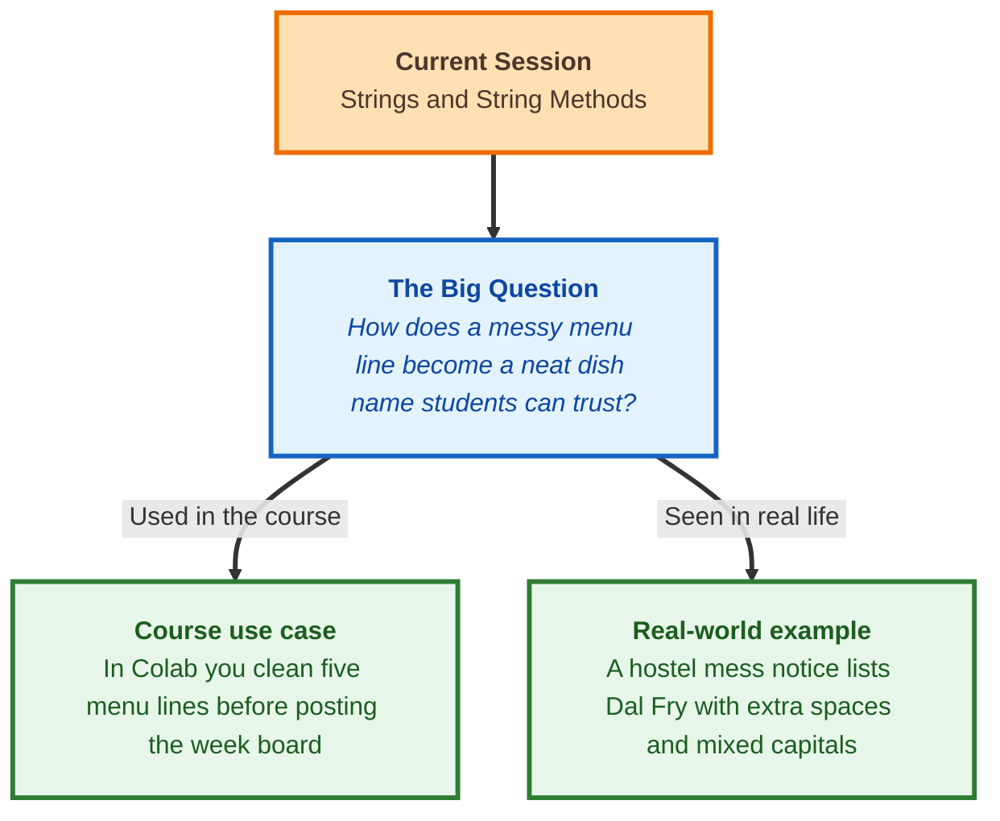

## <span style="color:#2F7DDE">Strings and String Methods</span>

### <span style="color:#2F7DDE">Mental Map</span>



---

### <span style="color:#2F7DDE">What You'll Learn</span>

Have you ever wondered why the same dish looks different when someone copies it from a chat message?

By the end of this session, you will be able to:

- <span style="color:#D9660B">**build**</span> menu text in Colab, join two dish names, and read the first and last character by position.
- <span style="color:#D9660B">**apply**</span> `strip`, `lower`, `upper`, `title`, and `replace` so a line like `  paneer  butter  MASALA  ` becomes `Paneer Butter Masala`.
- <span style="color:#D9660B">**extract**</span> the dish code `DAL-007-VEG` into category, number, and tag with slices.
- <span style="color:#D9660B">**process**</span> a short list of messy menu rows the way you did with passenger names last session.

> <span style="color:#2F7DDE">**Topics you will meet:**</span> Strings; String Methods; Text Processing.
>
> Join the session to learn each of these in detail.

---

### <span style="color:#2F7DDE">Why You Are Learning This Topic</span>

The hostel mess posts tomorrow's menu in a group chat.

One line arrives as `  jeera RICE  (jee-007-veg) ₹65 ` with extra spaces and mixed capitals.

A **string** means text Python stores in order, one character after another.

Last week you kept menu names inside **lists** in Colab. Today each list item is text you can cut, clean, and join.

> <span style="color:#2F7DDE">**Think about it:**</span> What breaks if the board shows `Jeera Rice` on Monday and `jeera RICE` on Tuesday for the same dish?

---

### <span style="color:#2F7DDE">The Mess Menu Board Puzzle</span>

| Before cleanup | After cleanup |
|:--|:--|
| `  jeera RICE  (jee-007-veg) ₹65 ` | `Jeera Rice` |
| `  PANEER  butter  MASALA  (pan-044-veg) ₹85  ` | `Paneer Butter Masala` |
| *(blank line pasted by mistake)* | *(skip — not posted)* |

<span style="color:#D9660B">**What you want to happen:**</span>

- Join lunch and dinner titles into one board line for the app.
- Pull out the dish code inside the brackets.
- Hand the kitchen a short list of tidy dish names.

Here is how it might start. You do not need to understand it yet.

```python
line = "  Dal Fry  "
print(line[0], line[-1])
print(line.strip())
```

> <span style="color:#D9660B">**Wonder about this:**</span>
>
> - Why might `line[0]` be a space, not the letter D?
> - Why does `strip()` change what you print, but `line` itself stay messy?

---

### <span style="color:#2F7DDE">Think It Through</span>

There is no wrong first try. Keep your guesses for the session.

**1. The text `menu = "Dal Fry"` holds eight characters. What position is the letter `D` when counting starts at zero?**

- A) 1
- B) 0
- C) 8
- D) 2

**2. You run `hello = "Hi"` then `hello + "!"`. What is stored in `hello` after the join?**

- A) `"Hi!"` because `+` always updates the old text
- B) `"Hi"` because joining makes a new text value
- C) `3` because Python counts characters
- D) an error because texts cannot join

**3. The text ` "  roti  " `.strip()` runs. Which part of the text changes?**

- A) only spaces at the start and end
- B) every space in the line, including between words
- C) only capital letters
- D) the whole line becomes empty

**4. A list `raw_lines` has five menu strings and one is `""`. Why might a `for` loop skip that item before posting?**

- A) empty text has no characters to clean
- B) Python cannot loop on lists
- C) strip always fails on empty text
- D) the loop must stop at three items only