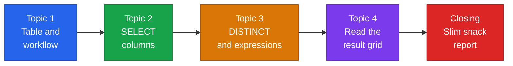
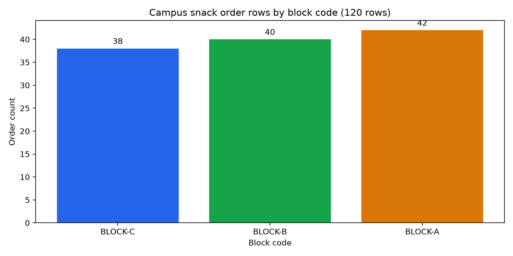
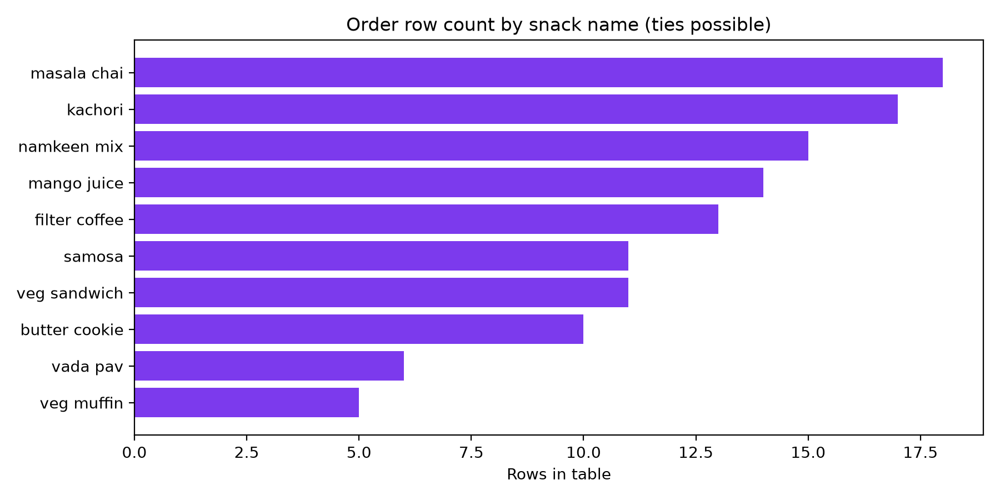
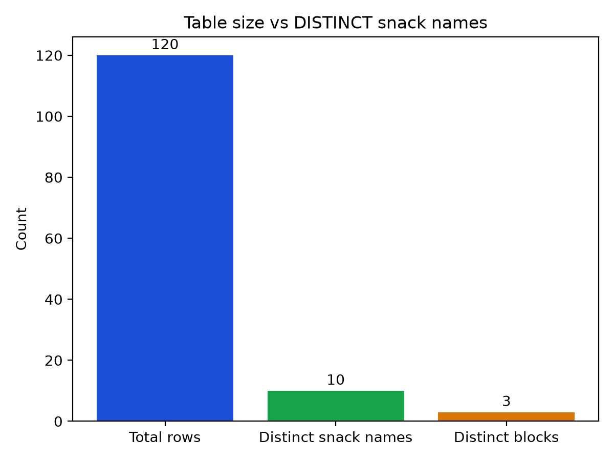
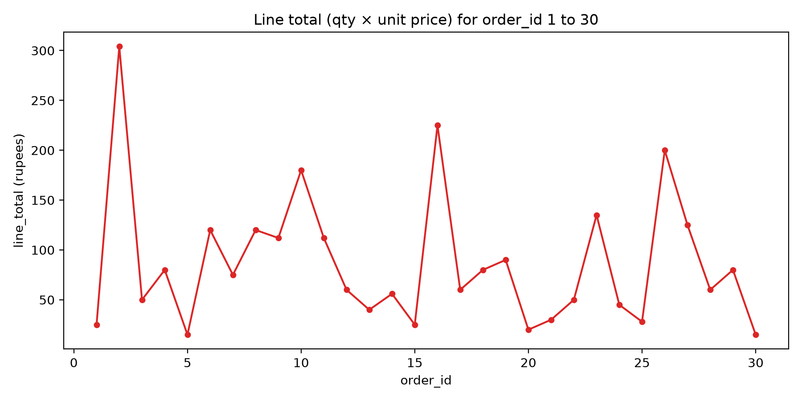
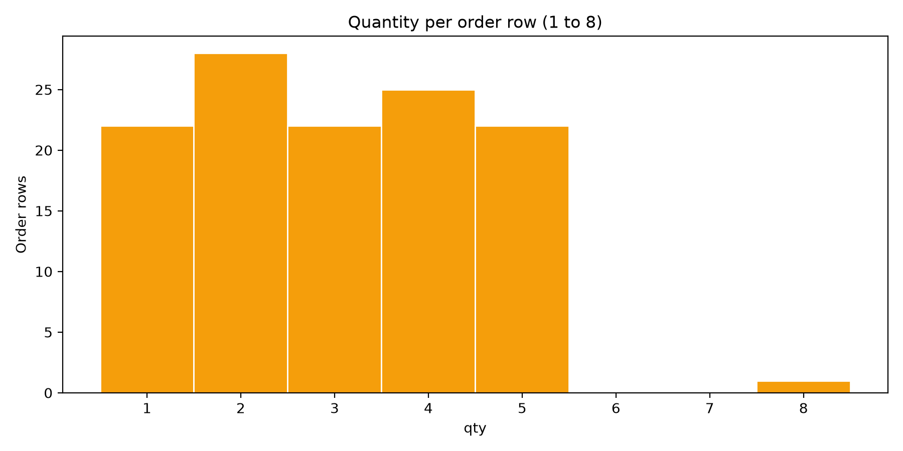
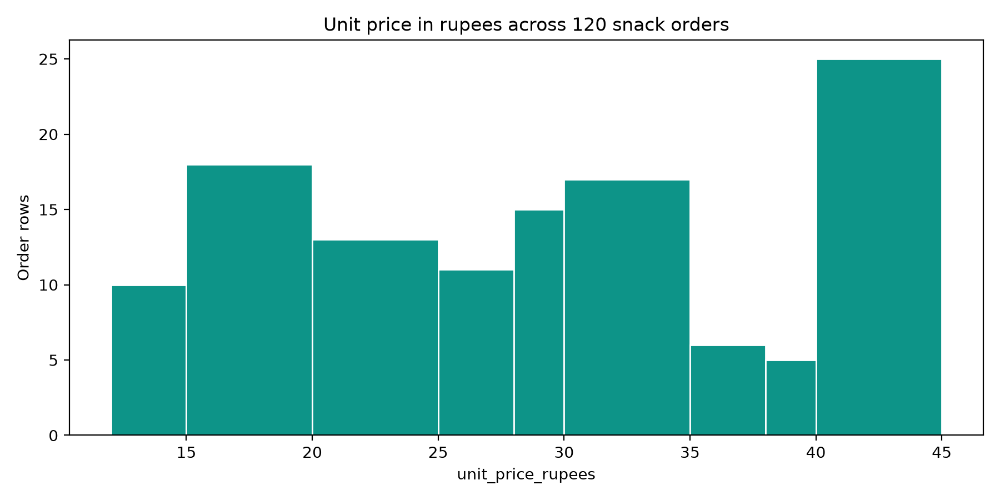

# <font color='#1d4ed8'>Lecture Script: Databases and the SQL Landscape: SELECT Basics</font>

---

## <font color='blue'>Agenda</font>

The lecture runs as four topics. Each topic ends with a quiz.

| Topic | What we do | Learning objectives covered | Minutes |
|:-:|:--|:--|:-:|
| 1 | Meet the snack order table | Explain at a high level what a relational database and a table are<br>Describe how SQL fits into the data analyst's workflow | 26 |
| 2 | Pick only the columns you need | Write SELECT queries to retrieve specific columns | 32 |
| 3 | Drop repeats and do maths in the grid | Use DISTINCT and basic expressions in a query | 32 |
| 4 | Read the orders screen calmly | Read a first result set from an orders table | 20 |
| — | Closing: Outcome & Summary | | 10 |
| | **Total** | | **120** |

> <font color="red">**🎯 Instructor Note**</font> Pace: keep Topic 1 on pictures and workflow; spend Topic 2 on column lists.
> Spend Topic 3 on `DISTINCT` and one multiply expression; Topic 4 is reading headers and rows on `campus_snack_orders`.

---

## <font color='blue'>Scenario</font>

A **Haldiram's-style** snack counter beside a coaching hostel takes block-wise orders all day. The mentor team tracks **120** invented rows in one table named `campus_snack_orders`.

| Step | What the desk does | Tool |
|:--|:--|:--|
| 1 | A plain question arrives ("Which snacks went to BLOCK-A this week?") | Chat or email |
| 2 | The analyst writes **SQL** against the snack table | **SQLite** or **MySQL Workbench** |
| 3 | The tool returns a **result set**: named columns and rows | Result grid on screen |
| 4 | The desk shares a slim grid, not a full sheet copy | Screenshot or export |

> <font color="red">**🎯 Instructor Note**</font> Haldiram's is only the setting; do not claim it uses this data. Load `data/campus_snack_orders.sql` once. Fixed review chat date: **15 March 2026**; order dates in the table are in **2025**.

---

## <font color='blue'>Problem Statement</font>

Volunteer Kavya pasted all **120** snack rows into a group chat so the block captain could check one evening order. The captain scrolled past the wrong block, missed the big **veg muffin** line (eight pieces), and queued the kitchen twice. The counter lost twenty minutes and one batch of samosas.

> <font color='purple'>**How can the desk ask the snack table for only the columns and rows it needs, without copying the whole sheet?**</font>

> <font color="red">**🎯 Instructor Note**</font> Poll: "How many different snack names sit in the 120-row table: 8, 10, or 12?" Give learners 30 seconds to respond in chat. Reveal the answer in the Closing.

---

## <font color='blue'>What We Will Use</font>

You leave Google Colab for this session. Each query runs in **SQLite** or **MySQL Workbench** on one snack **orders** table.

| Topic | Tools | In one line |
|:-:|:--|:--|
| 1 | table, row, column, schema | See how order data is stored before you query it |
| 2 | `SELECT`, column list, `ORDER BY`, `LIMIT` | Return only the fields the desk asked for |
| 3 | `DISTINCT`, `AS`, `+`, `*` | Drop repeated labels and compute a value per row |
| 4 | result grid, headers | Read labels and values without losing the question |

Load the table once: open `data/campus_snack_orders.sql` and run it. The file builds **campus_snack_orders** with six columns and **120** rows invented for teaching.

---

## <font color='blue'>How: Walking Through the Snack Counter Desk</font>



---

## <font color='blue'>Topic 1: Meet the Snack Order Table</font> `26 min`

> <font color='purple'>**Last session you cleaned and sliced text with string methods in Python. Where do many snack orders live so more than one person can query the same numbers?**</font>

In **Core Data Structures** you held one passenger name line in a **list**. A **relational database** stores many similar lines in **tables**. Each **row** is one snack order. Each **column** is one field (`snack_name`, `qty`). The **schema** is the list of column names and types.

### <font color='green'>Example: how many rows are in the table</font>

> <font color='purple'>**Does the counter table really hold 120 orders?**</font>

**Predict before running: What will happen?**

> <font color="red">**🎯 Instructor Note**</font> Expect one number, **120**. A common wrong guess is that each block has its own table.

```sql
SELECT COUNT(*) AS row_count
FROM campus_snack_orders;
```

**Output**

```
row_count
---------
120      
```

#### <font color='#c2410c'>Code Explanation</font>

- **Line 1** `COUNT(*)` counts every row in the table.
- **Line 2** `FROM campus_snack_orders` names the single orders table for this session.

```sql
PRAGMA table_info(campus_snack_orders);
```

**Output**

```
cid  name               type     notnull  dflt_value  pk
---  -----------------  -------  -------  ----------  --
0    order_id           INTEGER  0                    1 
1    snack_name         TEXT     1                    0 
2    qty                INTEGER  1                    0 
3    unit_price_rupees  INTEGER  1                    0 
4    block_code         TEXT     1                    0 
5    order_date         TEXT     1                    0 
```

#### <font color='#c2410c'>Code Explanation</font>

- **Line 1** `PRAGMA table_info` lists column names and types in **SQLite**.
- **MySQL Workbench users** run `DESCRIBE campus_snack_orders;` for the same labels.

> <font color='green'>**Result**</font> One **table** holds **120** **rows** and six **columns**. **order_id** is the primary key.

<p align="center"></p>

### <font color='green'>Extending it: how SQL fits the analyst workflow</font>

> <font color='purple'>**After the schema is clear, where does SQL sit between the question and the answer?**</font>

#### <font color='#c2410c'>Logic Explanation</font>

- **Question** — the desk writes what it needs in plain words ("snack name and qty for the first six orders").
- **SQL** — `SELECT` lists the columns; the database engine reads the table.
- **Result set** — the tool shows a grid with **headers** and **rows** you can scan or share.
- **Check** — you compare the grid to the question; if labels match, you stop re-copying the full sheet.

> <font color='green'>**Result**</font> SQL is the shared language between the question and the on-screen grid. The table on disk stays unchanged.

### <font color='purple'>Quiz 1</font>

**Question:** In a relational database, one table is best described as what?

**Options:**
- A) A folder of image files with no column names
- B) Rows and columns with a fixed schema
- C) One Python list that holds every value mixed together
- D) A single number updated by hand

**Correct Answer:** B

**Explanation:**
- **A)** Wrong — tables are not loose files; they have named columns.
- **B)** Correct — rows are records, columns are fields, and the schema names them.
- **C)** Wrong — lists are in-memory Python; the session stores orders in a table.
- **D)** Wrong — a table holds many rows, not one number.

---

## <font color='blue'>Topic 2: Pick Only the Columns You Need</font> `32 min`

> <font color='purple'>**The captain asked only for snack name and quantity. How do we avoid showing price and block on the same screen?**</font>

**SELECT** builds the result grid. The column list after **SELECT** controls which fields appear. It does not delete data from the table.

### <font color='green'>Example: two columns for the first six orders</font>

> <font color='purple'>**What are the first six snack names and quantities in order?**</font>

**Predict before running: What will happen?**

> <font color="red">**🎯 Instructor Note**</font> Expect six rows and two columns. Row 2 shows **veg muffin** with qty **8**.

```sql
SELECT snack_name, qty
FROM campus_snack_orders
ORDER BY order_id
LIMIT 6;
```

**Output**

```
snack_name     qty
-------------  ---
samosa         1  
veg muffin     8  
samosa         2  
filter coffee  4  
masala chai    1  
mango juice    3  
```

#### <font color='#c2410c'>Code Explanation</font>

- **Line 1** Lists only **snack_name** and **qty**.
- **Line 2** `FROM` names the orders table.
- **Lines 3–4** `ORDER BY order_id` fixes order; `LIMIT 6` keeps the demo short.

> <font color='green'>**Result**</font> The grid is slim. Block and price never appear because they were not selected.

### <font color='green'>Extending it: four columns the desk asked for</font>

> <font color='purple'>**The desk also needs order id, block, and unit price for the same six orders. What changes in SELECT?**</font>

```sql
SELECT order_id, snack_name, block_code, unit_price_rupees
FROM campus_snack_orders
ORDER BY order_id
LIMIT 6;
```

**Output**

```
order_id  snack_name     block_code  unit_price_rupees
--------  -------------  ----------  -----------------
1         samosa         BLOCK-C     25               
2         veg muffin     BLOCK-B     38               
3         samosa         BLOCK-C     25               
4         filter coffee  BLOCK-C     20               
5         masala chai    BLOCK-A     15               
6         mango juice    BLOCK-A     40               
```

> <font color='green'>**Result**</font> Same six orders, wider grid. Column order follows the **SELECT** list, not the table layout.

<p align="center"></p>

### <font color='green'>Extending it: wrong column name</font>

> <font color='purple'>**What happens if you misspell snack_name in SELECT?**</font>

> <font color="red">**🎯 Instructor Note**</font> Ask for a prediction first. Expect an error, not an empty grid.

```sql
SELECT snack_nam, qty
FROM campus_snack_orders;
```

**Output**

```
Error: no such column: snack_nam
```

> <font color='#b45309'>**Common mistake**</font> Picking every column with a wide export when the chat question named only two fields.

### <font color='purple'>Quiz 2</font>

**Question:** What does `SELECT snack_name, qty FROM campus_snack_orders` do?

**Options:**
- A) Deletes every other column from the table on disk
- B) Updates qty for all rows to 1
- C) Returns only `snack_name` and `qty` columns in the result grid
- D) Counts rows without showing snack names

**Correct Answer:** C

**Explanation:**
- **A)** Wrong — **SELECT** does not change stored columns.
- **B)** Wrong — there is no update clause in this query.
- **C)** Correct — the result set shows only the listed columns.
- **D)** Wrong — use `COUNT(*)` when you need a row count.

---

## <font color='blue'>Topic 3: Drop Repeats and Do Maths in the Grid</font> `32 min`

> <font color='purple'>**Samosa appears on many order rows. How do we list each snack name once for a menu check?**</font>

**DISTINCT** removes duplicate values in the **result** for the columns you list. **Expressions** combine columns with `+` or `*` and can use **AS** for a clear header.

### <font color='green'>Example: each snack name once</font>

> <font color='purple'>**How many different snack names show up when repeats are dropped?**</font>

**Predict before running: What will happen?**

> <font color="red">**🎯 Instructor Note**</font> Expect **10** snack names. Tie this to the opening poll.

```sql
SELECT DISTINCT snack_name
FROM campus_snack_orders
ORDER BY snack_name, order_id;
```

**Output**

```
snack_name   
-------------
butter cookie
filter coffee
kachori      
mango juice  
masala chai  
namkeen mix  
samosa       
vada pav     
veg muffin   
veg sandwich 
```

#### <font color='#c2410c'>Code Explanation</font>

- **Line 1** `DISTINCT` keeps one row per unique **snack_name** in the result.
- **Lines 2–3** `ORDER BY` sorts names A→Z; **order_id** breaks ties if your tool needs it.

> <font color='green'>**Result**</font> **10** snack names appear. The table still has **120** rows with repeats.

<p align="center"></p>

### <font color='green'>Extending it: line total per order</font>

> <font color='purple'>**What is the rupee line total when qty is 8 and unit price is 38?**</font>

```sql
SELECT order_id, snack_name, qty, unit_price_rupees,
       qty * unit_price_rupees AS line_total
FROM campus_snack_orders
ORDER BY order_id
LIMIT 6;
```

**Output**

```
order_id  snack_name     qty  unit_price_rupees  line_total
--------  -------------  ---  -----------------  ----------
1         samosa         1    25                 25        
2         veg muffin     8    38                 304       
3         samosa         2    25                 50        
4         filter coffee  4    20                 80        
5         masala chai    1    15                 15        
6         mango juice    3    40                 120       
```

#### <font color='#c2410c'>Code Explanation</font>

- **Lines 1–2** Multiply **qty** by **unit_price_rupees** for each row.
- **Line 2** `AS line_total` names the new column in the grid only.

> <font color='green'>**Result**</font> Order **2** shows **304** rupees without a calculator beside the sheet.

### <font color='green'>Extending it: add packing fee in the grid</font>

> <font color='purple'>**Can SELECT add five rupees packing to every unit price for display?**</font>

```sql
SELECT order_id, unit_price_rupees,
       unit_price_rupees + 5 AS price_with_packing
FROM campus_snack_orders
ORDER BY order_id
LIMIT 5;
```

**Output**

```
order_id  unit_price_rupees  price_with_packing
--------  -----------------  ------------------
1         25                 30                
2         38                 43                
3         25                 30                
4         20                 25                
5         15                 20                
```

> <font color='green'>**Result**</font> **price_with_packing** is computed per row. Stored **unit_price_rupees** stays **25**, **38**, and so on.

<p align="center"></p>

### <font color='purple'>Quiz 3</font>

**Question:** What does `SELECT DISTINCT snack_name` do?

**Options:**
- A) Shows each snack name once in the result even when many rows repeat it
- B) Deletes duplicate rows from the table on disk
- C) Sorts orders by highest unit price
- D) Adds a new snack column permanently to the schema

**Correct Answer:** A

**Explanation:**
- **A)** Correct — duplicates drop in the result grid only.
- **B)** Wrong — the table still holds all **120** rows.
- **C)** Wrong — no price column is in that query.
- **D)** Wrong — **DISTINCT** does not alter the schema.

---

## <font color='blue'>Topic 4: Read the Orders Screen Calmly</font> `20 min`

> <font color='purple'>**The grid is on screen. How do you read headers and rows without confusing order 2 with order 12?**</font>

A **result set** is the answer grid. The **header row** names each column. Each **data row** is one order. Read top to bottom along **order_id** when the desk sorted that way.

### <font color='green'>Example: first ten orders with every column</font>

> <font color='purple'>**What do the first ten snack orders look like end to end?**</font>

**Predict before running: What will happen?**

> <font color="red">**🎯 Instructor Note**</font> Point at **order_id**, **block_code**, and **order_date** while learners read.

```sql
SELECT order_id, snack_name, qty, unit_price_rupees,
       block_code, order_date
FROM campus_snack_orders
ORDER BY order_id
LIMIT 10;
```

**Output**

```
order_id  snack_name     qty  unit_price_rupees  block_code  order_date
--------  -------------  ---  -----------------  ----------  ----------
1         samosa         1    25                 BLOCK-C     2025-11-03
2         veg muffin     8    38                 BLOCK-B     2025-11-05
3         samosa         2    25                 BLOCK-C     2025-11-07
4         filter coffee  4    20                 BLOCK-C     2025-11-09
5         masala chai    1    15                 BLOCK-A     2025-11-11
6         mango juice    3    40                 BLOCK-A     2025-11-13
7         masala chai    5    15                 BLOCK-A     2025-11-15
8         kachori        4    30                 BLOCK-A     2025-11-17
9         namkeen mix    4    28                 BLOCK-B     2025-11-19
10        veg sandwich   4    45                 BLOCK-C     2025-11-21
```

#### <font color='#c2410c'>Code Explanation</font>

- **Line 1** Lists every stored column the desk needs for a first read.
- **Lines 2–4** `ORDER BY order_id` matches kitchen sequence; **LIMIT 10** keeps the screen readable.

> <font color='green'>**Result**</font> Row **2** is the heavy **veg muffin** order the captain missed in chat.

<p align="center"></p>

### <font color='green'>Extending it: three distinct blocks</font>

> <font color='purple'>**Which block codes appear at all?**</font>

```sql
SELECT DISTINCT block_code
FROM campus_snack_orders
ORDER BY block_code;
```

**Output**

```
block_code
----------
BLOCK-A   
BLOCK-B   
BLOCK-C   
```

> <font color='green'>**Result**</font> Three blocks show up. Pair this list with the **block_code** column when you read each data row.

### <font color='purple'>Quiz 4</font>

**Question:** For order_id 1, what is `qty * unit_price_rupees` in the result grid?

**Options:**
- A) 304
- B) 50
- C) 8
- D) 25

**Correct Answer:** D

**Explanation:**
- **A)** Wrong — **304** is order **2** (8 × 38).
- **B)** Wrong — **50** is order **3** (2 × 25).
- **C)** Wrong — **8** is a qty on another row, not this product.
- **D)** Correct — 1 × 25 = **25** for the first samosa row.

---

## <font color='blue'>Closing: Outcome & Summary</font> `10 min`

Kavya no longer needs to paste **120** rows into chat. She names the question, runs **SELECT** with only the needed columns, uses **DISTINCT** for menu names, adds **line_total** in the grid, and reads the header row before she calls the kitchen.

> <font color='purple'>**1. Where do the 120 snack orders live, and how does SQL fit between the question and the grid?**</font>

They live in one **relational** table, **campus_snack_orders**. SQL turns the desk question into a **result set** the tool shows on screen.

> <font color='purple'>**2. What columns prove the big muffin order without scrolling the whole sheet?**</font>

```sql
SELECT order_id, snack_name, qty, unit_price_rupees,
       qty * unit_price_rupees AS line_total
FROM campus_snack_orders
ORDER BY order_id
LIMIT 8;
```

**Output**

```
order_id  snack_name     qty  unit_price_rupees  line_total
--------  -------------  ---  -----------------  ----------
1         samosa         1    25                 25        
2         veg muffin     8    38                 304       
3         samosa         2    25                 50        
4         filter coffee  4    20                 80        
5         masala chai    1    15                 15        
6         mango juice    3    40                 120       
7         masala chai    5    15                 75        
8         kachori        4    30                 120       
```

#### <font color='#c2410c'>Code Explanation</font>

- **Lines 1–2** Topic 2 column list plus Topic 3 **line_total** expression.
- **Lines 3–4** Topic 4 sort order so row **2** is easy to spot.

<p align="center"></p>

### <font color='green'>Outcome</font>

| | Paste full sheet in chat | SQL result grid |
|:--|:-:|:-:|
| Columns shown | All six every time | Only what **SELECT** lists |
| Repeat snack names | Scrolling fatigue | **DISTINCT** menu list (**10** names) |
| Line total for veg muffin row | Manual maths | **304** in the grid |
| Block mix visible | Easy to mis-read | **42** BLOCK-A, **40** BLOCK-B, **38** BLOCK-C rows in the table |

> <font color='green'>**Therefore,**</font> the desk asks the snack **orders** table with **SELECT**, trims columns, drops duplicate names with **DISTINCT**, and reads the grid headers so the kitchen sees one correct screen instead of a noisy paste.

> <font color="red">**🎯 Instructor Note**</font> Reveal the poll: **10** distinct snack names. Row **2** is the eight-piece **veg muffin** line worth **304** rupees.

### <font color='green'>Summary</font>

| Learning objective | Takeaway |
|:--|:--|
| Explain at a high level what a relational database and a table are | Many orders sit in one table as rows and named columns |
| Describe how SQL fits into the data analyst's workflow | Question → SQL → result set → share a slim grid |
| Write SELECT queries to retrieve specific columns | List only the fields the desk asked for |
| Use DISTINCT and basic expressions in a query | Unique labels in the grid; multiply or add per row with **AS** |
| Read a first result set from an orders table | Read headers first, then each row along **order_id** |
| **Practical value** | Snack desks and sales teams query one orders table instead of re-copying wide sheets |

---

# <font color='red'>Launch the Feedback Poll</font>

> <font color="red">**🎯 Instructor Note**</font> Reminder: launch the feedback poll now to collect learner feedback.