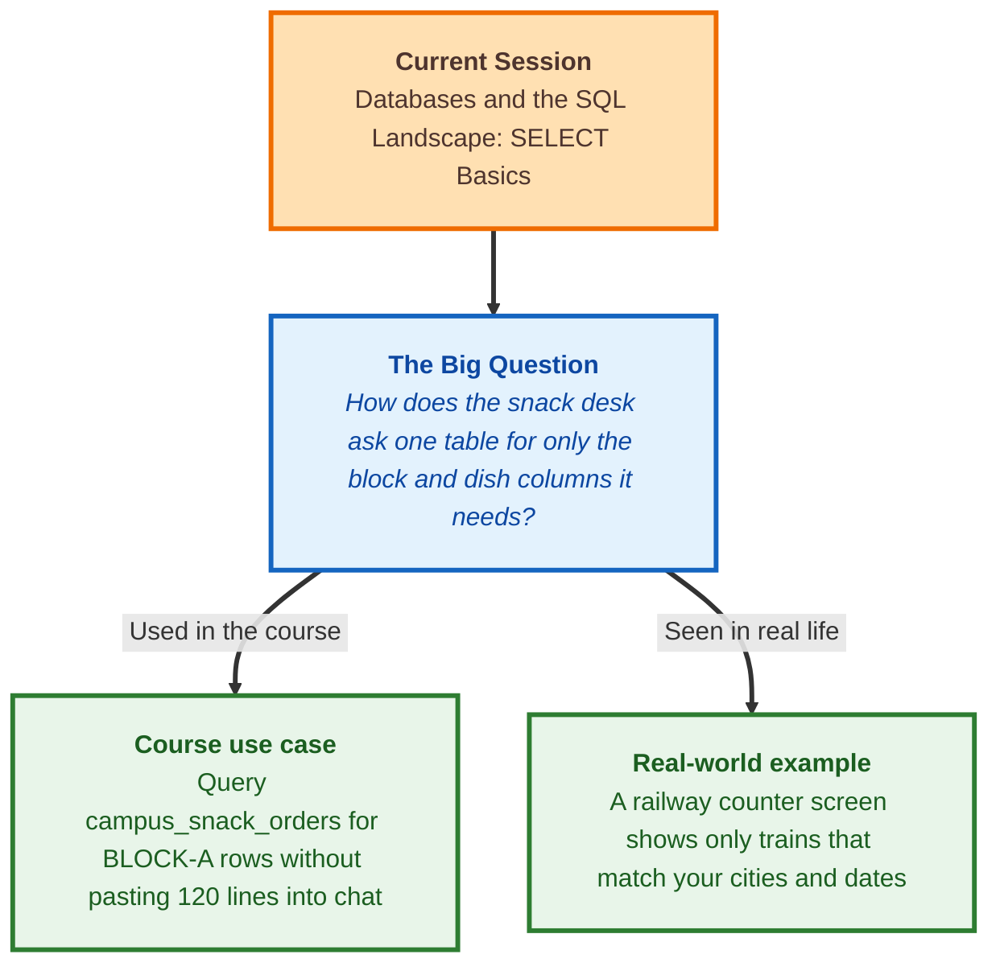

## <span style="color:#2F7DDE">Databases and the SQL Landscape: SELECT Basics</span>

### <span style="color:#2F7DDE">Mental Map</span>



---

### <span style="color:#2F7DDE">What You'll Learn</span>

Have you ever watched a block captain scroll past the wrong hostel block because the full snack sheet was too long?

By the end of this session, you will be able to:

- <span style="color:#D9660B">**explain**</span> at a high level what a relational database and a table are for the Haldiram-style snack counter.
- <span style="color:#D9660B">**describe**</span> how SQL fits between a plain question and a result grid in an analyst's day.
- <span style="color:#D9660B">**write**</span> `SELECT` queries that return only the columns the desk asked for.
- <span style="color:#D9660B">**use**</span> `DISTINCT` and a simple multiply expression in one query.
- <span style="color:#D9660B">**read**</span> column headers and row values in a first result set from `campus_snack_orders`.

> <span style="color:#2F7DDE">**Topics you will meet:**</span> Tables, rows, and columns; `SELECT`; `DISTINCT`; `AS`; basic expressions; reading a result grid.
>
> Join the session to learn each of these in detail.

---

### <span style="color:#2F7DDE">Why You Are Learning This Topic</span>

Volunteer Kavya pasted all **120** snack rows into a group chat so the block captain could check one evening order.

The captain scrolled past **BLOCK-B**, missed the big **veg muffin** line, and queued the kitchen twice.

You will leave Google Colab for this session. Each query runs in **SQLite** or **MySQL Workbench** on one teaching table loaded from `campus_snack_orders.sql`.

> <span style="color:#2F7DDE">**Think about it:**</span> What breaks if everyone copies the full sheet instead of asking the table for one block?

---

### <span style="color:#2F7DDE">The Snack Counter Desk Puzzle</span>

| Plain question | What a grid might show |
|:--|:--|
| "Which snacks went to BLOCK-A tonight?" | `block_code`, `snack_name`, `qty` only |
| "What dish names appear at least once?" | `DISTINCT snack_name` |
| "Line total if each muffin is ₹45?" | `qty * 45 AS line_total` |

<span style="color:#D9660B">**What you want to happen:**</span>

- Load **campus_snack_orders** once instead of re-pasting CSV every day.
- Return a slim grid the captain can read in one screen.
- Keep the question in mind while you read headers and numbers.

Here is how a first query might look. You do not need to understand it yet.

```sql
SELECT block_code, snack_name, qty
FROM campus_snack_orders
ORDER BY block_code
LIMIT 5;
```

> <span style="color:#D9660B">**Wonder about this:**</span>
>
> - Why does SQL list column names after `SELECT` instead of copying the whole table?
> - What is the difference between a **row** and a **column** on the result grid?

---

### <span style="color:#2F7DDE">Think It Through</span>

There is no wrong first try. Keep your guesses for the session.

**1. A relational table stores snack orders. What is one row?**

- A) one complete order line for one block and one snack
- B) the name of a single column
- C) the whole file on disk
- D) only the SQL tool window

**2. The desk wants three fields: block, snack name, and quantity. Which SQL clause picks those fields?**

- A) `WHERE`
- B) `SELECT`
- C) `FROM`
- D) `ORDER BY`

**3. Ten rows repeat the same snack name. Which keyword keeps one label per name in the result?**

- A) `LIMIT`
- B) `DISTINCT`
- C) `AS`
- D) `SELECT *`

**4. The result grid shows column titles at the top and values underneath. What should you check first?**

- A) that headers match the question you asked
- B) that the table has exactly 120 physical files
- C) that every cell is bold
- D) that Python is still running in Colab