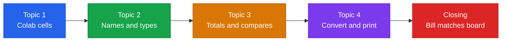

# <font color='#1d4ed8'>Lecture Script: Python and Notebooks: Variables, Data Types, and Expressions</font>

---

## <font color='blue'>Agenda</font>

The lecture runs as four topics. Each topic ends with a quiz.

| Topic | What we do | Learning objectives covered | Minutes |
|:-:|:--|:--|:-:|
| 1 | Open Colab and hand in one shared notebook | Work in a Google Colab or Jupyter notebook and share it as a deliverable | 25 |
| 2 | Name canteen values and spot each kind | Use variables and the core data types: int, float, string, and boolean | 30 |
| 3 | Multiply and compare line totals | Build expressions with arithmetic and comparison operators | 30 |
| 4 | Fix quoted cup count and trust the printout | Convert between types and avoid common beginner errors<br>Print and inspect results to check your work | 25 |
| — | Closing: Outcome & Summary | | 10 |
| | **Total** | | **120** |

> <font color="red">**🎯 Instructor Note**</font> Pace: keep Colab clicks to five minutes inside Topic 1; spend time on quoted `"3"` versus `3` in Topic 4.
> Run every code cell live; learners mirror in their own blank notebook.

---

## <font color='blue'>Scenario</font>

**Before noon:** The college canteen tablet shows Masala Dosa, 2 plates, ₹45 per plate. The slip looks fine.

**After the rush:** Tea cup count was stored as `"3"` in quotes. The tea line total looked odd and a student almost paid the wrong amount.

**Today:** You rebuild the same three lunch rows in **Google Colab** so one fix to a name or count updates every line total.

> <font color="red">**🎯 Instructor Note**</font> The campus and prices are invented for class; they are not from a real college chain.
> No `data/` upload today; rows live as named values in notebook cells. Later sessions may add a `data/` folder for larger tables.

---

## <font color='blue'>Problem Statement</font>

At the canteen counter, the cashier typed tea cup count as text `"3"` but multiplied before turning it into a whole number. The screen showed a broken line instead of ₹36. She retyped `tea_cups = 3`, fixed the total, but forgot to print all three lines together. The student at the front still could not see whether dosa, rice, and tea matched the board.

> <font color='purple'>**How do named values and expressions let Colab fix a canteen bill without redoing every step?**</font>

> <font color="red">**🎯 Instructor Note**</font> Poll: "Which value is text: `3`, `\"3\"`, or `True`?" Give learners 30 seconds to respond in chat. Reveal the answer in the Closing.

---

## <font color='blue'>What We Will Use</font>

Today you work only in **Google Colab**: a **markdown cell** for notes and a **code cell** for Python. Each code block below is one cell; click the play button or press Shift+Enter to run it.

| Topic | Tools | In one line |
|:-:|:--|:--|
| 1 | Colab code and markdown cells, Share | Run Python and save a copy you can hand in |
| 2 | `=`, names, `int`, `float`, `str`, `bool`, `type` | Store each lunch fact and see its kind |
| 3 | `*`, `+`, `>`, `<`, `==` | Build row totals and compare to a limit |
| 4 | `int`, `print`, fixing quoted numbers | Convert text to numbers and read the screen |

---

## <font color='blue'>How: Walking Through the Canteen Lunch Bill</font>



---

## <font color='blue'>Topic 1: Open Colab and Share One Notebook</font> `25 min`

> <font color='purple'>**Where do you type lunch numbers so the tablet can reuse them?**</font>

Open a new **Google Colab** notebook. Add a markdown cell with the session title and your name. Add a code cell for Python. When the meal rows run correctly, use **File → Share** so your mentor can open the same file.

### <font color='green'>Example: three named values from the dosa row</font>

> <font color='purple'>**What prints for item name, plate count, and price per plate?**</font>

A **variable** is a name with an `=` sign that holds one value. Use lowercase words with underscores between them.

**Predict before running: What will happen?**

> <font color="red">**🎯 Instructor Note**</font> Expected three lines: `Masala Dosa`, `2`, `45`. Common wrong guess: all three on one line without three `print` calls.

```python
item_name = "Masala Dosa"
plate_count = 2
price_per_plate = 45
print(item_name)
print(plate_count)
print(price_per_plate)
```

**Output**

```
Masala Dosa
2
45
```

#### <font color='#c2410c'>Code Explanation</font>

- **Lines 1 to 3** Quotes make text. Numbers without quotes are whole numbers stored under names.
- **Lines 4 to 6** Each `print` shows one value in the output area under the cell.

> <font color='green'>**Result**</font> The notebook now holds the dosa row facts the cashier would need on screen.

### <font color='green'>Extending it: text without quotes</font>

> <font color='purple'>**What happens if the item name has no quotes?**</font>

> <font color="red">**🎯 Instructor Note**</font> Ask for a prediction. Expected: `NameError`, because `Masala` is not a defined name.

```python
item_name = Masala
```

**Output**

```
Traceback (most recent call last):
  File "<cell>", line 1, in <module>
NameError: name 'Masala' is not defined
```

> <font color='green'>**Result**</font> Without quotes, Python treats `Masala` as another variable name. No such name exists, so the cell stops.

> <font color='#b45309'>**Common mistake**</font> Putting spaces inside a name. Use `item_name`, not `item name`.

### <font color='purple'>Quiz 1</font>

**Question:** Which cell do you run when you want Python to calculate tea line totals?

**Options:**
- A) A markdown cell only
- B) A code cell in Google Colab
- C) The title cell at the top of the browser tab
- D) The Share dialog with no code inside

**Correct Answer:** B

**Explanation:**
- **A)** Wrong: markdown holds notes; it does not run Python.
- **B)** Correct: only a code cell runs Python when you press play.
- **C)** Wrong: the browser tab title is not a notebook cell.
- **D)** Wrong: Share sends a link; it does not run calculations.

---

## <font color='blue'>Topic 2: Name Canteen Values and Spot Each Kind</font> `30 min`

> <font color='purple'>**The poll asked about quoted values. What kind is each lunch fact?**</font>

Each value has a **data type**. Today you meet **int** (whole number), **float** (decimal), **str** (string text), and **bool** (`True` or `False`).

### <font color='green'>Example: four kinds on one counter slip</font>

> <font color='purple'>**What four type names appear for plate count, price, item name, and student flag?**</font>

**Predict before running: What will happen?**

> <font color="red">**🎯 Instructor Note**</font> Expected four `<class '...'>` lines ending in `int`, `float`, `str`, `bool`.

```python
plate_count = 2
price_per_plate = 45.0
item_name = "Tea"
is_student_meal = True
print(type(plate_count))
print(type(price_per_plate))
print(type(item_name))
print(type(is_student_meal))
```

**Output**

```
<class 'int'>
<class 'float'>
<class 'str'>
<class 'bool'>
```

#### <font color='#c2410c'>Code Explanation</font>

- **Lines 1 to 4** Each `=` stores one value: whole number, decimal, quoted text, and a true flag.
- **Lines 5 to 8** `type(...)` reports the class name for that value.

> <font color='green'>**Result**</font> You can point at each value on the slip and name its type before doing math.

### <font color='green'>Extending it: digits still inside quotes</font>

> <font color='purple'>**The tablet shows cup count as `"3"`. Is it a whole number yet?**</font>

```python
cup_count_text = "3"
print(type(cup_count_text))
```

**Output**

```
<class 'str'>
```

> <font color='green'>**Result**</font> Digits inside quotes stay **str** until you convert them. That is why tea broke when the cashier multiplied too early.

### <font color='purple'>Quiz 2</font>

**Question:** What type does `type(45.0)` report for the price per plate?

**Options:**
- A) `<class 'int'>`
- B) `<class 'float'>`
- C) `<class 'str'>`
- D) `<class 'bool'>`

**Correct Answer:** B

**Explanation:**
- **A)** Wrong: `45.0` has a decimal point, so it is not an int.
- **B)** Correct: numbers with a decimal are float.
- **C)** Wrong: `45.0` is not inside quotes.
- **D)** Wrong: only `True` or `False` are bool.

---

## <font color='blue'>Topic 3: Build Totals and Compare to a Limit</font> `30 min`

> <font color='purple'>**How much is 2 dosa plates at ₹45, and does tea beat ₹30?**</font>

An **expression** combines values with **operators**. Use `*` and `+` for money math. Use `>` or `==` to compare a total to a limit on the board.

### <font color='green'>Example: dosa line total</font>

> <font color='purple'>**What single number prints for 2 plates times ₹45?**</font>

**Predict before running: What will happen?**

> <font color="red">**🎯 Instructor Note**</font> Expected: `90`. Common wrong guess: `245` from adding digits as text — that mistake appears in Topic 4.

```python
dosa_plates = 2
dosa_price = 45
dosa_line_total = dosa_plates * dosa_price
print(dosa_line_total)
```

**Output**

```
90
```

#### <font color='#c2410c'>Code Explanation</font>

- **Lines 1 and 2** Names hold count and unit price as whole numbers.
- **Line 3** `*` multiplies plates by price into one expression result.
- **Line 4** `print` shows the line total the student should see.

> <font color='green'>**Result**</font> Masala Dosa shows ₹90 without retyping both numbers.

### <font color='green'>Extending it: add rice and compare tea</font>

> <font color='purple'>**What is the bill so far after rice, and does ₹36 tea cross ₹30?**</font>

```python
rice_plates = 1
rice_price = 55
rice_line_total = rice_plates * rice_price
bill_so_far = dosa_line_total + rice_line_total
print(bill_so_far)
```

**Output**

```
145
```

```python
tea_cups = 3
tea_price = 12
tea_line_total = tea_cups * tea_price
print(tea_line_total)
print(tea_line_total > 30)
```

**Output**

```
36
True
```

> <font color='green'>**Result**</font> Dosa plus rice is ₹145. Tea at 3 cups is ₹36, which is greater than ₹30, so the compare line prints `True`.

### <font color='purple'>Quiz 3</font>

**Question:** Lemon Rice is 1 plate at ₹55. Which expression gives the rice line total?

**Options:**
- A) `rice_plates + rice_price`
- B) `rice_plates - rice_price`
- C) `rice_plates / rice_price`
- D) `rice_plates * rice_price`

**Correct Answer:** D

**Explanation:**
- **A)** Wrong: `+` adds count and price, which is not the line total.
- **B)** Wrong: subtraction does not model plates times price.
- **C)** Wrong: division would shrink the price, not build a row total.
- **D)** Correct: plates multiplied by price per plate matches the board.

---

## <font color='blue'>Topic 4: Convert Quoted Cup Count and Check the Printout</font> `25 min`

> <font color='purple'>**The tablet still has `"3"` for tea. How do you multiply safely and read every line?**</font>

Use `int(...)` when quoted digits must become whole numbers before `*`. Use `print` with several values so you can **check your work** against the board.

### <font color='green'>Example: fix tea cups then multiply</font>

> <font color='purple'>**What cup count and tea total print after conversion?**</font>

**Predict before running: What will happen?**

> <font color="red">**🎯 Instructor Note**</font> Expected: `3` and `36` on one line from the last `print`.

```python
tea_cups_text = "3"
tea_cups = int(tea_cups_text)
tea_price = 12
tea_line_total = tea_cups * tea_price
print(tea_cups, tea_line_total)
```

**Output**

```
3 36
```

#### <font color='#c2410c'>Code Explanation</font>

- **Line 1** Quoted `"3"` is still str on the slip photo.
- **Line 2** `int` builds a whole number you can multiply.
- **Lines 3 to 4** Price and total use numeric types only.
- **Line 5** Printing both values lets you confirm count and money together.

> <font color='green'>**Result**</font> Tea matches ₹36 once text becomes a whole number before math.

### <font color='green'>Extending it: adding text to a number</font>

> <font color='purple'>**What breaks if you add `"3"` and `12` without converting?**</font>

```python
broken_total = "3" + 12
```

**Output**

```
Traceback (most recent call last):
  File "<cell>", line 1, in <module>
TypeError: can only concatenate str (not "int") to str
```

> <font color='green'>**Result**</font> Python will not mix str and int with `+`. Convert first, then multiply or add numbers.

> <font color='#b45309'>**Common mistake**</font> Multiplying `"3" * 12` repeats text instead of charging for cups — always convert cup count before price math.

### <font color='green'>Extending it: one print line for the whole order</font>

> <font color='purple'>**Do dosa, rice, and tea totals still match 90, 55, and 36?**</font>

```python
print("Dosa", dosa_line_total, "Rice", rice_line_total, "Tea", tea_line_total)
```

**Output**

```
Dosa 90 Rice 55 Tea 36
```

> <font color='green'>**Result**</font> One print line shows every row total so you can compare the notebook to the canteen board.

### <font color='purple'>Quiz 4</font>

**Question:** Cup count is saved as `cup_count = "3"`. What is the safe next step before `cup_count * 12`?

**Options:**
- A) `cup_count = int(cup_count)`
- B) `cup_count = cup_count + 12`
- C) `cup_count = "3" * 12`
- D) `cup_count = print(cup_count)`

**Correct Answer:** A

**Explanation:**
- **A)** Correct: `int` turns quoted digits into a whole number for math.
- **B)** Wrong: you cannot add a string and an int without converting.
- **C)** Wrong: `"3" * 12` repeats characters; it is not a price total.
- **D)** Wrong: `print` shows a value; it does not convert the variable.

---

## <font color='blue'>Closing: Outcome & Summary</font> `10 min`

> <font color='purple'>**1. Which value was text in the opening poll: `3`, `\"3\"`, or `True`?**</font>

`"3"` is text (str) because of the quotes. `3` is a whole number (int). `True` is a bool flag.

> <font color='purple'>**2. Does the full lunch notebook match the board totals?**</font>

```python
print("Dosa", dosa_line_total, "Rice", rice_line_total, "Tea", tea_line_total)
```

**Output**

```
Dosa 90 Rice 55 Tea 36
```

#### <font color='#c2410c'>Code Explanation</font>

- **Line 1** Reuses totals from Topics 3 and 4 so one run proves every row.

### <font color='green'>Outcome</font>

| | Wrong slip (quoted `"3"` held for math) | Fixed Colab notebook |
|:--|:-:|:-:|
| Dosa line | ₹90 | ₹90 |
| Rice line | ₹55 | ₹55 |
| Tea line | broken or untrusted | ₹36 |
| Tea above ₹30? | unclear | Yes (`True`) |

> <font color='green'>**Therefore,**</font> named variables let you change one cup count and refresh every expression; converting quoted digits before multiply is what makes the canteen bill match the board without redoing each step by hand.

> <font color="red">**🎯 Instructor Note**</font> Reveal the poll: `"3"` was the text value. Point at the Outcome table tea column.

### <font color='green'>Summary</font>

| Learning objective | Takeaway |
|:--|:--|
| Work in a Google Colab or Jupyter notebook and share it as a deliverable | Markdown for notes, code cells for Python, Share for hand-in |
| Use variables and the core data types: int, float, string, and boolean | Names with `=` hold values; `type` shows int, float, str, bool |
| Build expressions with arithmetic and comparison operators | `*` and `+` build totals; `>` answers board limits |
| Convert between types and avoid common beginner errors | `int(...)` on quoted cup counts before price math |
| Print and inspect results to check your work | One `print` with all row totals catches mismatches fast |
| **Practical value** | Any counter tablet that stores counts as text becomes fixable once you name values, convert safely, and read the cell output |

---

# <font color='red'>Launch the Feedback Poll</font>

> <font color="red">**🎯 Instructor Note**</font> Reminder: launch the feedback poll now to collect learner feedback.