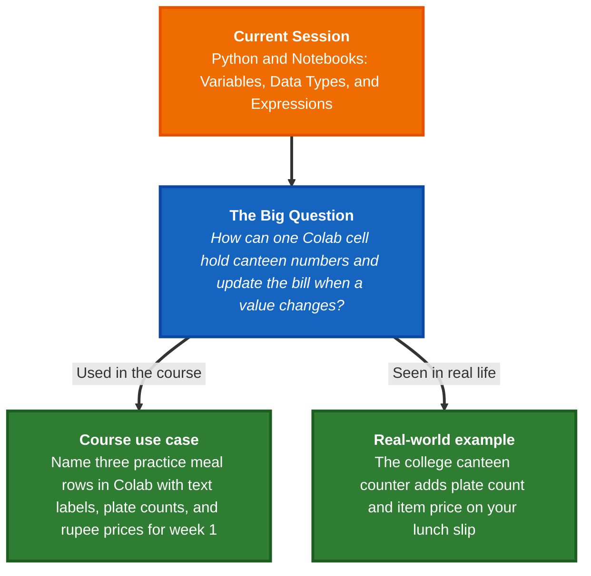

## <span style="color:#2F7DDE">Python and Notebooks: Variables, Data Types, and Expressions</span>

### <span style="color:#2F7DDE">Mental Map</span>



---

### <span style="color:#2F7DDE">What You'll Learn</span>

Have you ever wondered why the canteen bill changes when the counter fixes one number on the screen?

By the end of this session, you will be able to:

- <span style="color:#D9660B">**write**</span> a short Colab notebook with one code cell and one note cell to share.
- <span style="color:#D9660B">**identify**</span> whole numbers, decimals, quoted text, and true or false flags on one slip row.
- <span style="color:#D9660B">**calculate**</span> a line total for Masala Dosa at 45 rupees times 2 plates.
- <span style="color:#D9660B">**compare**</span> a tea line total against 30 rupees using one comparison step.
- <span style="color:#D9660B">**determine**</span> when cup count in quotes must become a whole number before you add prices.
- <span style="color:#D9660B">**check**</span> printed output so name, count, and total match what you expect.

> <span style="color:#2F7DDE">**Topics you will meet:**</span> Notebook Workflow; Google Colab; Jupyter; Variables; Data Types; Operators; Expressions.
>
> Join the session to learn each of these in detail.

---

### <span style="color:#2F7DDE">Why You Are Learning This Topic</span>

You stand at the canteen counter at noon with a tray.

The cashier types item name, plate count, and price per plate.

Yesterday tea cup count was saved as text in quotes. The screen showed a wrong line total.

Your friend fixed one value and the bill matched the board.

A **variable** means a named box in your notebook that holds one value your code can read and change.

You will use variables whenever you label rows in a course Colab sheet.

> <span style="color:#2F7DDE">**Think about it:**</span> What breaks first when cup count stays as quoted text during addition?

---

### <span style="color:#2F7DDE">The Canteen Lunch Bill Puzzle</span>

The counter tablet shows three lines for one student order.

| Item | Plates | Price per plate (₹) |
|:-----|:------:|:-------------------:|
| Masala Dosa | 2 | 45 |
| Lemon Rice | 1 | 55 |
| Tea cup | `"3"` | 12 |

<span style="color:#D9660B">**What you want to happen:**</span>

- Show 90 rupees for the dosa line without retyping both numbers.
- Answer whether the tea line crosses 30 rupees before you pay.
- Hand in one Colab file with your notes and running cells.

Here is how it might start. You do not need to understand it yet.

```python
plate_count = "3"
unit_price = 12
print(plate_count, unit_price)
```

> <span style="color:#D9660B">**Wonder about this:**</span>
>
> - Why might `"3"` and `3` behave differently when you multiply by 12?
> - What would you print first so you can trust the dosa total of 90?

---

### <span style="color:#2F7DDE">Think It Through</span>

There is no wrong first try. Keep your guesses for the session.

**1. Masala Dosa shows 2 plates at 45 rupees each. What single line total do you expect?**
Hint: Multiply count by price for one row only.

**2. Tea cup count appears as `"3"` in quotes in the table. Is that ready for multiply by 12?**
Hint: Picture text on the slip versus a counted number.

**3. Does the tea line beat 30 rupees? Which two values must your notebook hold?**
Hint: Name cup count and per-cup price from the table.

---

### <span style="color:#2F7DDE">One Question to Carry Into the Session</span>

> <span style="color:#2F7DDE">**How do named values and expressions let Colab fix a bill without redoing every step?**</span>
>
> Which row would you test first: dosa, rice, or tea?