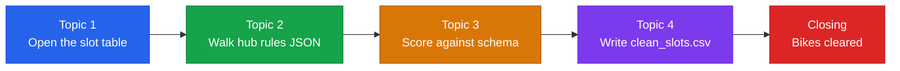
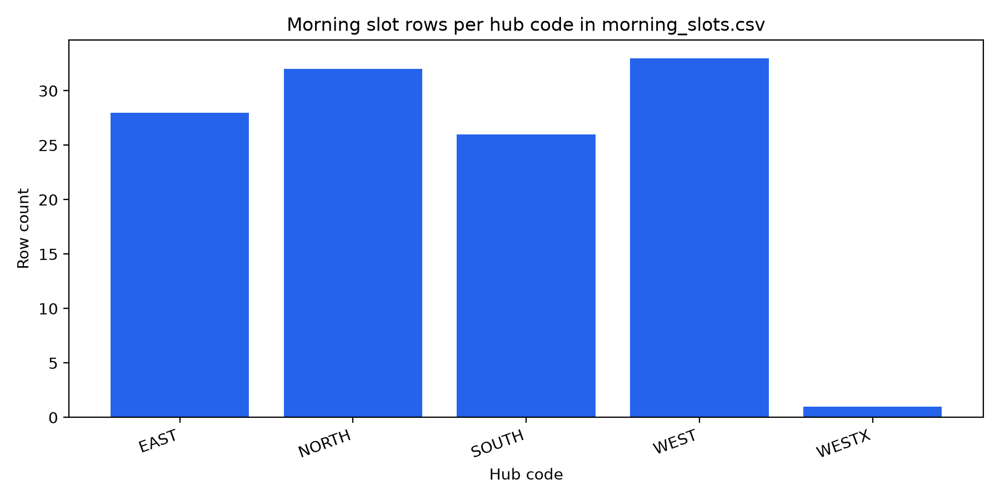
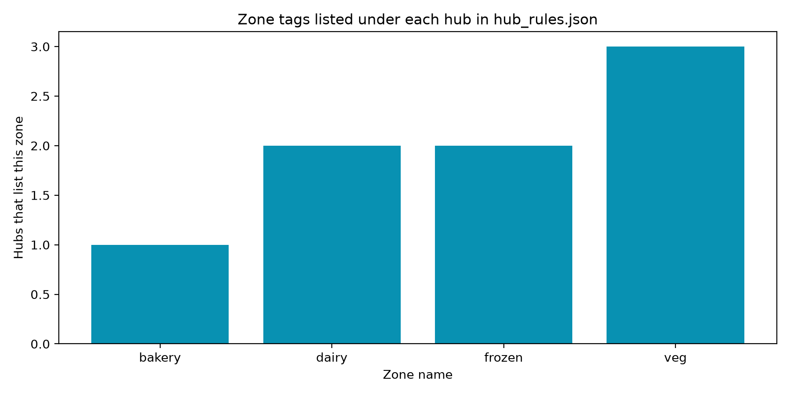
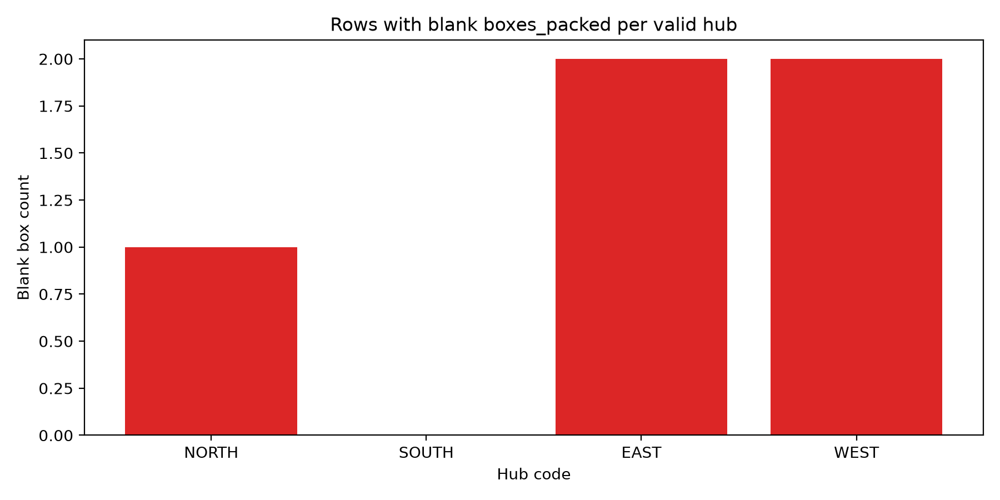
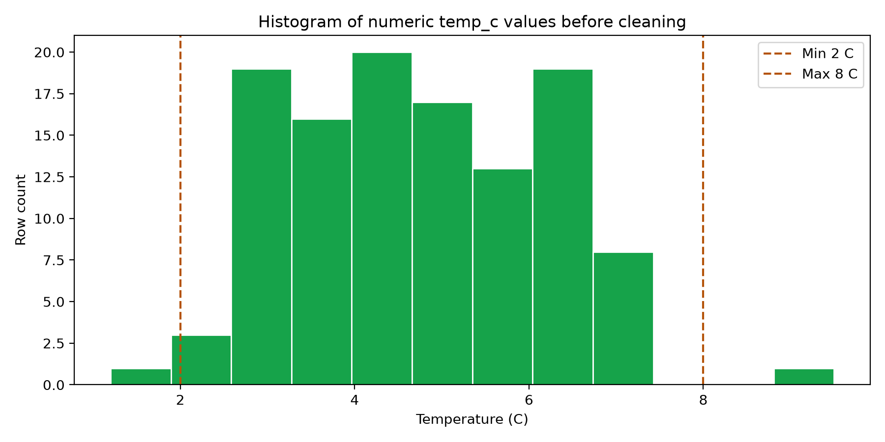
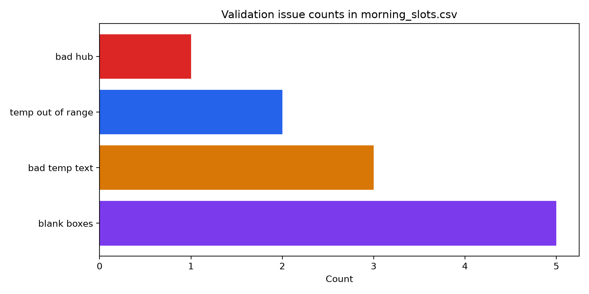
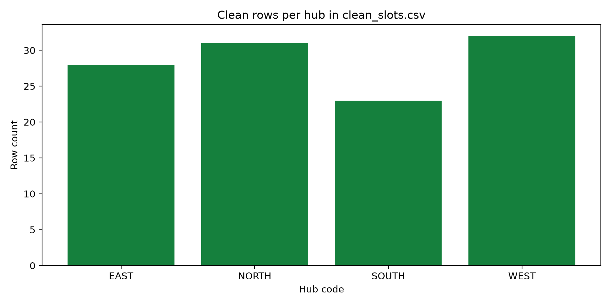

# <font color='#1d4ed8'>Lecture Script: Working with CSV and JSON</font>

---

## <font color='blue'>Agenda</font>

The lecture runs as four topics. Each topic ends with a quiz.

| Topic | What we do | Learning objectives covered | Minutes |
|:-:|:--|:--|:-:|
| 1 | Open the morning slot table | Read and write CSV files with Python and load them into usable structures | 30 |
| 2 | Walk nested hub rules | Parse JSON: navigate nested objects and arrays using dictionaries and lists<br>Explain why dictionaries are the natural shape for JSON data | 32 |
| 3 | Score the file against rules | Validate a dataset against an expected schema: columns, types, and ranges | 28 |
| 4 | Patch rows and save clean_slots.csv | Fix common issues: missing values, wrong types, and inconsistent formats | 20 |
| — | Closing: Outcome & Summary | | 10 |
| | **Total** | | **120** |

> <font color="red">**🎯 Instructor Note**</font> Pace: spend Topic 1 on `with open`, `DictReader`, and one `DictWriter` export. Spend Topic 3 on the four issue counters.
> Keep the dict-shape idea in Topic 2 short; it returns in the Closing.

---

## <font color='blue'>Scenario</font>

| What the intern opened in Colab | What the hub lead wanted on disk |
|:--|:--|
| A long pasted table of box counts and fridge temps | `data/morning_slots.csv` with **120** data rows |
| A rules summary copied from chat | `data/hub_rules.json` with nested hub settings |
| A quick sum of the `temp_c` column | `data/clean_slots.csv` after checks and fixes |

A BigBasket-style cold-chain hub must load grocery boxes into delivery bikes before **6:30 am**. One bad hub code or a warm row slows the whole lane.

> <font color="red">**🎯 Instructor Note**</font> BigBasket is only the setting; do not claim it uses this data. All rows are invented for teaching.
> **Colab setup:** upload the session `data/` folder (or a zip, then unzip) so paths like `data/morning_slots.csv` work from the notebook folder.

---

## <font color='blue'>Problem Statement</font>

Intern Kavya summed `temp_c` from a pasted table before the bikes rolled out. She missed a `WESTX` hub code, three text temps such as `warm`, and five blank box counts. The screen showed an average that looked safe, but six rows should have been held back. The lead stopped one lane and re-counted by hand.

> <font color='purple'>**How do we read morning_slots.csv and hub_rules.json in Colab, check them against the hub rules, and write clean_slots.csv before bikes leave?**</font>

> <font color="red">**🎯 Instructor Note**</font> Poll: "How many data rows are in morning_slots.csv: 60, 120, or 200?" Give learners 30 seconds to respond in chat. Reveal the answer in the Closing.

---

## <font color='blue'>What We Will Use</font>

Everything below runs in **Google Colab** code cells. Upload the session `data/` folder so paths like `data/morning_slots.csv` sit beside the notebook.

| Topic | Tools | In one line |
|:-:|:--|:--|
| 1 | `with open`, `csv.reader`, `csv.DictReader`, `csv.DictWriter` | Read and write table rows as lists or dictionaries |
| 2 | `json.load`, `json.loads`, dict keys, nested lists | Turn JSON text into Python dicts and lists you can index |
| 3 | header list, `float`, `set` of valid hubs, counters | Check columns, types, and value ranges row by row |
| 4 | `strip`, `or "0"`, `int`, date split, `writerows` | Fill blanks, drop bad rows, and normalise dates before export |

---

## <font color='blue'>How: Walking Through the Morning Hub Lane</font>



---

## <font color='blue'>Topic 1: Open the Morning Slot Table</font> `30 min`

> <font color='purple'>**The slot file is on disk now. How do we read the header, count rows, and filter one hub without repasting the table?**</font>

In **Core Data Structures** you stored keys in dictionaries and walked lists with a `for` loop. In **Functions** you wrapped repeated steps in one name. Today the same morning slots live in `data/morning_slots.csv`, and each **code cell** reads them with `open` and `csv`.

### <font color='green'>Example: read the header row and the row count</font>

> <font color='purple'>**What are the column names, how many data rows are there, and how many boxes on row SL0001?**</font>

**Predict before running: What will happen?**

> <font color="red">**🎯 Instructor Note**</font> Expected: a list of six column names, the count **120**, id **SL0001**, boxes **30**. Wrong guess: `reader` returns one big string.

```python
import csv
with open("data/morning_slots.csv", newline="", encoding="utf-8") as f:
    rows = list(csv.reader(f))
print(rows[0])
print(len(rows) - 1, rows[1][0], rows[1][3])
```

**Output**

```
['slot_id', 'hub_code', 'item_name', 'boxes_packed', 'temp_c', 'packed_on']
120 SL0001 30
```

#### <font color='#c2410c'>Code Explanation</font>

- **Lines 2 to 3** `with open(...)` opens the CSV and closes it when the block ends. `csv.reader` yields each line as a list of fields.
- **Line 4** prints the header list from row 0.
- **Line 5** subtracts one for the header, then prints id, slot id, and the boxes field.

> <font color='green'>**Result**</font> The table has six columns and **120** data rows; the poll answer is **120**, not 60 or 200.

<p align="center"></p>

### <font color='green'>Extending it: filter NORTH rows with DictReader</font>

> <font color='purple'>**How many NORTH hub rows are there, and what item sits on SL0001?**</font>

```python
import csv
north = 0
with open("data/morning_slots.csv", newline="", encoding="utf-8") as f:
    for row in csv.DictReader(f):
        if row["hub_code"] == "NORTH":
            north += 1
with open("data/morning_slots.csv", newline="", encoding="utf-8") as g:
    first = next(csv.DictReader(g))
print(north, first["slot_id"], first["item_name"])
```

**Output**

```
32 SL0001 Onion 1kg
```

#### <font color='#c2410c'>Code Explanation</font>

- **Lines 3 to 5** `DictReader` uses the header as keys, so `row["hub_code"]` is readable inside the loop.
- **Lines 6 to 7** reopen the file for the first data row as a dictionary.
- **Line 8** prints the NORTH count, first id, and item name.

> <font color='green'>**Result**</font> Thirty-two rows target the NORTH hub; dictionaries match how you labeled records last session.

### <font color='green'>Extending it: write EAST rows with boxes to east_export.csv</font>

> <font color='purple'>**How many EAST rows have a non-blank box count, and which slot id is first in the export?**</font>

```python
import csv
export = []
with open("data/morning_slots.csv", newline="", encoding="utf-8") as f:
    for r in csv.DictReader(f):
        if r["hub_code"] == "EAST" and r["boxes_packed"].strip():
            export.append({"slot_id": r["slot_id"], "item_name": r["item_name"], "boxes_packed": r["boxes_packed"]})
with open("data/east_export.csv", "w", newline="", encoding="utf-8") as g:
    w = csv.DictWriter(g, fieldnames=["slot_id", "item_name", "boxes_packed"])
    w.writeheader(); w.writerows(export); print(len(export), export[0]["slot_id"])
```

**Output**

```
26 SL0004
```

#### <font color='#c2410c'>Code Explanation</font>

- **Lines 3 to 6** build `export`, a list of dictionaries for EAST rows with a box count present.
- **Lines 7 to 9** `DictWriter` writes the header once, then each record to a new file.

> <font color='green'>**Result**</font> Twenty-six EAST rows with boxes land in `data/east_export.csv` for the lead bike list.

> <font color='#b45309'>**Common mistake**</font> Forgetting `newline=""` on CSV files can add extra blank lines on some systems.

### <font color='purple'>Quiz 1</font>

**Question:** Why use `with open(...) as f` when reading `morning_slots.csv`?

**Options:**
- A) The file handle closes when the block ends, even if the cell errors
- B) It converts CSV into JSON automatically
- C) It forces every field to become an integer
- D) It only works on Colab, not on a laptop

**Correct Answer:** A

**Explanation:**
- **A)** Correct: the context manager closes the file for you.
- **B)** Wrong: you still pick `csv.reader` or `DictReader`.
- **C)** Wrong: all fields start as strings from the file.
- **D)** Wrong: `with open` works anywhere Python runs.

---

## <font color='blue'>Topic 2: Walk Nested Hub Rules</font> `32 min`

> <font color='purple'>**Rules for each hub sit in hub_rules.json. How do we load nested dicts and lists the same way we parsed JSON strings last time?**</font>

You already turned JSON text into dicts with `json.loads` when the payload was pasted in a cell. On disk, `json.load` reads the same shape from a file object.

### <font color='green'>Example: load hub_rules.json</font>

> <font color='purple'>**What schema version is in the file, who leads NORTH, and what is the max temp in Celsius?**</font>

**Predict before running: What will happen?**

> <font color="red">**🎯 Instructor Note**</font> Expected: version **2**, lead **Meera**, max **8.0**. Wrong guess: `max_c` prints as text with quotes.

```python
import json
with open("data/hub_rules.json", encoding="utf-8") as f:
    rules = json.load(f)
print(rules["schema_version"], rules["hubs"]["NORTH"]["lead"], rules["hubs"]["NORTH"]["temp_range"]["max_c"])
```

**Output**

```
2 Meera 8.0
```

#### <font color='#c2410c'>Code Explanation</font>

- **Lines 2 to 3** `json.load(f)` reads the whole file and returns a Python dictionary.
- **Line 4** walks nested keys: top-level `hubs`, then `NORTH`, then `temp_range`.

> <font color='green'>**Result**</font> Nested JSON maps cleanly to chained dict keys, just like the booking records you built last session.

### <font color='green'>Extending it: read the sample_slots list inside the file</font>

> <font color='purple'>**How many sample slots are listed, and how many boxes on SL0001 in that list?**</font>

```python
import json
with open("data/hub_rules.json", encoding="utf-8") as f:
    rules = json.load(f)
sample = rules["sample_slots"]
print(len(sample), sample[0]["slot_id"], sample[1]["boxes_packed"])
```

**Output**

```
2 SL0001 30
```

#### <font color='#c2410c'>Code Explanation</font>

- **Line 4** `sample_slots` is a list of dictionaries inside the root dict.
- **Line 5** indexes list position 0 and 1, then reads keys `slot_id` and `boxes_packed`.

> <font color='green'>**Result**</font> JSON arrays become Python lists; each slot object is another dictionary.

<p align="center"></p>

### <font color='green'>Extending it: parse one row with json.loads on a string</font>

> <font color='purple'>**A bike scanner sends one JSON line as text. What hub code and Python type is temp_c?**</font>

```python
import json
snippet = '{"hub_code":"NORTH","temp_c":6.1,"ok":true}'
row = json.loads(snippet)
print(row["hub_code"], type(row["temp_c"]), row["ok"])
```

**Output**

```
NORTH <class 'float'> True
```

#### <font color='#c2410c'>Code Explanation</font>

- **Line 2** holds JSON as a string variable in the notebook.
- **Line 3** `json.loads` parses that string into a dict without a file path.

> <font color='green'>**Result**</font> The same `json` module parses strings from chat and files on disk.

### <font color='green'>Extending it: why dictionaries match JSON objects</font>

> <font color='purple'>**When JSON shows `"zones": ["veg", "bakery"]`, what Python types do you get?**</font>

#### Logic Explanation

- A JSON **object** uses curly braces and `key: value` pairs; Python stores that as a **dictionary** with the same keys.
- A JSON **array** uses square brackets; Python stores that as a **list** you can loop with `for`.
- Numbers and `true`/`false` become Python `int`/`float` and `bool`, so range checks in Topic 3 use normal comparisons.

```python
import json
with open("data/hub_rules.json", encoding="utf-8") as f:
    rules = json.load(f)
print(rules["hubs"]["SOUTH"]["zones"], type(rules["required_columns"]))
```

**Output**

```
['veg', 'bakery'] <class 'list'>
```

> <font color='green'>**Result**</font> You rarely need a new type when JSON arrives: dict plus list plus basic values is enough for this hub file.

### <font color='purple'>Quiz 2</font>

**Question:** What is the difference between `json.loads` and `json.load` in this session?

**Options:**
- A) `loads` reads a file path string; `load` reads a Colab path only
- B) `loads` parses a string already in memory; `load` parses from an open file object
- C) Both require the `pandas` library
- D) `loads` returns a list only; `load` returns a dict only

**Correct Answer:** B

**Explanation:**
- **A)** Wrong: the roles are the other way around.
- **B)** Correct: `load(f)` reads JSON text from the file handle `f`.
- **C)** Wrong: both live in the standard library `json` module.
- **D)** Wrong: either call can return dicts, lists, numbers, or booleans.

---

## <font color='blue'>Topic 3: Score the File Against Rules</font> `28 min`

> <font color='purple'>**How do we prove morning_slots.csv matches the columns and value rules before we write clean_slots.csv?**</font>

The schema list lives in `hub_rules.json`. Validation means checking the header, then each row for blank boxes, numeric temps between 2 and 8 °C, and hub codes the rules recognise.

### <font color='green'>Example: match the header to the schema list</font>

> <font color='purple'>**Do the CSV column names match the required_columns list in hub_rules.json?**</font>

**Predict before running: What will happen?**

> <font color="red">**🎯 Instructor Note**</font> Expected: **True**. Wrong guess: Colab invents extra column names on its own.

```python
import csv, json
with open("data/hub_rules.json", encoding="utf-8") as f: rules = json.load(f)
with open("data/morning_slots.csv", newline="", encoding="utf-8") as f:
    rd = csv.DictReader(f)
    print(rd.fieldnames == rules["required_columns"])
```

**Output**

```
True
```

#### <font color='#c2410c'>Code Explanation</font>

- **Lines 2 to 3** load the schema list from JSON and open the CSV once.
- **Line 5** compares header names from `DictReader` to the rule list.

> <font color='green'>**Result**</font> The file already uses the six expected column names.

### <font color='green'>Extending it: count the four issue types</font>

> <font color='purple'>**How many rows hit each issue bucket for blanks, text temps, range, and hub codes?**</font>

```python
import csv, json
with open("data/hub_rules.json", encoding="utf-8") as f: rules = json.load(f); valid, lo, hi = set(rules["hubs"]), 2.0, 8.0
with open("data/morning_slots.csv", newline="", encoding="utf-8") as f:
    bad = dict(blank=0, text=0, range=0, hub=0)
    for row in csv.DictReader(f):
        if not row["boxes_packed"].strip(): bad["blank"] += 1
        try: t = float(row["temp_c"]); bad["range"] += t < lo or t > hi
        except ValueError: bad["text"] += 1
        bad["hub"] += row["hub_code"] not in valid
print(bad)
```

**Output**

```
{'blank': 5, 'text': 3, 'range': 2, 'hub': 1}
```

> <font color='green'>**Result**</font> Eleven separate row issues are flagged across four buckets before any fixes run.

<p align="center"></p>
<p align="center"></p>
<p align="center"></p>

### <font color='green'>Extending it: prove the range rule on one known row</font>

> <font color='purple'>**Row SL0033 has temp 9.5. Does it fail the 2 to 8 rule?**</font>

```python
import csv
with open("data/morning_slots.csv", newline="", encoding="utf-8") as f:
    for row in csv.DictReader(f):
        if row["slot_id"] == "SL0033":
            t = float(row["temp_c"]); print(row["slot_id"], t, t > 8.0)
```

**Output**

```
SL0033 9.5 True
```

> <font color='green'>**Result**</font> One out-of-range temperature is enough to hold that slot back, even when the hub code is valid.

### <font color='purple'>Quiz 3</font>

**Question:** Which step checks the **type** of values in the `temp_c` column?

**Options:**
- A) Sort rows by `slot_id` only
- B) Print the header row once
- C) Call `json.dump` on the CSV file
- D) Use `float(row["temp_c"])` in a `try` block and count `ValueError` rows

**Correct Answer:** D

**Explanation:**
- **A)** Wrong: sorting does not check types.
- **B)** Wrong: the header is text, not row types.
- **C)** Wrong: `json.dump` writes JSON, not CSV validation.
- **D)** Correct: `float` fails on text like `warm`, which you count as type errors.

---

## <font color='blue'>Topic 4: Patch Rows and Save clean_slots.csv</font> `20 min`

> <font color='purple'>**After validation, how do we fill blank boxes, fix dates, and drop rows we cannot trust?**</font>

Valid hub codes are `NORTH`, `SOUTH`, `EAST`, and `WEST`. Dates like `18-03-2026` should become `2026-03-18` before export.

### <font color='green'>Example: flip one day-month-year date</font>

> <font color='purple'>**What ISO-style string should replace 18-03-2026?**</font>

**Predict before running: What will happen?**

> <font color="red">**🎯 Instructor Note**</font> Expected: `2026-03-18`. Wrong guess: the string stays in day-month-year order.

```python
bad = "18-03-2026"
d, m, y = bad.split("-")
fixed = f"{y}-{m}-{d}"
print(bad, fixed)
```

**Output**

```
18-03-2026 2026-03-18
```

#### <font color='#c2410c'>Code Explanation</font>

- **Lines 2 to 3** split on `-` and rebuild year-month-day, the same order used in most hub logs.

> <font color='green'>**Result**</font> Three dates in the morning file use this pattern and need the same fix before bikes load.

### <font color='green'>Extending it: treat blank boxes as zero</font>

> <font color='purple'>**What integer should a blank boxes field become for counting?**</font>

```python
boxes = ""
filled = int(boxes.strip() or "0")
print(repr(boxes), filled)
```

**Output**

```
'' 0
```

> <font color='green'>**Result**</font> Five blank box cells become zero so the row can stay when temp and hub are valid.

### <font color='green'>Extending it: build the clean list in memory</font>

> <font color='purple'>**How many rows survive filters, and what packed_on value sits on the first kept row?**</font>

```python
import csv
clean, okh = [], {"NORTH", "SOUTH", "EAST", "WEST"}
with open("data/morning_slots.csv", newline="", encoding="utf-8") as f:
    for row in csv.DictReader(f):
        try: t = float(row["temp_c"])
        except ValueError: continue
        if row["hub_code"] not in okh or not 2 <= t <= 8: continue
        p = row["packed_on"].split("-"); d = f"{p[2]}-{p[1]}-{p[0]}" if len(p[0]) == 2 else row["packed_on"]
        clean.append({"slot_id": row["slot_id"], "hub_code": row["hub_code"], "item_name": row["item_name"], "boxes_packed": int(row["boxes_packed"].strip() or "0"), "temp_c": t, "packed_on": d})
print(len(clean), clean[0]["packed_on"])
```

**Output**

```
114 2026-03-11
```

> <font color='green'>**Result**</font> **114** rows pass all gates; six rows with bad temps, one bad hub, or both stay out of `clean`.

### <font color='green'>Extending it: write clean_slots.csv from the list</font>

> <font color='purple'>**Does the file on disk match the list length?**</font>

```python
import csv
fn = ["slot_id", "hub_code", "item_name", "boxes_packed", "temp_c", "packed_on"]
with open("data/clean_slots.csv", "w", newline="", encoding="utf-8") as g:
    w = csv.DictWriter(g, fieldnames=fn); w.writeheader(); w.writerows(clean)
print("wrote", len(clean))
```

**Output**

```
wrote 114
```

> <font color='green'>**Result**</font> The bike-load file on disk has the same **114** rows as the list in memory.

<p align="center"></p>

> <font color='#b45309'>**Common mistake**</font> Writing every row without `continue` on text temps sends `warm` into the load list.

### <font color='purple'>Quiz 4</font>

**Question:** A row has temp text `warm`. What should you do when building `clean_slots.csv`?

**Options:**
- A) Write `warm` to the export file
- B) Replace `warm` with 6.0 without checking the sensor
- C) Skip the row using `continue` when `float` raises `ValueError`
- D) Delete `hub_rules.json` so no rules remain

**Correct Answer:** C

**Explanation:**
- **A)** Wrong: text temps should not reach the bike load list.
- **B)** Wrong: guessing a number hides the sensor fault.
- **C)** Correct: `continue` drops rows that cannot become floats.
- **D)** Wrong: the rules file defines valid hubs and columns.

---

## <font color='blue'>Closing: Outcome & Summary</font> `10 min`

Kavya moved from pasted tables to a `data/` folder on Colab. Topic 1 read and wrote CSV rows. Topic 2 walked nested JSON. Topic 3 counted schema issues. Topic 4 saved `clean_slots.csv` bikes can trust.

> <font color='purple'>**1. Did we answer how to read, check, fix, and save before bikes leave?**</font>

Yes. `morning_slots.csv` gave **120** data rows, `hub_rules.json` gave schema and hub ranges, validation found five blank boxes and six drop-worthy temp or hub issues, and the clean export kept **114** rows.

> <font color='purple'>**2. How many rows sit in the final clean file?**</font>

```python
import csv
with open("data/clean_slots.csv", newline="", encoding="utf-8") as f:
    n = sum(1 for _ in csv.DictReader(f))
print("clean rows:", n)
```

**Output**

```
clean rows: 114
```

#### <font color='#c2410c'>Code Explanation</font>

- **Lines 2 to 4** re-read Topic 4's export to confirm the bike-load count.

### <font color='green'>Outcome</font>

| | Pasted table in a cell | Files in data/ |
|:--|:-:|:-:|
| Row count the lead trusts | Easy to miscount | **120** in `morning_slots.csv` |
| Hub rules | Scattered in chat | Nested dict in `hub_rules.json` |
| Rows bikes can load | Unknown until manual scan | **114** in `clean_slots.csv` |
| Poll on row count | Guesses stick | Answer **120** data rows |

> <font color='green'>**Therefore,**</font> upload `data/` to Colab, validate against the JSON schema list, fix blanks and dates, drop bad temps and hub codes, then hand bikes `clean_slots.csv`—not a fresh paste from chat.

> <font color="red">**🎯 Instructor Note**</font> Reveal the poll answer: **120** data rows in `morning_slots.csv` (plus one header line).

### <font color='green'>Summary</font>

| Learning objective | Takeaway |
|:--|:--|
| Read and write CSV files with Python and load them into usable structures | `csv.reader` and `DictWriter` turn disk tables into lists and dicts |
| Parse JSON: navigate nested objects and arrays using dictionaries and lists | `json.load` and chained keys read hubs, ranges, and sample lists |
| Validate a dataset against an expected schema: columns, types, and ranges | Match `fieldnames` to `required_columns` and count blank, text, range, and hub issues |
| Fix common issues: missing values, wrong types, and inconsistent formats | `or "0"`, `float` checks, date flips, and `continue` build `clean_slots.csv` |
| Explain why dictionaries are the natural shape for JSON data | JSON objects and arrays map to dicts and lists without extra types |
| **Practical value** | Morning ops files from email or dashboards become checks you can rerun in one notebook |

---

# <font color='red'>Launch the Feedback Poll</font>

> <font color="red">**🎯 Instructor Note**</font> Reminder: launch the feedback poll now to collect learner feedback.