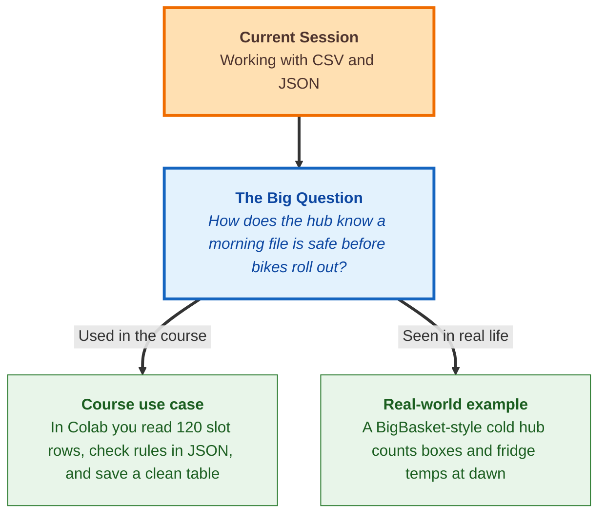

## <span style="color:#2F7DDE">Working with CSV and JSON</span>

### <span style="color:#2F7DDE">Mental Map</span>



---

### <span style="color:#2F7DDE">What You'll Learn</span>

Have you ever wondered how a morning grocery list stays correct when one fridge reading says `warm` instead of a number?

By the end of this session, you will be able to:

- <span style="color:#D9660B">**Open**</span> a **CSV** table file and turn each row into Python lists or dictionaries.
- <span style="color:#D9660B">**Read**</span> **JSON** rules with nested hubs and temperature limits.
- <span style="color:#D9660B">**Check**</span> column names, value types, and safe temperature ranges against those rules.
- <span style="color:#D9660B">**Fix**</span> blank box counts, bad temps, and mixed date shapes before bikes leave.

> <span style="color:#2F7DDE">**Topics you will meet:**</span> CSV; JSON; Schema Validation; Data Formats.
>
> Join the session to learn each of these in detail.

---

### <span style="color:#2F7DDE">Why You Are Learning This Topic</span>

At dawn, a grocery hub loads milk and vegetables into bikes.

The lead wants one **CSV** file with box counts and fridge temps.

She also keeps a **JSON** file with rules for each hub.

Last week an intern pasted the table into chat, missed a blank box count, and one lane almost shipped warm milk.

A <span style="color:#D9660B">**CSV**</span> means a comma-separated table saved as a file.

A <span style="color:#D9660B">**JSON**</span> file looks like nested dictionaries and lists you have already met in Python.

In this course you will upload both files to **Google Colab** and check them before you save a clean copy.

> <span style="color:#2F7DDE">**Think about it:**</span> What should happen to a row whose temp field says `warm` instead of a number?

---

### <span style="color:#2F7DDE">The Morning Slot Puzzle</span>

Three rows from the invented morning file.

| Slot | Hub | Boxes | Temp |
|:---:|:---:|:-----:|:----:|
| SL0001 | NORTH | 30 | 3.7 |
| SL0012 | EAST | (blank) | warm |
| SL0033 | SOUTH | 18 | 9.5 |

<span style="color:#D9660B">**What you want to happen:**</span>

- Read all **120** rows without retyping the table.
- Load hub rules from JSON and see allowed temps **2** to **8**.
- Drop or fix rows that break those rules before bikes move.

> <span style="color:#D9660B">**Wonder about this:**</span>
>
> - Which row has a type problem instead of a missing box count?
> - Why might a hub lead trust a saved file more than a pasted table?

```python
import json
snippet = '{"hub_code": "NORTH", "temp_c": 6.1, "ok": true}'
row = json.loads(snippet)
print(row["hub_code"], type(row["temp_c"]))
```

---

### <span style="color:#2F7DDE">Think It Through</span>

There is no wrong first try. Keep your guesses for the session.

**1. Row SL0012 has temp text `warm`. Should that row go into the bike load list?**
Hint: Can you do a greater-than check on the word `warm`?

**2. Row SL0001 has hub NORTH. Where might the max allowed temp live in a JSON rules file?**
Hint: Think nested dictionaries, not a single flat list.

**3. Why save a new `clean_slots.csv` instead of editing the old file by hand?**
Hint: Picture rerunning the same check tomorrow morning.

---

### <span style="color:#2F7DDE">One Question to Carry Into the Session</span>

> <span style="color:#2F7DDE">**How do we read morning_slots.csv and hub_rules.json in Colab, check them against the hub rules, and write clean_slots.csv before bikes leave?**</span>
>
> Bring one guess about how many rows you think pass every check on the first run.