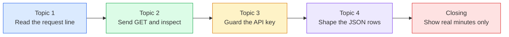
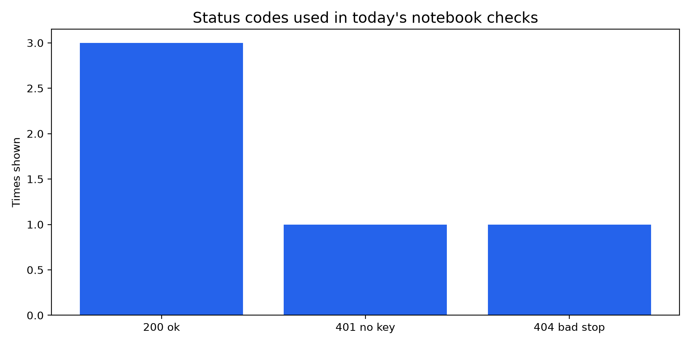
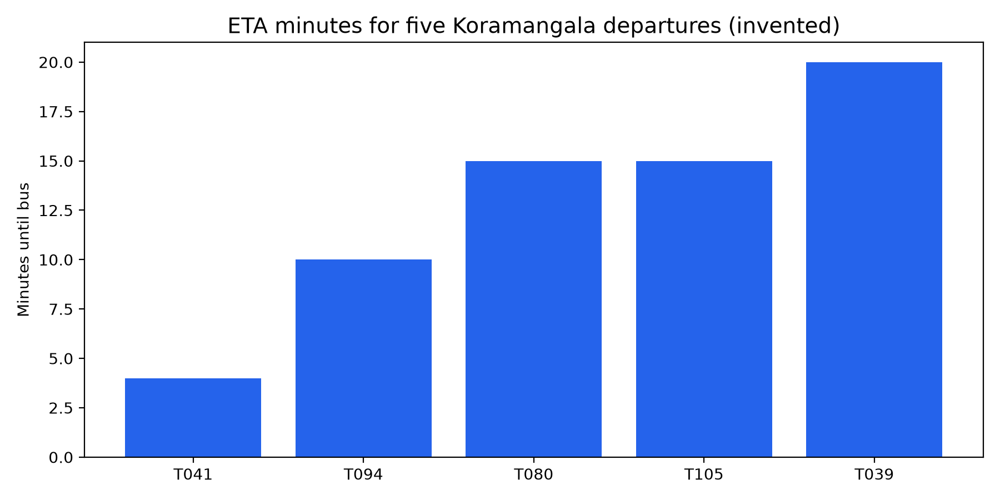
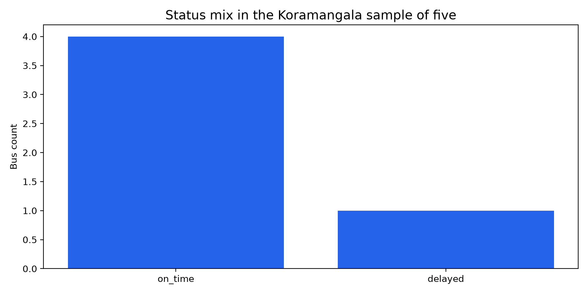
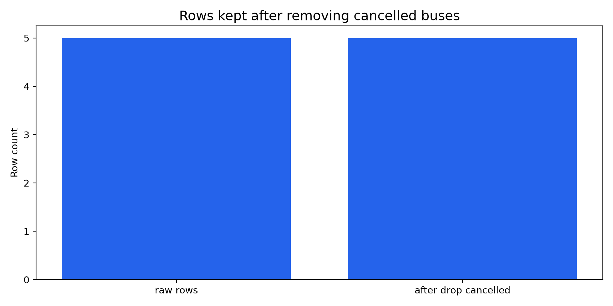
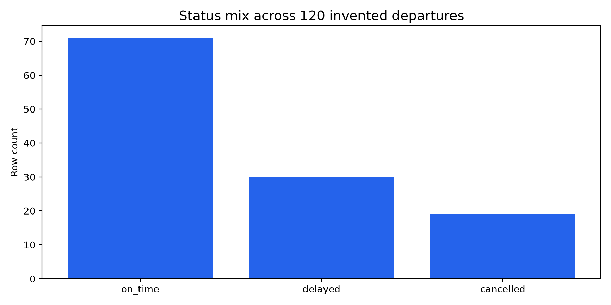
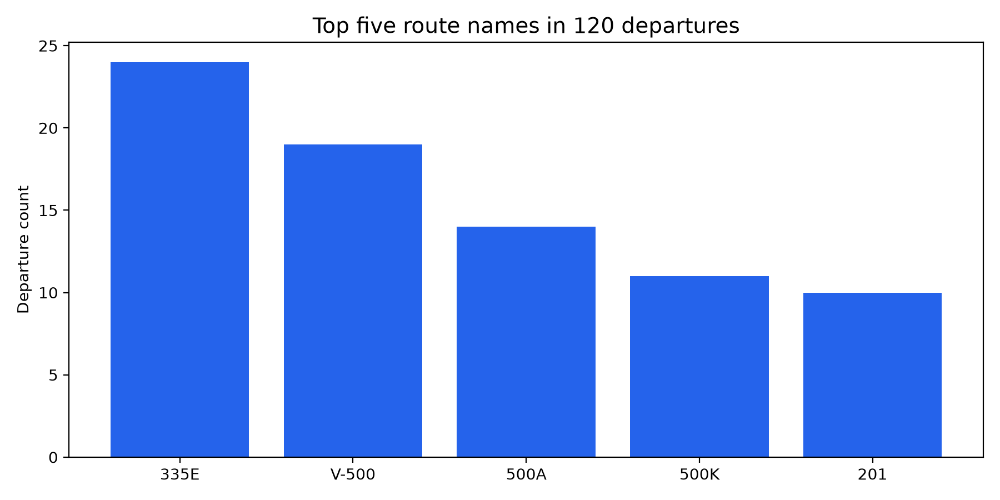

# <font color='#1d4ed8'>Lecture Script: APIs and REST: Fetching Real-World Data</font>

---

## <font color='blue'>Agenda</font>

The lecture runs as four topics. Each topic ends with a quiz.

| Topic | What we do | Learning objectives covered | Minutes |
|:-:|:--|:--|:-:|
| 1 | Read the request line | Explain how a client requests data from a web service with HTTP methods<br>Read the request-response cycle: URLs, parameters, and status codes | 30 |
| 2 | Send GET and inspect | Make GET requests from Python and inspect the response | 32 |
| 3 | Guard the API key | Authenticate a request with an API key and keep the key out of shared notebooks | 28 |
| 4 | Shape the JSON rows | Convert a JSON API response into a usable dataset | 20 |
| — | Closing: Outcome & Summary | | 10 |
| | **Total** | | **120** |

> <font color="red">**🎯 Instructor Note**</font> Pace: keep Topic 1 on methods and status codes quick with the httpbin line, then spend Topic 2 on `r.status_code`, `r.url`, and `r.json()`.
> Topic 3 is short but strict on keys; Topic 4 reuses the same Koramangala response and loops.

---

## <font color='blue'>Scenario</font>

A RedBus-style city bus app shows live minutes at each stop on your phone.

**The single risk:** the dashboard treats HTML error text as bus times when the status code is not **200**.

- **120** invented departures across **12** stops in `data/bus_departures.csv`
- Today's focus stop is **ST04 Koramangala** with **8** rows in the catalog
- A practice service on `http://127.0.0.1:18765` serves JSON shaped like the real product API
- Upload the whole **`data/`** folder to Colab before Topic 1

> <font color="red">**🎯 Instructor Note**</font> RedBus is only the setting; do not claim they use these numbers. All 120 rows are invented for teaching. Run `boot_background()` from `data/mock_bus_api.py` once per notebook session.

---

## <font color='blue'>Problem Statement</font>

Parth refreshed a RedBus-style stop screen during rain rush hour. His notebook printed HTML that started with `<html>` because the call had no API key. He copied the first line into a slide as "4 minutes" and a classmate ran to the wrong platform.

The app team apologised after checking the log: the server sent status **401**, not live JSON.

> <font color='purple'>**How do you ask a web service for bus times, read the status code, and turn only the JSON rows into a clean list?**</font>

> <font color="red">**🎯 Instructor Note**</font> Poll: "When the API key is missing, which status code should your notebook show: **200**, **401**, or **404**?" Give learners 30 seconds to respond in chat. Reveal the answer in the Closing.

---

## <font color='blue'>What We Will Use</font>

Everything runs in **Google Colab** with the **`requests`** library and the uploaded **`data/`** folder.

| Topic | Tools | In one line |
|:-:|:--|:--|
| 1 | GET, URL path, query params, status code | A client asks; the server answers with a number and a body |
| 2 | `requests.get`, `r.status_code`, `r.json()` | Send GET and read what came back |
| 3 | header `X-Bus-Key`, `os.environ` | Prove identity without pasting secrets into shared cells |
| 4 | list of dicts, `for` loop, `if` filter | Turn nested JSON into rows you can chart |

---

## <font color='blue'>How: Walking Through the Koramangala Stop Board</font>



---

## <font color='blue'>Topic 1: Read the Request Line</font> `30 min`

> <font color='purple'>**Last session you parsed JSON from files with dictionaries. What changes when the JSON travels through HTTP because the app just asked the server for fresh bus rows?**</font>

A **web service** publishes URLs. Your Colab notebook is the **client**. **REST**-style APIs use clear URLs per resource and **GET** to read without changing server data.

#### <font color='#c2410c'>Logic Explanation</font>

| HTTP method | Client job in plain words |
|:--|:--|
| **GET** | Ask for data; do not change what the server stores |
| **POST** | Send new data for the server to save (not used today) |
| **PUT** / **DELETE** | Replace or remove server data (names only for now) |

Each call returns a **status code** (a three-digit verdict) and often a **body** (text, often JSON).

### <font color='green'>Example: wake the practice bus service</font>

> <font color='purple'>**Does the practice server answer when we hit the health URL?**</font>

**Predict before running: What will happen?**

> <font color="red">**🎯 Instructor Note**</font> Expected: status **200** and keys `service`, `status`. Common guess: learners forget to upload `data/` or skip `boot_background()`.

```python
import sys, time
sys.path.insert(0, "data")
from mock_bus_api import boot_background
boot_background()
import requests
BASE = "http://127.0.0.1:18765"
r = requests.get(BASE + "/v1/health")
print(r.status_code)
print(sorted(r.json().keys()))
```

**Output**

```
200
['service', 'status']
```

#### <font color='#c2410c'>Code Explanation</font>

- **Lines 1 to 4** Put the uploaded folder on the path and start the practice server in the background.
- **Lines 5 to 6** Import `requests` and set the base URL for today's service.
- **Line 7** `requests.get` sends an HTTP **GET** with no body.
- **Lines 8 and 9** Print the status code, then the sorted JSON keys from `r.json()`.

> <font color='green'>**Result**</font> Status **200** means the service is alive and returned JSON.

<p align="center"></p>

### <font color='green'>Extending it: three status codes on httpbin</font>

> <font color='purple'>**Do the numbers in the response always match the number in the URL?**</font>

> <font color="red">**🎯 Instructor Note**</font> Ask learners to predict the third line before you run. Expected: each printed status matches the URL segment.

```python
import requests
for code in (200, 401, 404):
    r = requests.get("https://httpbin.org/status/" + str(code), timeout=15)
    print(code, "->", r.status_code)
```

**Output**

```
200 -> 200
401 -> 401
404 -> 404
```

> <font color='green'>**Result**</font> The status code is the first thing to read before you trust any body text.

### <font color='green'>Extending it: missing key on the bus URL</font>

> <font color='purple'>**What status code appears when Koramangala rows are requested without `X-Bus-Key`?**</font>

```python
import requests
BASE = "http://127.0.0.1:18765"
r = requests.get(BASE + "/v1/stops/ST04/departures", params={"limit": 3})
print(r.status_code)
print(r.json())
```

**Output**

```
401
{'error': 'missing_or_bad_key'}
```

> <font color='#b45309'>**Common mistake**</font> Reading `r.text` as bus minutes when the status is **401**. Fix: check `r.status_code` first, then call `r.json()` only on success.

### <font color='purple'>Quiz 1</font>

**Question:** Which HTTP method should your notebook use to **read** Koramangala departure rows without changing server data?

**Options:**
- A) POST, because every web call uses POST
- B) GET, because it only asks the server to send data back
- C) DELETE, because the list is short
- D) PUT, because JSON needs a body

**Correct Answer:** B

**Explanation:**
- **A)** POST sends new data; today's read path uses GET.
- **B)** GET matches the read-only bus timing request.
- **C)** DELETE removes server data; not used for reading.
- **D)** PUT replaces resources; not today's read path.

---

## <font color='blue'>Topic 2: Send GET and Inspect</font> `32 min`

> <font color='purple'>**The health check returned JSON keys. How do we request only stop ST04 with `limit=5` and inspect the answer?**</font>

### <font color='green'>Example: GET with path, header, and query</font>

> <font color='purple'>**What exact URL and row count should the notebook print?**</font>

**Predict before running: What will happen?**

> <font color="red">**🎯 Instructor Note**</font> Expected: URL with `limit=5`, status **200**, count **5**, stop name Koramangala. The demo key string is only for this example cell; Topic 3 moves it to the environment.

```python
import requests
BASE = "http://127.0.0.1:18765"
KEY = "redbus-campus-demo-2611"
url = BASE + "/v1/stops/ST04/departures"
r = requests.get(url, headers={"X-Bus-Key": KEY}, params={"limit": 5})
print(r.url)
print(r.status_code)
body = r.json()
print(body["count"], body["stop_name"])
```

**Output**

```
http://127.0.0.1:18765/v1/stops/ST04/departures?limit=5
200
5 Koramangala
```

#### <font color='#c2410c'>Code Explanation</font>

- **Line 3** `KEY` is the invented demo key the practice server checks (Topic 3 hides this string).
- **Line 5** Headers travel separately from the URL; the key rides in `X-Bus-Key`.
- **Lines 4 and 5** Path selects stop **ST04**; `params` adds `limit=5` to the query string.
- **Lines 6 to 9** `r.url` shows the final URL; `r.json()` turns the body into a dictionary.

> <font color='green'>**Result**</font> Five Koramangala rows arrived sorted by `eta_min` inside the JSON list.

<p align="center"></p>

### <font color='green'>Extending it: read one departure row</font>

> <font color='purple'>**Which trip is due soonest among the five?**</font>

```python
first = body["departures"][0]
print(first["trip_id"], first["route_name"], first["eta_min"], first["status"])
```

**Output**

```
T041 V-500 4 on_time
```

> <font color='green'>**Result**</font> Trip **T041** on route **V-500** is four minutes away with status `on_time`.

<p align="center"></p>

### <font color='green'>Extending it: wrong stop id</font>

> <font color='purple'>**What changes when the path uses stop ST99, which is not in today's catalog?**</font>

```python
r2 = requests.get(
    BASE + "/v1/stops/ST99/departures",
    headers={"X-Bus-Key": KEY},
    params={"limit": 5},
)
print(r2.status_code, r2.json())
```

**Output**

```
404 {'error': 'stop_not_found', 'stop_id': 'ST99'}
```

> <font color='green'>**Result**</font> Status **404** means the stop id in the path was not found, different from a missing key (**401**).

### <font color='purple'>Quiz 2</font>

**Question:** `params={"limit": 5}` is attached to a GET call. Where does `limit=5` show up?

**Options:**
- A) Inside the JSON body as a new key you must type by hand
- B) Only in a comment above the cell
- C) In the query string at the end of the URL after `?`
- D) In the HTTP method name instead of GET

**Correct Answer:** C

**Explanation:**
- **A)** Query params are not typed inside the response body.
- **B)** Comments never change the real request.
- **C)** `requests` appends query parameters to the URL, visible in `r.url`.
- **D)** The method stays GET; params do not rename it.

---

## <font color='blue'>Topic 3: Guard the API Key</font> `28 min`

> <font color='purple'>**Topic 2 used a visible key string. How do we authenticate without leaving secrets in a notebook learners will share?**</font>

An **API key** proves the client is allowed to read live rows. Treat it like a hostel room PIN: pass it in the request header, not in chat or slides.

### <font color='green'>Example: read the key from the environment</font>

> <font color='purple'>**Does the same GET succeed when the key comes from `os.environ`?**</font>

**Predict before running: What will happen?**

> <font color="red">**🎯 Instructor Note**</font> Before this cell, run `%env BUS_API_KEY=redbus-campus-demo-2611` in the mentor notebook only. Tell learners to use Colab secrets or a private copy, never commit the key to GitHub.

```python
import os, requests
BASE = "http://127.0.0.1:18765"
os.environ.setdefault("BUS_API_KEY", "redbus-campus-demo-2611")
key = os.environ.get("BUS_API_KEY", "")
headers = {"X-Bus-Key": key}
r = requests.get(
    BASE + "/v1/stops/ST04/departures",
    headers=headers,
    params={"limit": 3},
)
print(r.status_code, "rows", r.json()["count"])
```

**Output**

```
200 rows 3
```

#### <font color='#c2410c'>Code Explanation</font>

- **Line 3** `os.environ.get` reads the key the mentor set outside shared cells.
- **Line 4** The header name must match what the practice server expects.
- **Lines 5 to 9** Same GET path as Topic 2 with a smaller `limit`.
- **Line 10** Status **200** with row count **3** confirms authentication worked.

> <font color='green'>**Result**</font> The notebook authenticates without hard-coding the key in a cell learners will export.

### <font color='green'>Extending it: empty environment key</font>

> <font color='purple'>**What status appears if `BUS_API_KEY` was never set?**</font>

```python
import os, requests
os.environ.pop("BUS_API_KEY", None)
key = os.environ.get("BUS_API_KEY", "")
r = requests.get(BASE + "/v1/stops/ST04/departures", headers={"X-Bus-Key": key})
print(r.status_code, r.json()["error"])
```

**Output**

```
401 missing_or_bad_key
```

> <font color='#b45309'>**Common mistake**</font> Pasting the key into a public Colab link. Fix: environment variable or Colab user data, rotate the key if leaked.

### <font color='purple'>Quiz 3</font>

**Question:** Where should the API key live in a notebook you might share with a classmate?

**Options:**
- A) In the slide footer so everyone can copy it
- B) Hard-coded as `KEY = "..."` in the first cell
- C) In the JSON response body returned by the server
- D) In an environment variable or Colab secret, read with `os.environ`

**Correct Answer:** D

**Explanation:**
- **A)** Public slides leak keys to anyone who views them.
- **B)** Hard-coded strings travel with exported notebooks.
- **C)** The server never places your secret key inside the response body.
- **D)** Environment variables keep the secret out of saved notebook text.

---

## <font color='blue'>Topic 4: Shape the JSON Rows</font> `20 min`

> <font color='purple'>**We have three authenticated JSON rows. How do we drop cancelled buses and keep only trip, route, and eta for a chart?**</font>

Nested JSON lists are the same shape you practised with dictionaries last session. Now you build a **usable dataset**: a list of flat dictionaries your loop can walk.

### <font color='green'>Example: build a list of dicts</font>

> <font color='purple'>**How many rows stay after we skip `cancelled`?**</font>

**Predict before running: What will happen?**

> <font color="red">**🎯 Instructor Note**</font> Expected: `usable 3` and three printed dicts. All three rows in this sample are not cancelled.

```python
import os, requests
BASE = "http://127.0.0.1:18765"
key = os.environ.get("BUS_API_KEY") or "redbus-campus-demo-2611"
r = requests.get(
    BASE + "/v1/stops/ST04/departures",
    headers={"X-Bus-Key": key},
    params={"limit": 3},
)
rows = r.json()["departures"]
usable = []
for item in rows:
    if item["status"] != "cancelled":
        usable.append({"trip": item["trip_id"], "route": item["route_name"], "eta": item["eta_min"]})
print("usable", len(usable))
for row in usable:
    print(row)
```

**Output**

```
usable 3
{'trip': 'T041', 'route': 'V-500', 'eta': 4}
{'trip': 'T094', 'route': 'KIA-14', 'eta': 10}
{'trip': 'T080', 'route': '335E', 'eta': 15}
```

#### <font color='#c2410c'>Code Explanation</font>

- **Line 1** `r.json()["departures"]` is the list inside the API payload.
- **Lines 2 to 5** The loop copies only fields the chart needs into new dictionaries.
- **Line 4** `if` drops cancelled rows before they reach the dataset.
- **Lines 6 to 8** Print the count, then each usable row.

> <font color='green'>**Result**</font> Three flat rows are ready for sorting or charting without the raw API nesting.

<p align="center"></p>

### <font color='green'>Extending it: keep far buses only</font>

> <font color='purple'>**How many usable rows have eta at least 10 minutes?**</font>

```python
far = [row for row in usable if row["eta"] >= 10]
print("far_buses", len(far))
for row in far:
    print(row["trip"], row["eta"])
```

**Output**

```
far_buses 2
T094 10
T080 15
```

> <font color='green'>**Result**</font> Two buses are at least ten minutes out; the filter reused the dataset from the first example.

<p align="center"></p>

### <font color='purple'>Quiz 4</font>

**Question:** You have `body["departures"]` as a list of dictionaries. What is the clean first step to build a chart-ready table in plain Python?

**Options:**
- A) Loop, pick the fields you need, and append small dicts to a new list
- B) Email the JSON to yourself and open it in a spreadsheet
- C) Call GET again without `limit` and hope the server returns fewer keys
- D) Convert the status code to a dictionary with `dict(r.status_code)`

**Correct Answer:** A

**Explanation:**
- **A)** A list of flat dicts matches what loops and charts expect.
- **B)** Manual export skips the Python skills this course practises.
- **C)** A second GET does not reshape the JSON for you.
- **D)** Status codes are integers, not row data for a chart.

---

## <font color='blue'>Closing: Outcome & Summary</font> `10 min`

Parth's mistake was treating error HTML as bus minutes. The fix is the same path you walked today: check the status code, send the key safely, then flatten JSON.

> <font color='purple'>**1. Which HTTP method did every live read use today?**</font>

**GET**, because each call only asked the practice service to send Koramangala rows back.

> <font color='purple'>**2. What status code should appear when the key is missing?**</font>

**401**, as in Topic 1's poll. **404** was for stop **ST99** on a bad path, not for a missing key.

```python
import os, requests
BASE = "http://127.0.0.1:18765"
os.environ.setdefault("BUS_API_KEY", "redbus-campus-demo-2611")
key = os.environ.get("BUS_API_KEY", "")
url = BASE + "/v1/stops/ST04/departures"
r = requests.get(url, headers={"X-Bus-Key": key}, params={"limit": 5})
body = r.json()
kept = [d for d in body["departures"] if d["status"] != "cancelled"]
print(r.status_code, "kept", len(kept), "of", body["count"])
```

**Output**

```
200 kept 5 of 5
```

#### <font color='#c2410c'>Code Explanation</font>

- **Lines 1 to 8** Topic 3's authenticated GET from Topic 2's URL pattern fetches five rows.
- **Line 10** List comprehension drops cancelled buses (none in this sample of five).
- **Line 11** Prints success code and how many rows remain chart-ready.

<p align="center"></p>

### <font color='green'>Outcome</font>

| | Copy-paste from browser | GET + status check + JSON flatten |
|:--|:-:|:-:|
| Wrong error text on slide | Yes | No |
| Knows when key failed | No | Yes (status **401**) |
| Chart-ready rows | Manual cleanup | `usable` list in Colab |

> <font color='green'>**Therefore,**</font> Parth should read `r.status_code`, keep the API key in the environment, and only publish minutes from a flattened list after **200**.

> <font color="red">**🎯 Instructor Note**</font> Reveal the poll: missing key → **401**. Five Koramangala rows on screen → status **200** with `limit=5`.

### <font color='green'>Summary</font>

| Learning objective | Takeaway |
|:--|:--|
| Explain how a client requests data from a web service with HTTP methods | **GET** reads bus rows; other method names exist but today's reads use GET only. |
| Read the request-response cycle: URLs, parameters, and status codes | Path picks the stop, `params` set `limit`, status code comes before trusting `r.json()`. |
| Make GET requests from Python and inspect the response | `requests.get` plus `r.url`, `r.status_code`, and `r.json()` show what the server returned. |
| Authenticate a request with an API key and keep the key out of shared notebooks | Send `X-Bus-Key` from `os.environ`, not from a cell you will export. |
| Convert a JSON API response into a usable dataset | Loop `departures`, drop `cancelled`, keep small dicts with trip, route, and eta. |
| **Practical value** | You can pull live-style tables into Colab the same way commute apps fetch stop boards—safely and repeatably. |

---

# <font color='red'>Launch the Feedback Poll</font>

> <font color="red">**🎯 Instructor Note**</font> Reminder: launch the feedback poll now to collect learner feedback.