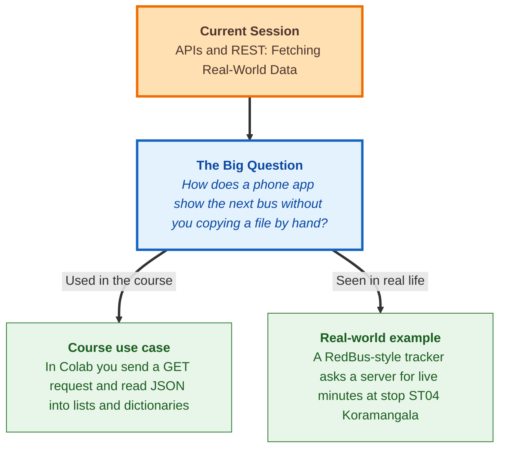

## APIs and REST: Fetching Real-World Data

### Mental Map

---

### What You'll Learn

Have you ever wondered how the bus screen updates when the same stop has five different route numbers?

By the end of this session, you will be able to:

- **Explain** why a **GET** call only asks the server to send data back without changing it.
- **Read** a response and name the **status code**, the **URL**, and a **query parameter** such as `limit=5`.
- **Send** a GET request from Python and print the status code plus one field from the JSON body.
- **Use** an API key from the notebook environment instead of pasting it into a shared cell.

> **Topics you will meet:** APIs; REST; HTTP Methods; Status Codes; Request-Response; API Keys; Responses to Datasets.
>
> Join the session to learn each of these in detail.

---

### Why You Are Learning This Topic

Parth opens a RedBus-style city bus app before class.

Stop **ST04 Koramangala** shows five upcoming buses with minutes and route names.

Those rows were not typed into the app by hand.

The phone sent a short **GET** request to a web service, and the service answered with JSON text.

An **API** is the published door other programs use to ask that service for data in a fixed shape.

In this course you will send the same kind of request from **Google Colab** and turn the answer into Python lists you can loop over.

> **Think about it:** What number should the app show when the server refuses the call because the key is missing?

---

### The Koramangala Stop Puzzle

Five invented departure rows the API might return for one stop.

| Trip | Route | ETA (min) | Status |
|:---:|:-----:|:---------:|:------:|
| T041 | V-500 | 4 | on_time |
| T094 | KIA-14 | 10 | delayed |
| T080 | 335E | 15 | delayed |
| T112 | 500A | 18 | on_time |
| T058 | 201 | 22 | on_time |

**What you want to happen:**

- Ask only for stop **ST04** and at most **5** rows.
- See status code **200** when the key is accepted.
- Drop any row with status **cancelled** before you show minutes on a chart.

> **Wonder about this:**
>
> - Which HTTP method should only read data: GET or POST?
> - What status code fits a missing API key: **401**, **200**, or **404**?

---

### Think It Through

| If you see… | It often means… |
|:--|:--|
| Status **200** | The server understood the request and sent a body back |
| Status **401** | The server wants a valid API key in the header |
| Status **404** | The path or stop id does not exist on this service |
| Query `limit=5` | Return at most five matching rows after sorting |

You already opened JSON files with dictionaries last week. This session the JSON arrives through one GET response instead of a file read.

---

### Before Session Checklist

- Open **Google Colab** and confirm you can run a cell with `print("ready")`.
- Bring your notes on **dictionaries** and **lists** from the JSON session.
- Expect to upload the session **`data/`** folder when the mentor shares it. It holds invented bus rows and a small practice server file.

Join live to run **`requests.get`** against the practice server and build your first live dataset in the notebook.